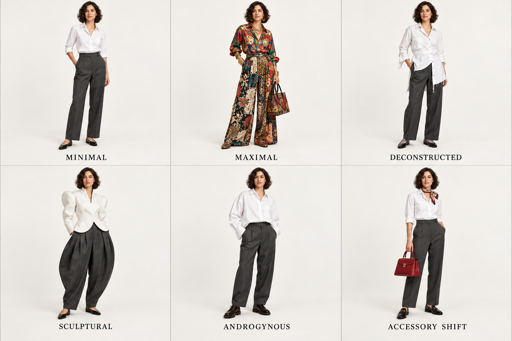
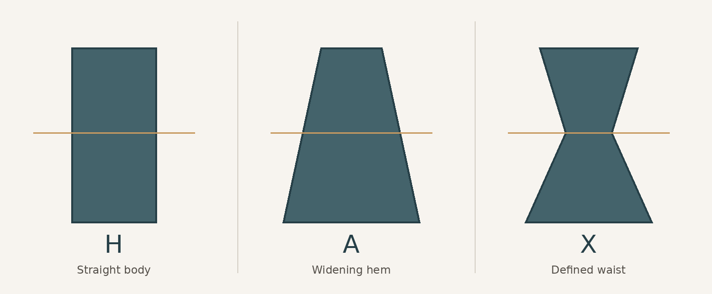

# 第 1 章｜先看衣服，再猜风格

如果一张照片只有人物半身、咖啡馆和暖色滤镜，我们可能觉得它“法式”。但把背景换成办公室，感觉就变了。这说明我们有时认出的不是衣服，而是摄影的暗示。真正有用的识别，应当在去掉背景以后仍然成立。

*图 1：AI 教学示意。沿用上衣配长裤的基本组合，分别向简约、繁复、解构、雕塑、中性表达和配饰变化移动；繁复格同时改变了色彩与纹样。人物姿态与服装细节也有差异，不是严格的控制变量实验。*

## 从远到近的五次观察

第一眼看**廓形**，也就是衣服围绕身体形成的外轮廓。是从肩到下摆近似直线的 H 形，是向下展开的 A 形，还是收腰后两端扩张的 X 形？一件裙子有没有腰线、体积集中在哪里，常常比它有没有花纹更有辨识度。

*图 1A：原创几何示意，不是 AI 生图。H 的主体近直线；A 从上向下展开；X 在腰部收窄、向肩部与下摆展开。示意忽略人体与袖型，不是裁剪纸样。*

第二眼看**比例**。短外套配高腰长裤会改变上下半身的视觉分段；低腰长上衣会把分段往下移。宽松不等于尺寸错误：有意留出的空间叫松量，可以帮助活动，也可以创造体积。

第三眼看**材料的视觉行为**。薄纱透出层次，缎面集中反光，绒面吸光，挺括帆布形成较硬折线，柔软针织贴着身体落下。不要把“缎面”直接等同于真丝：缎是组织或表面效果相关的词，不是唯一的纤维名称。

第四眼看**结构**：领口、肩线、门襟、口袋、袖口、褶裥、扣具。它们能把相同颜色推向不同方向。立领与盘扣可以提供中国服饰灵感，但仅凭这两项仍不能断言某件衣服属于某个朝代。

最后看**配饰与穿法**：扣子是否全部扣好，袜口是否显露，鞋底是薄还是厚，包是软塌还是硬挺。识别是一组证据相互支持，不是一票定名。

| 观察项 | 低信息说法 | 可以执行的说法 |
|---|---|---|
| 廓形 | 很优雅 | 窄腰、膝下 A 字裙、肩部柔和 |
| 材质 | 很高级 | 低光泽细织物，表面平整，垂坠清楚 |
| 结构 | 很复古 | 高领、前排密扣、长袖、后部裙体隆起 |
| 穿法 | 很松弛 | 开领、外套敞穿、裤腿宽松、鞋跟低 |
| 重点 | 很有设计感 | 门襟向左偏移，下摆一长一短 |

## 为什么“黑色”不能直接叫哥特

图 1 的极简与中性表达都是白上衣、深裤子，却有不同的松量和鞋型。把它们改成黑色，也不自动产生哥特的装饰语言。同样，给全身加蝴蝶结不保证是洛丽塔；把裤子加几个口袋也不能证明它拥有技术服装的性能。

这里有一个很好用的顺序：**类别词负责方向，衣服词负责落地，细节词负责校准。**“极简”给方向，“白色直身衬衫、灰色直筒裤”给实物，“隐藏门襟、无装饰、平底鞋”把结果锁定。

## 四组基础词

**贴体与宽松**说的是衣服与身体的距离；**柔软与挺括**说的是材料如何维持形状；**简约与繁复**说的是视觉信息量；**正式与休闲**说的是穿着场合与惯例。同一件衣服可以宽松、挺括、简约而正式。不要把这些维度压缩成一条从“随便”到“高级”的阶梯。

FIT 的《Minimalism/Maximalism》将极简与繁复作为会随历史变化的设计关系，而不是价格等级。这也是本书采用多维观察的依据之一。[资料：Museum at FIT，展览导言](https://exhibitions.fitnyc.edu/minimalism-maximalism/introduction/)

## 一个可以立刻完成的小练习

选图 1 右上与左上两格，暂时不读标签。两套都使用白色衬衫和深裤子；右上门襟、下摆与外露结构改变了服装的常规组织。你可以说“解构式白衬衫”，比说“特别的衬衫”更清楚。不过，这只是解构语言的一种示意，不能用一张不对称下摆囊括整个设计方法。

本章观察词可用于任何体型、性别与价格段。下一章先从生活里容易遇到的衣服开始。
