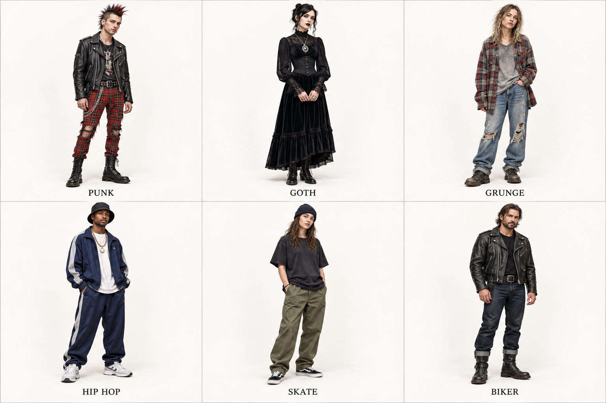

# 第 4 章｜朋克、哥特与街头：衣服背后有社群

*图 4：AI 教学示意。上排：朋克、哥特、Grunge；下排：Hip-hop 灵感、滑板、机车。各类都有多种历史分支，本图着重比较衣物、材料与组合。*

“街头”不是一种固定版型。校园、滑板、音乐、运动与奢侈时装相互借用，使一件宽松上衣可能同时出现于多个场景。识别时要看组合，理解时还要尊重它的社群背景，不能只把文化压成一套消费清单。

## Punk / 朋克：把服装的秩序打断

破损、外露的安全别针、金属链、格纹、皮革和粗糙拼接，是常见视觉线索。它们会让“整齐完成的服装”显得被拆过、改过、挑战过。图中左上选择了皮夹克、破损红格裤与靴子这条容易辨认的路径，但不是所有朋克都穿这套。

V&A 收藏的 Westwood 与 McLaren 1976 年服装，能够说明束带、军装和机车元素怎样被重新组合。它们不是朋克全部的起源，却是非常具体的真实案例。[资料与真实案例：V&A，Vivienne Westwood: punk, new romantic and beyond](https://www.vam.ac.uk/articles/vivienne-westwood-punk-new-romantic-and-beyond)

格纹与皮革的对照、可见修补、金属链都属于具体服装线索；“叛逆”则是对表达态度的概括。整洁衬衫与粗糙皮夹克也能形成冲突，未必需要同时佩戴所有常见符号。理解这一点，才能区分设计借用与对整个社群的刻板概括。

## Goth / 哥特：暗色中的材质与戏剧关系

本章说的是现代哥特相关衣着，不是中世纪哥特建筑的穿衣版。深色、丝绒、蕾丝、皮革、长线条、装饰性首饰常被使用，但哥特内部有传统、浪漫、工业、赛博等差异。

图中上中是偏浪漫哥特的示意：长裙、高领、绒面暗光与银色吊坠。它不能代表所有 Goth。FIT 的《Gothic: Dark Glamour》同时展示设计师作品与不同亚文化分支，说明“哥特”远比“黑衣＋浓妆”广。[资料：Museum at FIT，Gothic: Dark Glamour，2008–2009](https://www.fitnyc.edu/museum/exhibitions/gothic-dark-glamour.php)

日常穿搭可以把装饰集中在一件上衣或一只吊坠上；浪漫哥特晚装则可能用长线条、绒面和层叠蕾丝扩大戏剧感。两者的差别在衣物组合与场合，并不是背景是否出现古堡。

## Grunge：磨损、随手层叠与反精致表面

Grunge 常译“垃圾摇滚风”或直接保留英文。服饰语汇可见旧格衬衫、褪色 T 恤、松牛仔裤、磨损靴与层叠。这里的“旧”是一种外观，不能据此判断穿着者的生活条件。

上右与朋克都可能破损，但图中 Grunge 的重点是松垮、旧感和相对随手的搭配；朋克则把破坏与金属冲突做得更明确。不要把这一比较变成历史硬规则：真实参与者经常跨界，时装设计也会借用两者。

## Hip-hop style：一套不断变化的文化表达

宽松运动套装、运动鞋、帽子、首饰，是本图选择的一条路径。Hip-hop 时尚并不只等于 oversized：不同时期与地区有不同剪裁，女性表达与贴体造型也构成重要部分。

FIT《Fresh, Fly, and Fabulous: Fifty Years of Hip Hop Style》把服饰放在五十年文化交流中展示，适合作为继续认识其多样性的入口。看展览中的 Jamel Shabazz 摄影时，可以观察鞋履、成套运动服和群体姿态如何共同构成特定时间和地点的衣着形象。[真实参照：Museum at FIT，2023 年展览](https://www.fitnyc.edu/museum/exhibitions/hip-hop-style/)

讨论具体照片时，应注明其时间、地点与来源，再看夹克、裤型、帽型和鞋履。不能把某个时期广为传播的宽松比例，直接当作整个 hip-hop 时尚的永久标准。

## Skate / 滑板：活动空间与低重心鞋履

箱形 T 恤、宽裤、低帮滑板鞋、针织帽，是下中图的线索。与 hip-hop 可能共享宽松比例，但鞋型、裤料与配饰重量会改变整体。实际选择还随个人、时期与运动需求变化。

T 恤长度、裤腿空间与鞋型，是比较滑板衣橱与其他休闲组合的入口。实际运动还要考虑动作和装备。拿着滑板不能决定整套衣服的风格，同样，穿运动鞋也不能把所有组合都归为一种街头装。

## Biker / 机车：皮革结构的分量

斜门襟双骑士皮夹克、厚皮靴、深色牛仔裤和腰带，是下右这套的骨架。机车夹克也能进入朋克，但两套的视觉重点不同：机车示意偏向厚重表面与清晰结构；朋克示意增加格纹、磨损与金属干扰。

机车灵感日常穿搭借用骑行衣物的外观，真实骑行服则还涉及护具、耐磨与穿着配合，不能凭皮革和金属件判断防护能力。

## 社群衣着不能由外貌替代

参与者有不同肤色、发型、性别与体型，同一种衣着也会被不同的人改造。读社群照片时，既要观察服装，也要保留摄影时间、音乐与社群活动等背景；只看外貌或模仿一个造型，不能代替对其文化的了解。

本章练习：遮住脸，只根据服装写出三个证据。能从“格纹”继续说到“红格破损窄裤、皮革、链条”，才是在学习衣服。
