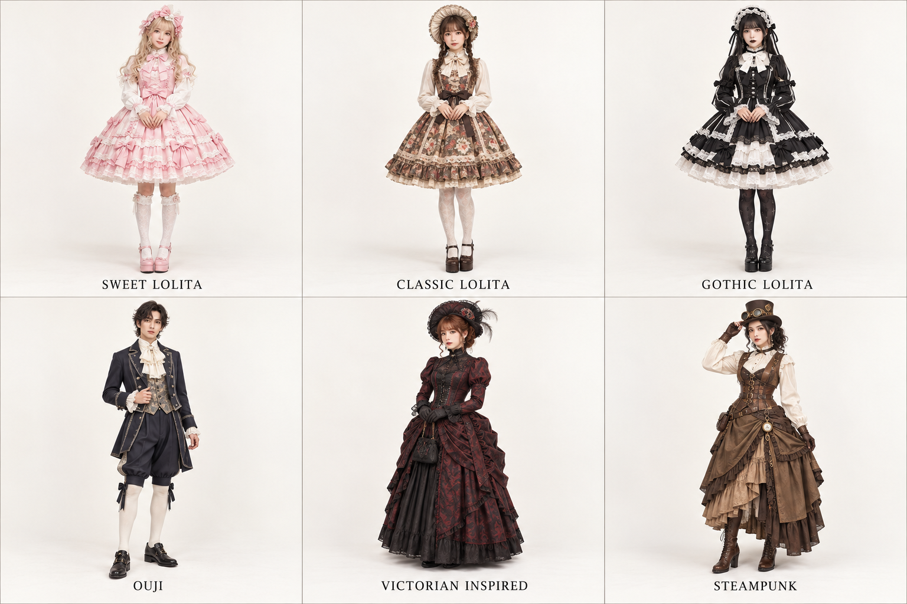
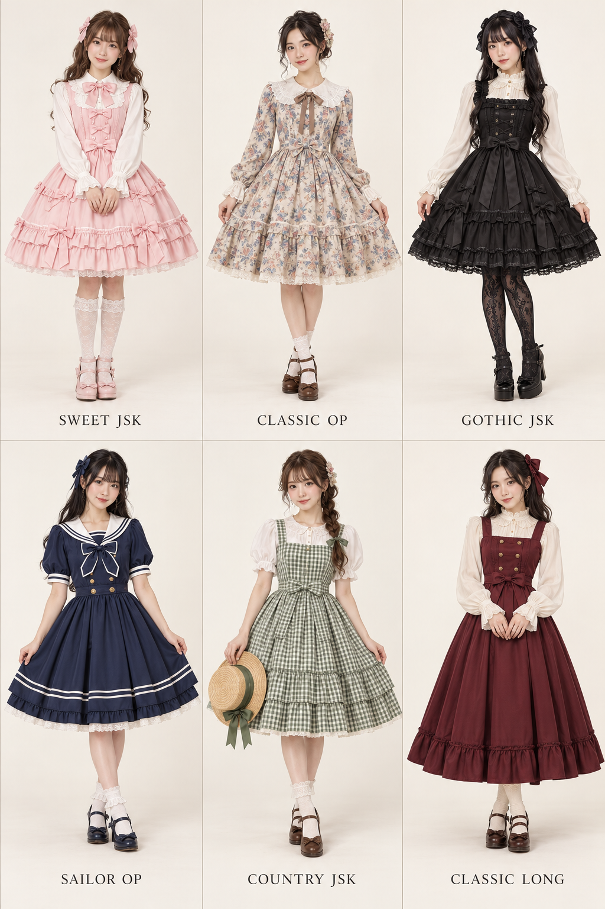

# 第 7 章｜洛丽塔、王子系与蒸汽朋克：共享历史灵感，不是同一种衣服

*图 8：AI 教学示意。上排：甜系、古典系、哥特洛丽塔；下排：王子系、维多利亚灵感、蒸汽朋克。王子系示意裤长偏小腿，属于较长的变体；不要把膝下到小腿长度认成唯一标准。*

## 先给 Lolita fashion 正确的位置

这里讨论的是服饰社群与时尚。它不表示穿着者年龄，也不要求扮演某个角色。V&A 将洛丽塔时尚放在日本街头时尚语境中，并明确区分它与扮演动漫人物的 cosplay。其历史参考与当代社群表达相互交织。[资料：V&A，Lolita fashion: Japanese street style](https://www.vam.ac.uk/articles/lolita-fashion-japanese-street-style)

对初学者，先观察裙型、衬裙体积、上身结构、头饰、袜与鞋的成套关系。图中的膝附近裙长和撑开的体积是直观线索，但不能据此制定所有款式必须遵守的单一比例。

**JSK**常指 jumper skirt，即可与衬衫搭配的无袖连衣裙；**OP**常指 one-piece 连衣裙；**petticoat**是提供或调整体积的衬裙。这些单品词比“公主裙”更能帮你搜索。JSK 不是一种独立风格，同样形制可以进入不同分支。

## Sweet Lolita / 甜系

上左使用浅粉、较显著的蝴蝶结、层叠蕾丝与圆润裙体。这些线索共同产生甜感；也有更深色、更克制或主题印花的甜系，不能只按颜色判断。画面重点是服装协调，而不是把人物画得幼小。

提示词示例：“成年模特，Sweet Lolita coordination，粉色 JSK 配白色长袖衬衫、钟形衬裙体积、协调发饰、袜与玛丽珍鞋，全身目录图。”如果模型只生成普通荷叶边裙，要补“从腰部向外撑开的明确裙体”，而非继续重复“可爱”。

## Classic Lolita / 古典系

上中采用柔和棕色、花卉、较克制的头饰与更修长的视觉分配。它常借用古典花纹、成熟色调和较含蓄的装饰，但“古典”不是指所有衣服都是真正古董，也不等于维多利亚时代复原。

与甜系比较，不必只把粉色改成棕色：可以减少大型蝴蝶结、改变印花尺度、让装饰更集中。V&A 页面列出的真实例子之一是 Innocent World 的 Yumi Fujihara 设计，2011 年，馆藏 FE.242:1 to 3-2011，可用于观察真实衣物比例。[真实参照与图像入口：V&A 同篇藏品说明](https://www.vam.ac.uk/articles/lolita-fashion-japanese-street-style)

## Gothic Lolita / 哥特洛丽塔

上右既保留洛丽塔的裙装体积与成套协调，又加入暗色、蕾丝与哥特装饰语言。黑白是常见组合之一，并非唯一；全黑普通长裙则不因此成为 Gothic Lolita。

比较第 4 章的浪漫哥特：那套靠长线条和绒面质感展开，这套以较紧凑的裙体、头饰和袜鞋关系展开。两者共享部分语汇，主导结构不同。提示词可写“Gothic Lolita，明确衬裙支撑的膝附近裙型”，而不是只用“gothic girl”。

## Ouji / 王子系

王子系常以短外套、马甲、装饰领口、短裤或及膝裤、长袜和皮鞋组成带历史想象的轮廓。它不限制穿着者性别，也不等同于真实王室制服。裤长、外套长度与装饰程度有多种变化。

图中下左采用较长裤型，仍能看到上短下收、马甲与领饰的协调。若希望典型的短裤长袜效果，应明确“knee breeches、knee socks、短上衣”，避免模型自动生成现代长西裤。不要只写“prince”，否则很容易变成皇冠与礼服披风。

## Victorian-inspired / 维多利亚灵感

下中通过高领、长袖、贴合上身与长裙表达历史想象。它比上排更长、更强调纵向和裙体后部装饰。但十九世纪衣着变化很大，且日装、晚装、劳动衣着不同；本图没有指定精确年份，故只叫“灵感”。

若你要“1880 年代英国日装”，应检索具体藏品和结构；如果只是角色设计，可以明说“维多利亚灵感幻想服装，允许现代材料”。这两个目标都成立，关键是不要把幻想插图当历史证据。

## Steampunk / 蒸汽朋克

下右组合历史式马甲、衬衫、长裙、皮革腰包与黄铜色配件，表达架空技术与复古机械想象。它与技术机能都可能有携带系统，但一个常借历史机械语言，一个常借当代技术服装语言。

“齿轮贴哪里都算蒸汽朋克”会让服装失去结构。更好的办法是先决定人物工作与携带需求：修理、测量、驾驶或旅行，再给腰包、手套和护目镜合理位置。纯视觉创作也应让器件有可读的连接关系。

## 一类多款：同一穿搭文化中的裙型与搭配变化

*图中顺序均为从左到右、先上后下。依次为：甜系JSK、古典碎花OP、哥特JSK、水手领OP、田园格纹JSK、较长的古典JSK。JSK为无袖连衣裙搭配衬衫的常见说法，OP为一件式连衣裙；分类会交叉，长短、印花与领型也能叠加。此图以日本洛丽塔穿搭语境为参照，模特为成年女性；这些衣服适合任何背景的穿着者。*

可以直接这样描述：**她穿绿色格纹JSK，内搭白色泡泡袖衬衫，裙摆有横向层次，配白袜与搭扣鞋。**

## 最重要的三条区分

甜系、古典系和哥特洛丽塔的对照，主要发生在同一服饰体系内；洛丽塔与维多利亚灵感的比较，涉及当代社群衣着与历史参照的层级差异；蒸汽朋克则引入架空叙事。没有必要把它们归入一个含糊的“西洋公主风”。

图中衣装比日常穿搭更完整，适合看关系；实际创作可以只借用一两项。写“王子系领饰与马甲，搭配现代阔腿裤”，你就在清楚地说明混合，而不是命名失败。
