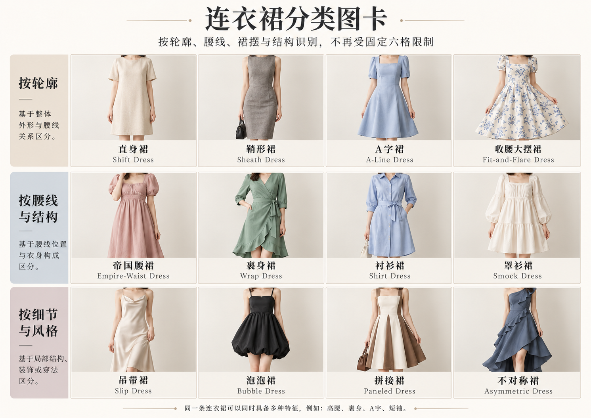
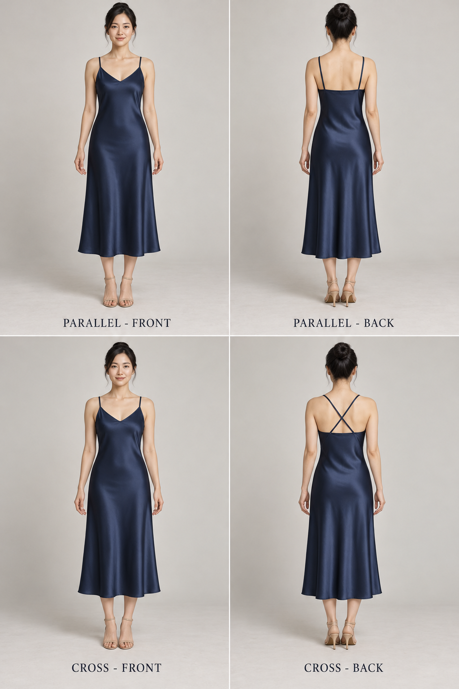
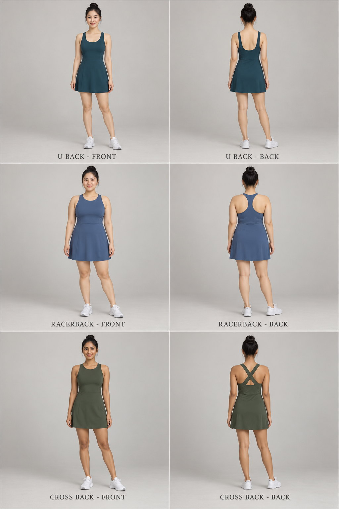

# 第 13 章｜连衣裙叫什么：从细肩带到网球裙装

前面的风格名称给衣服一个方向，但“浪漫风连衣裙”仍能指很多不同东西。要在生图、角色设定或设计讨论中说得清楚，还得继续叫出单品。先把最容易混用的英文分开：**dress 是上下连成一件的连衣裙，skirt 通常是独立下装半裙**。英文里的 skirt 也能指连衣裙的裙体部分，读具体语境；不能把所有中文“裙子”都翻译成 skirt。

*图 13：AI 教学示意，已按画面核对。上排是深蓝无蕾丝细肩带裙 Slip dress、同色领口与裙摆加蕾丝边的 Lace-trim slip、浅蓝翻领单排扣系腰带衬衫裙 Shirt dress；下排是绿色交叠领腰侧系带裹身裙 Wrap dress、酒红无袖罗纹贴体裙 Bodycon dress、白色无袖短门襟褶摆网球连衣裙 Tennis dress。首两格为膝下中长裙，网球款明显较短、停在膝上；长度差异不是类别定义。正文的穿着句是可另行创作的示例，不是对六格的逐字图注。*

*扩展观察图卡（AI 教学示意）：按行比较廓形、腰部与衣身构成、局部变化；同一条裙可同时收腰、A字、裹身。罩衫裙图展示宽松抽褶，不能由外观确认手工smocking。图中例子不是完整分类；细部判断请结合本章原图和正文。*
## Slip dress：从细肩带与下落线条说起

Slip dress 常译“吊带裙”，更具体地说，是借用衬裙线条的外穿连衣裙。常见窄肩带、相对简洁的上身、柔软垂坠，但不是每一件都用缎面、斜裁或 V 领。Vintage Fashion Guild 将它与 slip 的区别放在外穿用途以及所用材料、厚度上，而不是只看有没有蕾丝。[资料：Vintage Fashion Guild，Slips](https://vintagefashionguild.org/resources/item/lingerie/slips/)

图中第一格提供最简基线。描述时依次看肩带宽度、领型、腰部松量、裙长与表面反光。“香槟色缎面细肩带中长连衣裙，浅 V 领、腰部略有空间、裙体自然下落、无蕾丝和裙撑”，比“性感吊带裙”提供更多服装信息，也不会把人物情绪误当剪裁。

**完整穿着句：**“成年人物穿香槟色缎面细肩带中长连衣裙，领口无装饰，外搭敞开的深灰短开衫，配低跟细带鞋和小型方包。”外套与鞋包可以把相同基础裙推向日常、晚装或复古，不必为每种搭配发明一个新裙型。

## 一类多款：细肩带是一类入口，垂领、裙长和叠穿继续细分

*图中顺序均为从左到右、先上后下。依次为：垂领缎面吊带中长裙、蕾丝饰边吊带裙、直筒长吊带裙、柔和外展的斜裁感吊带裙、内搭白T恤、外搭短针织开衫。斜裁是裁剪方式，照片中的垂坠只能提供线索，不能独自证明裁片方向。*

可以直接这样描述：**她穿香槟色细肩带垂领中长裙，裙身顺着身体垂落，配细带低跟鞋。**

## 补上背视：同样的正面，肩带可以接向不同位置

*图 67：两行两列的 AI 配对教学示意，每行左正面、右背面。上行为平行细肩带，下行为背部 X 形交叉细肩带；两款背片上缘均较平，停在肩胛下方。每行尽量保持同一人物与同一款不透明中长裙，姿态、布褶和边缘高度有轻微漂移，不作精确转面制版。*

正面两根细带不能决定背面走向。沿一根带子观察：它从前片哪一点上肩，向同侧背片落下，还是斜向对侧；再核对背片上缘、腰线与裙摆是否连续。交叉带是连接方向，低背是背片覆盖范围，两者不是同义词。Reformation 的 Amani 连衣裙将细肩带与背部交叉细节分别列出，提供了真实商品描述参照。[商品旁读：Reformation，Amani Dress](https://www.thereformation.com/products/amani-dress/1310787.html)

可以写：“深蓝细肩带中长裙，前面浅 V 领；两带过肩后在背中交叉，分别接回背片两侧，背片上缘较平。”若只见正面，就保留“背部连接未展示”，而不是自动补出低背、系带或拉链。图 67 是新创作的配对示例，不是图 13 或图 23 某一款的精确背面。

## Lace-trim slip：蕾丝边改变了什么

第二格不是一套与第一格毫无关系的新类别，而是在相近细肩带裙上添加 lace trim／蕾丝饰边。领口蕾丝把视线引向上身，裙摆蕾丝改变边缘，颜色相近时较含蓄，深浅对比明显时更突出。蕾丝边不代表整件裙子都是蕾丝，也不决定它一定是睡衣或内搭。

**完整穿着句：**“她穿一件黑色缎面细肩带及小腿连衣裙，V 领与裙摆各有一圈窄黑蕾丝边，腰部不紧束，搭配黑色玛丽珍鞋与短款米白开衫。”如果希望蕾丝只有领口，明确删除裙摆饰边。模型容易把“lace dress”理解成全蕾丝，应用“satin dress with narrow lace trim”把主体与装饰分清。

第一、二格的比较可以继续做：固定颜色、裙长和人物，只改饰边宽度，观察“精巧细节”什么时候开始变成主要装饰。这个方法同样适用于领口滚边、刺绣或珠饰。

## 一类多款：同样叫蕾丝裙，蕾丝可以放在不同位置

*图中顺序均为从左到右、先上后下。依次为：蕾丝饰边、带不透明里衬的蕾丝覆盖裙、蕾丝袖拼接裙、蕾丝肩部拼接裙、层叠蕾丝裙、蕾丝衬衫式连衣裙。看蕾丝覆盖的面积、所在部位和里衬，比只说“有蕾丝”更准确。*

可以直接这样描述：**她穿酒红色方领中长裙，裙身为不透明面料，长袖用花卉蕾丝拼接，袖口收拢。**

## Slip、slip dress 与 chemise：外形相近，名字还涉及用途

**Slip／衬裙**通常作为衣内层，full slip 从上身延伸到裙摆，half-slip 则从腰部开始。第 15 章用平铺图继续介绍。它与 slip dress 在外形上可能很像，不能仅凭“细肩带＋光滑布面”断言内穿或外穿，最好结合商品资料、结构与搭配情境。

**Chemise**在历史资料中可指贴身穿的衬衣式内衣；当代商品中又常用于较简洁的裙式睡衣。它不永远等同于现代吊带外穿裙。若不确定，直接说“轻薄裙式内搭”或“细肩带裙式睡衣”，再补领口、长度和松量，比一味寻找唯一译名更准确。

V&A《Undressed》指出，内衣、睡衣与外衣之间一直存在设计借用。因而“内衣灵感”与“真实用途”应分开理解，并不是看到蕾丝就能划定边界。[资料：V&A，Inside the Undressed: A Brief History of Underwear exhibition](https://www.vam.ac.uk/articles/inside-the-undressed-a-brief-history-of-underwear-exhibition)

## Shirt dress：衬衫结构延伸成裙

上右可以看到长袖、翻领、正面单排扣和布腰带，衣摆在膝附近。识别重点是衬衫式领口、门襟、扣子与袖口，再看它们怎样延伸到完整裙体。Shirt dress 可以直身，也可以收腰展开；可以长袖、短袖或无袖。它不是把一件普通衬衫画长一点就万事完成，腰部与下摆仍需要清楚组织。

**完整穿着句：**“人物穿浅蓝棉布衬衫连衣裙，翻领、正面单排扣、肘长袖、同色布腰带，裙摆到膝下并轻微展开，配棕色乐福鞋。”这句话同时交代单品、结构与搭配，适合直接作为角色衣着说明。

真实旁读可以看费城艺术博物馆约 1955 年的 Woman's Shirtwaist Dress。其说明把领口、腰部与有褶裙体放在一起讲，说明衬衫裙完全可以兼具清楚的上身结构与丰盈裙体，并非只剩宽松直筒一种。[真实案例：Philadelphia Museum of Art，Woman's Shirtwaist Dress，约 1955](https://www.philamuseum.org/objects/93329)

## Wrap dress：看交叠与固定关系

裹身连衣裙的关键不是 V 领，而是前部衣片交叠、通过系带或其他方式固定的关系。腰间打结只是容易看到的结果。**Faux-wrap／仿裹身**则可能把交叠外观固定缝合，穿着方式不等同于真正展开包裹的结构；一张正面图往往不能完全确认。

**完整穿着句：**“她穿深绿小点纹裹身连衣裙，七分袖、交叠 V 领、一侧腰间系带，裙摆到膝下、行走时有自然开合，配低跟鞋。”若需要制作，把内外衣片、固定点和遮盖关系另画清楚。不能让一根浮在面料上的带子代替真实连接。

DVF 的裹身裙是很好的真实参照，但不必把整类结构说成某位设计师从无到有发明。大都会博物馆将其 1975–76 年藏品放在更早的美式运动休闲服装包裹传统中理解。[真实案例：Diane von Furstenberg，Dress，1975–76，The Met，1997.487](https://www.metmuseum.org/art/collection/search/79701)

## Bodycon dress：贴体程度，不是固定领型

Bodycon 强调靠近身体轮廓，常见弹性面料，但可以有不同肩带、领口、袖长和裙长。它不能与 pencil skirt／铅笔半裙直接互换：一个是整件连衣裙及其贴体倾向，一个是下装轮廓。它也不等于能改变腰围的塑形衣。

**完整穿着句：**“成年人物穿深蓝罗纹针织贴体连衣裙，圆领、无袖、长度到膝下，腰与髋部轮廓清楚，搭配敞开的直身西装与平底鞋。”若想要贴合但不绷紧，写“沿身体自然下落、保留活动空间”，比同时要求“极紧身且完全宽松”更明确。

## Tennis dress：用途灵感能与裙型叠加

网球连衣裙是一件完整裙装，不是“运动背心＋网球半裙”的必然缩写。图中这一款是白色无袖翻领、短拉链式门襟、腰下较宽褶摆，长度明显在膝上；它没有展示内置短裤或口袋，不能补想成已看见的结构。此类服装常见无袖或短袖、清楚的上身与较便于动作的裙摆，有些带领、有些没有。仅看百褶和白色，不能证明它是专业比赛服。

**完整穿着句：**“人物穿白色无袖网球连衣裙，小翻领、短门襟、腰部清楚，下接膝上的浅褶裙摆，配白色运动袜与低帮球鞋。”若是网球灵感日常装，就直接写明；若要真实运动用途，再补材料、活动与内层需求。

## 一类多款：运动感也有多种裙装路径

*图中顺序均为从左到右、先上后下。依次为：Polo领百褶网球裙装、运动背心式A字裙、半拉链短袖运动裙、包裹前片裙裤、侧条纹运动中长裙、长袖运动上衣配网球半裙。第二格标签RACERBACK涉及后背结构，当前正面图不能验证；要明确工字背，应另要求背面图。裙裤可见侧边露出的短裤层；图中的运动感不代表已验证专业运动性能。*

可以直接这样描述：**她穿鼠尾草绿短袖半拉链运动连衣裙，裙摆微微外展，配白色运动鞋。**

## 工字背与交叉带，要转身后再区分

*图 68：三行两列的 AI 新创作示例，每行左正面、右背面。从上到下为深青色 U 形背开口、灰蓝色工字／Y 形背部连接、橄榄绿色 X 形交叉宽带。三行人物与设计不同，只在各行内部作近似前后配对；没有展示内置胸垫、短裤或功能测试。*

本图 U 背保留两侧分开的宽肩带，工字背让两侧向背中汇合并形成中央衣料连接，交叉背则让两带形成 X。真实款式还会把这些处理混合，商品名称也可能重叠。Nike 的 Swoosh 用 racerback 描述背部设计，One Strappy Back 则明确提到交叉带，可结合各自背面商品照比较；本图只是借用外观组织，不对应品牌产品。[真实参照：Nike，Swoosh 899371](https://www.nike.com/sg/t/swoosh-womens-medium-support-sports-bra-NDQZsv/899371-010) [真实参照：Nike，One Strappy Back FZ2914](https://www.nike.ae/en/one-strappy-back-womens-medium-support-lightly-lined-printed-sports-bra/NKFZ2914-010.html)

图 25 的旧示例仍只有正面，不能由其标签倒推背部。现在可以另看图 68 的背视学习差异，再把“肩带向背中汇合”或“背部两带交叉”写进新人物描述。结构像运动装，不等于已经验证支撑、透气或运动安全性能。

## 用一句话把不同维度放在一起

“黑色、缎面、细肩带、蕾丝边、中长、浪漫晚装方向”并不互相竞争：它们分别回答颜色、表面、肩部结构、装饰、长度和风格。“运动风、A 字、针织、裹身”也可能叠加，但结构必须能解释。

本章练习是只改一个条件：从第一格出发，先加蕾丝，再换成针织，再把肩带改宽。每一步都问自己：改变的是材料、装饰还是单品结构？如果名字没变，描述仍然可以更精确，这正是学习单品词的价值。

## 直身、鞘形与收腰大摆：把腰髋松量补进来

**Shift dress／直身裙**通常以相对简洁、腰部不明显收紧的衣身作为观察入口。它可以有袖，也可以无袖；不等于“尺码很大”。看侧缝是否大致下落，再看腰部是否有明显省道、收束或腰带。**Sheath dress／鞘形裙**则更沿身体曲线组织，通常仍可保留穿着松量；它与强调贴体效果的 bodycon 在商品命名中可能重叠，不能靠英文名称推断弹性或紧束程度。

**Fit-and-flare／收腰外展裙**把较贴合的上身与明显展开的裙体接在一起。A-line 主要描述外轮廓，fit-and-flare 更强调上下的对比。两者可以同时成立。描述时不只说“大裙摆”，还要指出从哪里展开：自然腰、胸下、低腰或膝部，形成的是不同线条。

> 比较例句：“米白无袖直身及膝裙，腰间不束带”与“米白无袖收腰及膝裙，裙体从腰缝向下外展”。固定颜色和长度后，差别落在腰部与摆量，而不是人物、鞋子或背景。

## 腰线、覆盖层与下摆：继续识别更多裙装

**Empire waist／胸下高腰**描述腰缝或主要收束线靠近胸下，不能与“把普通腰带系高一点”画等号。**Dropped waist／低腰线**把上身延长到自然腰线以下。它们都能接直裙、抽褶裙或褶裥裙，不是只配一种裙摆。

**Smock dress／罩衫式宽松裙**常用较宽松的衣身、局部抽褶或育克组织布量。不要将它与 smocking／褶绣工艺等同；名字相近，并不证明这条裙使用了褶绣。**Pinafore／围裙式连衣裙**常见背带、胸前衣片和便于叠穿的结构；**jumper dress** 在一些英语语境也用于此类无袖罩裙，而 jumper 在另一些地区又指套头针织衫，检索应加衣物结构与地区语境。

**Asymmetrical hem／不对称下摆**说明左右或前后落点不同；**high-low hem／前短后长下摆**是其中一种安排。它们可以加在裹身裙、衬衫裙或晚装裙上。层叠、开衩、拖尾也各自补充结构信息，不能把装饰和长度当成全新的互斥大类。

## 用分类坐标组织检索，不背一个固定数量

| 先问的问题 | 观察与检索词 | 可以继续叠加的条件 |
|---|---|---|
| 上下是否连成一件 | dress；与分体上衣加半裙区分 | 接缝、腰线、开合 |
| 腰髋怎样贴合 | shift、sheath、bodycon、fit-and-flare | 松量、弹性、摆量 |
| 衣身靠什么组织 | shirt dress、wrap、pinafore | 门襟、肩带、固定位置 |
| 什么位置发生变化 | empire waist、dropped waist、asymmetrical hem | 裙长、袖型、领口 |
| 材料与用途是什么 | knit dress、lace dress、tennis dress | 里衬、活动余量、真实产品资料 |

一条裙可以同时是“针织、胸下高腰、A 字、无袖中长裙”。这些词是在补充不同信息。原六格与扩展图卡都只是可比较的样本；遇到没有画出的衣服，仍然可以沿这些问题描述，而不必把它硬塞进某一格。
