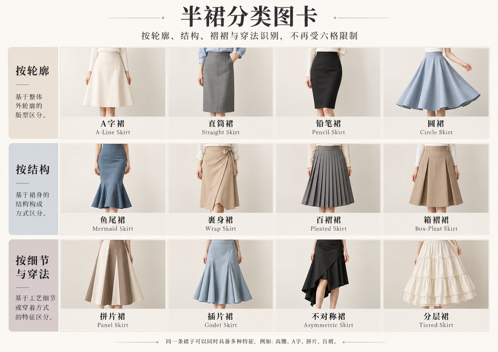

# 第 14 章｜半裙的分类坐标：廓形、裁片与裙摆怎样展开

连衣裙把上身与裙体接成一件；半裙则从腰或髋部开始，与上衣分别搭配。同样的黑裙换一件上衣，可以从学院、都市转到浪漫或街头。先认出裙子本身的结构，才知道风格变化来自哪里。

*图 14｜AI 教学示意。依次为 A 字、铅笔、褶裥、圆裙、鱼尾与分层裙；轮廓、裁片和折层是不同观察维度。*

*AI 教学示意。比较外轮廓、裹身与褶裥，以及拼片、插片等构成；圆裁比例与斜裁方向需看裁片。*

本章先分三件事：**轮廓往哪里走，裙体用什么方式获得余量，长度停在哪里。**A 字与鱼尾主要提示轮廓；Pleated 提示褶的组织；Tiered 提示横向层次；Circle 还涉及裁片的几何关系。所以你可以有一条“A 字百褶中长裙”，也可以有“分层长圆裙”。

## A-line：从腰髋向下逐渐打开

A 字裙的直观特征，是上部较窄、下摆逐渐展开，远看接近字母 A。它可以短到大腿，也可长到脚踝；面料挺或软、腰位高或低，都会改变最终效果。别把所有蓬裙都叫 A 字：有些体积从腰部突然膨出，更接近鼓起的钟形；鱼尾则先贴合再在较低处展开。

平整腰头、无褶裙面和逐渐外展的下摆，可以清楚呈现 A 字的基本轮廓；加上百褶、贴袋或排扣之后，A 字仍然成立，因为这些细节没有取代整体的展开关系。

裙摆开度较小时，A 字线条接近直裙；开度扩大后，下身的横向体积更突出。同一类别之内仍有连续变化，腰位与面料软硬也会影响最终轮廓。

## 一类多款：同样向下展开，A字半裙仍有很多样式

*AI 教学示意。A 字轮廓与牛仔排扣、裹身、缎面、纵向拼片、工装贴袋及横向层叠的组合。*

裹身 A 字裙兼有向下展开的轮廓与前片交叠的结构；纵向拼片款则通过裁片分割组织裙体。它们虽然外形相近，开合与接缝关系却不同。

## Pencil skirt：一条更靠近身体的窄线

铅笔裙通常沿腰髋形成相对贴合的窄长轮廓，下部不大幅展开。它可有前开衩、后开衩或其他活动安排，也可能使用弹性布料。开衩位置与高度独立于窄裙轮廓，并非所有铅笔裙都有高开衩。

窄裙需要为步行留出空间，常见安排包括开衩、叠合活动衩或利用面料弹性。开口的位置与高度因款式而异，后衩也应结合背面观察。

与 bodycon dress 区别时，先看是否为独立下装；与 mermaid 区别时，看膝部以下有没有显著展开。贴体程度、裙长与开衩高度都可以独立调整，并不决定穿着者身份或性格。

## Pleated skirt：褶把收拢与展开连接起来

褶裙把布料有秩序地折叠，让较小的腰部容纳更多裙体。静止时可呈现重复的竖向节奏，动作时折叠打开，产生新的体积。褶可以只在一段出现，也可以绕裙一周；“有褶”不等于每条都细密到同样宽度。

**Knife pleats／顺向褶**常向同一方向折；**box pleats／箱褶**与**inverted box pleats／倒箱褶**的折叠关系不同；**accordion pleats／手风琴褶**常用较连续的折扇节奏表达。入门不必背全部名称，先能说清褶宽、方向和起止位置。

细密褶与宽褶形成不同的表面节奏。挺括宽褶更容易显出清楚折面，薄软细褶则更接近连续纹理；褶宽、裙长与布面共同影响穿着效果，格纹只是可叠加的图案。

真实设计可远比校服式褶裙复杂。大都会博物馆约 1990 年的三宅一生 Flower Pleats 上衣与裙装组合，用褶和造型组织出花瓣般的体积。它适合提醒我们：褶是设计方法，既能规整，也能进入立体实验。[真实案例：Issey Miyake，Ensemble，约 1990，The Met，2015.451a, b](https://www.metmuseum.org/art/collection/search/695620)

## Circle skirt：由几何余量形成展开

圆裙通常关联圆形或部分圆形裁片围绕腰部形成的裙体。完整圆、半圆或其他展开量，可以带来不同的裙摆余量；自然下垂时常形成较大的柔软折浪。它未必需要在腰部密密打褶，也不意味着所有时候都像圆盘一样撑开。

圆裙可以在腰部较平整、没有密集抽褶的情况下形成大摆量。静态垂下时，裁片中的余量收成大折浪；展开或运动中的轮廓，更容易显示裙摆的容量。

圆裙与 A 字裙的名称依据不同：前者更接近裁片来源，后者主要说外观轮廓。圆裙垂下时也可能呈 A 字；反过来，具有 A 字外观的裙子也可能由拼片等其他方式形成。

## Mermaid：先贴合，再让下部展开

鱼尾裙的重点是上部较贴合、在较低位置转为明显展开。图中下中格能看到下部横向接缝：接缝上方相对收窄，下方展开，并不是拖地长礼服。展开点可以变化，下摆也可用裁片、插片或荷叶边获得体积。它不必是拖地婚纱，也可以是日常及小腿裙；但只有裙摆一条窄荷叶边，未必就需要强调成夸张鱼尾。

鱼尾从哪里展开、展开多少，会影响活动空间与下部重心。膝附近才明显展开的长款，与较高位置轻微外展的中长款，虽然都可能使用鱼尾名称，穿着轮廓仍有很大差异。

与铅笔裙的区别不是“更正式”，而是下部体积的变化。与 A 字裙的区别也不只是裙摆宽：A 字从较高位置逐渐展开，鱼尾把展开推迟到更低处。

## Tiered skirt：用横向层次逐段增加体积

分层裙的裙体由一层层横向结构组织，常见接缝、抽褶或荷叶式边缘。它可以长也可以短，层与层的宽度、数量和材料都能变化。中文“蛋糕裙”常用来形容较鲜明的横向层叠，但商品用法不稳定，最好继续说明到底是接片层次还是附加荷叶边。

层数、每层高度、接缝下的余量和面料软硬，共同决定分层裙的体积。轻度抽褶的长裙可以自然垂落，余量较大的挺布款则更容易形成明显横向层次。

Tiered 先看横向分段，pleated 先看布料折叠；一条裙也可以同时具有两者。每层是否打褶、褶是否连续、横接缝位于哪里，决定了它们在同一裙体中的关系。

## 长度与腰线，是第二套坐标

Mini、midi、maxi 常指短、中长与长裙，但具体落点会随品牌用法与穿着者身高变化。膝上、小腿中部或脚踝附近，是更直观的身体参照；成衣尺寸仍需看实际裙长。

高腰、自然腰、低腰说的是裙腰位置，不是裙型。把一条高腰铅笔裙改为低腰，并不会自动成为 A 字；把长鱼尾缩短，也不必变成圆裙。材料、腰位、长度、装饰应各自描述。

## 半裙、衬裙、裙裤与连衣裙裙体

Skirt 是本章的外穿独立裙装；underskirt／petticoat 则可能是内层，作用可包括体积、保暖或遮盖，不是所有衬裙都带硬裙撑。Skort／裙裤常把裙式外观与短裤结构结合，能否看见裤腿要看设计；一张正面图不能证明其内部结构。

英文 skirt 也可指连衣裙的裙体。A dress with a pleated skirt 是带有褶裥裙体的连衣裙，a pleated skirt with a blouse 则是褶裥半裙与上衣的组合，整件与分体的区别不会因表面相似而消失。

上衣与鞋包会改变半裙搭配的整体印象，裙体结构则保持自身特点。识别时把单品与整套穿着分开，可以同时理解轮廓差异和风格变化。

## 直筒、钟形与茧形：不要把所有体积都叫 A 字

**Straight skirt／直筒半裙**的侧线较平直，腰髋到下摆的宽度变化较小；铅笔裙通常更强调窄而贴合的线条。实际商品的名称边界可能重叠，髋部松量、裙脚宽度与裙长更能显示具体区别。

**Bell-shaped／钟形轮廓**强调腰部向外形成明显体积，再以较饱满的弧线下落；**cocoon／茧形轮廓**则常在中段较宽、下摆向内收。它们和 A 字的逐渐外展不同。若看到裙摆内翻形成圆鼓效果，还要区分外轮廓与下摆处理，不能只凭蓬松就推断一定有裙撑。

## 拼片、插片与裹身：看接缝怎样组织裙体

**Panelled／拼片裙**由多个裁片组织形状。这里的重点是纵向等分割线及各片宽度变化；拼片可以做成直裙，也能做成大摆裙。**Godet／插片**则是在开口或接缝间加入扩量裁片，常能看到上窄下宽的楔形区域，让局部裙摆展开。看不清接缝，就说“下摆局部展开”，不要凭折浪断言插了几片。

**Wrap skirt／裹身半裙**以裙片交叠围合为入口，需继续追踪腰部固定与内外片关系。前面一条斜线也可能是固定缝合的仿裹身。它可以是 A 字、直筒或不对称下摆。**Bias-cut／斜裁**是裁剪方向，不能与拼片、裹身并列成外观六选一；柔和贴落只是线索，需要纸样或商品说明才能确认。

纵向分割线可以把裙体组织成数片，上部较窄、下部逐渐增加宽度，形成平顺腰髋与外展下摆。裁片数量需从接缝或平铺资料确认，不能只按布面折浪计数。

## 褶裥、抽褶与长度各有自己的位置

褶裥是折叠的组织，抽褶则把较长的一段布收进较短的连接边；两者都可能让裙体有体积，但接缝附近的节奏不同。“百褶”并不要求一百道褶，“分层”也不等于每层一定抽褶。第 19 章继续区分这些局部处理。

腰位、轮廓、结构、长度与细节共同构成一条半裙的特征。高腰直筒裙可以采用裹身闭合，也能加入侧腰扣合；百褶又能与不同裙长组合。裙裤以分腿为基础，连衣裙的下半部分则属于整件裙体；这些关系不会因外观相似而消失。
