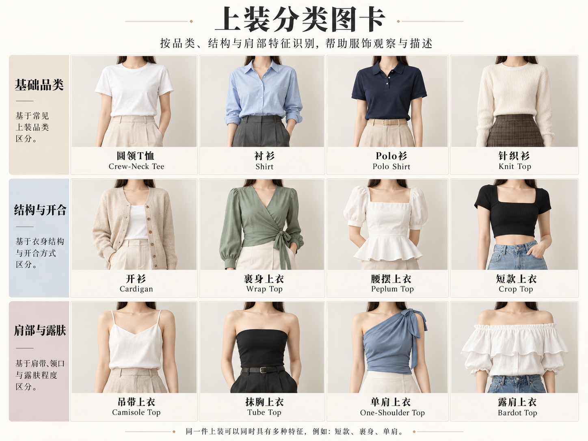

# 第 15 章｜吊带、背心、胸衣与连体衣：外观、结构和用途分别命名

有些单品在中文里只差一个字：吊带衫、吊带裙、衬裙；有些英文又常被商品标题混用：bustier、corset、corset top。学习时先找衣服覆盖到哪里、由哪里固定、如何连接，再问它在这套搭配中承担什么用途。这样不会把所有有细肩带的衣服都叫背心，也不会把每条竖缝都当成真正的支撑结构。

*图 15｜AI 教学示意。依次为细肩带衫、宽肩背心、胸衣式上衣、挂脖上衣、露肩上衣与裹身上衣。*

*AI 教学示意。品类、开合、肩部连接与衣长分别观察；针织、短款和单肩可与不同上衣组合。*

## Camisole：先说细肩带与衫身

Camisole／吊带衫常以相对窄的肩带、无袖上身和到腰髋附近的衫身识别，既有内搭，也有外穿设计。它可以缎面、针织或其他材料；蕾丝不是必要条件，细肩带也不是内衣用途的证明。

与 slip dress 比较，先看长度与整件关系：吊带衫仍是上衣，需要另配下装；吊带连衣裙则是完整裙装。与 tank top 比较，细肩带和较轻的衫身常是有效线索，但商品边界有重叠，别只凭肩带宽一厘米就强判。

吊带衫常作衬衫、针织开衫或西装内层；衣摆到腰与到髋，会改变它与裤腰、裙腰的衔接。短款与长款仍可共用相近肩带和领口结构。

## Tank top：肩部连接更像无袖上衣

Tank top 常译背心或无袖背心上衣，常见较宽肩部、连续的前后衣片、圆领和针织材料，也有不同领型、宽度与版型。它不一定贴体，不一定用于健身，也不等于运动文胸。

罗纹背心的纵向纹理、肩部宽度、腋下开口和衣身松量，可以分别观察。运动式背心还可能采用不同背部连接；专业用途和支撑程度则需看实际产品。

## Bustier top：胸衣式结构成为上衣

这类名称常用于强调胸部造型、贴合衣身与分片线的上衣，可能有杯型、支撑条外观，也可能用省道与较挺材料形成结构。可以无肩带，也可以有肩带；胸衣式上衣并不等于无肩带抹胸。

胸衣式上衣可与长裤、半裙或外套组合，作为外部造型的一部分。弧形杯线与竖向分割线是常见外观，内部钢圈、加固条和束形能力则取决于实际结构。

## 一类多款：胸衣式上衣：把结构放进日常搭配

*AI 教学示意。胸衣式上衣的材料、领口、腰摆与叠穿变化；内部支撑需结合实物判断。*

心形领、方领、腰摆与不同材料，都能加入胸衣式衣身。外套敞穿时，上衣的领缘和分片更突出；叠穿衬衫或针织衫时，则增加一层衣物关系。

## Halter top：从颈部关系识别挂脖

Halter／挂脖式的关键是上部绕颈或在颈后固定的关系，肩部常较开放，前胸可以是高领、V 领或其他覆盖。它不是只要露肩就成立；普通肩带从前片直连后片，也不叫挂脖。

挂脖上衣的领带或上缘怎样绕向后颈，是辨识重点。相近的高领正面也可能连接完整背片，只有结合颈后与背部，才能看清固定方式。

## Off-shoulder top：领口落在肩线以下

露肩或一字肩上衣把领口安排到肩部以下，常形成横向线条，也可以不对称。它与 **cold-shoulder／肩部挖空**不同：后者可能仍有衣料覆盖肩顶，只在局部打开；与无肩带 bustier 也不同，露肩上衣仍可以有袖子，并借领口结构固定。

露肩针织衫可以由横向翻折领形成上缘，袖子仍与衣身相连。单肩款则强调左右不对称；肩部挖空款保留肩顶连接，它们的覆盖关系各不相同。

## Wrap top：交叠停在上衣长度

裹身上衣借前片交叠与腰部固定形成关系，和第 13 章裹身裙的区别是衣长及是否连有裙体。它可以长袖或无袖、针织或梭织；也有仿裹身外观，交叠处已经缝合。

真正裹身结构通常能展开，并通过内外固定点维持交叠；仿裹身款把交叠外观缝合，穿脱仍可能依靠弹性、拉链或其他开口。外侧一根系带并不能独自区分两者。

## 一类多款：衬衫与罩衫：领型和袖型一起命名

*AI 教学示意。依次比较衬衫式、开领、系带领、裹身、立领抽褶与方领泡泡袖上衣。*

系带领把领部布带结成蝴蝶结或自然垂落；袖口收拢则是独立的袖体安排。柔软罩衫常同时运用这些细节，形成不同于硬挺衬衫的表面与体积。

## 一类多款：针织上衣：不必只说一件毛衣

*AI 教学示意。细罗纹、麻花、开衫、针织 Polo、镂空针织与 V 领背心的衣型及层次。*

镂空针织与不透明吊带叠穿时，外层的孔洞和内层颜色共同构成表面。V 领针织背心叠衬衫，则以领口、袖子和衣摆的交接体现层次。

## 再看内层：名字不能只靠有多少蕾丝

*图 16｜AI 教学示意。平铺比较有钢圈文胸、Bralette、Bustier、胸下式 Corset、全衬裙与连体衣的覆盖及连接。*

内层可以遮盖、减少外衣摩擦、承托、保暖或参与外部造型，不应只按装饰多少分成两类。FIT《Exposed》以有结构与较柔软的衣物组织观察，并展示内衣与外衣之间的借用，例如约 1950 年 Iris 睡裙与 Claire McCardell 同期晚装的并置。[资料与真实案例：Museum at FIT，Exposed: A History of Lingerie](https://www.fitnyc.edu/museum/exhibitions/exposed-history-of-lingerie.php)

## Underwire bra：名称指向杯下支撑结构

Underwire bra／有钢圈文胸的重点是杯下沿的支撑圈结构，可能搭配不同杯面、罩杯高度、肩带和后背形式。“有圈”不等于厚垫或聚拢，“无圈”也不等于没有其他支撑。平铺画中看到弧形缝线，只能说呈现钢圈式外观；真实结构需看实物。

可调肩带、后排扣、杯面接缝与下围分别负责不同位置的调节或成型。有钢圈的款式也可以使用平滑无蕾丝杯面，装饰多少与支撑结构应分开理解。

## Bralette：较柔软的文胸式上身

Bralette 常指较轻、较少硬结构的文胸式衣物，常见无钢圈款，但商品用法并非绝对统一。它可以蕾丝，也可以素面针织，可以有软杯、内衬或加长下围。三角形杯面是常见外观之一，不是唯一形制。

三角软杯、较宽下围和弹性织物，是部分 bralette 的常见组合。透明度取决于面料密度、覆盖层及衬里；蕾丝、针织和不透明布面都可以用于这类衣物。

## Bustier：胸部与躯干共同组织

与常见只到胸下的文胸相比，bustier 往往将较贴合的衣身向腰部延伸，可能结合杯型、分片与支撑。其长度、肩带与扣合形式有变化。它与本章前面的 bustier top 不是只差一条固定长度线，而是还涉及内层、外穿和商品定位。

Bustier 的较长衣身把胸部与腰部放在一起组织。肩带、背扣和可能附加的吊袜带属于独立细节，不是每一款都具备，也不决定全部用途。

## Corset：结构词不能被装饰线代替

Corset 常译紧身胸衣、束身衣或束腰，但这些中文词覆盖并不完全相同。图中下左具体是 **underbust corset／胸下式束身衣**：上缘止于胸下方向、重点包围腰部，主图显示前中扣合，小图显示后部交叉系带。它只是 corset 的一种，不能把整类都限定为这幅腰封式外观。

**Overbust／full-bust corset**则是覆盖胸部的款式，常译全胸式束身衣。这里的 full-bust 指覆盖范围，不用来评价穿着者体型。胸下式与全胸式都还会有长度、分片与扣合差异；描述时先说覆盖哪里，再说前扣、后系带或其他结构。Corset 常涉及成型裁片、加固结构与扣合关系，不要简化为“长一点的文胸”，也不能认定凡有后系带的上衣都具有束腰效果。

可对照收藏机构实际使用的两个名称：[The Underpinnings Museum，Thomson's Glove Fitting 胸下式 corset](https://underpinningsmuseum.com/museum-collections/cotton-overlocked-elastic-panel-underbust-corset-by-thomsons-glove-fitting/)与[Agent Provocateur 缎面蕾丝全胸式 corset](https://underpinningsmuseum.com/museum-collections/satin-lace-overbust-corset-by-agent-provocateur/)。本书平铺图只示范前一种覆盖关系，没有复制这两件真实藏品。

V&A 的维多利亚内衣专题把 corset、裙撑与后裙撑分别解释，能看出它们对衣服轮廓的不同作用；竖向支撑、前中结构与系带要结合整件衣物理解。[资料：V&A，Corsets, crinolines and bustles](https://www.vam.ac.uk/articles/corsets-crinolines-and-bustles-fashionable-victorian-underwear)

**Corset-inspired top／束身衣灵感上衣**借用分片、系带或骨条感线迹形成造型，与真实束身衣的内部加固和受力安排有别。购买与穿着时，应把外观风格、结构和实际用途分别辨明。

## Full slip：连续裙式内层

Full slip／全衬裙从上身延伸为裙式内层，区别于只从腰部开始的 half-slip。它可以细肩带、宽肩带、不同领口和长度；有蕾丝不一定更“内衣”，无蕾丝也不自动是外穿裙。

全衬裙的长度通常需要与外裙协调，是否外露又取决于具体穿法。顺滑低装饰的内层与外穿 slip dress 可能外形接近，使用定位和结构资料更有助于区分。 [术语旁读：Vintage Fashion Guild，Slips](https://vintagefashionguild.org/resources/item/lingerie/slips/)

## Bodysuit：上下连续到裆部的连体结构

Bodysuit／连体衣的关键不是贴身程度，而是上身延伸到下部、形成连续结构；可能有裆部扣合，也可能采用别的穿脱方式。它可以用于内层、塑形、外穿或表演，衣物用途仍需分别辨明。只见上半身时，它可能与普通背心完全相像。

连体衣下部藏在裤裙内时，上半身看起来可能接近普通上衣；裆部连接是整件结构的重要区别。它与泳衣、舞蹈 leotard 等也可能外形相近，材料和使用情境仍需分别判断。

## 内外层与用途的变化

“外穿短西装，里面是蕾丝边吊带衫，下配铅笔半裙”说明三件分体衣物；“外穿无蕾丝 slip dress，内有不外露的全衬裙”说明外裙与内层；“corset-inspired 上衣配牛仔裤”说明借用设计语言，不承诺真正束形。

同一件衣物可以在不同穿搭中承担不同层级：吊带衫可单穿，也可作衬衫内层；针织开衫可作外层，也可放在大衣里面。层级变化不一定改变衣物名称，结构与用途因此需要分开认识。

## 基础上装：T 恤、Polo、衬衫与针织衫

前面的示例聚焦肩带、胸部与内外层关系，基础日常上装还需要独立观察。**T-shirt／T 恤**通常从套头、针织衣身与简单袖体入手；“T 恤”不决定它一定圆领、短袖或宽松。**Polo shirt／Polo 衫**常见翻领和短门襟，但衣长、袖长及松量仍可变化。短门襟只到上胸，与整件衬衫前襟可打开的结构不同。

**Shirt／衬衫**可从领子、前开合、袖口与衣摆观察，不以蓝白色或棉布感单独定名。**Blouse／女衬衫、罩衫式上衣**在实际使用中范围较宽，可能强调柔软布面、抽褶、飘带或宽松衣身，并不保证某一种领型。无袖衬衫仍可以有翻领和全开门襟，不能因为没有袖子就一律称背心。

**Pullover／套头衫**与 **cardigan／开衫**先区分开合。**Knit top／针织上衣**说明织物路径，仍需补领口、袖长与松量；一件罗纹背心和一件长袖套头毛衣都可能属于针织上装。不要把“针织”“开衫”“短款”当成同层互斥选项。

## 抹胸、单肩与腰摆：不同部位分别命名

**Tube top／抹胸式上衣**通常以无肩带、围绕躯干的上身结构为入口；**bandeau top／带状抹胸上衣**常呈较短的横向带状轮廓，商品名称会重叠。是否有支撑、怎样防滑，仍需实物信息。画面一条直上缘不能证明内部有松紧带或鱼骨。

**One-shoulder／单肩**说明左右肩部不对称，一侧有覆盖或连接；它可以有袖、无袖、贴体或宽松。**Off-the-shoulder／露肩**则让领口低于肩点，两者不能直接互换。**Peplum／腰摆**是腰部附近外展的一圈或一段衣摆，可以接在胸衣式上衣、衬衫或夹克上；不能把“有腰摆”当成另一套完整领袖结构。

衬衫通过腰省收束后，再接外展腰摆，会形成上部合体、腰下展开的关系。翻领、排扣与短袖仍属于衬衫结构，腰摆则是在这些基础上增加的局部变化。

## 长度、松量和用途：最后加上去的三组信息

Cropped／短款、hip-length／及髋和 tunic-length／长上衣描述长度；fitted／合体、relaxed／宽松描述松量；内搭、外穿、运动或舞台描述用途。**Tunic／长上衣**可能遮过臀部，却未必是连衣裙，仍需看衣长、开衩与搭配。**Crop top／短上衣**也不专属于吊带：短 T 恤、短衬衫与短针织衫都可以成立。

观察一件没见过的上衣，先确定是否为独立上装，再记录“领口—肩袖—门襟—衣长—松量—层次”。名字不够确定时，具体描述照样有效；用途及内置支撑则查产品资料，不能让外观标签代替证据。
