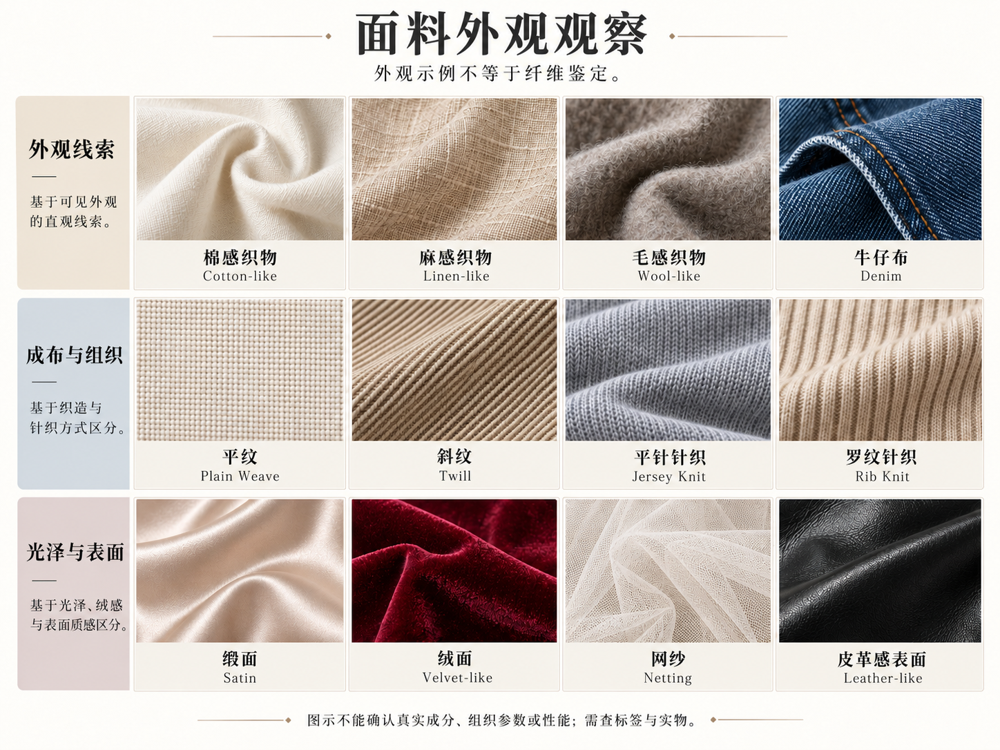

# 第 17 章｜蕾丝、缎面与网纱：材料如何改变同一件衣服

“黑色蕾丝上衣”可能指三种完全不同的东西：只有领边一圈蕾丝、肩部有蕾丝拼接，或整件蕾丝面料覆在衬里上。它们在图案密度与透光范围上相差很大，也会影响轮廓。材料的**位置、面积与层次**，是理解成衣外观的重要条件。

## 先分原料、成布方式与表面

| 层次 | 它回答什么 | 可用的词 |
|---|---|---|
| 原料／纤维 Fiber | 由什么纤维做成？ | 棉、麻、羊毛、蚕丝、聚酯等 |
| 成布方式 Construction | 材料怎样形成布面？ | 机织、针织、非织造等 |
| 具体组织 Structure | 所选成布方式内部怎样组织？ | 机织下的平纹、斜纹、缎纹；针织下的平针、罗纹等 |
| 表面效果 Surface | 看起来和摸起来怎样？ | 光亮、哑光、绒面、压皱、金属光泽 |
| 工艺与装饰 Technique | 怎样加工或添加图案？ | 刺绣、印花、镶边、贴花、压褶等 |

它们可以叠加。一块蚕丝织物可以采用机织成布、缎纹组织，再增加刺绣；罗纹属于针织组织，也不只有一种纤维。装饰工艺与起绒、涂层等整理效果分开记录，不把所有绣花、印花一律归成同一种后整理。讨论真实衣服时，纤维成分以可靠资料为准；看一张图时，可以说“缎面光泽”“亚麻感表面”，不要直接宣布真丝、纯麻或手工制作。

*图 19｜AI 教学示意。缎面、蕾丝边、带衬蕾丝、刺绣、网纱罩层与罗纹外观；右上翻起一角展示衬层。*

*AI 教学示意。分行观察质感、成布与组织、光泽与表面；真实成分和织物参数以标签及实物为准。*

## Satin／缎面：看光怎样沿褶走

缎面常呈较连续的光带，折转处明暗变化明显；不必每一处都像镜子。缎纹是一种织物组织，不能与蚕丝画等号。MFA 的材料数据库将 satin weave 作为结构说明，并列举可使用的不同纤维。[资料：Museum of Fine Arts Boston，CAMEO，Satin weave](https://cameo.mfa.org/wiki/Satin_weave)

缎面的光带会随布褶转折形成明暗变化。轻薄与较厚的缎面、柔软与较挺的缎面，都可能有明显光泽，但下落方式不同；光泽不能独自决定厚度、重量和支撑感。

## Lace trim／蕾丝镶边：只让边缘发声

镶边是沿领口、袖口或下摆出现的窄条装饰，主体仍由另一种布面构成。它的视觉作用集中在边缘；窄同色蕾丝突出纹理，宽边或对比色蕾丝则更容易强调轮廓。

蕾丝的位置、面积和连接方式会影响整件衣物的观感。袖口一圈窄边、领口宽镶边与胸前整片拼接，虽然材料相同，覆盖和装饰重心却不同。

## Lace inset／蕾丝拼接：明确哪一块被替换

拼接是相对独立的材料区域，例如肩部、上胸、袖子或腰侧。它与镶边的区别在于位置与面积：镶边沿边界延伸，拼接则参与构成衣身或袖体。主体可以保持不透明，局部采用透空材料。

肩部拼接可以在领口与袖窿之间形成独立区域，袖部拼接则使袖子与衣身采用不同材料。沿接缝观察主体与拼接的分界，有助于理解这些材料分区。

## Lined lace／带衬里的满幅蕾丝：花纹与底层一起看

满幅表示花纹覆盖较大区域；衬里是下方另有一层。深色同色衬里让纹样较含蓄，对比色衬里更突出花纹。衣身带衬而袖子不带衬，是覆盖范围不同的常见组合。

蕾丝并不只是一种单一制作工艺。V&A 的纺织收藏记录中可见 bobbin lace 等不同类别；继续研究时，应看藏品的材料与技法字段，而不凭图案猜针法。[真实材料参照入口：V&A East Storehouse，Textiles at the V&A](https://lookup.vam.ac.uk/east-storehouse/storagedisplays/USE2193/)

## Embroidery／刺绣：图案怎样依附在底布上

先看图案是不是落在一块可辨认的底布上，线迹或装饰是否有厚度。但现代印花也会模拟绣纹，刺绣还能做在网底上，因此仅靠普通照片未必能确定制作方式。不能把“花卉图案”直接翻成 embroidery。

刺绣线迹附着于底布，贴花 appliqué 则把独立材料片固定到另一层材料上。前者可观察线纹的连续性与凸起，后者可观察花片边缘；模拟绣纹的印花又可能造成相近远观效果。

V&A 的刺绣收藏包含不同地区与针法的作品，也有现代时装实例。它适合用来比较刺绣如何随底布、线材与图案位置改变，而非把刺绣当成一种固定“复古风”。[资料与真实作品入口：V&A，Embroidery](https://www.vam.ac.uk/collections/embroidery)

## Tulle overlay／网纱罩层：重点在两层之间

网纱的细网眼与覆盖关系，可以让同一深色衣物多出轻薄外层。它不一定有蕾丝花纹，也不是所有透明织物都叫 tulle；雪纺与欧根纱还涉及不同组织、挺度和表面。CAMEO 将 tulle 解释为细薄网状材料，并列出多种可用纤维。[资料：MFA Boston，CAMEO，Tulle](https://cameo.mfa.org/wiki/Tulle)

网纱罩层与下层裙体可以长度相同，也可以在裙摆处形成错落；袖子单用一层网纱时，又与带衬衣身形成透光差异。Organza／欧根纱常提供另一种较挺的薄纱外观，不能只凭“轻透”就与细网纱混为一种。

## Rib knit／罗纹针织：条纹来自结构，不只是印花

常见罗纹针织有连续凹凸竖棱，能在领口、袖口或衣身上形成节奏。不能因为看到竖条就断定罗纹：条纹也可能来自印花、压褶或其他织造。CAMEO 的 rib knit 条目以正反针形成的棱谷解释其结构。[资料：MFA Boston，CAMEO，Rib knit](https://cameo.mfa.org/wiki/Rib_knit)

细罗纹、粗罗纹和宽窄相间的罗纹形成不同节奏。纹理顺着衣身垂直延伸时，与印出的竖条视觉上可能接近，但前者带有织物本身的凹凸结构。

## 透明度、衬里与覆盖范围

单层薄纱袖、带衬衣身和透空下摆，可以在同一件衣物上形成不同覆盖。透明度不仅取决于材料名称，也受密度、颜色、叠层及照明影响。衬里的颜色和厚薄，又会改变外层花纹的清晰度与整体透光。

## 从照片读材料，先排除光线的干扰

黑色布面在侧光下可能出现很亮的折线，柔光下又接近哑光；背景透过网眼，也可能被误认成面料自身的浅色图案。学习时可以把注意力从最亮的反光移到没有过曝的平面，看看纹样是否连续、边缘是否真实连接。图像证据不足时，描述现象即可：“表面有柔和光带”“局部能看见细网眼”，不急着鉴定。

照片适合比较光泽、花纹和可见层次，实物还补充触感、重量、厚薄与悬垂。成分相同的两块布，也可能因纱线、组织、密度和整理不同而有明显差异；购买或制作衣服时，材料名称需要与这些具体条件一起理解。

窄领边保留主体布面的连续性，肩部拼接划出材料分区，满幅带衬里则让纹样与底层覆盖整个衣身。这三种用法说明，成衣效果不仅来自选了什么材料，也来自材料怎样进入衣服。

## 从近景继续读：棉麻、毛呢与牛仔分别在说什么

“棉”“麻”“毛”“丝”首先涉及纤维；“牛仔布”“缎面”“罗纹”又涉及织物及外观路径。扩展图把这些放在一起便于观察，却不能把每一格都当成同一层的材料门类。粗细不匀的纱线、绒毛、斜向纹路或光带，是可以描述的视觉线索；纯棉、纯麻、羊毛含量与真丝则应查成分记录。

**Denim／牛仔布**常能观察到斜纹、色差及磨洗效果，但“蓝色”本身不是组织证据。**Tweed／粗花呢类织物**可从混色纱线、较复杂的纹理与成衣表面观察；厚重、有颗粒，也不能独自证明羊毛成分。描述“混色粗纹理外套”比未经核实写“纯羊毛手工粗花呢”更可靠。

## 平纹、斜纹与针织：看得见的线索，需要怎样的近景

平纹以经纬交织的基本格状关系为观察起点；斜纹可以形成连续斜向纹路。CAMEO 的斜纹词条同时列出牛仔布等织物，并展示不同纤维的实物，说明“组织”与“原料”不能合并。[资料：Museum of Fine Arts Boston，CAMEO，Twill weave](https://cameo.mfa.org/wiki/Twill_weave)

针织通过线圈组织成布，平针、罗纹等属于内部的不同结构。观察成衣时，全身轮廓反映布面下落，近景显示纱线、线圈及表面装饰，实物与结构资料则有助于把外观和成布方式对应起来。

## 绒面、皮面与涂层：表面相近，不保证材料相同

绒面布可以在光线变化时出现深浅方向感；光滑皮面感可以有细纹、折痕或涂层反光。天鹅绒、起绒织物与麂皮感表面并非同一种结构；真皮、合成革与涂层织物也可能在小图中相近。需要采购、养护或性能判断时，应进一步查材料标签和产品说明，而不靠“看起来高级”归类。

**Chiffon／雪纺类薄织物**与 **tulle／薄网纱**都可能轻薄，但应分别观察连续布面和网眼；透明度还受密度、颜色、叠层和照明影响。既不能看到透明就叫蕾丝，也不能看到网眼就补出绣花。第 26 章的同衣型对照可以继续观察：换表面以后，折线、透光和轮廓各改变了多少。

## 材料信息怎样对应穿着表现

材料信息可按纤维、成布方式与组织、表面整理、装饰及衬层分别记录。纤维说明原料，组织说明材料怎样成布，整理与装饰又改变表面；成衣中的厚度、松量、覆盖和叠层继续影响穿着感受。

例如，罗纹针织既说明线圈组织，也常在袖口形成收束外观；缎面说明织物组织及光泽路径，却没有直接给出纤维成分；蕾丝带衬则说明外层纹样与下层覆盖的关系。舒适、保暖或适合某项活动等判断，还需结合实际产品、穿着条件和使用资料。
