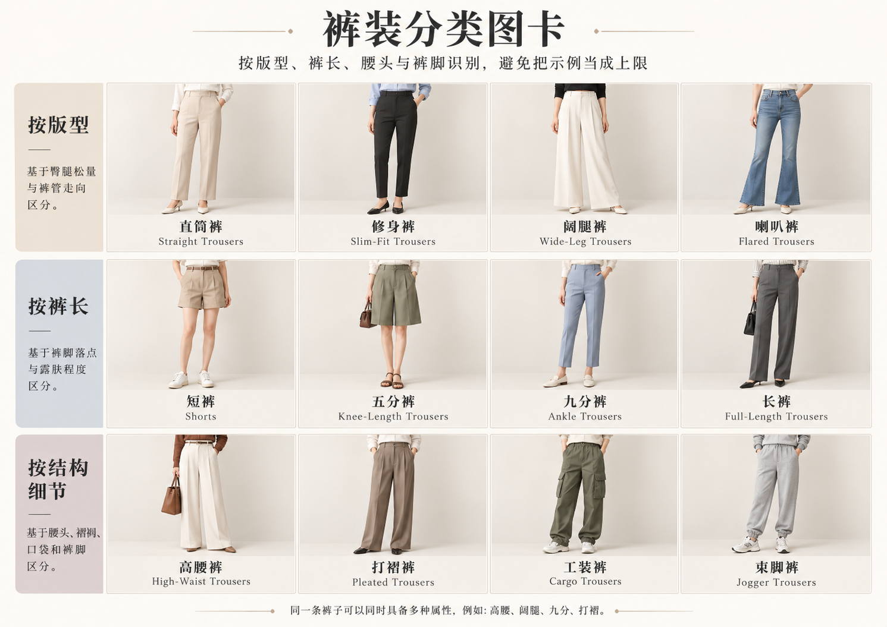
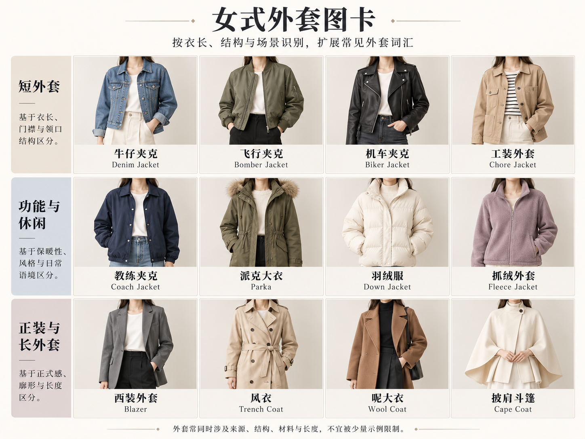

# 第 18 章｜裤子与外搭：先看轮廓，再说衣型

“这条裤子很松，是阔腿裤还是工装裤？”两者可以同时成立。阔腿描述裤腿形状，工装裤常指向袋位、结构与衣橱来源。认识单品时，先把不同问题拆开：它有多宽，在哪里变宽，有多长，又带什么细节？

*图 20｜AI 教学示意。依次为直筒、阔腿、锥形、喇叭、Cargo 与裙裤，分别涉及轮廓、口袋与长度。*

*AI 教学示意。比较裤管、裤长、腰头与口袋；高腰、阔腿和打褶等特征可以组合。*

## 直筒、阔腿与锥形：宽度在哪里改变

**Straight／直筒裤**的关键不是“贴腿”，而是裤腿向下的变化相对平直。可以有窄直筒，也可以有宽松直筒。看膝部到裤脚的外缘，再看裤脚是否明显收窄或展开；不要只看腰部合不合身。

**Wide leg／阔腿裤**强调较宽的裤腿与身体周围的空间。它可以从大腿就宽松向下，也可能带前褶与高腰。阔腿不等于长到拖地：及踝阔腿、短阔腿和拖地阔腿，都需要另说长度。

**Tapered／锥形裤**从较宽处逐渐收向较窄裤脚，常见效果是大腿有空间，脚踝附近更紧凑。它不必像紧身裤一样全腿贴合。“窄裤”说的是整体宽度，“锥形”说的是宽度变化，两者不是同义词。

Levi’s 的官方版型指南分别说明 Straight、Tapered 与 Bootcut，并将宽松程度作为另一项描述。这是观察裤型的实物词汇参照，不是全行业尺寸标准。[原始资料：Levi’s，Men’s Denim Fit Guide](https://www.levi.com/US/en_US/features/men-jeans-guide)

## 喇叭、工装与裙裤：换一个问题，名称就会改变

**Flared／喇叭裤**在膝部附近向裤脚展开。它与阔腿的区别，是上部到下部的扩量关系，而不只是裤脚有多宽。Bootcut 常指较温和的下摆扩量，具体程度会随产品用词变化；膝部松量与裤脚宽度仍需结合观察。

**Cargo／工装袋裤**常以大腿侧的外置袋、翻盖袋等为识别线索。它可以做成直筒、锥形或宽腿，也可以是短裤。一条裤子若同时有宽裤腿和侧袋，完全可以叫“阔腿 Cargo 工装裤”。不要因为袋子多，就忽略真正决定剪影的裤腿。

**Culottes／裙裤**在这里指宽阔、长度常在膝下至小腿附近、站立时可能近似裙摆的分腿裤装。中文“裙裤”也可能用于带裙片的其他结构，宽腿、膝下长度与分腿是这里的主要特点。走动时能看见两条裤腿，比单张正面静态照更容易判断。

## 裤腰、裤长和裤线：不属于另一种神秘风格

高腰、中腰、低腰描述腰头相对身体的位置；腰带系得高，不会把一条原本低腰的裤子变成同样结构的高腰裤。九分、七分、及踝和拖地是长度提示，但穿着者身高会改变实际落点，沟通时最好直接说“裤脚停在脚踝上方”。

前褶是从腰部放出空间的结构；裤中线则是裤腿正中可见的折线，两者不相同。“高腰、单前褶、宽松直筒、及踝”已经是一条相当清楚的裤子描述；不必先决定它属于学院、法式还是极简。

## 外搭不是一种固定衣服

“外套”常是穿着层级，“夹克”是较具体的衣物家族，“开衫”又同时涉及材料与开合。一件开衫可以穿在外面，也可以套进大衣里；一件薄西装也能成为中间层。我们需要的不是强行排出唯一树状分类，而是知道每个词在补什么信息。

*图 21｜AI 教学示意。依次为 Blazer、针织开衫、风衣、Bomber、牛仔夹克与 Bolero。*

*AI 教学示意。比较短夹克、休闲外层与长外套的领襟和衣长；填充与纤维成分需查实物资料。*

**Blazer／西装式夹克**可以从翻折的驳领、前门襟、衣身裁片与较明确的肩部组织入手。不要把所有带领外套都叫西装，也别认为西装一定收腰、垫肩或成套。要区别，描述“单排扣、软肩、直身、长度盖住臀部”会比“休闲西装”具体。

**Cardigan／针织开衫**通常有前开口，可能用扣子、拉链或敞开方式处理。它可以薄、厚、短、长；“毛衣”则不必前开。若你看到针织上衣却没有清楚门襟，不妨先叫针织衫，而不是替它猜一排扣子。

**Trench coat／战壕式风衣**常借双排扣、腰带、肩袢、挡片或袖袢等组合形成识别。中文“风衣”范围更宽，不是每件长外套都必须具备这些细节。表达时可以说“米色双排扣腰带风衣”，再说明长度与肩线；浅卡其色本身不足以定名。

**Bomber／飞行夹克式外套**常用短衣身、前拉链、收束袖口和下摆形成圆而紧凑的体积。以 MA-1 为例，Alpha Industries 的官方说明列有针织罗纹领、袖口和腰部，这是可以直接观察的一组细节；它只是 Bomber 家族的一条路径。[原始资料：Alpha Industries，MA-1 Bomber Jacket](https://www.alphaindustries.com/products/mjm21000c1-ma-1-bomber-jacket-heritage)

**Denim jacket／牛仔夹克**先给出材料与衣物家族，还需继续看胸袋、明线、金属扣、衣长和衣身分割。牛仔面料也能做风衣或西装，不能看见蓝色斜纹就停止观察。Trucker jacket／卡车司机式夹克是其中一类常见版式，不等于所有牛仔外套。

**Bolero／博莱罗短外搭**常见很短的衣身与敞开前片，让里面衣服继续成为视觉主体。图中黑色款的衣身停在胸下、腰线上方，前片呈弧形，没有可见扣合；它不一定由针织制成。伦敦博物馆藏有一件 1891—1899 年的黑缎 Bolero，前部与袖口饰有珠绣，可见短外搭可以相当有结构与装饰。[真实案例：London Museum，Jacket, bolero，36.80/2](https://www.londonmuseum.org.uk/collections/v/object-79246/jacket-bolero/)

## 一类多款：短外套：长度相近，结构可以完全不同

*AI 教学示意。短西装、Bomber、牛仔夹克、无领短外套、机车夹克与绗缝夹克的结构变化。*

无领、菱格绗缝与边缘包边分别属于领部、表面固定和边缘处理；它们可以同时出现在短外套上，也可以进入长外套与背心等不同衣型。

## Cropped：只说“短到哪里”，不替代衣型

Cropped 是截短的长度描述。Cropped blazer 是短西装，cropped cardigan 是短开衫，cropped trousers 是较短裤长；三个词组不能互相替换。看到一件胸下结束的小外搭，可以先说“胸下长度、长袖、前开式短外搭”，再判断更接近 Bolero、针织 Shrug，还是某件衣服的截短变体。

齐腰 Bomber 的罗纹下摆把上身体积收在腰部，阔腿或直筒裤则延续下身线条。外套的收束与裤腿的放量，是整套穿着轮廓的一组关系；“酷”“休闲”等感受来自这些具体安排与材料、色彩的共同作用。

## 贴腿、窄腿、气球裤与慢跑裤：继续分开廓形和细节

**Skinny／紧窄贴腿**常强调从髋腿到脚踝较贴合；**slim／修身**通常保留更多空间，但品牌之间没有统一松量界线。**Carrot／胡萝卜形**、**balloon／气球形**等名称常指向上部或中段有体积、下部收窄的轮廓，具体位置仍要描述。不要只说“宽松”，还要说宽在臀部、大腿、膝部还是裤脚。

**Joggers／慢跑裤式裤装**常用抽绳或弹性腰、裤脚收束形成识别，但未必都为实际运动准备，也不是所有锥形裤都叫 joggers。**Leggings／打底紧身裤**还需看弹性衣身及用途信息；穿得紧的梭织长裤不因贴腿就自动变成 leggings。

**Bermuda shorts／百慕大短裤**通常指长度接近膝部的短裤，实际落点随款式与穿着者身高变化。**Overalls／dungarees，背带工装裤**通常多了连接裤装的胸前片与肩带；只有两条可拆吊带、没有胸前片的长裤又是另一种组合。连体裤 jumpsuit 把完整上身与裤装连接，不能只因“一件式”就与背带裤混用。

高腰锥形 Cargo 裤可以在大腿保留空间、裤脚收窄，再叠加翻盖侧袋和松紧收口。Cargo 说明袋型，锥形说明轮廓，收口说明裤脚处理，它们互不排斥。

## 外套的遗漏家族：机车、工装、雨壳、保暖与披覆

**Biker／机车式夹克**可观察斜向拉链、翻领、搭扣与腰部处理，但并非每件都具备全部细节；黑色皮面感外套也不一定是机车款。**Chore jacket／工装夹克**常以较直接的前开合、贴袋和相对简洁衣身为入口，仍需补领口、袋位、衣长与布面。

**Rain shell／雨壳式外层**在外观上可以有连帽、挡片、抽绳等，但防水、防风和透湿属于待验证的性能；**parka／派克式外套**又常提示连帽、较长覆盖和腰部或下摆收束。两个名称的结构及用途会有重叠，不能看见帽子就认定保暖或防水。

**Puffer／蓬松填充外套**与 **quilted jacket／绗缝夹克**需分开看：前者强调蓬松体积，后者提示表面分隔固定的缝线安排。格子或条道可见，不等于填充物已确认为羽绒。**Cape／斗篷**与 **poncho／套头披覆式外衣**则要找开口、肩部支撑及手臂从哪里伸出，不能把披在肩上的任何布都叫袖子。

## 双面检查，比增加一个款式名更有用

前面确定门襟、袋位和领口，侧面核对长度与体积，背面核对肩部、开衩、帽子及褶裥；内部和材料记录再回答里衬、填充与功能。第 34 章继续展开男式外套，第 25 章补背部观察。这些衣物结构也不由模特性别独占：本章的女装示例便于阅读，不应被理解为谁能穿哪一类衣服的边界。
