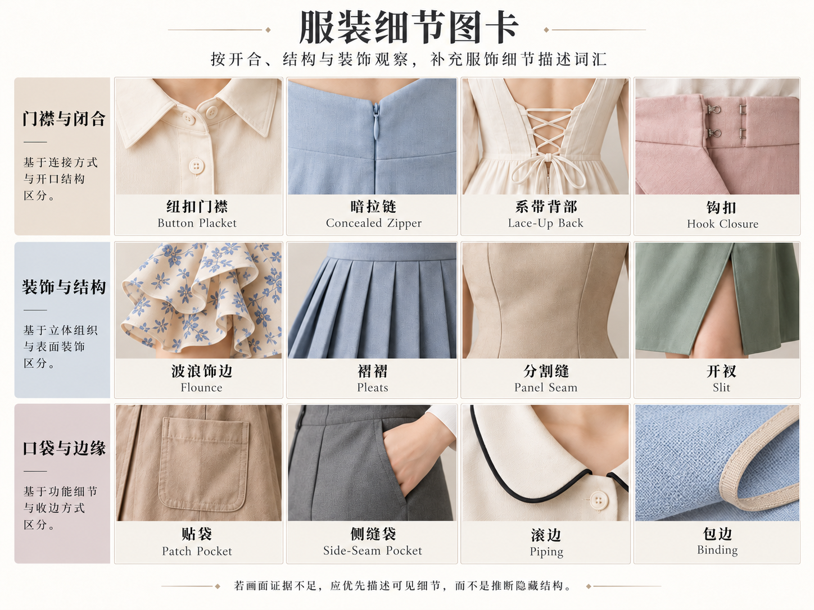

# 第 19 章｜不要都叫“褶皱”：抽褶、褶裥与波浪边

腰侧密集细褶与袖口的一圈波浪都让布面起伏，结构却可能不同：前者收拢衣身，后者可能是另接的装饰边。褶的位置、方向、重复节奏与连接方式，是理解这些细节的基础。

*图 22｜AI 教学示意。依次为局部抽褶、弹性抽褶、抽褶荷叶边、弧形裁片波浪边、刀褶与悬垂。*

*AI 教学示意。闭合、布量与分割、口袋和边缘处理；注意分割缝、侧缝袋、包边与滚边的区别。*

## 皱褶是看到的现象，褶裥是有意组织的结构

坐下、抬臂或把衣服塞进裤腰，都会产生自然皱褶。它们随动作与材料变化，不一定是设计师预先固定的。Pleats／褶裥则通常有明确的折叠安排：方向、宽度、间距或开合方式可以被描述。

自然压皱与设计褶裥是不同现象。一条整理平整的百褶裙仍保留规则折层；折线是否清楚、是否有意固定，以及布面上是否另有凌乱压痕，应分别观察。

## Ruching：把局部布面收拢，让细褶向那里汇集

Ruched 常用于描述局部抽褶处理，可能由缝线、抽绳或弹性收缩形成。本图左上可见单侧收拢：一组柔软小褶朝衣身侧缝汇集，而不是整片表面铺满规则竖折。

不要把 Ruching 记成“必须有一条绳”。看不见内侧结构时，可以说“腰侧抽褶、横向细褶向左侧集中”；如果确实能看到绳头与通道，再加“抽绳”。位置也很重要：侧腰、领口与袖口的抽褶，会把视线带到不同部位。

## Shirring：多排缝线让一片布均匀收缩

本章用 Elastic shirring／弹性抽褶指多行弹性线形成的密集收缩面。常见线索是多排相对平行的缝线与其间的小褶，像一整片有节奏的细纹；它不只是某一边聚拢。

Seamwork 的原作教程说明，机缝弹性抽褶通过多排缝线与弹性底线形成纹理和伸缩性。该教程也区分了 Shirring 与利用刺绣组织褶面的 Smocking；市场名称可能混用，学习时不要直接画等号。[原始资料：Katie Whittle，A Guide to Shirring，Seamwork，2017](https://www.seamwork.com/sewing-tutorials/a-guide-to-elastic-shirring)

多行平行缝线与其间细褶是弹性抽褶的常见外观。真正的伸缩性还取决于弹性线和缝制方式；只有纹理而缺少内部资料时，观察结论宜停留在表面组织。

## Ruffle 与 Flounce：波浪都在边上，体积来源不同

**Ruffle／抽褶荷叶边**常由一条布料沿连接边聚拢，再缝到衣服上。靠接缝处也能看到细密的收拢，剩余布料向外展开。它可以窄到只是领口一圈，也可以宽到成为层叠裙摆；窄宽不是唯一判据。

**Flounce／弧形裁片波浪边**通常借弧形或圆形裁片，让外缘比连接边更长，因此形成展开的波浪。连接处可以相对平顺，体积更多出现在自由边缘。中文商品名称往往也叫“荷叶边”，所以想精确讨论时补英文与结构描述就够了。

纸样设计者 Paper Theory 用裁片与缝合边说明这一区别：一类在连接边抽拢，另一类主要把扩量放到外缘。它比“Ruffle 小、Flounce 大”更值得记住。[原始资料：Paper Theory Patterns，Frill and flounce](https://papertheorypatterns.com/pages/frill-and-flounce)

相同的波浪边用于薄软纱与挺牛仔布，密度、折面和张开程度会不同。连接处是否抽拢、自由边缘怎样展开，才是区分结构的主要线索，波浪大小本身不是固定判据。

## Knife pleats：一排朝同一方向倒下的整齐褶裥

Knife pleats／刀褶常用于指连续向同一方向折叠的褶裥。观察折边的方向、宽度与重复节奏。它与相邻折层成对相向或背向安排的工字褶类处理不同。后者还可用 box pleat 与 inverted box pleat 进一步区分；中文译名有重叠，讨论时最好指明折向。“百褶”也不是要求恰好一百道。

褶裥未必全都从腰头固定到底，也不必永远锋利挺直。裙子走动时，折层会张开；薄软材料的折面可能更柔和。描述“腰部固定、下摆可以展开的单向褶裥”，比“有很多竖条”更能区分褶与印花。

## Drape：让宽而软的布面悬垂

Drape 在服装语境里可以涉及材料的垂坠表现，也可描述有意组织的悬垂效果。这里重点是后者：布从支撑或固定位置落下，形成较宽、柔软、连续的褶面，不一定有整齐压出的折线。

领口的松软弧垂、腰间斜向挂落与侧边宽褶，都与布料的固定位置和重力方向有关。舒展悬垂常呈现较宽、连续的褶面，局部抽褶则使细褶朝收束处汇集；两者的节奏与体积来源不同。

## 常见细节的辨识线索

| 常见外观 | 结构线索 | 对应细节 |
|---|---|---|
| 腰上皱一点 | 褶向左腰集中 | 左侧腰抽褶，细褶横向汇集 |
| 后背弹弹的 | 多排缝线、密集小褶；弹性尚待确认 | 背部多排平行缝线形成细褶；确认弹性后可称弹性抽褶 |
| 领边有波浪 | 另接窄条、连接处聚拢 | 圆领接窄抽褶荷叶边 |
| 裙边大波浪 | 接缝较平、外缘展开 | 下摆接弧形裁片波浪边 |
| 整齐的一条条 | 折层同向重复 | 从腰部向下展开的单向褶裥 |
| 布料软软挂着 | 宽褶从固定处悬落 | 侧腰固定、斜向悬垂的宽软褶 |

褶裥还可以成为整件衣服的设计方法。The Met 收藏的三宅一生《Flower Pleats》套装，用褶与体积形成花瓣般的肩、胯轮廓，适合旁读“局部细节怎样变成整体造型”。这不是图 22 刀褶格的原作来源。[真实案例：Issey Miyake，Ensemble，约 1990 年，The Met，2015.451a, b](https://www.metmuseum.org/art/collection/search/695620)

蕾丝镶边位于衣物边缘，局部抽褶收拢布面，褶裥则组织折层。同一条裙可以同时有这三种安排，但每一处的布量来源与连接方式各不相同。

## 门襟、拉链与系带：图卡里的细节并不都是褶

**Placket／门襟**是开口附近的组织与加固，**button closure／纽扣扣合**是固定方式；有门襟不等于一定用纽扣。**Concealed zipper／隐形拉链**需要观察拉链牙是否被遮住、开口位于哪里；一条平直缝线不足以证明内侧有拉链。**Lace-up／交叉系带**应追踪带子穿过孔眼或布袢的路径，图上有绳结也不等于一定能调节松量。

后中拉链负责闭合，腰部蝴蝶结可能只是装饰；门襟与扣合、收束与装饰也需分别辨认。外露的结、扣或拉链头并不一定承担整件衣服的全部固定作用。

## 省道、拼缝、贴袋与滚边：平整部分也值得命名

**Dart／省道**把局部布量收进缝合的楔形区域，帮助衣物从平面转成立体；**seam／接缝**连接裁片，不能看到一条线就一律叫省道。装饰明线还可能沿接缝或边缘重复出现。只从照片难以确认时，描述“从腰部向上延伸的两条分割线”，比武断认定纸样更准确。

**Patch pocket／贴袋**在衣物表面形成可见袋片；**welt pocket／嵌线袋**常从条状袋口观察，袋身未必在外露出。装饰假袋与真实袋口需要产品资料或实物确认。**Piping／嵌条、滚条**与较平的包边、镶边也可能在小图中相近，应说明位置、凸起和颜色，不把所有细边都叫蕾丝。

## 开衩、叠片与翻边：先追踪边缘，再起名字

**Slit／开衩**让衣片在局部形成开口；**vent／活动衩**还常涉及叠合等具体安排，不能从正面一条黑线决定背后结构。袖口或裤脚 **turn-up／翻边**是边缘折起形成的可见层次；一条横向装饰带则可能并未翻折。识别时从自由边缘追到固定处，区分开口、接缝、折叠和附加装饰。

本章可以用一句完整说明串起来：“直身外套，前中单排扣门襟，两只方形贴袋，领缘有深色滚条，后中留活动衩。”褶、开合、塑形、口袋与边缘处理各回答不同问题。图卡只示范部分细节；认识这些坐标，才能继续读没有画进图里的新衣服。
