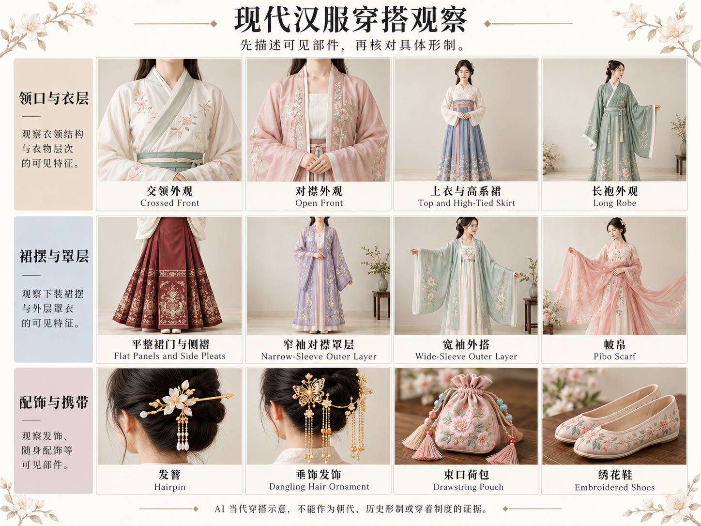

# 第 21 章｜汉服：先认形制，再谈风格

汉服涵盖多种单件衣物和穿着组合。辨认具体形制，需要观察上衣、下装、领襟闭合、裙片围合及内外层次。本章从有藏品资料支持的实例出发，比较衣物结构及其穿着关系。

本章采用 AI 教学示意辅助观察；历史形制以相邻引用的文物、实测和研究资料为依据。插图的配色、人物与部分配件属于当代呈现，不作为断代依据。

## 先分清：形制、组合、审美与使用目的

形制关注衣物怎样构成；搭配组合关注几件衣物怎样叠穿；审美可以是素雅、浓丽、清秀；用途则可以是当代穿着、历史研究或角色服装。四者可以同时描述，却不能互相替代。

| 你说的词 | 它主要回答什么 | 还需补充什么 |
|---|---|---|
| 交领、对襟、右衽 | 领襟与掩合关系 | 具体衣物、时期和闭合位置 |
| 褙子、袍、裙 | 单件衣物类别 | 领、袖、长短、开衩与内部结构 |
| 上衣下裙、袄裙、衫裙 | 穿着组合 | 上衣是哪件、裙是哪种 |
| 素雅、华丽、仙气 | 视觉感受 | 可见剪裁与材料，不能据此定朝代 |
| 历史复原、当代汉服、幻想古风 | 对证据与设计的不同要求 | 哪些结构有出处，哪些是创作 |

例如“明代女装”不是一个固定款式。中国丝绸博物馆的展览同时展示不同领式与裙褶的复原实例；认识时代之后，仍要落到具体衣物。[资料：中国丝绸博物馆，《丝·赏》，历史服饰复制展示](https://www.chinasilkmuseum.com/yz/info_18.aspx?itemid=26689)

## 交领右衽：按穿着者的左右判断

交领是领襟交叉；交领右衽通常表现为穿着者的左前襟在外，覆盖右前襟，并向穿着者右侧掩合。判断时追踪哪片前襟在外、最后在哪侧固定，不以观者左右或一个似乎像字母Y的线条下结论。镜像照片尤其容易造成反向。

一个可核查的例子是万黄氏墓出土的黄绮折枝花卉女单衣：馆方明确记录交领右衽、右腋下纽襻扣合，且为无衬里的单衣。这说明**宽袖和交领并不足以把所有衣物都叫“袄”**；单、夹及材料结构仍须查实物。[资料：中国丝绸博物馆，一物Vol.11，黄绮女单衣与曲水如意云罗裙](https://www.chinasilkmuseum.com/info_151.aspx?itemid=27787)

交领右衽是领襟与掩合关系；衣长、袖体、侧衩、单夹及固定位置，则属于具体衣物的其他特征。相同领襟可以出现在不同衣物与不同时期，不能单独承担全部断代判断。

## 南宋褙子：直领对襟，还要看侧衩和系结

*AI 教学示意。直领对襟、窄袖、长侧衩与一处前襟扣合。纹样和内层采用简化呈现。*

*AI 教学示意。当代汉服灵感穿搭的领口、衣层、裙摆、罩层与配件；不作历史形制复原。*

这里选择南宋周氏墓素罗单衣的资料作为观察入口：这件实物衣长120厘米，直领对襟、窄袖、两侧长开衩，领襟和袖口有缘边，前门襟中部有一粒同料纽扣。它不是一件用宽腰带束紧的交领大袖袍。馆方还记录宋代女式褙子的不同前襟固定方式，因此“褙子一定没有扣和带”并不成立；这些特征也不能不分时期地套给所有名为褙子的衣物。[资料：中国丝绸博物馆，一物Vol.38，素罗单衣](https://www.chinasilkmuseum.com/gskt/info_319.aspx?itemid=28354)

另一件周氏墓镶边褙子则为夹衣，门襟用纽襻系结，侧面开衩。博物馆的复原研习资料另列围裹式两片裙，说明裙片由两块交叠围合。**两片围裹裙不因为有重叠就自动等于马面裙**，还须看平幅、褶裥和围合的具体组织。[资料：中国丝绸博物馆，南宋褙子与围裹式两片裙复原研习](https://www.chinasilkmuseum.com/yg/info_13.aspx?itemid=31106)

看图时可以先遮住人物的脸，只看衣边：两条前襟是否平直、袖体是否相对窄长、侧边是否真的分开？这些信息比“清冷宋风”更容易传达给设计者。

窄袖、较长衣身与长侧衩使外层和里面衣裙保持清楚分界。褙子的前襟固定、袖宽和单夹还有具体实例差异，理解时应回到相应藏品，而非只记一个宽泛外形。

## 明初三件套：不能把短袖外层误看成披帛

*AI 教学示意。长袖内衫、短袖外衫与下裙的层次。原件纹样及裙片细节从略，藏品资料见下文。*

中国丝绸博物馆的“绢短袖衫、绮长袖衫、绢裙”记录了一套明初钱姓女子的三件组合：里面是直领对襟长袖衫，外层为直领对襟短袖衫，门襟有两根系带结系，腋下开衩，下面配裙。“两根系带”指成一组系结的两条布带。外层有自己的衣身和袖子，不能因短袖就只叫“肩上披的一块布”。[资料：中国丝绸博物馆，绢短袖衫、绮长袖衫、绢裙](https://www.chinasilkmuseum.com/zggd/info_21.aspx?itemid=1870)

这套衣物由长袖内衫、短袖外衫与下裙组成。短袖外层下面露出的长袖属于另一件衣物，与同一袖体上的拼色裁片不同；内外衣各自的领襟和衣摆，也是层次辨识的重要线索。

“袄裙”和“衫裙”是上衣与裙的组合说法，不能与“马面裙”并排当成互斥裙型。更准确的表达是“某领式上衣配某结构的裙”。上衣是否有里、是否夹棉，优先按实物记录命名，不凭画面厚薄猜测。

## 马面裙：从平整裙门继续追到裙片

*AI 教学示意。马面裙与现代短外套、衬衫、针织衫、西装及开衫的搭配。*

平整的正面、两侧褶裥只是可见入口，严格辨识还要看裙片的交叠与围合。国丝馆藏曲水如意云纹罗裙的说明记录两片交叠与裙门两侧对称折裥；清代红色皮球花纹绸马面裙则记录了两片裙、腰部扣合和马面两侧百褶。实例不同，具体闭合与装饰也不同。[资料：中国丝绸博物馆，曲水如意云纹罗裙](https://www.chinasilkmuseum.com/zggd/info_21.aspx?itemid=1905) [资料：中国丝绸博物馆，红色皮球花纹绸马面裙](https://www.chinasilkmuseum.com/zggd/info_21.aspx?itemid=1974)

| 观察位置 | 应继续核查 | 常见误认 |
|---|---|---|
| 正面平幅 | 是裙片重叠形成，还是另贴装饰布 | 在百褶裙前贴一片布就叫马面裙 |
| 两侧褶裥 | 褶的位置、方向、宽窄及固定方式 | 把全周均匀褶当作所有马面裙标准 |
| 后面 | 是否有相应平幅与交叠 | 只有正面图就宣称完整结构正确 |
| 腰部 | 裙片连接、系带或扣合方式 | 只凭现代腰头判断历史原貌 |
| 裙襕与纹样 | 所属藏品和时期 | 任意印花都据称复原某朝纹样 |

清华艺博《裙裳华彩》按明代、清代、二十世纪初与当代重构展现裙装变化。它提醒我们，同一个名称中有不同的时期与样式，不能把一套现代商品照片当作所有马面裙的唯一标准。[资料：清华大学艺术博物馆，裙裳华彩](https://www.artmuseum.tsinghua.edu.cn/cpsj/zlxx/zlhg/202509/t20250926_20317.shtml)

马面裙与现代短夹克、衬衫或针织衫组合，属于当代搭配。正面平幅、侧褶与下部裙襕可以共同构成视觉重心；传统裙体与现代上装的组合，不等同于某一时期整套衣装的复原。

## 圆领袍、曲裾与齐胸穿法：别急着套名字

**圆领袍不是看到圆领就能认定。** 还要看整件袍服、领部开合、袖体、腰带和侧部结构。国博“男装女陶俑”明确记载女性着圆领袍服、束带、穿靴；因此圆领袍不能写成男性专属，也不能只靠领口就定为唐代。[真实案例：中国国家博物馆，男装女陶俑](https://www.chnmuseum.cn/zp/zpml/kgfjp/202111/t20211116_252274.shtml)

**曲裾不是“下摆弯弯的”。** 需要追踪衣襟、衣裾延长及交掩的路径；一根斜向飘带或一块三角下摆不能证明曲裾。国丝《丝·赏》里的曲裾袍被明确标为依据马王堆出土实物制作的复制品，应以这个具体案例理解，不推出“所有曲裾都绕同样圈数”。[博物馆复制案例：中国丝绸博物馆，印花敷彩纱曲裾袍](https://www.chinasilkmuseum.com/yz/info_18.aspx?itemid=26689)

**齐胸首先涉及穿着高度，完整结构还包括裙腰、系结、内层与裙片围合。** “唐风”“敦煌风”常概括视觉灵感，历史复原则需要落实到具体出土实物、历史图像与研究对象，两者的依据不同。

## 从单件衣物到整套穿着的观察次序

历史衣装、当代汉服与仙侠角色服装有不同的资料依据。历史实例先确认对象与年代，再看领襟方向、袖体衣长、裙片与褶、内外层次，最后看纹样与配件。这样的顺序有助于把主体结构与后加装饰分开。

正面有助于观察领襟与裙门，背面与侧面补充围合、开衩和层次。被遮挡的结构须结合藏品资料继续辨认；幻想设计则与历史实例分别讨论。

## 组件图怎样读：衣、裙、披覆与装饰不要混层

组件图从衣物位置与连接关系入手。交领上衣、对襟上衣等先回答领襟与衣身；长裙先看腰部、裙片和褶；披帛等披覆物另看覆盖与垂落。发簪、发饰、腰间配件不能与这些主体衣物并列成同层形制，更不能仅凭配件认朝代。

同样叫“宽袖”，可能出现在不同衣物和不同设计中；同样叫“对襟”，也不能代替衣长、袖体、侧衩、内外层及固定方式。组件表可按下列次序记录：

| 记录层 | 需要写清的内容 | 不宜直接推断 |
|---|---|---|
| 单件衣物 | 领襟、衣长、袖体、侧部开口 | 名称一确定就代表某个朝代 |
| 下装 | 围合、裙片、褶、腰部固定 | 只见正面就认定完整裙制 |
| 穿着组合 | 内外、上下的顺序与覆盖 | 组合名称等于单件衣物名称 |
| 披覆与配件 | 放置、系结、是否独立 | 有飘带或发簪就证明历史准确 |
| 证据 | 具体藏品、历史图像或研究资料 | 用一张造型图代替完整实物资料 |

## 单件、组合与穿着高度之间的关系

裤装、袍服、短上衣与裙装，可以形成多种内外层组合。本章的褙子、明初三件套与马面裙是具体入口，服饰范围还远不止这些。齐胸涉及穿着高度，对襟涉及领襟开合，襦裙则涉及上衣与裙的组合；这些名称来自不同层级，可以在具体衣装中交叉。

比较本章博物馆资料中的衣物，可以看到同类名称下领襟、袖体、衣长与固定的具体差异。一个时期内部也存在多种衣物和穿着场景，形制知识因此建立在具体实例的积累上，而不是用某一套现代造型概括全部历史。

当代搭配中的对襟长上衣、侧褶长裙和新设计头饰，可以分别辨认结构与审美来源。部件有传统灵感，并不自动使整套组合成为历史复原；两类穿着都可以研究，但依据不同。
