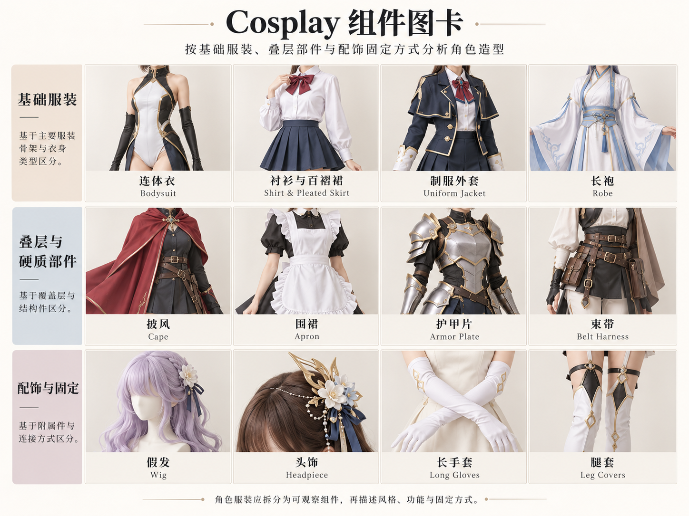

# 第 22 章｜Cosplay与角色服装：把角色拆成可描述的衣物

Cosplay不是一种固定剪裁。它可以使用制服、长袍、铠甲、日常服装，也可能把多种元素组合进同一个角色。只说“动漫风衣服”，模型不知道该生成水手领、立领制服，还是厚重肩甲。

本章按服装结构组织原创教学示意；图里没有声称还原某个已有角色。若目标是某作品中的具体人物，应另以该作品的官方设定与明确版本为标准。

## 先问：还原、改编，还是原创

| 目标 | 描述必须包含 | 如何检查 |
|---|---|---|
| 还原既有角色 | 作品、角色、服装版本、参考图 | 与该版本的轮廓、层次和配件逐项对应 |
| 角色改编 | 保留哪些识别点，改动哪些结构 | 不把改编称为完全还原 |
| 日常化搭配 | 色彩、轮廓、标志细节与日常单品 | 是否仍能解释灵感来自何处 |
| 原创角色服装 | 角色用途、衣物结构、世界观和材料 | 结构自洽，避免无意拼出矛盾部件 |

同一角色的默认服装、节日服、游戏皮肤和影视版本可能不同。把版本写清，比不断增加“精美”“高级”“还原”更有效。如果前后参考来自不同版本，应主动指出，这是混合改编。

世界Cosplay锦标赛将服装与原作设计的对应列入评审，同时考虑制作质量与技术；这是一项具体赛事的标准，不是所有cosplay活动的统一规则。它也明确说明，扮演者的种族、性别或身形与原角色的差异，不影响服装完成度的评判。[资料：World Cosplay Championship，Judging and Competition Rules，2026年1月更新](https://wcc.worldcosplaysummit.jp/en/championship/rule/)

## 六种入口：看服装骨架，不先猜角色

*AI原创教学示意，均为成年模特。从左到右、先上后下：水手领制服式、幻想立领制服、舞台演出服、法师长袍、板甲式装甲、科幻连体服。这是本书的观察分组，彼此可组合，不是官方分类，也不对应特定作品。*

*扩展观察图卡（AI 教学示意）：从基础衣物读到覆盖层、硬质件与配件。图示长手套、腿套不展示全部固定点；护甲为造型示例，不能据此判断防护能力或制作材料。图中例子不是完整分类；细部判断请结合本章原图和正文。*
**水手领制服式**的重点是领片形状、领带或领巾、上衣和裙裤。前面V形领只是部分信息；要确认后方方形领片，还应看背面。日常制服、角色制服和原创制服不能仅凭同一领型当作一回事。

**立领制服式**要说明衣身长短、门襟走向、肩部与袖口。图中黑色套装的斜向开合、长短不同的下摆和银色饰边，是可描述的设计信息；它并不证明某国真实军服或特定军衔。

**舞台演出服**常需要把上衣、裙体、装饰层与鞋靴分别说清。本图是短外套配多层裙摆；“偶像服”只是使用情境，不能代替领口、裙长和层次。

**长袍与披肩**要辨认是不是独立衣物。图中酒红长袍外有短连帽披肩，腰带另带小袋。“有帽子的红裙子”会丢失层次，也容易把罩在外面的披肩画成裙身的一部分。

**装甲式服装**可以描述肩甲、胸甲、护臂与胫甲的分件关系，以及下面穿什么。外观像金属，不等于真由金属制成；材料与连接方式应来自制作者记录，不能从AI画面猜出EVA、树脂或热塑片材。

**科幻连体服**先说连续的基础衣身，再说外加护具、背包、束带和挂载。贴在衣上的色块、缝线和可拆装甲不是同一结构。图中为闭合式连体服与外置装备，读图时先追踪哪些部件独立于布料。

> 描述例句：成年角色穿象牙白立领连体服，外加独立肩部与膝部护片，腰间有灰色装备带，背负小型硬壳背包，袖口和鞋靴之间保留布料活动区。

## 假发、披风、铠甲与道具：分别命名，避免一团装饰

假发说明发型、发束与颜色；头饰说明固定位置和轮廓；披风、披肩和外袍说明覆盖范围；手持物说明角色如何持握。它们可能一起形成识别点，但不应统称“角色配饰”。

| 不够清楚的描述 | 更可执行的表达 |
|---|---|
| 很复杂的肩部 | 两侧独立层叠肩甲，外缘上翘，下面是布料袖子 |
| 脖子后面一大块布 | 从肩部扣合的短披肩，后缘到腰，独立于内层长袍 |
| 腰上很多东西 | 宽腰带上挂两只皮质感小袋，左侧悬挂圆形徽章 |
| 角色发型 | 银白齐肩假发，侧分刘海，右侧有一枚蓝色发夹 |
| 二次元材质 | 哑光织物衣身、亮面护片、压纹饰边；具体材质待实物确认 |

Blizzard官方的角色参考套件说明很值得借鉴：它强调多角度、装备与徽记近景，以及披风和装甲遮住的内层。这正是“知道名字”之后，让制作或生图能执行下去的资料形式。[真实参考方法：Blizzard，Introducing: Cosplay Reference Kits](https://news.blizzard.com/en-gb/article/19881985/introducing-cosplay-reference-kits)

拿到参考图后，先列可见部件，再列被遮住的部件。看不见背包背面的绑带，就不要假装已经知道；可以要求补背视图，或将连接方式标为原创设计。

## 仙侠古风：有意幻想，也把衣物说清

*AI原创幻想服装，均为成年模特，不作朝代形制复原。从左到右、先上后下：宽袖层叠袍服、窄袖侠客装、短上衣与层叠裙、带护甲的袍服、旅装、仪式感长袍。名称是本书的描述入口，不是历史服装定名。*

仙侠服装可以借用交领、长裙、宽袖和肩部披饰，也可以加入虚构护甲或现代固定件。创作空间很大，但如果它混合了不同来源，就明确写“仙侠幻想设计”，不要因为人物拿着长剑或站在古建筑前，就称为某朝汉服。

图中第一格先读内外层：白色内层、浅蓝宽袖外袍、窄腰带。第二格则强调窄袖、护腕、长短衣摆与裤装，活动感来自这些具体关系，而不只来自“英气”。第三格以独立肩部轻披与长裙形成纵向线条，不能把所有垂下的布都自动命名为某朝披帛。

第四格可以说“幻想长袍叠穿肩甲，外衣分片，下配裤装”；第五格是窄袖旅装；第六格则用宽袖、长袍与独立披肩形成仪式感。它们和上一章有文物依据的形制教学采用不同验收目标：这里检查设计是否清楚、自洽，以及是否诚实标注幻想来源。

> 描述例句：原创仙侠成年女性角色，穿不透明白色内层与冰蓝色宽袖长外袍，腰间用窄银色带固定，裙摆分层；发型简洁，服装为幻想设计，不指定朝代。

## 从还原走向日常化：识别点可以少而明确

日常化角色穿搭可以保留主色关系、某一轮廓或一两件标志配件，再换成现成衬衫、夹克和裤裙。它与严格复制角色服装是不同目标，不必用“装甲不够多”去评价一套本来就在做轻量改编的穿搭。

Blizzard的真实采访提供了两个容易理解的例子：Nic的“Golfer:76”以Polo衫的色块和数字表达角色；Marina的“Casual Johanna”把角色装甲的灵感转成围巾与夹克。它们说明角色的识别线索可以迁移，而不是只有整套铠甲才算有角色意识。[真实案例：Blizzard，Casual Cosplay Shines at BlizzCon](https://news.blizzard.com/en-us/article/22647474/casual-cosplay-shines-at-blizzcon)

练习时可以选一个自己熟悉的角色，写下三个不可少的识别点，然后只用日常单品改编。再写出改动：例如“保留蓝白主色和领部蝴蝶结，将夸张裙架改为普通A字裙”。这样既能讨论原角色，也能明确设计取舍。

## 可直接复用的角色穿着说明

> 目标：还原／改编／原创。参考：作品、角色与版本。人物：成年、面孔及体型另行说明。服装：内层、主衣、外层。结构：领、襟、袖、腰和裙裤。装备：头饰、假发、护具、鞋靴与手持物。必须保留：三个识别点。需要补充：背面、连接处与遮挡层。

例如：“原创成年女法师，穿高领酒红长袍，外罩独立连帽短披肩，腰带有两只小袋，下配深色平底靴。披肩到腰，长袍到脚踝，两件分开制作。”这段话不依赖某个网络风格标签，也能帮助画师和生图系统理解衣物关系。

汉服与cosplay的交集在于服装可以成为角色的一部分；区别在于评价依据。历史衣装核对文物与研究，既有角色还原核对设定版本，原创角色核对设计目标。**先确定依据，再讨论哪里准确。**

## 从整套造型转向组件：同一个角色可以跨越多种衣型

六个造型只是观察入口，不能把角色服装限制为六类。日常制服能叠加装甲，长袍能搭配机械背包，舞台服能加入披风；“蒸汽朋克”“赛博”“奇幻”主要补世界设定或审美，不能代替基础衣物的结构说明。

| 组件层 | 先记录什么 | 容易漏掉的关系 |
|---|---|---|
| 基础衣物 | 衬衫、连体衣、长袍、裙裤 | 上下是否分体、穿脱开口 |
| 覆盖层 | 外袍、披肩、披风、围裙 | 覆盖哪一层、从哪里固定 |
| 硬质部件 | 肩甲、护胸、护臂、护胫 | 分件边界、关节附近空间 |
| 悬挂装备 | 挂包、徽章、鞘、背包 | 悬挂点、左右位置、受遮挡部分 |
| 头部与肢端 | 假发、头饰、手套、鞋靴 | 是否为独立部件、与衣身连接 |
| 固定与开合 | 扣、带、拉链等可见结构 | 可见固定与制作方案是否一致 |

遇到一个没有现成名字的部件，先描述位置、覆盖范围与轮廓。例如“肩部外侧有两片叠置的白色硬质护片，下面保留布料袖子”。这比把所有凸起都叫“装甲”更接近可检查的设计。

## 战术、宫廷、竞技与机械造型怎样展开

战术造型可以先分基础衣裤、背心或携行具、袋包与护具；不能把袋子多少当作真正功能性证明。宫廷灵感服装先看胸身、裙体、外罩与装饰层，再辨哪些是历史借用、哪些为角色夸张。竞技灵感服装则先分比赛制服、训练装与纯视觉改编，衣服像运动服并不意味着通过了活动测试。

机械外骨骼式造型应将内穿衣物、框架、外壳和连接件分别记录；画面中的轴线或发光件只是设计信息，不说明真实机械可运动。拟人化设计也同样如此：动物、植物或器物的颜色与轮廓，可以转化为帽、领、袖、裙摆与配件；尾巴、翅膀等额外部件需要单独说明固定与遮挡，而非让它们凭空长在衣服上。

> 描述例句：“原创成年旅行者，灰色连体基础衣外套短披风；腰带挂两只小袋，左肩有独立护片，背包从披风预留处穿出。”这里先写层次，再写部件关系，即使没有指定一个既有角色，也能讨论设计是否完整。

## 参考页的完成标准：从正面好看到前后可核对

一套角色参考至少要能回答：正面主轮廓是什么，背面有哪些部件，侧面层叠有多厚，重要配件怎样放置。新增组件图卡可用于学习词汇，但不同格中的部件属于不同示例，不能不经设计就拼成“同一套已验证服装”。

需要制作时，再建立编号部件表、尺寸、材料与连接方案；这些信息必须由实际设计和试装确认。概念图适合先讨论外观，正背侧视适合核查一致性，连接件近景适合进一步沟通制作。每种材料的证据各司其职，角色服装的范围也就不再受某张拼图的格数限制。
