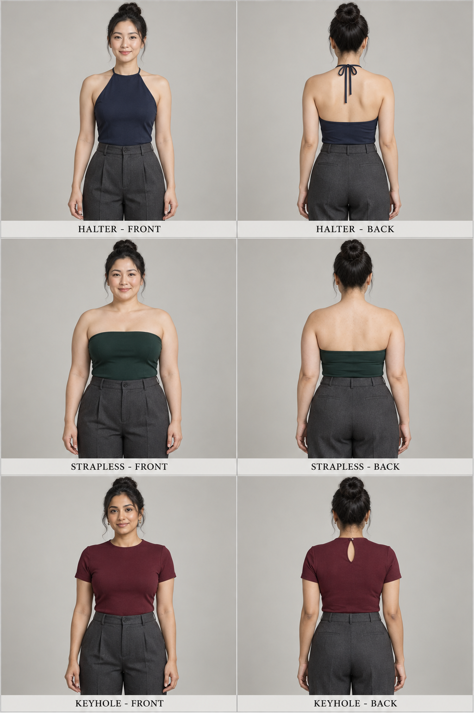
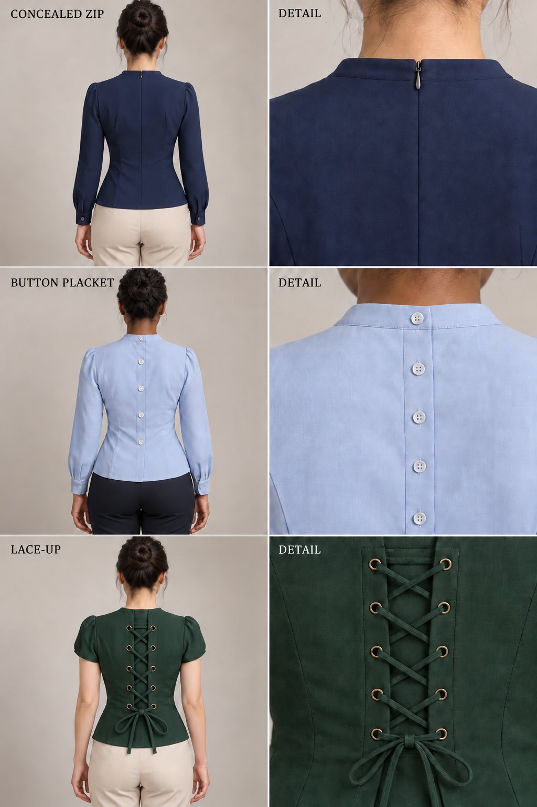

# 第 25 章｜领口、袖子与背部：上衣的连接和开合

*图 40：领口与背部处理的 AI 教学示意。上排比较正面领缘，下排比较背面处理；各格为独立设计方案，不是三套衣物的前后配对。观察开口边界、覆盖位置和带子的连接，不据图确认内部支撑。*

第 16 章介绍领口与袖型，本章进一步讨论它们怎样与肩部和后背连接。正面方领并不规定后背高度，插肩连接也不规定袖体必须宽松；开口、连接与闭合属于不同的结构关系。认识这些关系，有助于判断衣物怎样穿脱和活动。

## 正面开口：形状、宽度与深度分别说

先沿着衣物与皮肤之间的边界看一圈。方领的下缘较平、两侧形成转角；心形领口在前中形成凹口，两边是弧峰；船领则偏向横向展开，通常较浅。它们不是三个固定尺寸：方领能深能浅，船领的弧度也有变化。犹他教育网络的服装教学图将不同领口并排展示，适合先认边界，再补深浅。[教学参照：Utah Education Network，Neckline Variations](https://www.uen.org/cte/family/fashion/downloads/principles/necklines.pdf)

“宽方领、下缘停在上胸”比“法式领口”更具体。“贴近锁骨的宽船领”则交代了横向开口和纵向高度。这里的深浅应尽量依靠可见位置表达，不把某个领名直接理解为暴露程度，也不据此判断穿着者的身材或身份。

## 背面不是正面的镜像

有些上衣正面十分平整，转身后才显出低背、交叉带或多排系带。描述时先指出开口占据的位置，再说边缘和连接，不把所有露背款都写成同一个 backless。

| 可见处理 | 比较时抓住什么 | 可以怎样写 |
|---|---|---|
| 深 U 形背部开口 | 圆弧最低点与背腰的位置 | 背部为深 U 开口，下缘止于腰线上方 |
| 交叉肩带 | 带子从哪里出发、在哪里交叉 | 两条细带在肩胛之间交叉，接回后腰两侧 |
| 背部系带 | 成对孔眼、穿带范围与是否留隙 | 背部中段有多排交叉系带，底下保留不透衬片 |
| 局部镂空 | 是否被衣料完整包围 | 高背上衣在肩胛之间留一处水滴形开口 |
| 后中开合 | 拉链、纽扣或其他闭合件的位置 | 后中隐形拉链，领口顶部以小扣闭合 |

这张表是本书用于观察的拆解方法，不是互斥分类。一件衣服可以既有 U 形开口，又有跨过开口的横带；交叉带也可能只是装饰。若图像没有展示接点，就写“背部可见交叉细带”，暂不补它怎样承重或怎样穿脱。

查看商品时，正面领口只能提供部分结构信息。后背照片或实物能进一步说明覆盖高度、带子接点与闭合件；缺少这些资料时，不能自行认定背部采用低背或交叉结构。

## 三组正背对照：绕颈、无肩带与后领开孔

*图 71：AI 教学示意，按三行排列，每行左为正面、右为背面。依次比较挂脖、无肩带和后领局部开孔三种方案；同一行用于核对前后连接，各行互相独立。挂脖后下片部分受裤腰遮挡，无肩带款上缘近水平；画面只说明可见衣料与接点，不作为精确转面纸样，也不证明内部支撑。*

先找**绕到哪里**。挂脖款的前片向颈部收拢，这组背面展示绕颈带和颈后结；它不等于任意高领无袖上衣。现实中的挂脖也会配不同背部覆盖，例如 Reformation 的 Amarena 同时标注挂脖领、开放后背与系带，说明这几个条件需要分别交代。[真实案例：Reformation，Amarena Dress](https://www.thereformation.com/products/amarena-dress/1320355WHT.html)

再找**有没有越过肩顶的连接**。无肩带款的上缘围绕躯干，背片仍可以完整覆盖；“无肩带”不等于“没有背片”，也不保证里面有骨条。Reformation 的 Lennon 将无肩带、后背松紧抽褶与后拉链同时列出，是结构可以组合的例子；图 71 不据此宣称复制了它的抽褶或内工艺。[真实案例：Reformation，Lennon Top](https://www.thereformation.com/products/lennon-top/1312244.html)

最后找**开口边界**。后领的小水滴开孔只打开局部，顶端可以用扣与扣袢连接，不能把它写成整片低背。Tilly and the Buttons 的 Marnie 纸样明确使用这种后开孔与扣袢组合，可对照它的技术图理解边缘。[纸样参照：Tilly and the Buttons，Marnie](https://tillyandthebuttons.com/blogs/sewing/meet-marnie-blouse-and-dress-sewing-pattern)

水滴形后领开孔在顶端闭合后，其余后背仍可保持完整覆盖。它与深 U 形低背的开口范围不同，也不意味着衣身能从后中全部打开。理解开口的范围，才能判断它主要方便头部穿入，还是提供更大的衣身穿脱通道。

## 袖子用两层词，不挤进一个名称

一层说袖子怎样接近肩部，另一层说袖体怎样展开。常规装袖沿袖窿连接独立袖体，常见接合位置接近肩部；落肩描述连接位置向上臂方向下移；插肩则让袖部延伸到领口附近，形成斜向分界。针织服装还可能通过增减针形成这些边界，不一定都有可见缝线。Knit Picks 的自有教学文章用实际毛衣区分这些结构，因此看针织物时应写“斜向分界”或“增减针线”，不一律说成缝合线。[品牌教学参照：Knit Picks，Anatomy of a Sweater](https://blog.knitpicks.com/anatomy-of-a-sweater/)

泡泡、主教、喇叭等词主要涉及袖体的体积与末端。它们能与接合方式组合：插肩连接可以配宽松前臂与窄袖口，装袖也可以配上臂鼓起的短袖。中文“灯笼袖”使用范围较宽，应结合鼓起位置、袖长与收口辨认，不宜把它当成唯一固定轮廓。

*图 41：袖子接合与体积的 AI 教学示意。上排比较装袖、落肩与插肩的可见边界；下排比较短泡泡袖、宽松收口长袖与喇叭形袖口。下中“LANTERN SLEEVE”作为宽泛造型标签使用，具体轮廓为下半段宽松、袖口收拢；示意图不作为精确裁片依据。*

FIT 的《Statement Sleeves》展览把基础袖型与设计变奏相连：同类袖子可通过材料、形状、装饰和功能继续改变。读图时因此要同时记录“叫什么”和“这一件具体怎样”。[博物馆参照：Museum at FIT，Statement Sleeves](https://www.fitnyc.edu/museum/exhibitions/statement-sleeves/index.php)

## 开口与闭合方式不是同一件事

开口说衣服哪里敞开；闭合方式说哪些边缘怎样合在一起。衬衫前中一排纽扣，通常与门襟区域有关；后背一个水滴形开口，则可能只在顶端用小扣连接。看见一根绳结，只能确认系带外观，不能保证它是唯一穿脱通道。拉链也可能在侧缝，不一定出现在视觉上最明显的背部开口旁。

装饰性系带可能附在连续衣片表面，可开启的背中穿带则连接开口两侧。二者的穿脱方式与调节范围不同。检查时看衣片边缘是否真实分开、衬片位于哪里，以及是否另有侧缝或后中闭合件；只看一个绳结无法回答这些问题。

## 闭合件要看近一点：拉链、纽扣与穿带

**拉链**看拉头与合拢的后中边缘，不要把任何一条竖缝都认成拉链。隐形拉链合上后，链齿通常被接缝边缘遮住，可能主要看到细缝与小拉头；缺少这些线索时先写“后中接缝”。[结构参照：YKK，Concealed and Reverse Use Coil Zippers](https://ykkamericas.com/what-is-the-difference-between-concealed-and-reverse-use-coil-zippers/) Martha 纸样明确用后背隐形拉链闭合，是可查验的实际设计。[纸样参照：Tilly and the Buttons，Martha](https://tillyandthebuttons.com/blogs/sewing/meet-martha-our-new-sewing-pattern-for)

**纽扣**看排列，也看两侧布边是否形成重叠门襟。图 40 已展示一排后背纽扣，这里增加近景，帮助区分“有纽扣外观”与“边缘怎样合拢”。Mathilde 纸样将后纽扣开口列为设计特征；实物中还应检查对应扣眼，区分功能纽扣与装饰扣。[纸样参照：Tilly and the Buttons，Mathilde](https://tillyandthebuttons.com/products/mathilde-blouse-sewing-pattern)

**穿带**看两侧对应的孔眼、带子往返路线与下方覆盖。这里保留同色不透衬片，不把交叉空隙误读成裸露皮肤。Reformation 的 Cara 明确说明可调后系带，但那是该商品的资料；本图只示范可见穿带关系，不把调节能力或紧身塑形效果直接移植过来。[真实案例：Reformation，Cara Top](https://www.thereformation.com/products/cara-top/1308732.html)

颈后单个系结与腰背多排穿带的作用位置不同。前者可能参与挂脖固定，后者可能连接背中开口；下方有无衬片，又会改变覆盖方式。查看实物时，应同时检查衣片边缘、孔眼加固和穿带路线，而不只关注绳结的外观。

*图 72：AI 教学示意，三行分别比较后中隐形拉链式、纽扣门襟式与穿带式处理；左侧展示背部位置，右侧放大相应部位。近景帮助核对边缘和接点，不提供内部工艺、纤维成分或束形性能证明。*

## 前后结构共同决定穿着感受

前领口、肩部、袖窿与背部并不是彼此独立的装饰。浅心形前领可以配完整高背，也可以配较低背片；肩带的后连接点会影响其走向，袖体布量与袖窿又共同影响活动。试穿一件上衣，不能只确认正面是否合意，还应转身查看后领高度、肩带位置与闭合件是否便于操作。

手臂自然垂下时，腋下布量会折入衣身；抬臂后，上衣也可能随之上移。因此先在自然站姿下看静态合体，再坐下和抬臂检查活动，不把动作产生的一时褶皱全部当作版型错误。长发或外搭遮住的部位，可以移开后再看。

## 从不同部位辨认后背

吊带的后接点、外套后摆开衩、衬衫育克与大衣覆片，分别回应不同的结构问题。图 40 各格是独立方案，不能把上下排直接配成同一件衣服；[第 13 章](13-dresses.md)有吊带裙与运动式裙装的前后对照，[第 34 章](34-mens-outerwear.md)讨论衬衫和外套后背，[第 35 章](35-mens-tailoring.md)讨论西装后摆。

检查实物时，可以沿领口、肩部连接、后中、腰部与下摆依次观察。近看闭合件有助于理解穿脱，退后看整体则能判断衣长和覆盖；两种观察互补。需要精确制作或改衣时，还应结合纸样和实际尺寸，示意图不能代替这些信息。
