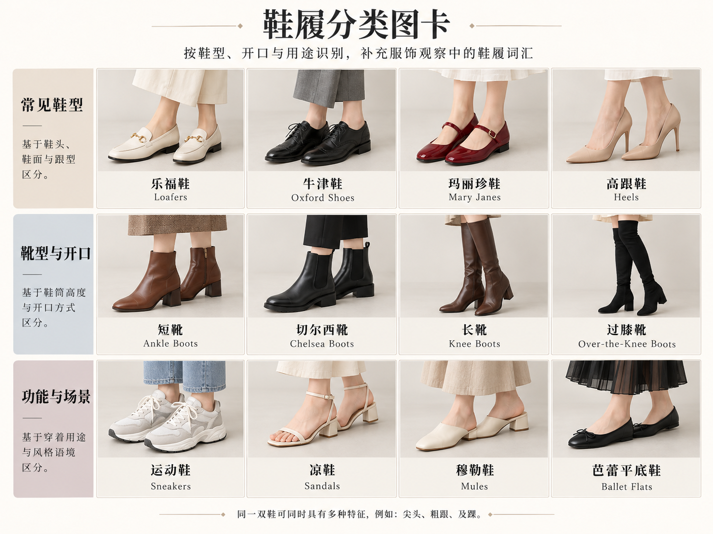
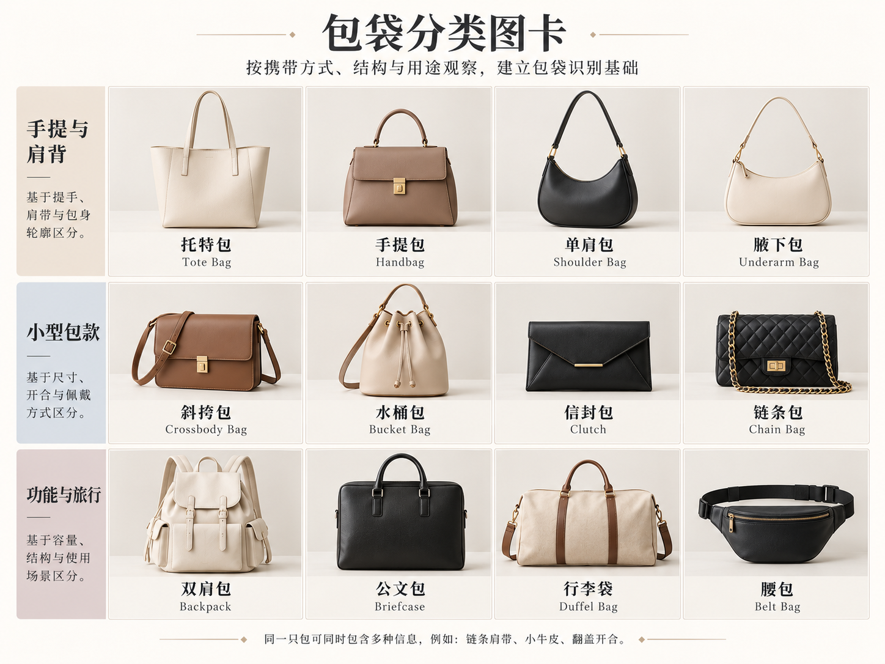

# 第 27 章｜鞋袜与包：名称之外，还要说清哪些部位

*图 43：鞋型与局部结构的 AI 教学示意。用于比较可见外观，不据此推断真实鞋履的合脚程度、支撑性能或材料成分。*

*扩展观察图卡（AI 教学示意）：观察鞋面固定、筒高和后跟覆盖。牛津鞋需核对闭合式系带，不能由黑色皮面判断；运动鞋外观不代表专项运动性能。高跟、玛丽珍、露跟等特征可组合。图中例子不是完整分类；细部判断请结合本章原图和正文。*
第 10 章讨论配饰如何参与风格，这一章把镜头拉近：同样是一双黑鞋，脚背横带、后跟露空、鞋头形状和鞋底厚度，都是辨认具体鞋型的重要线索。鞋与包的名字也不总是互斥分类；有些词说外形，有些词说结构，有些词说怎样穿戴。

## 先找固定方式，再补鞋头与鞋跟

玛丽珍鞋（Mary Jane）以跨脚背的带子为重要线索。经典款常见圆头与低跟，但现代设计会改变带数、跟高和鞋底，不能把“平底圆头”当成所有玛丽珍鞋的必要条件。[资料：CHARLES & KEITH，Mary Jane Shoes: All You Need to Know](https://www.charleskeith.com/sg/guides/mary-janes.html)

穆勒鞋（mule）的辨认重点是露出的后跟；乐福鞋式前帮也可以与这种后部结构结合。Cole Haan 的官方指南直接使用“loafer mule”，解释其保留乐福鞋的前帮而去掉后帮。因此，“穆勒”和“乐福鞋式”可以共同描述一双鞋，而不是必须二选一。[资料：Cole Haan，Women's Loafer Style Guide](https://www.colehaan.com/pages/womens-loafer-style-guide)

后空带鞋（slingback）用带子绕住后跟，与完全没有后跟带的穆勒鞋区别明显。Clarks 的 Straven Sling 又同时使用“slingback loafer”名称，展示乐福鞋式前帮与后跟带的组合。商品命名是实用参照，不能由此推出所有品牌都采用同一分类规则。[资料：Clarks，Straven Sling](https://clarks.sg/products/straven-sling-womens)

| 命名层次 | 观察位置 | 具体表达 |
|---|---|---|
| 基本鞋型或前帮语言 | 整体鞋面、脚背 | 乐福鞋式前帮、玛丽珍横带 |
| 后跟固定方式 | 足跟周围 | 包后跟、露后跟无带、后跟绕带 |
| 鞋头轮廓 | 最前端 | 圆头、杏仁头、尖头、方头 |
| 鞋跟与鞋底 | 侧面和地面之间 | 平底、低粗跟、细跟、厚底 |
| 表面与细节 | 鞋面及边缘 | 光亮漆皮感、绒面感、搭扣、横带 |

尖头、低粗跟、后空带与脚背双横带可以同时出现在一双鞋上，分别涉及鞋头、鞋跟与固定方式。鞋底厚度与鞋跟高度也要分开：厚底可以同时抬高前掌和后跟，高跟则涉及前后高度差。选鞋时应分别看前掌底厚、后跟形状与实际落差。

鞋面覆盖范围会改变鞋口形状。有的前帮覆盖到脚背较高处，有的仅包住脚趾、露出较多脚背；深浅鞋口需要结合鞋头与后部固定共同观察。浅鞋口不自动表示更合脚，实际还要看脚型、鞋楦与穿着时的稳定程度。

辨认鞋履时，正面可看鞋口与鞋头，侧面可看鞋跟、前掌底厚与后部固定，鞋底和内侧又提供另一部分信息。实物选购还应试穿并走动，查看脚趾空间、足跟贴合与鞋口是否磨擦；外观名称不能代替合脚程度。照片只展示一个方向时，鞋带、鞋耳和后跟结构不清楚，就暂不细分。

检索可以分两轮进行：先用最确定的结构词找相似鞋型，再添加颜色和表面效果。比如先搜“后跟绕带、方头、低跟”，随后才加“酒红漆皮感”。如果第一轮已被宽泛的“法式鞋”带偏，增加更多情绪词只会让方向继续漂移；回到鞋的可见部位，往往更快。

图 43 另有两种结构入口：牛津鞋（Oxford）重点看闭合式鞋襟，穿鞋带的部位连接在前帮下方；切尔西靴（Chelsea boot）则看踝部靴筒和弹力侧片。系带皮鞋未必都叫牛津鞋，棕色短靴也未必都是切尔西靴。[品牌结构指南：Charles Tyrwhitt，Shoe Design](https://www.charlestyrwhitt.com/ca/en_CA/ttip-shoe-design.html)

## 袜长、厚薄与贴合程度

“短袜”的商品边界并不统一。可以直接用人体落点区分：袜口在踝骨下、越过踝骨少许、到小腿中部或到膝下。再看贴腿还是松堆、细罗纹还是平滑表面、透明还是不透明。袜长、厚薄与松紧是不同条件，不能由一个“短”字同时确定。

英文标签也要结合品牌定义看。Injinji 将 Hidden 定位在典型跑鞋鞋口以下，No-Show 位于踝下，Mini-Crew 位于踝骨上方，Crew 到小腿中部；它的 Over the Calf 到膝下。这是一套已查证的品牌用法，并非所有袜子的统一厘米标准。[资料：Injinji，Toesock Height Options](https://www.injinji.com/height.html)

本书的表达方法是先说可见关系：“米白细罗纹袜，袜口到小腿中部，穿黑色圆头单横带平底鞋”。若裤脚遮住袜口，只能确认露出的颜色与纹理，不必猜袜长。袜子与鞋同色时，脚下边界较连续；强对比袜色会增加一条醒目的分段。这是视觉分段的观察，不是必须遵守的穿搭规则。

*图 44：包型与提带形式的 AI 教学示意。上排为托特包、翻盖书包式 satchel、新月肩包 hobo；下排为水桶包、手拿包与小型长肩带包。最后一格的 crossbody 是背法方向，实际佩戴落点仍需结合人物或尺寸资料确认。*

*扩展观察图卡（AI 教学示意）：携带方式、包体结构、开口、肩带材料分别命名。斜挎、水桶与链条包不限小尺寸；本图未提供同一比例尺，不能比较真实容量。图中例子不是完整分类；细部判断请结合本章原图和正文。*
## 包型、软硬与背法要分开说

托特包（tote）常见两条提带与较开放的容纳空间；hobo 常以柔软、弯曲或新月状轮廓识别；satchel 在本书中用作翻盖书包式的检索入口，具体提手、扣带与包身仍需说明。这里不把这些名称变成严密互斥的几何盒子：品牌会推出混合设计，托特也可以柔软，hobo 也可以较有结构。

CHARLES & KEITH 的官方 hobo 指南同时列出 hobo tote、satchel hobo 和可转换背法的款式，正好说明名称可以组合。Mulberry 的斜挎包分类也包含 satchel 与 tote 产品，提示 crossbody 主要回答“怎样跨身携带”，不足以单独确定包身轮廓。[资料：CHARLES & KEITH，Hobo Bags Guide](https://www.charleskeith.co.uk/gb/guides/hobo-bags.html)；[资料：Mulberry，Crossbody Bags](https://www.mulberry.com/sg/shop/women/bags/crossbody-bags)

图中的水桶包（bucket bag）有立体桶状包身与抽绳口；手拿包（clutch）则以不用提带、握持携带作为入口，图里是薄长方形翻盖款。并非所有水桶包都必须抽绳，也并非所有 clutch 都没有可拆肩带；描述具体包口与提带，仍比只写名称可靠。[实物检索参照：CHARLES & KEITH，Bucket & Drawstring Bags](https://www.charleskeith.com/sg/bags/bucket-bags)

包可以从轮廓、软硬、开口、提带与佩戴位置分别观察。横向长方形翻盖包可能同时保留短提手和长肩带；柔软新月包的包身则可能随装载量塌落。空包外形与实际装物后的状态都值得看，不能只凭商品名称推断支撑感。

包的大小最好有可读的参照。“大包”可能指宽，也可能指厚；实际背负时可以比较包身与躯干的相对宽度，以及包底在腰侧还是髋部，需要产品精度则直接给尺寸。也要记录包口怎样闭合：拉链、翻盖、抽绳和开放口，会改变边缘轮廓。“带金属件”太宽泛，可以继续定位为提手连接环、前翻盖锁扣或肩带调节扣。无需把每颗铆钉列完，但最影响识别的位置应当保留。

最后检查佩戴位置与携物方式。腋下、腰侧和髋部会让同一个包接触不同衣物；肩带可能压住翻领，满载后也可能改变包身与身体的距离。试背时可穿平日常用的外套，调整肩带长度，再检查取物、行走与坐下是否方便。配饰的数量不等于使用价值。

## 把常见鞋履放进同一张观察地图

鞋履还包括凉鞋、芭蕾平底鞋、浅口单鞋，以及不同筒高的靴子。名称有时描述覆盖方式，有时描述用途，不能排成一串互斥选项：一双鞋可以同时是尖头、细跟、后空带的浅口鞋；凉鞋也能采用玛丽珍式横带。

| 观察方向 | 继续识别的对象 | 与相邻名称的区别 |
|---|---|---|
| 鞋面覆盖 | 浅口鞋、芭蕾平底鞋、凉鞋 | 浅口强调开口与覆盖；芭蕾平底鞋借用特定鞋面轮廓；凉鞋通常由较开放的带状鞋面组织 |
| 后跟固定 | 包后跟、后空带、穆勒 | 前面相似的鞋，后部仍可能完全不同 |
| 靴筒高度 | 踝靴、中筒靴、长靴、过膝靴 | 用踝骨、小腿和膝盖的位置补充，不依赖各商家的同一高度界线 |
| 闭合与穿入 | 系带、搭扣、拉链、松紧片、直接套穿 | “长靴”不能替代拉链在哪一侧或靴口怎样固定 |
| 鞋底形态 | 薄底、厚底、坡跟、粗跟、细跟 | 坡跟在侧面形成连续楔形；粗细跟描述独立鞋跟的体积 |

例如图中只露出裙摆下的一段棕色靴筒，就描述“棕色长靴，靴口被裙摆遮住”，不能进一步定成过膝靴。选购膝下靴时，则进一步确认靴筒实际落点、拉链位置与跟高；同一商品高度在不同腿长上可能产生不同覆盖。

## 包的家族还要容纳双肩包、腰包与不同横纵比例

链条肩带描述提带构造，不限定包身必须小巧；斜挎描述背法，水桶描述包身入口，也都不是小尺寸的专属类别。先看包体、提带与尺度各自的信息，能避免照抄商品分组造成误解。

双肩包（backpack）主要提供两条肩带的背负入口；公文包（briefcase）指向文件携带的款式传统；腰包（belt bag／waist bag）则常与腰带式固定联系。它们仍要继续说明包身结构。一只小双肩包可以柔软抽绳，也可以挺括翻盖，不能只凭背带数量就补写它的开口。

Baguette／法棍包常作为细长、贴近腋下的包型入口；bowling bag／保龄球包常见立体包身、圆弧形上缘与短提手的组合，实际产品也会变化。品牌使用 east-west／东西向一词强调横向拉长的比例，它可以与其他包型相叠加，不能把“横向”当成一种固定背法。[实物命名与轮廓对照：CHARLES & KEITH，East-West Bags Guide](https://www.charleskeith.co.uk/gb/guides/east-west-bags.html)

比较包型时，可把包身宽、高、深与提带分开。较扁的横长包和加深的圆弧顶包，即使长度相近，容积与装物后的轮廓也不同；短提手和长肩带又改变提携方式。同一只包接上可拆长肩带后可能适合斜挎，但包身并没有因此改变形状。