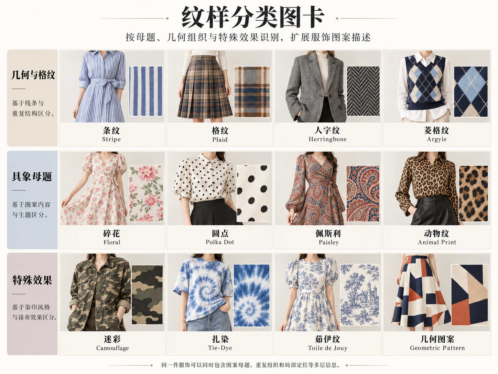

# 第 29 章｜纹样的名称、尺度与分布

*图 46：从左至右，上排为纵条纹、维希格纹、波点，下排为小碎花、佩斯利纹、千鸟格。用于比较基本形状、重复方向、尺度与留白；图中的花纹不能证明印花、织造或刺绣工艺，具体图案也不对应某一族群、品牌或历史实物。*

*扩展观察图卡（AI 教学示意）：从条纹、格纹和花卉等观察母题与重复。圆点属于几何图形；人字可由织造或图案模拟，扎染外观也可能是印花，不能由图反推工艺。图中例子不是完整分类；细部判断请结合本章原图和正文。*
第 17、26 章讲布面质感，本章把注意力放到布面上的形状。两件衣服都可以是棉质平纹，却分别出现细条纹与大花；同一种格纹也可以印在布上，或由不同颜色的纱线组织出来。先叫出纹样，再补制作资料，能避免把“看起来有花”直接写成“刺绣”。

## 先看一个重复单位，再看它怎样排列

不必一次记住全部花纹名称。先在衣服上找出一个能重复的单位：一条线、一个圆点、一组方格、一朵花，或一个弯曲的叶状形。接着看单位的大小、间距、方向和底色。相同花形排得稀疏或密集，常比换一个风格标签更能改变整体观感。

| 纹样入口 | 可见线索 | 可以继续补充的词 |
|---|---|---|
| Stripe／条纹 | 线带沿一个主要方向重复 | 横向、纵向、斜向；等宽或宽窄交替 |
| Check／格纹 | 两组线带相交成格 | 方格大小、线带宽度、交点颜色 |
| Polka dot／波点 | 圆点在底色上重复 | 点径、间距、整齐或错位排列 |
| Floral／花卉纹 | 可辨认的花、叶或枝条 | 小碎花、大朵花、枝蔓、疏密与留白 |
| Paisley／佩斯利纹 | 常见弯尖的水滴或叶状单元 | 尖端方向、内填花纹、单元尺度 |
| Geometric／几何纹 | 圆、菱形、折线等组织成图案 | 轮廓、重复节奏、色块与方向 |

这张表提供检索入口，不是互斥分类。佩斯利单元内部可以填花卉，几何格子中也能嵌入花朵。“碎花”主要帮助表达花朵较小而重复较多，并没有跨品牌统一的厘米界线。描述时加上“花形约纽扣大小、间距较宽”，往往比只写“复古碎花”有效。

## 格纹要看交叉之后留下什么

Gingham／常称维希格纹或小方格纹，典型外观由间隔均匀的两色线带交叉，形成规则方块和交叠色。MFA 的 CAMEO 从平纹织物与经纬配色解释 gingham；但仅凭照片，仍不能确定眼前这件衣服是否按这种方式织成。[材料与组织参照：MFA Boston，Gingham](https://cameo.mfa.org/wiki/Gingham)

Houndstooth／千鸟格的单位带有断裂、向外伸出的尖角，不是普通的黑白棋盘格。纺织行业机构 Première Vision 用双色纱线和斜纹组织说明传统千鸟格的形成；现代衣服也可能只借用它的外观。因此先写“黑白千鸟格外观、单位较大”，不要自动补成“羊毛呢”。[行业参照：Première Vision，Textile Glossary: Suiting Motifs](https://www.premierevision.com/articles/094df59a-75fa-ef11-90cb-00224888722c/textile-glossary-suiting-motifs)

Tartan／苏格兰格纹则要留意不同宽度的色带和重复次序。苏格兰格纹登记机构把 tartan 设计与纵横交织、重复的彩色条带联系起来。看到红绿相交不能直接认定某个家族格纹；需要具体纹样名称、线数记录或可靠商品资料。[定义与识别边界：Scottish Register of Tartans，FAQ](https://www.tartanregister.gov.uk/FAQ)

## 人字纹与连续折线，不只差在名字

Herringbone／人字纹在纺织结构中是一类交替方向的破斜纹。Chevron 常用来描述连续尖角折线，也可以指相应织物设计。CottonWorks 的织造教材将二者并列：chevron 在转向处形成尖点，herringbone 的转向存在错位与中断。商品名称可能混用，普通远景也未必能分辨这个接点。[结构说明：Cotton Incorporated，Weaving 101，第 22—23 页](https://cottonworks.com/wp-content/uploads/2023/03/Weaving-101.pdf)

图 46 未展示人字纹与 chevron；辨认转向接点时，请对照上述教材的组织示意，不能把图中的千鸟格当作人字纹例图。

需要精确表达时，把英文名与观察句放在一起：“灰色细人字纹，左右斜纹在转向处错开”“海军蓝与米白连续 V 形折线，尖点衔接”。不能看清接点时，写“细密 V 形纹理”就足够；不要借一个远景花纹去推断完整织法。

佩斯利同样需要区分名称与文化来源。它常见弯尖单元，却不等同于一个可以随意安上寓意的“神秘符号”。苏格兰国家博物馆以南亚社群叙述和披肩藏品说明 buta 等纹样与 Paisley 名称之间的关系。兴趣检索可沿这些具体资料继续，不把某一种起源故事写成全部纹样的唯一解释。[文化与实物旁读：National Museums Scotland，South Asian origins of Paisley pattern](https://www.nms.ac.uk/discover-catalogue/stories-about-the-south-asian-origins-paisley-pattern)

## 尺度、密度与位置共同形成纹样效果

同为蓝色花卉纹样，花形可以大至掌心，也可以小如指甲；底色留白与排列密度又会改变整体观感。花卉均匀满幅分布，和只沿裙摆集中出现，是不同的位置关系，不能仅凭相同花形把它们视作同一种安排。

Placement print／定位印花涉及图案在衣物上的特定安排。胸前单个图案、沿下摆环绕的纹样，都可以先从位置观察，再查资料确认工艺。领口真正镶接的蕾丝，与印出蕾丝外观的边框，也要分别看接缝、边缘和材料。

## 还要说明图案怎样经过衣服的边界

图案在成衣上会被门襟、口袋、袖口和接缝分割。门襟闭合后横条可能连续，口袋也可能使用不同方向的条纹以突出边界；不同裁片的方向与位置共同影响最终排列。是否对花对条应结合具体设计判断，不能据某一处是否连续单独判断价格或质量。

例如一件白底细海军蓝横条纹衬衫，胸袋使用斜向条纹、领子保持素面：主体与局部采用不同方向，能让口袋边界更清晰。检查实物时，还可转到侧缝和后背，看图案是否连续以及各部位怎样转换；照片没有展示的部位则保留为未知。

比较纹样尺度时，可把同类衣型的布样或衣物放在一起，先看单位大小，再看单位之间露出的底色。大波点不必然更密，小花也可能排列稀疏。混搭时若希望有主次，可先观察两种纹样各占多少面积、哪一种对比更强，而不直接用“更高级”代替这些具体差异。

资料核查：2026 年 10 月 22 日。图案外观、织物组织与文化归属需要分别核实。

## 从母题、排列和位置继续认识纹样

圆点属于几何形状，不宜与花卉、动物一道统称“具象母题”；人字纹则还可能涉及组织结构，图案轴和工艺轴仍要分开。

图中的样本只是一组比较入口。要扩展识别能力，先把三个问题分开：**画了什么**、**怎样重复**、**落在哪里**。动物斑纹回答第一个问题，错位重复回答第二个，沿裙摆集中回答第三个；同一件衣服可以同时具备三项。

| 母题或外观入口 | 先观察什么 | 需要保留的边界 |
|---|---|---|
| 动物纹 | 不规则斑块、长条斑纹、鳞片状单元及其间距 | 豹纹感、斑马纹感不证明天然皮毛或具体动物材料 |
| 迷彩外观 | 多色不规则色块相互嵌接，边缘与尺度 | 外观模仿不等于符合某种军用规格或隐蔽性能 |
| 菱格／Argyle 等 | 菱形是否连续相接，是否另叠细斜线 | 只见单个菱形时，不急于细分命名 |
| 文字与标志 | 字号、方向、重复次数和局部位置 | 不清楚的文字不补写成品牌；单个胸前标志也不是满幅纹样 |
| 场景与人物 | 是否存在可读的叙事画面、建筑或人物组合 | 单色风景不自动等于某一种历史织物或工艺 |
| 抽象笔触与色块 | 边缘清晰或晕散、走势、重叠和留白 | 晕散边缘不能直接证明染色方式 |

先用“灰绿多色迷彩外观、色块较大”记录所见，和用“带有动物斑纹与迷彩联想的细点设计”描述混合图案，都比强行给它一个单一类别可靠。行业设计观察中也会出现母题交叠，说明类别边界服务于观察，而非要求每块布只属于一格。[当代设计参照：Première Vision，Decodings SS25: Designs](https://www.premierevision.com/en/magazine/decodings-designs-ss-25/)

“锦缎”“织锦”涉及织物与制作组织，不适合直接放在“花、点、条纹”旁当作同层母题。类似地，Ikat 不宜笼统译成“扎染外观”：特定工艺名称需要工艺资料支持。仅看到边缘晕散的几何纹时，直接描述“菱形边缘呈羽化、断续状”，先不判定制作方法。图案内容和形成方式分开，既能避免错误，也能给后续查资料留下准确问题。

## 重复不只有横平竖直

规则方格排列中，图案中心沿横纵方向对齐；错位排列中，相邻行或列会偏移。镜像成对、围绕中心放射与沿边缘连续，则形成另外的组织关系。确认完整重复单位需要观察足够大的布面，小块衣片可能只保留其中一部分。

观察重复方式时，找同一行或同一列中的几个单元，检查它们是对齐、错位还是镜像；再看图案在领口、门襟、袖口与下摆如何结束。排布与位置分别记录，能帮助区分“整块布的重复规则”和“图案在成衣上的安排”。