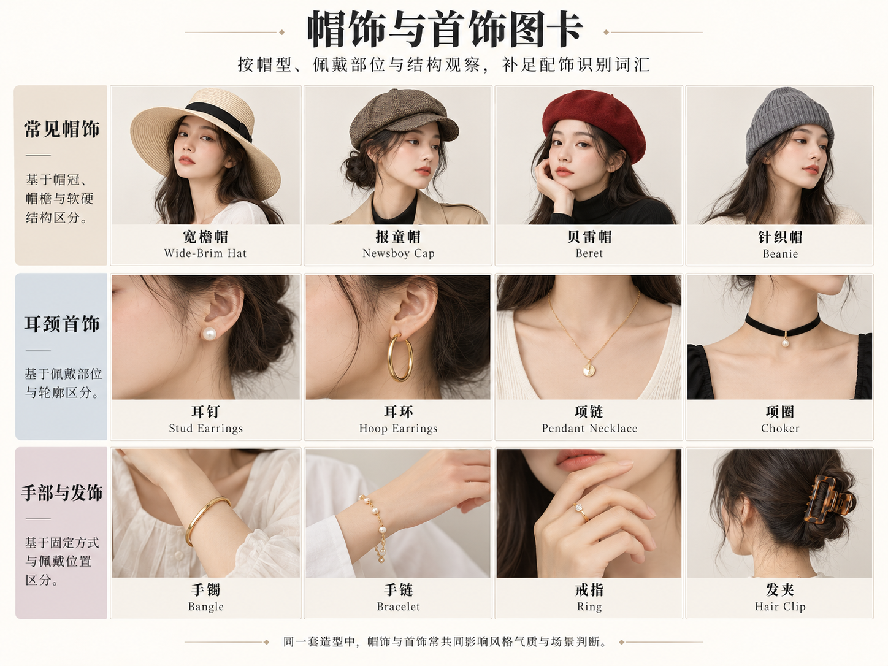

# 第 30 章｜帽饰与首饰：轮廓、位置和尺度

*图 47：帽饰的 AI 教学示意。从左至右，上排为贝雷帽、渔夫帽、费多拉帽，下排为钟形帽、棒球帽、宽檐帽。用于观察帽冠、帽檐与佩戴位置；右侧两格的帽檐接近或碰到画面边缘，不适合据此量取完整檐宽。帽型可以由不同性别、年龄和文化背景的人使用，图中人物不代表某类帽子的专属人群。*

*扩展观察图卡（AI 教学示意）：帽冠、帽檐、佩戴部位与首饰尺度的速览。珍珠状、金色等只说明外观，不证明珠宝成分；鸭舌与分片帽冠仍须结合侧面判断。图中例子不是完整分类；细部判断请结合本章原图和正文。*
第 10 章讨论配饰与风格，本章进一步观察头部与领口周围的物件。帽子在头顶与脸旁形成轮廓，项链在颈部与衣领之间形成线条；尺寸、位置、固定方式以及与衣物的关系，共同影响佩戴效果与使用感受。

## 帽冠和帽檐，分开观察

Crown／帽冠是围住头部的主体；brim／帽檐通常沿帽冠下缘向外伸出。棒球帽前方的遮檐与一顶四周有檐的帽子，轮廓组织并不相同。还可以继续说明帽冠高低、顶面圆平、是否有凹折，以及帽檐向下、平伸还是局部翻起。

| 名称 | 主要观察点 | 有用的补充描述 |
|---|---|---|
| Beret／贝雷帽 | 柔软、较扁的圆形主体，通常没有向外伸出的环形帽檐 | 米白软帽冠，轻向一侧偏戴 |
| Bucket hat／渔夫帽 | 帽冠与向下斜出的环形帽檐相接 | 深蓝短檐，边缘自然下垂 |
| Fedora／费多拉帽 | 帽冠常有凹折与前部捏褶，四周有檐 | 棕色帽冠中部凹折，配窄帽带 |
| Cloche／钟形帽 | 较贴头的钟状轮廓，檐部常向下包拢 | 深灰低戴，短檐靠近眉上 |
| Baseball cap／棒球帽 | 贴头帽冠，主要遮檐位于前方 | 无标识、弯檐，后部调节带可见 |
| Wide-brim hat／宽檐帽 | 强调帽檐较宽，而非一种唯一帽冠 | 平顶或圆顶另说，帽檐较平或柔软下垂 |

Lock & Co. 的官方说明以软帽檐、凹折帽冠和前部捏褶解释 fedora；同一类别内也有不同檐宽。因此“宽檐”和“费多拉”可以同时成立，不是非此即彼。[帽型参照：Lock & Co.，What is a Fedora Hat?](https://www.lockhatters.com/blogs/news/what-is-a-fedora-hat)

贝雷帽可参考品牌的软毡款；钟形帽与渔夫帽则重点比较贴头的圆拱轮廓、下包程度，以及帽檐与帽冠的分界。品牌分类能帮助检索具体款式，不必照搬其“某种脸型必须配某种帽子”的搭配判断。[真实产品参照：Lock & Co.，French Beret](https://www.lockhatters.com/collections/best-selling-hats/products/women-wool-french-beret-hat)；[帽形比较：Eric Javits，Hat Shapes Guide](https://ericjavits.com/blogs/news/hat-shapes-guide-fedora-cloche-bucket-boater)

## 佩戴位置不是帽型名称的一部分

同一顶软帽，深戴、后移和偏戴会露出不同面积的额头，也改变帽冠与头发的相对位置。试戴时先确认帽围与固定是否合适，再看前缘是否挡住视线、转头时是否容易移位。佩戴角度不是帽型本身；一顶贝雷帽偏向一侧，仍不因此变成另一类帽子。

帽形与衣领还会共同影响头颈周围的空间。短檐渔夫帽与高领外套并用时，可检查转头是否碰到领口；宽檐帽则要留意檐缘与肩部、眼镜的关系。喜欢某种帽形后，仍应实际试戴，而不是只凭“文艺”“复古”等搭配印象选择。

*图 48：首饰与佩戴部位的 AI 教学示意。从左至右，上排为耳钉、圈式耳环、垂坠耳饰，下排为贴颈项链、长项链配吊坠、胸针。长项链一格取景更远，用于展示悬垂落点，不宜直接据各格大小比较首饰实物尺寸。金属色泽、珠状外观和透明亮点不能用来鉴定贵金属或宝石。*

## 耳饰：贴在哪里，向哪里延伸

Stud／耳钉通常在耳垂附近呈现较紧凑的装饰；hoop／圈式耳环以环形轮廓为主要线索；drop 或 dangle／垂坠耳饰则把装饰向耳垂下方延伸。商品中这些轴可以叠加，例如圈上接一枚垂坠物。Tiffany 官方耳饰分类与产品名称同时使用 stud、hoop 和 drop，适合对照不同轮廓。[真实产品分类：Tiffany & Co.，Earrings](https://www.tiffany.com/jewelry/earrings/)

耳饰的大小需要结合形状理解。细圈耳环主要沿环状边缘形成线条，紧贴耳垂的圆形耳钉集中在较小区域，细长垂坠耳饰则向下颌附近延伸。相近长度的耳饰仍可能因宽度、重量与连接方式不同，产生不同佩戴感受。

## 项链：名称之外，补上落点

Choker／贴颈项链强调靠近颈部的佩戴关系；long necklace／长项链则仍需说明末端到哪里。Pendant／吊坠描述悬挂的主体，不能单独决定链长。GIA 的首饰教学把不同长度和构造的项链并列展示，说明项链远不止“细链”与“珍珠串”两种。[首饰教学参照：GIA GemKids，Necklaces](https://gemkids.gia.edu/jewelry/necklaces)

单层细链可以落在锁骨附近，长链则可能在胸前形成较深的 U 形；吊坠的位置由链长、佩戴者颈肩与衣领共同影响。相同链长不保证在每个人身上落到同一位置，选购时既看厘米尺寸，也应实际检查与衣领是否互相遮挡。

## 胸针与整套配饰的重心

Brooch／胸针把装饰固定在衣物表面，常见于领片或胸前；位置、方向和尺度会改变与衣领的关系。金匠中心的专题也提醒，胸针兼有服装扣合的历史与装饰潜力，不能一概视为领口上多出的一朵花。[专题旁读：The Goldsmiths’ Centre，The Brooch: A Versatile Jewel](https://www.goldsmiths-centre.org/learn-and-upskill/resources/knowledge-brooch-versatile-jewel-rachel-church/)

配饰的主次可以通过面积、对比和位置形成。米白无领夹克左上胸的一枚叶形胸针，可能已成为上半身的醒目细节；小耳钉会留下更多领口空间，圈式耳环与圆片吊坠则能形成重复节奏。这些都是可选择的组合关系，不是必须遵守的穿搭禁令。

## 看正面轮廓，也为固定方式留出余地

耳钉外观不等于已经确认耳针结构，贴耳的圆片也可能采用耳夹；一张正面人像通常看不见背面的耳堵。辨认外观时，可以先区分贴耳还是垂坠。若需要制作或佩戴参考，则应另查扣合位置和产品说明，不把前视图当作完整结构图。

围巾、眼镜与头发也占据同一个局部空间。帽檐可能碰到镜框，垂坠耳饰可能被围巾遮住或勾挂；戴齐后转头、低头，能更实际地检查它们是否互相干扰。首饰的大小与位置不仅改变观感，也关系到日常动作和穿脱方便程度。

整理配饰时，可以分别记录形状、尺度、位置与固定方式，再补已知材料。小耳钉与长垂坠耳饰、短檐帽与宽檐帽，各自有不同的覆盖和活动关系；了解这些差异，比仅以“漂亮”“复古”概括更便于实际选择。

## 帽饰继续沿帽冠、帽檐和支撑感展开

图中的帽子以便于比较的外观为主，不能涵盖全部帽饰。把下列名称放回结构坐标，比再记一张定长清单有用：

| 检索入口 | 观察重点 | 容易混淆之处 |
|---|---|---|
| Boater／平顶硬草帽 | 平顶帽冠、较平的环形帽檐与挺括轮廓 | 草编说明材料外观，不能使所有草帽都成为 boater |
| Flat cap／扁帽 | 较扁的帽身、前方短遮檐与前倾轮廓 | 与棒球帽都有前檐，但帽冠组织不同 |
| Newsboy／报童帽 | 分片帽冠、较蓬的顶部与短前檐的常见组合 | 不只按“有鸭舌”判断；商品命名仍须核具体款 |
| Beanie／针织无檐帽 | 帽身贴头或在顶部留余量，帽口可翻折 | 帽口翻边不是向外遮阳的帽檐 |
| Visor／空顶遮阳帽 | 前方遮檐与环头固定部分，顶部开放 | 不等于把棒球帽戴得浅 |
| Pillbox／药盒帽 | 小型无檐轮廓、较直的侧壁与平顶 | 与软贝雷帽的塌落方式不同 |

上述是常用检索入口，不是文化服饰的全集。Lock & Co. 的款式指南同时列出多种帽型，其 FAQ 对 pillbox 的无檐、平冠特征作了说明；具体尺寸、材料和佩戴位置仍应看产品或实物。[帽型对照：Lock & Co.，Hat Styling](https://www.lockhatters.com/pages/hat-styling)；[定义参照：Lock & Co.，FAQs](https://www.lockhatters.com/pages/faqs)

草编外观的帽子可以有柔软下垂的宽檐，也可以采用平顶、较硬的平直环檐。材料相近不表示帽型相同；帽冠与帽檐仍需分别观察。裹头巾、发带和硬质帽饰又采用不同的组织与固定方式，不能全部套用帽冠与帽檐的二分。

## 手腕、手指与头发也有独立的配饰空间

首饰的范围包括手链、手镯、戒指与发饰。手链可由链节或串珠连接，手镯常呈较稳定的环状或开口弧形；具体是否有铰链、开口和扣件，仍要看局部。戒指要描述戴在哪只手、哪根手指、宽窄及装饰朝向，不能把单颗亮点当成已经鉴定的宝石。发夹、发簪和发梳需要交代它与头发的固定关系，不能只写“头上有装饰”。

同样的“耳部金属饰物”也可能贴耳、绕耳或垂坠。正面只看到一条沿耳缘的弧线时，先记录位置；耳夹、耳针、耳骨夹等连接判断应留给侧面、背面或实物说明。领带夹与领针则属于不同局部：前者关联领带与衬衫前部，后者通常关联领片，不能因为都很细就互换名称。

手腕、手指、耳部与头发分属不同的配饰位置。窄幅手镯、细戒、小耳钉与长发夹可以同时出现，但各自的松紧、开口和固定方式仍要单独检查。选择重点配饰时，可比较它们的面积、对比与彼此距离，而不是只按数量判断丰富程度。