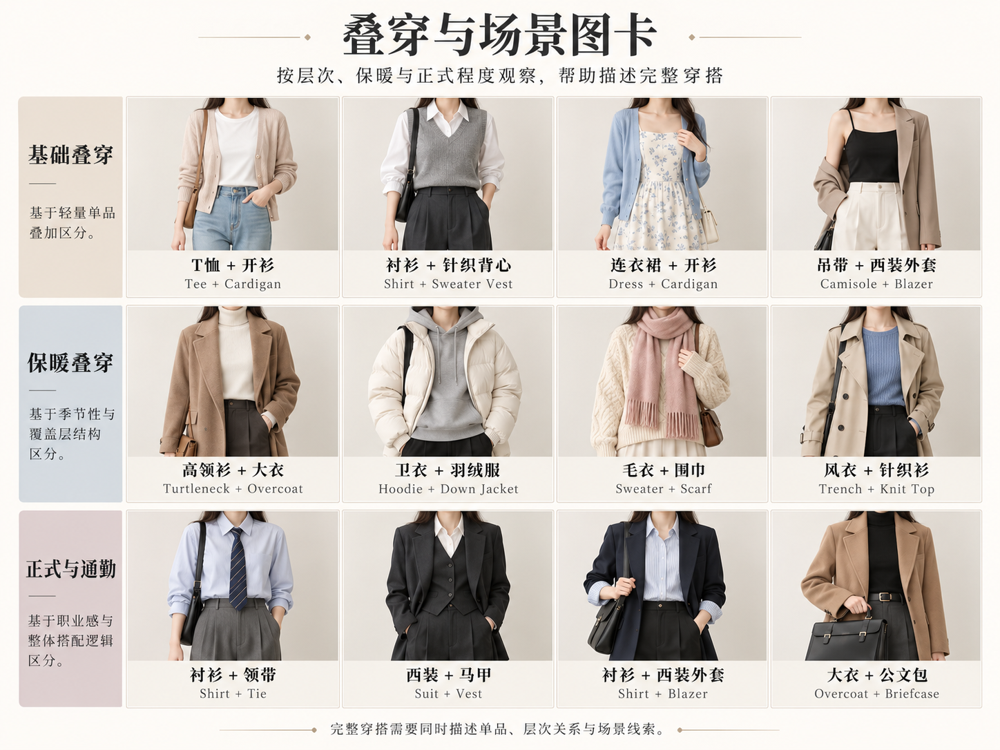

# 第 31 章｜季节与场景：让一套衣服适应实际活动

*图 49：白色 T 恤与深蓝裤装外增加不同衣层的 AI 教学示意。各格展示不同外搭，并非从左上到右下逐件累加；观察内外顺序、衣长与开合。图中 shell、insulated 等标签提示造型主题，不证明衣物具有特定保暖、防水或透湿性能。*

*扩展观察图卡（AI 教学示意）：十二套叠穿示例展示内外层关系和场景线索，不是十二种固定搭配法。保暖和正式程度还取决于材料、活动、天气与具体着装要求。图中例子不是完整分类；细部判断请结合本章原图和正文。*
场景会影响实际穿着需求。一个人从地铁走到办公室，需要考虑外套脱下后还剩下什么；逛街与舞台表演的动作幅度不同；室内晚宴与露天傍晚也不能只用“正式一点”概括。先确认活动、环境和着装要求，再考虑衣物组合。

## 先分清功能层，再写清可见层

户外装备常用基础层（base layer）、中间层（mid layer）与外层（outer layer／shell layer）说明功能分工：贴肤层处理汗液，中间层帮助保温，外层应对风雨。REI 还提醒读者，活动强度、个人冷热感受与天气都影响组合，三层不必始终同时穿在身上。[资料：REI，Layering Basics](https://www.rei.com/learn/expert-advice/layering-basics.html)

这套功能分类和时尚照片中的“内搭／中层／外搭”有联系，却不能完全互换。敞开的西装可能是当前组合的最外层，但不因此成为防雨壳衣；衬衫可以贴肤，也可以作为罩在背心外面的轻外搭。同一件衣物处在哪一层，需要看当前组合。选衣时，既要检查穿着顺序与活动空间，也要查资料确认相应功能。

| 衣层 | 可见的穿着关系 | 需要额外资料的判断 |
|---|---|---|
| 贴身衣物 | 圆领上衣从衬衫领口露出；袖口贴近手腕 | 纤维成分、吸湿与干燥表现 |
| 中间衣物 | V 领开衫包在衬衫外；衣身有余量 | 实际保温能力、填充材料 |
| 最外衣物 | 连帽外套敞穿；下摆盖过中层 | 防水等级、耐磨与透湿指标 |

叠穿先要容纳彼此。衬衫、针织和外套的领口、袖口与下摆会互相覆盖；如果中层太厚，外套肩袖可能紧绷，如果中层比外层长，下摆会露出。外观层次只是其中一面，扣合、抬臂与脱穿是否顺畅同样需要检查，层数也不必越多越好。

## 季节信息要落在具体变化上

“春装”“冬装”本身不能决定衣物。不同城市的温湿度、室内空调和出行方式差别很大。可从当天的室内外转换出发，考虑外套是否方便脱穿、脱下后如何携带、颈部和四肢覆盖是否合适；同一季节也可能需要不同组合。

同一套米白上衣与藏蓝直筒裤，在温暖室内可以只露出基础层；转到凉爽室外，可增加敞穿针织开衫；再加外套时，要给肩袖和身体留出叠放空间。外层若比中层更短，中层下摆会露出；若外层很长，腰部比例则可能被覆盖。这些关系都能通过图像观察。实际旅行或户外活动的装备选择仍需查看当地条件、产品资料与相应活动指南。

*图 50：以深灰上衣与深蓝裤装为基础的场景衣橱 AI 教学示意。展示外搭、鞋包和配饰的组合。场景标签不证明衣物性能或符合某一场所的着装要求。*

## 场景给约束，不替人物作身份判断

| 场景 | 先确认什么 | 相关穿着需求 |
|---|---|---|
| 通勤与办公 | 工作场所要求、交通方式、室内外转换 | 外套如何脱穿、鞋履与行走、包的背法 |
| 日常出行 | 走路、久坐、携物与天气 | 裤脚或裙摆落点、可活动余量、外搭位置 |
| 宴会或较正式聚会 | 邀请函原文、时间、场地与主办方说明 | 衣型、面料表面、鞋包和首饰的尺度 |
| 户外活动 | 活动强度、环境与装备要求 | 穿着层序及可验证的功能信息 |
| 舞台或角色演出 | 动作、灯光、收音和服装切换 | 下摆与袖体积、固定方式、道具位置 |

场景名并不等于统一着装标准。Saffron Hall 在观众指南中明确表示不设着装要求，日常装与较整洁的休闲装都可出现。这是一个具体场所的例子，不能据此推断其他音乐厅、场次或典礼的要求。[资料：Saffron Hall，New to concerts?](https://www.saffronhall.com/visit-us/new-to-concerts)

收到 smart casual、business casual 或“半正式”等说法时，保留邀请方的原词，再确认是否有示例、限制或主题。Black tie 也不能理解成“黑色西装加领带”：在常见西式晚间礼服语境中，tuxedo／dinner suit 与普通商务西装存在礼服结构和搭配上的区别；Suitsupply 的指南分别讨论传统 black tie、creative black tie 和 black-tie optional。阅读这类品牌指南时，应将品牌的造型建议与活动方的实际要求分开。[资料：Suitsupply，Black-Tie Attire Decoded](https://suitsupply.com/en-us/journal/blacktie-attire-decoded.html)

## 把动作也写进穿着

站立与实际活动会改变衣服的位置。坐下时看长外套与裙摆怎样落在座位周围，抬手时看袖口和衣摆是否上移，背包时看肩带是否压住衣领。宽袖、长下摆与挂饰可能增加活动中的干涉，试穿不应只停留在镜前站立。

舞台与展演还需区分衣服本体、道具和设备。长披风、挂饰、剑鞘或麦克风各有固定位置，可能影响动作、收音与换装。真实表演中应由相应团队检查固定、活动范围与换装流程，示意外观不能代替试穿排练。

## 用一套基础穿着应对不同活动

以米白圆领上衣和藏蓝直筒裤为例，通勤时可以增加可脱的夹克与便于携物的包，到了温暖室内脱下外套；凉爽天气的城市散步，可以根据天气增加开衫或外层；没有指定礼服要求的聚会，则可按个人偏好与场所条件调整鞋包和配饰。基础衣物不必每次全部更换。

这类调整仍有边界：普通外套加上帽子不自动成为专业防雨装备，日常组合增加首饰也不自动符合 black tie。具体功能看产品与活动要求，正式着装看邀请方的说明。实际需要比场景标签更具体。

## 场景不能装进固定数量的造型格

图卡的每一格是一个组合示例，不是从轻到重的统一等级，也不是一套通用于所有人的四季方案。工作、旅行、日常照护、骑行、演出与居家等活动，都可能同时包含室内外转换、不同携物量与坐站动作。同一个“通勤”标签，步行十分钟和长时间骑车需要提出的问题就不同。

实际需要可沿环境转换、动作、携物与衣层逐项检查。以城市短途出行为例：

| 条件改变 | 先检查的衣物关系 | 实际安排 |
|---|---|---|
| 从室外进入温暖室内 | 外层脱下后，内层是否完整，外套放哪里 | 外套脱下搭在手臂上，包带不与外套缠在一起 |
| 从站立改为久坐 | 腰头、裙摆、裤脚与椅子的关系 | 长外套前襟打开，衣摆自然落在座位两侧 |
| 增加随身物品 | 背法、包体积与手的占用 | 小手拿包改为有长肩带的包，包身位于髋侧 |
| 需要清楚展示手部 | 袖口、手套、饰物与动作 | 袖口停在腕部，长挂饰避开正在操作的位置 |

这张表帮助检查穿着关系，不能代替性能测试。运动与专业作业还需核对实际装备要求；日常穿着也应把衣物层序、动作与携物方式一起考虑。
