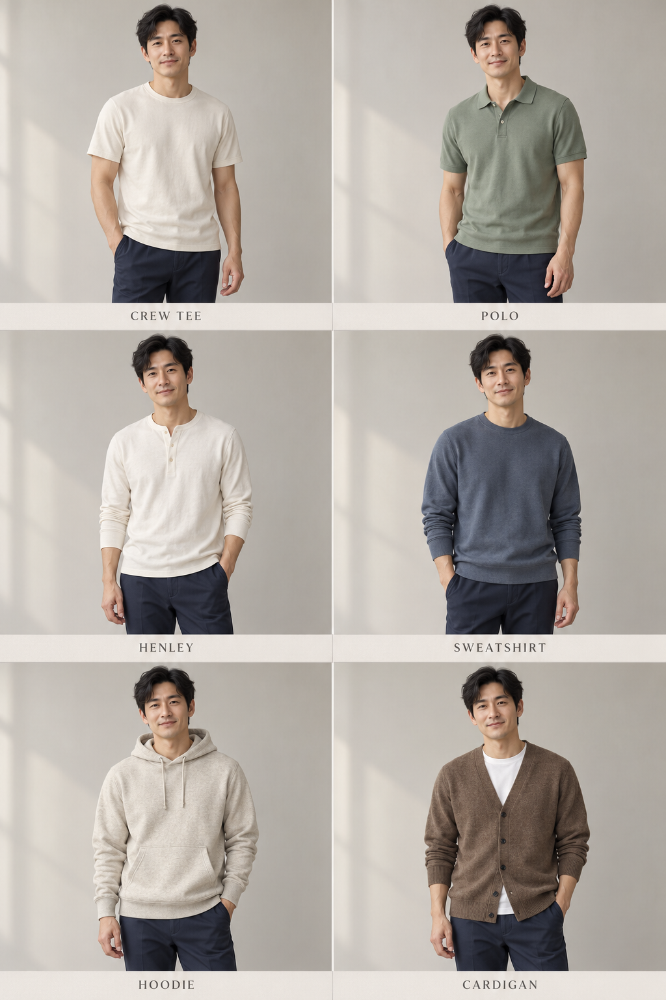
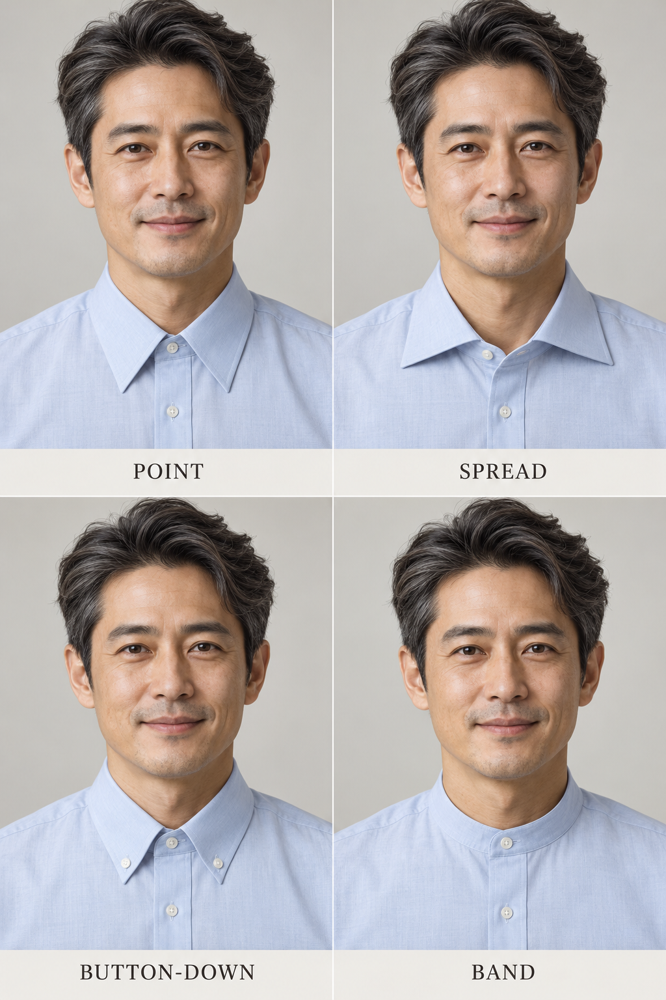

# 第 32 章｜男式上装：从领口、开合与下摆认名字

*图 51｜AI 教学示意：上排为圆领 T 恤、Polo 衫，中排为亨利领上衣、圆领卫衣，下排为连帽卫衣、V 领针织开衫。注意领口、门襟与帽子的区别。*

*扩展图卡｜AI 教学示意：常见男式上装的开襟、领型与衣层关系。牛津布和法兰绒是面料名称，不能与领型或格纹直接等同。*
男式上装中的 T 恤、衬衫、卫衣与针织衫，既有衣物家族的区别，也有领型、开合和材料的交叉。一件上装的领口形状与前身开口，通常是辨认衣型的起点；肩袖、衣长与松量则决定穿着时的轮廓。这些结构术语也适用于其他性别穿着的相同衣物。

## 短门襟旁边有没有翻领

T-shirt／T 恤通常是套头针织上衣，圆领、V 领、长短袖都是进一步变化。同为白色 T 恤，窄罗纹圆领与较宽圆领、自然肩与落肩、齐腰与盖臀的衣长，都会形成不同轮廓。这里说的“针织”是组织方式，不等于粗线毛衣。

Polo shirt／Polo 衫的常见识别组合是翻领与前胸短门襟。它可以长袖，也可以采用细针织、网眼感或较平滑的布面。“Polo”不能直接替代“珠地棉”：Charles Tyrwhitt 的官方目录同时列出珠地 Polo 与针织 Polo，说明衣型和材料组织应分别描述。[真实商品分类参照：Charles Tyrwhitt，Polo Shirts](https://www.charlestyrwhitt.com/us/mens-shirts/polo-shirts/)

Henley／亨利领上衣也有前胸短门襟，但没有 Polo 那样的翻领。L.L.Bean 的说明将无翻领领口与短扣门襟作为识别线索。描述“米白长袖亨利领上衣，圆形领缘下接三颗扣的短门襟”，比“有扣子的 T 恤”更清楚。扣子数量与袖长还会变化，不必把三颗扣当成所有款式的硬条件。[衣型参照：L.L.Bean，Henley Tops](https://www.llbean.com/buy/henley-tops)

## 卫衣、毛衣和开衫，分别在说什么

| 名称 | 先找的外观线索 | 还需要补充 |
|---|---|---|
| Sweatshirt／卫衣 | 常见套头、罗纹领口或袖口与下摆 | 是否有帽、衣身长短、落肩程度 |
| Hoodie／连帽上衣 | 带帽，可套头或有拉链 | 开合方式、帽绳、袋鼠袋或分体口袋 |
| Pullover sweater／套头针织衫 | 从头套入的针织衣身 | 圆领、V 领、高领；针目粗细 |
| Cardigan／针织开衫 | 前身可打开，常用扣或拉链 | V 形或圆形领缘、衣长与口袋 |

中文“卫衣”与英文 hoodie 并非一对一：连帽卫衣是常见交集，hoodie 的命名重点在帽子，sweatshirt 则不一定有帽。UNIQLO 的男装分类将 sweatshirt 与 pullover hoodie 分列，可以用真实商品图检验这个区别。[商品旁读：UNIQLO Singapore，Men’s Sweatshirts & Hoodies](https://www.uniqlo.com/sg/en/men/tops/sweatshirts-and-hoodies)

看远景时，薄针织衫与长袖 T 恤可能很像。若针目与商品资料均不清楚，先写“贴近身体的深蓝圆领长袖上衣，袖口较窄”，保留判断空间。也不要因为布面看起来厚，就替它补上抓绒内里；内里是否起绒需要另一面的照片或说明。

## 衬衫要把布料与领型分开叫

*图 52：从左至右，上排为尖领、展开领，下排为领尖扣领、立领。展开领示例的最上方扣位敞开，比较时应同时留意领尖方向与扣合状态。AI 教学示意；领角的具体数值随款式而异。*

Point collar／尖领的领尖较向下；spread collar／展开领的两尖张开较多。Cutaway／大开角领或温莎领是展开程度更大的常见商品称呼，各品牌的边界并不完全相同。Button-down collar／领尖扣领则强调两枚小扣把领尖固定到衣身。它不是“前面一路有扣”的意思：一件普通尖领衬衫可以有全开门襟，却没有领尖扣。[领型定义与照片：Charles Tyrwhitt，Formal Shirt Collars](https://www.charlestyrwhitt.com/us/ttip-formal-shirt-collar.html)

Band collar／立领只保留围住颈部的一圈领座，没有向外翻下的领片。它和 Henley 的无翻领短门襟仍有区别：立领衬衫可以从领口一直开到下摆，Henley 常见的开口只在前胸。描述时把“领子”和“开口长度”一起交代，别用一个名称代替两项结构。

Oxford／牛津纺首先指布料组织。Charles Tyrwhitt 将 Oxford 解释为篮纹感的交织结构；OCBD 是 Oxford cloth button-down 的缩写，将“牛津纺布料”与“领尖扣”组合起来。牛津纺也能做其他领型，领尖扣衬衫也能用其他布料。“牛津领”在不同商品语境中可能含混，将布料与领型分别称为“牛津纺”和“领尖扣”，可以避免把两者误认成同一结构。[织法参照：Charles Tyrwhitt，Weaves & Weights](https://charlestyrwhitt.dixa.help/en/article/9194f5)

牛津布与法兰绒等布料名称也不靠领型或格纹确认：领尖扣衬衫可以使用不同布料，格纹衬衫也不一定是法兰绒。若图卡以这些商品词标注示例，应把它当作造型入口，再回到商品说明核材料；不要从格子与短绒感就替图像做成分鉴定。

## 袖子和口袋，把相似上装继续分开

领口相同，袖子仍可能明显不同。先看肩缝是在肩点附近，还是下落到上臂，再看袖管是贴近手臂还是保留一圈空间。插肩袖的接缝从领口附近斜向腋下，与常见装袖的肩部接缝路线不同。它可以出现在 T 恤、卫衣或针织衫上，因此“插肩”与“卫衣”也能组合使用。图 51 没有系统展示所有袖型，补充辨认可回到[第 16 章](16-necklines-sleeves.md)。

口袋同样要指定位置。连帽上衣前方横跨腹部的一只大袋，常称袋鼠袋；拉链开衫则可能分成左右两只口袋。T 恤或 Polo 的胸前贴袋是一处局部结构，不会自动把衣物变成衬衫。袋口的方向、是否有袋盖以及口袋的位置，都是区分相似衣型的线索。

实际试穿时，可以把两件衣长不同的上装搭配同一条裤子，比较下摆与腰头、口袋的交界位置；再观察自然肩与落肩款的肩袖轮廓。衣长、肩线与松量是不同因素，不能把整套穿着的差异都归结为某一个名称。

## 下摆与穿法改变衣层关系

衬衫下摆可以较平，也可以呈前后圆弧并在侧面抬起；一件长弧形下摆衬衫敞穿时，会形成不同于齐腰短夹克的轮廓。不要把“衬衫”默认理解成塞进裤腰，也不要把所有外穿衬衫称为衬衫夹克。Overshirt／衬衫式外套强调外层用途，具体厚度、衬里和余量仍需描述。

浅蓝领尖扣衬衫搭配深灰直筒裤时，下摆塞入腰头会清楚露出裤腰；圆弧下摆自然外露，则会覆盖一部分裤袋与腰臀。亨利领上衣的短门襟只打开前胸，不具有衬衫全开襟的相同穿法。衣物之间的关系，应从实际衣长与开口出发理解。

图案与衣型也应分开认识：同样的圆领 T 恤可以有素色、细横条或大图案；条距和图案尺度改变表面节奏，却不会使它变成另一种领型。

继续阅读：[第 33 章的裤装分类](33-mens-trousers.md)，或到[第 36 章](36-mens-fit.md)观察肩线与衣长。

## 把上装名称放回开合、领型与衣层坐标

上装可以沿几条相互交叉的方向认识：套头、短门襟与全开襟说明穿入方式；圆领、V 领、高领与翻领说明颈部轮廓；T 恤、衬衫、针织衫、卫衣等名称又关联衣物家族。比如“有拉链”不能独自决定它是卫衣、针织开衫还是薄夹克。

| 常见补充 | 主要辨认问题 | 描述示例 |
|---|---|---|
| 高领与半高领针织衫 | 领部覆盖到哪里，是否翻折 | 深灰细针织上衣，领部贴颈并向下翻折 |
| 针织背心 | 无袖、针目和领缘怎样组织 | 米白 V 领针织背心，前身不开襟，罩在衬衫外 |
| 无袖内搭或背心 | 肩带宽度、袖窿与衣身覆盖 | 黑色宽肩带圆领背心，腋下开口较深 |
| 半拉链上衣 | 拉链从领口向下延伸多远 | 深蓝立领上衣，前胸短拉链，前身其余部分连通 |
| 短袖翻领衬衫 | 是否全开襟，领片如何展开 | 浅色短袖翻领衬衫，前中纽扣，下摆平直 |
| 衬衫式外层 | 衬衫结构怎样容纳里面一件衣物 | 橄榄色衬衫式外套敞穿，内搭白 T 恤，胸前双贴袋 |

背心尤其需要补词：针织背心、贴身无袖内搭与带前扣的西装马甲，并不是同一件东西。英文 vest 在不同地区与商品体系中也可能指向不同衣物；检索时配上 knit、suit 或 sleeveless 等具体描述，比单独使用 vest 更稳定。

“工作衬衫”也不等于已经确认防护用途。图中的多贴袋与较宽衣身能支持外观描述，工作场景适用性仍需产品资料。短袖、长袖、落肩和宽松则可以跨越多个家族组合，不能让一个领型名称替代完整衣身。

无袖 V 领针织背心罩在长袖衬衫外，衬衫领与袖子会成为外露部分；背心的袖窿大小、V 领深度和衣长决定内层露出多少。男女商品类别可以共享这些结构术语，具体版型、尺码与比例仍应分别核对。
