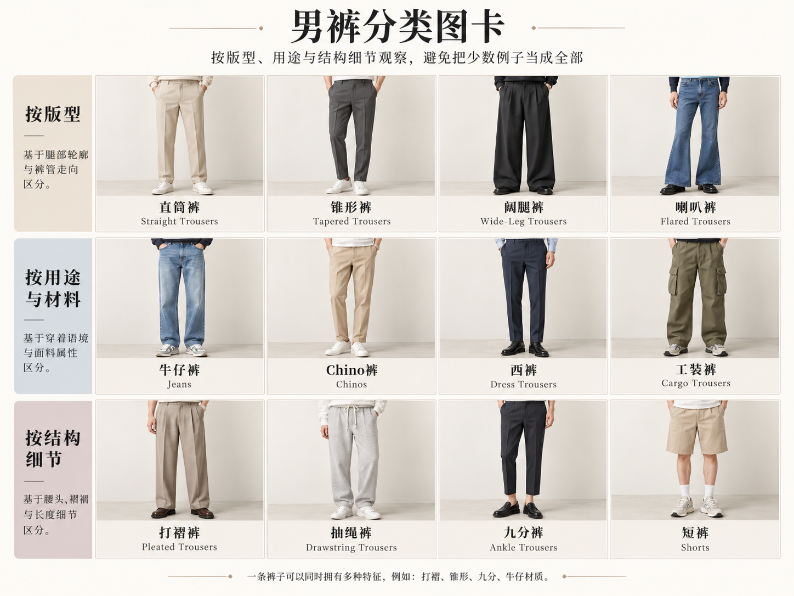

# 第 33 章｜男式裤装：裤类、裤型和细节要分开说

*图 53｜AI 教学示意：上排为剪裁长裤、奇诺裤，下排为工装袋裤、束口休闲裤。比较口袋、腰部与裤脚构成。*

*扩展图卡｜AI 教学示意：裤型、裤类、腰头与长度是不同维度。阔腿可以同时采用直筒轮廓；“九分”与及踝位置须结合穿着者的身高和裤长。*
“宽松裤”“西裤”“卡其裤”听起来像同一层级的选项，其实各自在回答不同问题：宽松说余量，西裤说衣型与使用传统，卡其又可能只是颜色。认识裤装时，应把裤类、轮廓、腰部与裤脚分别考察，而不是把它们当成互相排斥的选项。

## 同是长裤，先确定衣物家族

Tailored trousers／剪裁长裤或日常所说的西裤，常让人注意到明确腰头、门襟和较整洁的垂坠线条；它可以有褶，也可以平前片，可以窄也可以宽。前中烫出一条裤线，并不能单独证明它属于一套西装，更不能证明羊毛成分。若外套与裤子并非配套设计，写“藏蓝西装外套搭灰色剪裁长裤”比“一套西装”准确。

Chinos／奇诺裤常见棉斜纹外观、斜插袋与较简洁裤身，但并不限定为米黄色、修身或九分。UNIQLO 的官方商品同时出现直筒宽松与修身 chino，能直观看到同一裤类具有不同轮廓。中文“卡其裤”可作为检索俗称，正式描述再交代颜色及衣型。[真实对照：UNIQLO，Straight Chino Pants](https://www.uniqlo.com/in/en/products/E479424-000/00)；[Slim Chino Pants](https://www.uniqlo.com/au/en/products/E487209-000/00)

Jeans／牛仔裤的常见识别线索包括丹宁布面、明显车线、五袋式口袋布局与部分款式的铆钉。不过深色牛仔布在远景中可能接近普通长裤，也有省略铆钉或改动口袋的设计。Cargo trousers／工装袋裤则突出腿侧附加口袋；没有腿袋的工作裤仍可能属于工装衣物，而口袋多也不保证耐磨性能或适合实际作业。[工装实物旁读：Dickies，874 Work Pants Family](https://www.dickies.com/en-us/pages/874-family)

Joggers／束口休闲裤通常让人先注意到弹性腰和收拢裤脚；sweatpants／运动卫裤偏向布料与休闲运动用途，两词有交集。宽直裤脚的卫裤并不会因为没有束口就失去卫裤身份；梭织工装裤也可能接束口。开放式裤脚与松紧束口是两种不同的收边构成，不能仅凭“运动裤”这一用途名称判断。

## 轮廓有两条轴：空间多少，向下怎样变化

*图 54：从左至右，上排为修身、直筒，下排为宽松直筒、阔腿。牛仔裤裤型的 AI 外观比较中，后两格差异较含蓄，不能据此量化品牌尺寸。观察重点是臀腿空间和从膝部到裤脚的走向；它不是尺码表，也不表示所有品牌对修身、宽松或锥形采用相同尺寸。*

| 描述轴 | 常用词 | 观察位置 |
|---|---|---|
| 整体余量 | slim 修身、regular 常规、relaxed 宽松 | 腰臀、大腿与小腿分别有多少空间 |
| 裤腿走向 | straight 直筒、tapered 锥形、bootcut 靴型 | 膝盖至裤脚保持、收窄或略向外展开 |
| 体积程度 | wide leg 阔腿、baggy 宽大 | 大腿与下段是否都保持较大体积 |
| 长度与落点 | cropped 短截、full length 全长 | 裤脚和脚踝、鞋面如何连接 |

Levi’s 的官方裤型指南把 straight、relaxed、slim／skinny 与 tapered 分开介绍：锥形的重要线索是膝部向裤脚收窄，直筒则关注这一段宽度较稳定。这些名称可以组合成“宽松锥形”或“修身直筒”，因此“直筒”不自动等于紧，“锥形”也不自动等于贴腿。[版型参照：Levi’s，Men’s Denim Fit Guide](https://www.levi.com/US/en_US/features/men-jeans-guide)

实际观察中，先用手遮住裤脚，比较臀腿余量；再露出下段，比较裤腿是否收窄。这样能避免把一条大腿宽、脚口窄的裤子笼统叫成“宽腿裤”。照片中的站姿、裤线与阴影会影响轮廓，不能从一个斜侧镜头读取精确宽度。

## 腰高、裤裆和裤褶，各自改变一处关系

High rise／高腰涉及裤腰穿在身体的什么位置；rise／裆长则常见于从裆部接缝到腰头的量法。品牌量法和前后裆数据可能不同。高腰不等于把裆部拉低，低裆也不等于低腰：一条裤子可以腰位较高，同时在裆部保留较大空间。腰位、裆长与尺码各有含义，试穿时应结合腰头落点、裤裆空间和具体尺寸表判断。

Pleats／裤褶是在腰头下方有组织地折入的布量，常见每侧一褶或两褶。Flat front／平前片没有这些预设前褶，但穿着动作仍会产生皱纹。前中烫线又是另一件事：有褶裤和无褶裤都可能有裤线。Suitsupply 的宽松裤指南展示褶裥、侧调节袢、腰带与腰带袢等组合，可用来核实同一轮廓的腰部还能怎样变化。[细节参照：Suitsupply，Relaxed Trousers Guide](https://suitsupply.com/en-us/journal/relaxed-trousers-guide.html)

后袋还可采用单嵌线、双嵌线、袋盖或贴袋。这些结构影响袋口和裤后片的外观；完整了解一条裤子，需要结合正面、背面和内侧检查。

## 口袋、腰带与短裤，都是独立变化

裤腰可以依靠腰带袢配腰带，也可以通过侧调节袢收放，或由弹性腰头贴合。正面看不到传统腰带扣时，别急着把它写成“松紧腰”；还可能是侧调节结构或上衣遮住了腰部。侧调节袢款可以在不外露腰带的情况下调节腰围；腰头是否平整、调节范围多大，应结合具体结构与试穿确认。

短裤也可以沿相同方法命名。剪裁短裤、奇诺短裤、牛仔短裤、带腿袋短裤，分别保留不同衣物家族的线索；百慕大短裤常作为接近膝部长度的检索入口，实际长度仍需用人体位置表达。工装短裤常以腿侧口袋为线索，跑步短裤则还要考察内衬、侧开衩和实际使用说明；两者不能因为同为短裤而直接互换。

不要把名义尺码等同于外观轮廓。同样的腰围标签，可能对应不同臀腿空间和前后裆长；同一条裤子在不同身体上，腰头与膝位也会落在不同位置。读图时记录可见关系，选实物时再核具体量法和尺寸表，这两项信息可以配合，却不能互相替代。

## 裤装与鞋履的实际配合

自然腰、有前褶的宽直剪裁长裤，可以同时在腰部保持清楚结构、在臀腿保留空间。弹性腰工装袋裤也可以采用锥形裤管和开放式裤脚；腿侧口袋并不要求搭配束口。这些组合说明，裤类、腰部、裤型与裤脚具有相当的独立性。

也可以做一次容易完成的观察：拿同一条裤子分别配低帮鞋和较厚鞋底的鞋，拍相同距离的正侧面照片。记录裤脚是否被鞋面顶起、前方形成几道折痕，而不急着判定哪种长度最好。更细的裤脚落点见[第 36 章](36-mens-fit.md)；与上装组合可回到[第 32 章](32-mens-tops.md)。

## 继续展开裤腿轮廓，不把商品名当坐标轴

直筒、锥形、阔腿之外，还会遇到 skinny／紧身、bootcut／靴型微扩与 flared／喇叭形等入口。关键不在背出名称，而在看清**从哪一段开始改变宽度**：贴腿裤沿臀腿较紧，靴型裤通常在下段略展开，明显喇叭形则在膝下形成更强扩张。品牌边界不统一，最终仍用“膝上较贴、膝下逐渐向外展开”落实所见。[裤型与商品对照：Levi’s，Men’s Denim Fit Guide](https://www.levi.com/US/en_US/features/men-jeans-guide)

腰高、余量、裤管、长度和细节可以组成一句话，而不是互相争夺一个分类位置。高腰宽松锥形裤、自然腰直筒牛仔裤、低腰短截工装袋裤，都在组合不同观察轴。九分裤并不必然修身，翻边也不是宽腿裤的专属结构。

## 容易遗漏的裤装，仍用相同方法读

背带裤要额外说明胸前围片与肩带：有围片的款式，与普通长裤接两条可拆背带不同。连体工装服又把上身与裤部连为一件，不能因为也有肩部覆盖就叫成背带裤。功能性裤装、打底紧身裤与特定运动裤可以进入衣橱，但单看弹性外观不能保证它用于跑步、骑行或防护。

长度也值得独立比较。短裤先说裤脚在大腿中部、膝上还是膝下，再说裤身是剪裁、牛仔、工装袋或运动式。长度到膝附近不自动规定裤管宽度；同样长短的两条裤子，腿口的开放程度仍可能截然不同。

自然腰的宽松直筒牛仔裤，与高腰、双前褶、膝下收窄的剪裁裤，差别同时涉及裤类、腰位、褶裥和裤管。同为深蓝色长裤，并不表示它们具有相同结构或穿着空间。
