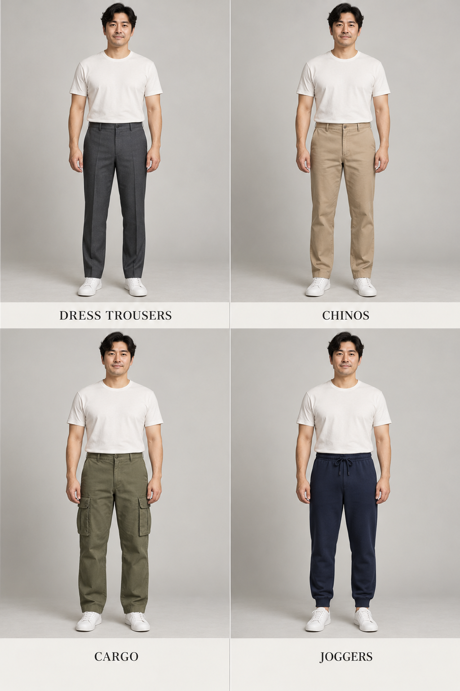
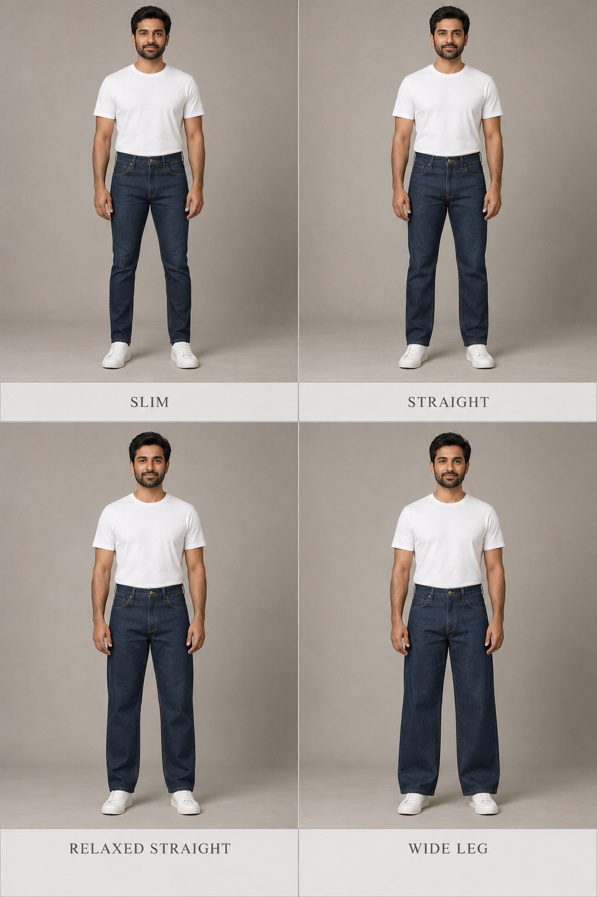

# 第 33 章｜男式裤装：裤类、裤型和细节要分开说

*图 53：从左至右，上排为剪裁长裤、奇诺裤，下排为工装袋裤、束口休闲裤。AI 教学示意用于观察衣料外观、口袋与裤脚组织。裤类名称需结合正文和具体商品资料，不凭颜色判断纤维成分、弹性或用途认证。*

“宽松裤”“西裤”“卡其裤”听起来像同一层级的选项，其实各自在回答不同问题：宽松说余量，西裤说衣型与使用传统，卡其又可能只是颜色。给人物设计裤装时，把裤类、轮廓、腰部和裤脚分别写清，选择就不会互相打架。

## 同是长裤，先确定衣物家族

Tailored trousers／剪裁长裤或日常所说的西裤，常让人注意到明确腰头、门襟和较整洁的垂坠线条；它可以有褶，也可以平前片，可以窄也可以宽。前中烫出一条裤线，并不能单独证明它属于一套西装，更不能证明羊毛成分。若外套与裤子并非配套设计，写“藏蓝西装外套搭灰色剪裁长裤”比“一套西装”准确。

Chinos／奇诺裤常见棉斜纹外观、斜插袋与较简洁裤身，但并不限定为米黄色、修身或九分。UNIQLO 的官方商品同时出现直筒宽松与修身 chino，能直观看到同一裤类具有不同轮廓。中文“卡其裤”可作为检索俗称，正式描述再交代颜色及衣型。[真实对照：UNIQLO，Straight Chino Pants](https://www.uniqlo.com/in/en/products/E479424-000/00)；[Slim Chino Pants](https://www.uniqlo.com/au/en/products/E487209-000/00)

Jeans／牛仔裤的常见识别线索包括丹宁布面、明显车线、五袋式口袋布局与部分款式的铆钉。不过深色牛仔布在远景中可能接近普通长裤，也有省略铆钉或改动口袋的设计。Cargo trousers／工装袋裤则突出腿侧附加口袋；没有腿袋的工作裤仍可能属于工装衣物，而口袋多也不保证耐磨性能或适合实际作业。[工装实物旁读：Dickies，874 Work Pants Family](https://www.dickies.com/en-us/pages/874-family)

Joggers／束口休闲裤通常让人先注意到弹性腰和收拢裤脚；sweatpants／运动卫裤偏向布料与休闲运动用途，两词有交集。宽直裤脚的卫裤并不会因为没有束口就失去卫裤身份；梭织工装裤也可能接束口。给生图要求时，直接写“裤脚开放、没有松紧束口”能减少误解。

## 轮廓有两条轴：空间多少，向下怎样变化

*图 54：从左至右，上排为修身、直筒，下排为宽松直筒、阔腿。牛仔裤裤型的 AI 外观比较中，后两格差异较含蓄，不能据此量化品牌尺寸。观察重点是臀腿空间和从膝部到裤脚的走向；它不是尺码表，也不表示所有品牌对修身、宽松或锥形采用相同尺寸。*

| 描述轴 | 常用词 | 观察位置 |
|---|---|---|
| 整体余量 | slim 修身、regular 常规、relaxed 宽松 | 腰臀、大腿与小腿分别有多少空间 |
| 裤腿走向 | straight 直筒、tapered 锥形、bootcut 靴型 | 膝盖至裤脚保持、收窄或略向外展开 |
| 体积程度 | wide leg 阔腿、baggy 宽大 | 大腿与下段是否都保持较大体积 |
| 长度与落点 | cropped 短截、full length 全长 | 裤脚和脚踝、鞋面如何连接 |

Levi’s 的官方裤型指南把 straight、relaxed、slim／skinny 与 tapered 分开介绍：锥形的重要线索是膝部向裤脚收窄，直筒则关注这一段宽度较稳定。这些名称可以组合成“宽松锥形”或“修身直筒”，因此“直筒”不自动等于紧，“锥形”也不自动等于贴腿。[版型参照：Levi’s，Men’s Denim Fit Guide](https://www.levi.com/US/en_US/features/men-jeans-guide)

实际观察中，先用手遮住裤脚，比较臀腿余量；再露出下段，比较裤腿是否收窄。这样能避免把一条大腿宽、脚口窄的裤子笼统叫成“宽腿裤”。照片中的站姿、裤线与阴影会影响轮廓，不能从一个斜侧镜头读取精确宽度。

## 腰高、裤裆和裤褶，各自改变一处关系

High rise／高腰讨论裤腰穿在身体的什么位置；rise／裆长则常见于从裆部接缝到腰头的量法。品牌量法和前后裆数据可能不同。高腰不等于把裆部拉低，低裆也不等于低腰：一条裤子可以腰位较高，同时在裆部保留较大空间。描述图片时先写“腰头接近自然腰位置”或“腰头落在胯部”，避免仅凭模特肚脐是否露出判定尺码。

Pleats／裤褶是在腰头下方有组织地折入的布量，常见每侧一褶或两褶。Flat front／平前片没有这些预设前褶，但穿着动作仍会产生皱纹。前中烫线又是另一件事：有褶裤和无褶裤都可能有裤线。Suitsupply 的宽松裤指南展示褶裥、侧调节袢、腰带与腰带袢等组合，可用来核实同一轮廓的腰部还能怎样变化。[细节参照：Suitsupply，Relaxed Trousers Guide](https://suitsupply.com/en-us/journal/relaxed-trousers-guide.html)

后袋的单嵌线、双嵌线、袋盖或贴袋，也会改变裤子给人的印象。正面没有露出后袋时，不替参考图补写；需要设计背面时，另列为创作要求即可。

## 口袋、腰带与短裤，都是独立变化

裤腰可以依靠腰带袢配腰带，也可以通过侧调节袢收放，或由弹性腰头贴合。正面看不到传统腰带扣时，别急着把它写成“松紧腰”；还可能是侧调节结构或上衣遮住了腰部。画人物时，若希望腰部简洁，就明确写“平整腰头、侧调节袢、无外露腰带”，而不是只说“高级西裤”。

短裤也可以沿相同方法命名。剪裁短裤、奇诺短裤、牛仔短裤、带腿袋短裤，分别保留不同衣物家族的线索；百慕大短裤常作为接近膝部长度的检索入口，实际长度仍需用人体位置表达。把“橄榄色大腿中部工装短裤，侧面翻盖袋、开放裤脚”写出来，比只说“运动短裤”更能控制造型；真正跑步短裤还应另看内衬、侧开衩和使用说明。

不要把名义尺码等同于外观轮廓。同样的腰围标签，可能对应不同臀腿空间和前后裆长；同一条裤子在不同身体上，腰头与膝位也会落在不同位置。读图时记录可见关系，选实物时再核具体量法和尺寸表，这两项信息可以配合，却不能互相替代。

## 一条裤子的完整描述

“灰色宽松西裤”可以展开为：“中灰剪裁长裤，腰头位于自然腰附近，每侧一道前褶；臀腿留有空间，膝下保持宽直，开放裤脚轻触黑色乐福鞋。”如果改成“橄榄色工装袋裤，弹性腰、大腿侧翻盖袋、裤腿向下收窄，脚口仍为开放式”，裤类、口袋和轮廓就都得到交代。

也可以做一次容易完成的观察：拿同一条裤子分别配低帮鞋和较厚鞋底的鞋，拍相同距离的正侧面照片。记录裤脚是否被鞋面顶起、前方形成几道折痕，而不急着判定哪种长度最好。更细的裤脚落点见[第 36 章](36-mens-fit.md)；与上装组合可回到[第 32 章](32-mens-tops.md)。

## 裤型是组合坐标，而非固定款式表

男裤分开标注腰高（高、自然、低）、臀腿松量（修身、常规、宽松）、裤管（直、锥、靴型、阔腿）、长度（短裤、九分、全长）与结构（单双褶、翻边、抽绳、侧调节袢、工装口袋）。Chino、jeans、cargo、dress trousers 还涉及用途、材质或工艺，并不与锥形、直筒互斥。

配图固定模特、鞋型及机位，分别比较裤腰褶裥、裤脚宽度和裤长落点，再补后袋与侧缝局部。
