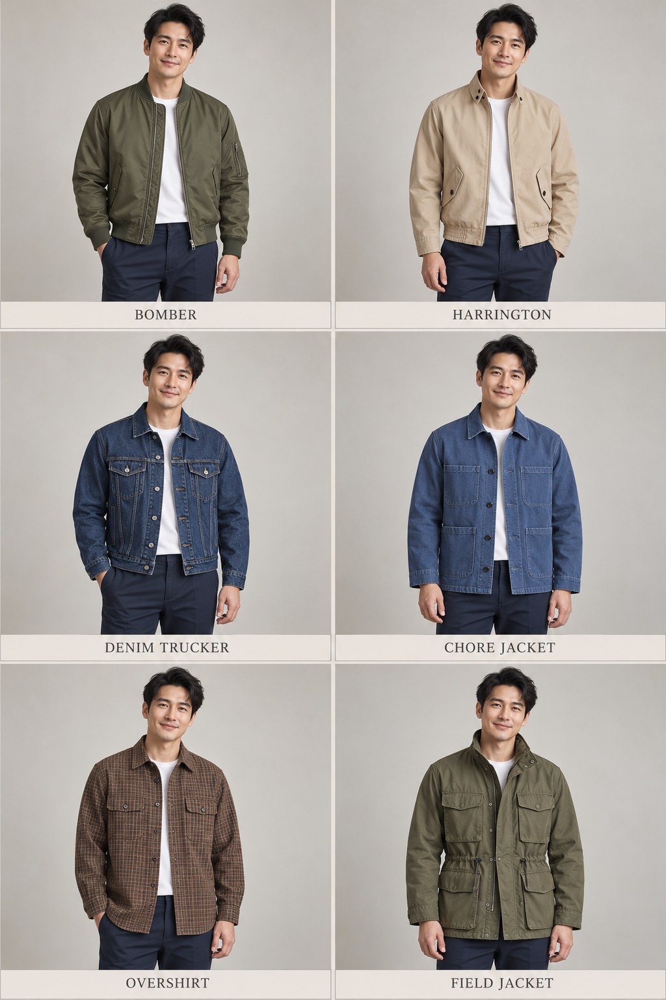
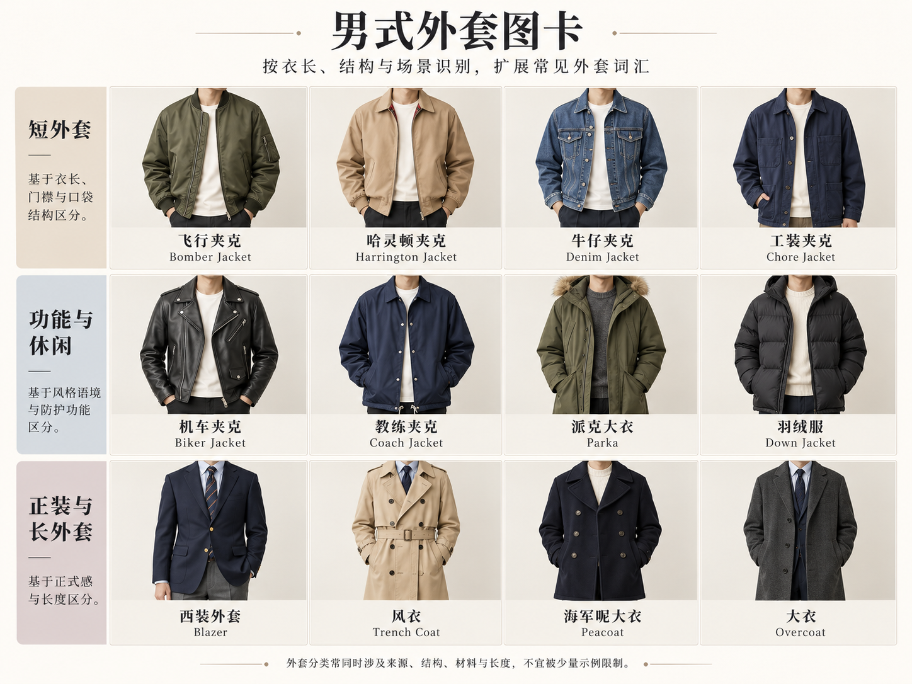
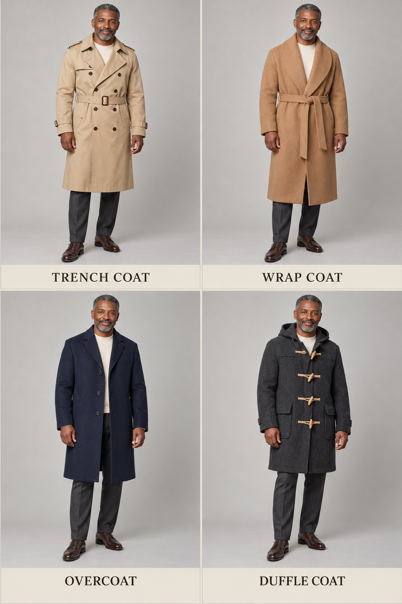
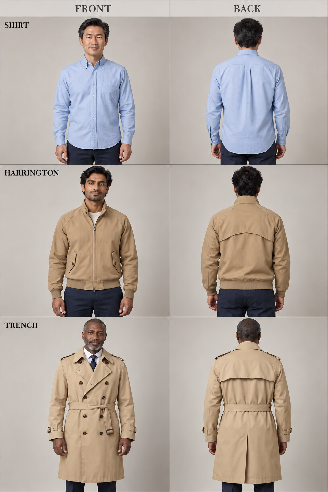

# 第 34 章｜男式外套：短夹克与长外套怎样辨认

*图 55：从左至右，上排为飞行员夹克、哈灵顿夹克，中排为牛仔卡车司机式夹克、工作夹克，下排为衬衫式外套、野战式夹克。工作夹克一格呈牛仔布外观，说明衣型和材料可以交叉。短外套的 AI 教学对照以领口、前开合、口袋和下摆帮助识别衣型。示例不是军服复原、品牌实物或防护装备，不能据图判断保暖、防水与耐磨等级。*

*扩展观察图卡（AI 教学示意）：从短夹克到长外套观察门襟、领子、口袋与衣长。海军呢大衣有短款传统，图中只示双排扣轮廓；材料、防水、防护与保暖不能从造型确认。图中例子不是完整分类；细部判断请结合本章原图和正文。*
同样一件齐腰外套，可能是飞行员夹克、哈灵顿夹克、牛仔夹克，也可能是工作夹克。把它们全部叫“工装风”，会漏掉最有用的形状信息。先按长度分开，再沿领口、袖口、口袋和扣合方式观察，往往比先猜年代更容易。

## 短夹克先看边缘怎样收住

Bomber／飞行员夹克是一个宽泛家族。常见 MA-1 式示例有较短衣身、前中拉链，以及领口、袖口和下摆的罗纹收口。Alpha Industries 的 MA-1 Heritage 商品资料同时列出这些收口与袖上工具袋，可作为具体款式的实物参照；它们不代表所有飞行夹克都必须具备相同领子、面料或颜色。[实物参照：Alpha Industries，MA-1 Bomber Jacket Heritage](https://www.alphaindustries.com/products/mjm21000c1-ma-1-bomber-jacket-heritage)

Harrington／哈灵顿夹克也常见短身与罗纹下摆，但领口常呈可竖起的小翻领，而非紧贴颈根的一圈罗纹。Baracuta 官方列出的 G9 细节包括双扣犬耳领、斜向扣盖口袋，以及背面伞形育克。正面图看不到背部结构时，只说前面可见的线索；不要因为出现一件米色短拉链外套，就断定它有 G9 的全部细节。[原型旁读：Baracuta，What Is the G9?](https://support.baracuta.com/en-US/what-is-the-g9-327300)

Trucker jacket／卡车司机式夹克在男装讨论中常指牛仔夹克家族的一支。可观察翻领、前扣、胸袋以及衣身的分割车线。Levi’s 的 Trucker 系列展示了这些细节与宽松、拉链等变化；“牛仔”说明材料家族，“Trucker”则帮助说明衣型，两者并非永久绑定。[真实款式旁读：Levi’s，Vintage Relaxed Fit Trucker Jacket](https://www.levi.com/US/en_US/clothing/men/outerwear/vintage-relaxed-fit-trucker-jacket/p/773800057)

## 工作夹克、衬衫外套与机车夹克

| 常用入口 | 易辨认的组织 | 描述时再核对 |
|---|---|---|
| Chore jacket／工作夹克 | 直身、前扣、多个实用贴袋的常见组合 | 袋子数量和位置、衣长、是否有内里 |
| Overshirt／衬衫式外套 | 衬衫式翻领与开合，作为外层穿着 | 袖口、胸袋、衣身余量与下摆形状 |
| Biker jacket／机车夹克 | 部分经典款有斜向拉链、大翻领与金属件 | 是否真为骑行防护服、实际扣合方向 |
| Track jacket／运动外套 | 拉链、立领或短领，常见运动式拼接 | 束口、侧条、长度；勿默认速干性能 |

这些名称之间会交叠。一件工作夹克可以采用牛仔布，衬衫式外套也可以加贴袋，机车夹克还有前中直拉链版本。遇到混合设计，先写“黑色短夹克，前襟斜拉链、大翻领、腰侧两只拉链袋”，已经能让画面明确；找不到唯一标签并不影响交流。

Field jacket／野战式夹克的时装版本，常让人注意到胸腹两层口袋、较长的夹克衣身和腰部调节。图 55 只提供这类可见组合，没有按某一年代军用规格复原。需要在历史或角色设计中写 M-65 等具体型号时，应补查原物、年份与细节，不能把所有四袋外套都当成同一制式。[现代款式旁读：Alpha Industries，M-65 Field Jacket Heritage](https://www.alphaindustries.com/products/mjm24000c1-m-65-field-jacket-heritage)

## 长外套不只按“长”命名

*图 56：从左至右，上排为战壕式风衣、围裹式大衣，下排为单排扣大衣、达夫尔大衣。长外套的 AI 外观示例供观察长度、领子、帽子和扣合。不同外套的布面与体积也有变化，不能把整组差异归因于衣长这一项。*

Overcoat／大衣是较宽的入口，常指穿在其他衣物外的长外套；在造型描述里，还应交代单排或双排扣、翻领、肩线与衣摆。Chesterfield／切斯特菲尔德大衣、polo coat／马球大衣等更细名称有各自历史与款式传统；初学时不必从一张普通长大衣照片强行细分。先写“炭灰单排扣翻领大衣，直身、长度至膝下”，信息已经实用。

Trench coat／战壕式风衣的经典参照包含腰带、肩章和特定前后覆片，而不是所有轻薄长外套的总名。Burberry 的男式 Kensington Heritage 商品列出双排扣、肩章、后背挡雨覆片、肩部覆片、腰带与袖袢。改良款会省略或改变部分细节；一件无腰带、单排扣的简洁长外套，直接称“轻型长外套”或按具体资料称 mac／雨衣式外套，通常更稳妥。[经典结构旁读：Burberry，Kensington Heritage Trench Coat](https://tr.burberry.com/mid-length-kensington-heritage-trench-coat-p81172291)

Wrap coat／围裹式大衣把重叠前襟与系带作为主要外观线索。图 56 中腰带将衣身收拢，前部没有一列明显纽扣，衣摆约在膝部以下；这种可见组合不能证明内部一定没有暗扣。描述“驳领宽、腰带系结、重叠前襟自然垂下”，比把它含混叫成“浴袍风”更实用。

Duffle coat／达夫尔大衣，中文常称牛角扣大衣，典型线索是帽子与绳圈、长形扣组合；扣子并不保证真的来自牛角。Gloverall 用帽形、扣袢与贴袋介绍其传统款式，适合作为真实参照。Parka／派克大衣则常见带帽、较长衣身和较多覆盖，具体填充、毛边、抽绳与防水性能需要逐项核实。[款式与发展旁读：Gloverall，What Is a Duffle Coat?](https://www.gloverall.com/blogs/journal/history-of-the-duffle-coat-origins-heritage)

长度相近也不代表用途相同。雨衣式外套可能外观平滑轻薄，大衣可能呈厚实绒面；这些是远景印象，无法代替标签。写作或讨论时，可以先用“表面较平滑”“布面有短绒感”描述所见，再把防水、涂层和纤维配比留给真实制作资料。尤其不要把帽子和拉链的存在，当成达到专业户外要求的证明。

## 转到背面：育克、褶与覆片不要混叫

*图 70：三行两列的 AI 配对示意，每行左正面、右背面。上行为浅蓝衬衫及后育克下中央褶，中行为卡其哈灵顿式夹克及弧形后育克／覆片，下行为米色系腰带风衣及横向后覆片。每行人物与衣物尽量连续，不据图确认褶的精确折叠量、覆片内部或材料性能。*

Yoke／育克是肩背上部的结构片，box pleat／箱褶则是衣料的折叠组织，两者可以在同一件衬衫上相接。Ralph Lauren 的牛津衬衫将后育克与箱褶分别列出，说明“后背有一条线”并不足以命名全部结构；图 70 中较窄的中央褶，只作可见位置示意。[实物参照：Ralph Lauren，Stitch Your Own Men's Oxford](https://www.ralphlauren.com.sg/stitch-your-own-mens-oxford-CYO0053AP.html)

哈灵顿式夹克可继续对照前文 Baracuta 的伞形后育克，风衣则留意 Burberry 商品资料中的后背覆片与腰带。三者并非同一部件换了名字。描述时先说位置和边缘：“肩背横向育克下有中央褶”“上背有弧形覆片”“后覆片横跨肩背，腰带绕至腰后”。看不到覆片下方，就不自行补通风孔、衬里或防水做法。[原型细节：Baracuta，What Is the G9?](https://support.baracuta.com/en-US/what-is-the-g9-327300) [后覆片参照：Burberry，Kensington Heritage Trench Coat](https://tr.burberry.com/mid-length-kensington-heritage-trench-coat-p81172291)

## 用内层说明外套需要的空间

外套的用途关系会改变描述。同一件长大衣，里面只有 T 恤，与里面还有衬衫、针织和西装夹克，需要的空间不同。观察肩臂是否挤紧、前襟能否自然重叠、内层下摆从哪里露出，比笼统说“宽松有层次”更有帮助。加一件厚针织后扣不上，不应立即归咎于人物体型；衣物之间的尺寸关系同样要检查。

可以写：“成年男性穿橄榄色短工作夹克，直身、前中四颗可见纽扣，胸前一只贴袋、下方两只大贴袋；内搭米白圆领上衣，下配深蓝宽直牛仔裤。”若想换成冷季通勤，再改为“深灰膝下大衣敞穿，里面的藏蓝西装外套完整收在大衣内，衬衫领与窄领带清楚可见”。

这些是原创创作描述，不是对图 55、56 每一格的逐项抄写。需要同人物比较时固定姿态、镜头和内搭，先只换外套；要辨认更正式的夹克和套装关系，继续阅读[第 35 章](35-mens-tailoring.md)。

## 外套家族还可怎样展开

短夹克与长外套之间不是一条硬分界。同一家族可能同时有齐腰、盖臀与更长的版本；有帽、填充或大量口袋，也不能独自决定它属于哪一个家族。图鉴适合提供外观入口，完整识别仍需逐项组合。

| 补充入口 | 可观察的组织 | 别与什么直接等同 |
|---|---|---|
| Coach jacket／教练夹克 | 常见翻领、前扣、较简洁直身与下摆调节 | 不等同于所有运动外套，也不保证防雨 |
| Peacoat／海军呢大衣式款 | 常见双排扣、宽翻领与较短大衣衣身 | 双排扣本身不是它独有的识别依据 |
| Puffer／绗缝蓬松外套 | 由分格与蓬松体积形成的轮廓 | 外观不能确认填充为羽绒，也不能量取保温等级 |
| Fleece jacket／抓绒外套 | 常见表面短绒与拉链开襟 | 短绒外观不能单独判定纤维、重量或防风性能 |
| Gilet／外搭背心 | 无袖、肩部覆盖及外层空间 | 与贴身无袖内搭、针织背心和西装马甲分开描述 |

名称也会跨材料：一件绗缝外套可以是无袖背心，一件教练式夹克可以使用不同布面。看见鼓起的分格，就先写“横向绗缝、衣身蓬松”；有可靠商品资料后，再补填充成分。Field jacket 在本章译作“野战式夹克”，不宜在后续清单里直接换成“狩猎夹克”，以免把不同来源的时装入口混为同义词。

需要描述没有明确类别的混合款时，依次记录衣长、轮廓、领帽、门襟、口袋与下摆：“黑色盖臀直身外套，翻领、前中按扣、两侧斜插袋，下摆抽绳收拢”。这已经可读，不必为了给出唯一名称而猜测年代或军服型号。

## 用外套的边界检验叠穿关系

加一件外套时，先看肩袖空间是否容纳内层，再看领子是否互相遮挡，最后看下摆和口袋还露出多少。无袖外层会让里面的袖子完整出现；短外层会露出较长的衬衫下摆；较长大衣则可能遮住整套内层轮廓。图卡若同时更换内搭、外套和姿态，只能作为组合示例，不能拿来证明某种衣长必然产生同一种效果。

可以把同一套衬衫与直筒裤依次配上短工作夹克、无袖绗缝外层与膝下大衣。分别记录露出的部位，再检查三个版本的肩线、衣摆和门襟。比较的目标是理解衣层怎样相接，而不是用外套名称给人物贴身份标签。
