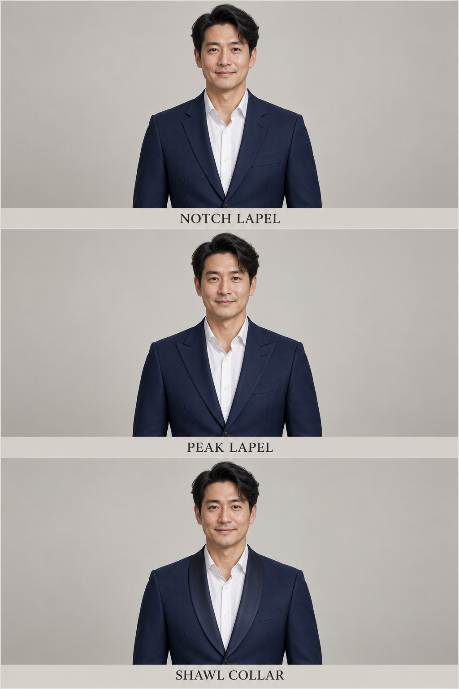
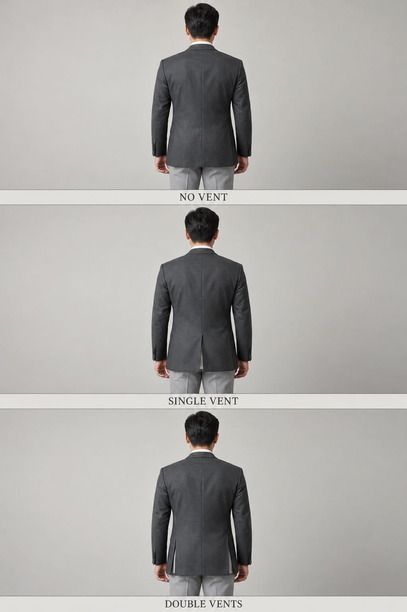
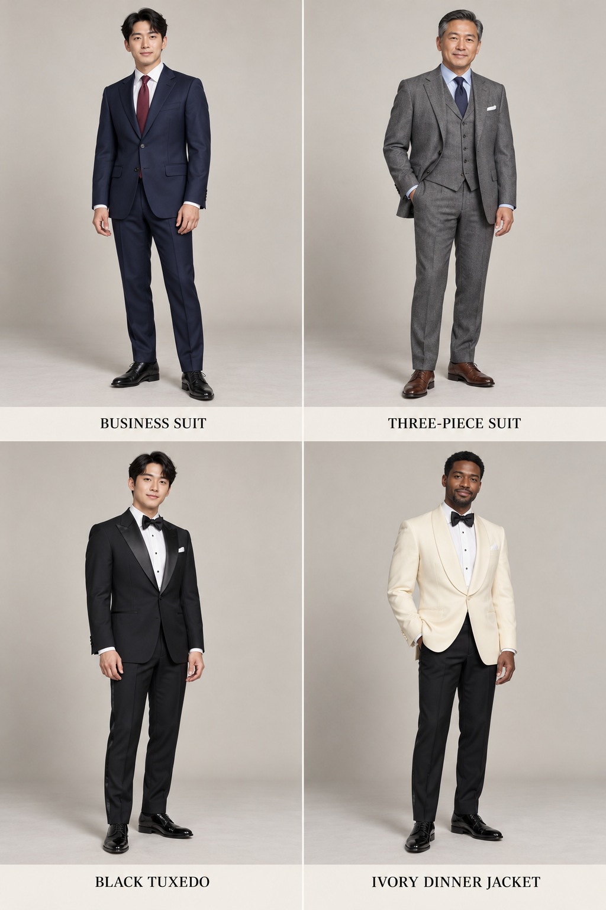

# 第 35 章｜西装与晚礼服：从套装关系读到驳领细节

*图 57｜AI 教学示意：从上到下为平驳领、戗驳领、青果领。注意领与驳头的交接处，以及连续弧线与尖角的差别。*

“西装感”既可能来自一件有驳领的夹克，也可能来自真正配套的上衣和裤子。先分清衣物关系，再认局部结构，就能避免把所有深色外套叫成西装，把所有黑色西装叫成晚礼服。

## 一套、单件与混搭

Suit／西装套装强调上衣与裤子作为一套设计，通常在面料、颜色和剪裁上相互配合。两件套是夹克与裤子，三件套再加配套马甲。分开购买尺码，不一定破坏套装关系；反过来，找两件颜色很接近的衣物，也不能仅凭照片证明它们配套。

Blazer／西装式便装外套、sport coat／休闲西装外套或单件便装夹克，在商品语境中会有交叠。中文把它们都称作“西装外套”时，可以继续说明“单件藏蓝夹克、金属色扣”“棕色纹理外套、贴袋、搭不同颜色长裤”。不必只凭一颗金色扣子就判断全部历史类别。Suitsupply 将闭合、驳领、口袋与肩部并列为夹克观察轴，适合拆开看这些变化。[结构参照：Suitsupply，Your Jacket Detail Guide](https://suitsupply.com/en-in/journal/jacket-details-explained.html)

## 扣列、驳领和口袋，互相有关却不绑定

Single-breasted／单排扣的前部常以一列主要扣位闭合；double-breasted／双排扣有更明显的前襟重叠和两列外观扣位，但不是每颗可见扣子都用于扣合。双排扣外套即使前方同样有六颗可见纽扣，可扣合的位置和穿着时的扣法仍需分别核对；具体内扣则要查看衣物内部。

| 结构 | 观察方法 | 常见误认 |
|---|---|---|
| Notch lapel／平驳领 | 领与驳头交接处有缺口 | 不是领尖都必须水平 |
| Peak lapel／戗驳领 | 驳头尖端向上挑起 | 不只出现在双排扣上 |
| Shawl lapel／青果领 | 翻折边形成连续弧线 | 不是所有圆领外套都是青果领 |
| Patch pocket／贴袋 | 袋布贴在外面、边缘可见 | 与袋盖不是同一项分类 |
| Jetted pocket／嵌线袋 | 袋口以窄嵌线收边 | 有无袋盖还可以继续区分 |

这张表只解释外观组织。平驳、戗驳和青果领没有一条适用于所有场景的“高级程度排序”。它们与活动传统、面料、比例和整套搭配共同起作用。肩部看着平滑，也不能直接写成“无垫肩、无胸衬”；内部结构要靠制作资料或实物。[驳领与口袋旁读：MR PORTER，The Ultimate Guide to Buying a Suit Online](https://www.mrporter.com/en-us/journal/fashion/how-to-buy-a-suit-online-tailoring-shopping-guide-1874472)

## 后摆开衩：缝线和开口要分别看

*图 69｜AI 教学示意：从上到下为无后衩、后中单衩、后侧双衩。背中缝可以出现在三种结构中，接缝与开衩需要分开辨认。*

Vent／开衩从夹克后下摆向上延伸，改变后摆衣片能够分开的部位。Indochino 的官方说明将无衩、单衩与双衩分列；本书借用其部位定义，不照搬品牌对场合或版型的偏好。[结构参照：Indochino，What Are Vents?](https://support.indochino.com/hc/en-us/articles/360044131754-What-are-Vents)

无衩的下缘保持连续，背中仍可有接缝；单衩在后中留一道开口；双衩在后部两侧各留开口，中间后片保持连续。实际重叠边可能在站立时合拢，不能因为没露出裤子就断定无衩。开衩的位置与重叠关系需从背面检查；实际活动中的开合还会受版型、松量与动作影响。

## 晚礼服靠整套组织，而不只是黑色

*图 58｜AI 教学示意：上排为商务两件套、三件套；下排为黑色晚礼服组合、象牙白青果领晚礼服上衣配黑礼裤。礼裤的侧饰带在正面示例中不清楚。*

Tuxedo／dinner suit／晚礼服套装的常见线索包括与衣身形成光泽差异的驳领覆面、相配礼裤、正式衬衫及领结。Dinner jacket 也可以是与黑色礼裤搭配的另一色上衣，例如象牙白；因此“上下颜色不同”并不自动排除晚礼服搭配。实际参加活动时，应以邀请函和主办方的着装说明为准。

Black tie 是一种晚间着装规范的名称，常规男装组合围绕晚礼服与黑领结展开；它不是字面上的“打一条黑色长领带”。Suitsupply 官方指南展示完整晚礼服，也展示 dinner jacket 与礼裤的组合，并讨论衬衫、驳领覆面和鞋。把普通黑西装加黑长领带，不能仅凭颜色宣布它符合指定的 black tie。[规范与实物参照：Suitsupply，Black Tie Dress Code Decoded](https://suitsupply.com/en-in/journal/blacktie-guide.html)

White tie／白领结礼服则是另一套更正式的传统，常见燕尾礼服上衣等组合，不能简单把黑领结换白就完成转换。Smoking jacket／吸烟夹克也有特定来源与装饰传统，不应把所有绒面晚间外套都当作同一规范。Huntsman 的晚间衣装指南把不同类型分开说明，适合继续旁读。[延伸参照：Huntsman，Evening Wear Style Guide](https://www.huntsmansavilerow.com/pages/evening-wear-style-guide)

## 从远景到近景，检查衣物之间的连接

看全身图时，先确认夹克、马甲与裤子是不是需要作为同一套设计；看半身图，再检查夹克开口内露出什么。白衬衫配长领带时，领带结的位置、领尖与驳领会共同围出胸前形状；改成高领针织后，衬衫领和领带两层结构都消失了，但夹克本身的单排扣与驳领并没有因此改名。

马甲还可以作为单件使用。V 领深浅、前扣位置、下摆尖角、腰侧口袋，都值得单独描述。搭配衬衫与不同颜色裤子时，可以说“便装马甲组合”；只有确定它与外套、裤子配套，才写“三件套”。套装关系最终应通过实物或商品信息确认，不能只根据照片中色泽相近作结论。

三件套的常见衣层由内向外为衬衫、马甲和夹克。夹克敞开时，马甲的前襟、扣位和下摆会显露出来；加上领带后，领尖、领带结和马甲开口又共同形成胸前层次。认识这种穿着顺序，比笼统用“正式”概括所有细节更有帮助。

## 日常西装与晚间礼服的实际区别

日常两件套可以由单排扣平驳领夹克、配套长裤、衬衫与长领带组成。夹克的收腰程度、裤腿宽窄和鞋履选择会改变整体轮廓；“西装”这一名称本身并不要求所有款式都采用贴体剪裁。

晚间礼服需要整体认识：驳领覆面、礼裤、正式衬衫、领结与鞋履共同构成组合。青果领与戗驳领都可能用于晚礼服；礼裤侧饰带等细部还需通过侧面或商品资料核对。普通黑西装与黑色晚礼服之间的区别，不能简化为颜色深浅。

同色衣料在不同光线下也会显出深浅差别，照片中存在色差时，先保留疑问，再用商品资料确认是否配套。

最后把“衣型判断”和“活动合规”分开：前者涉及衣物类别与结构，后者取决于具体活动的规则。关于肩线、袖长和裤脚的观察，继续阅读[第 36 章](36-mens-fit.md)；领带、领结与皮鞋细节见[第 37 章](37-mens-accessories.md)。
