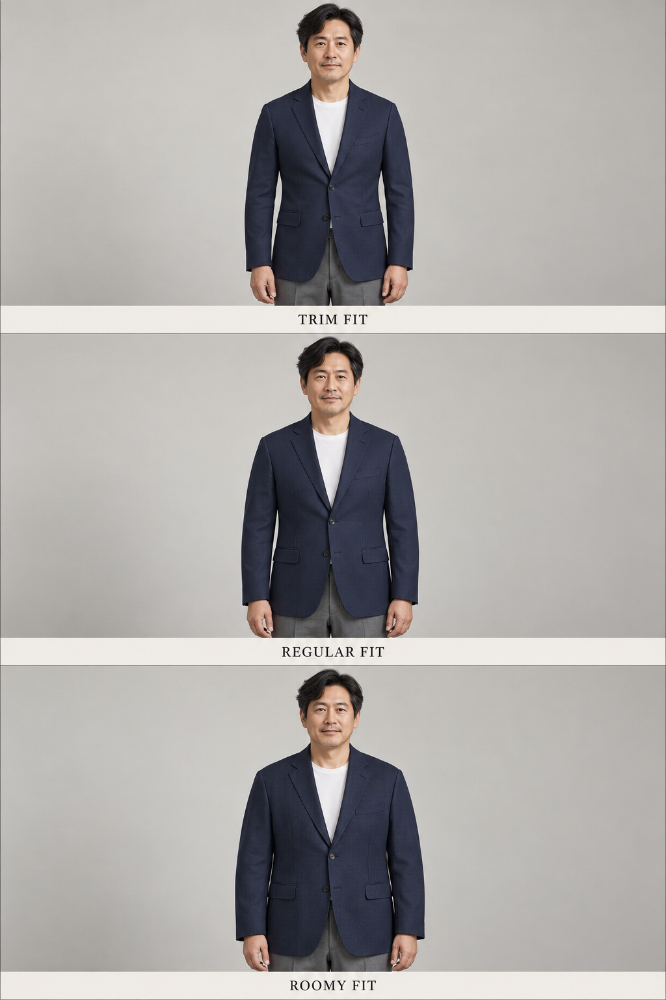
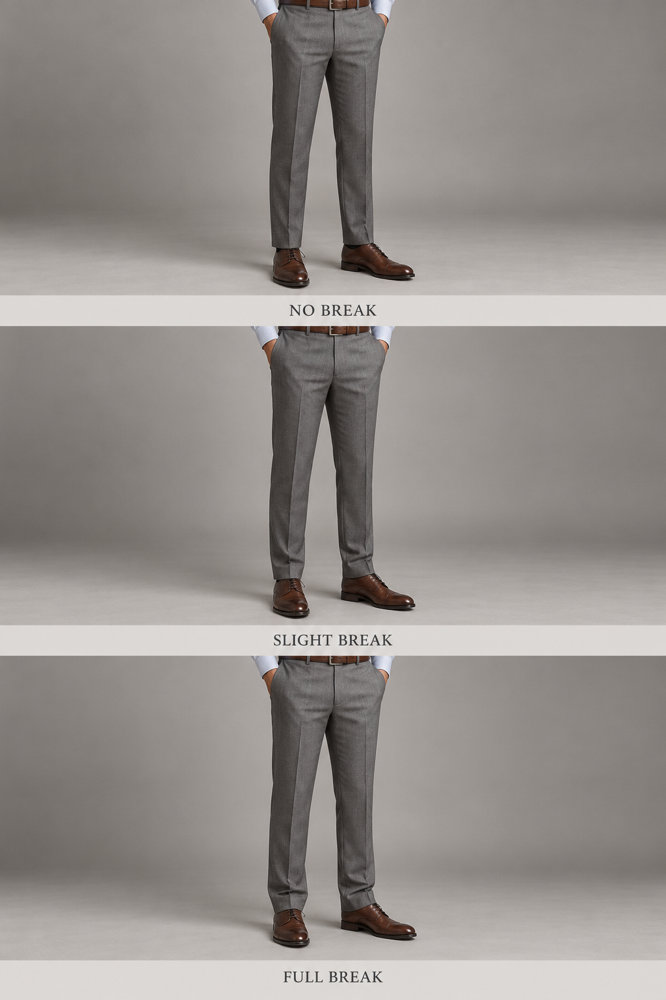

# 第 36 章｜男装版型与比例：把“合身”拆成可见关系

*图 59：男式夹克余量的 AI 教学示意。从上到下为较贴体、自然余量、较宽松，比较胸腰空间与肩部轮廓；衣长、领口和姿态存在细微变化，不是严格的量体对照，也不能据此判断内部衬料。*

“这个男生穿得很合身”听起来明确，真正让人照着画，却缺少不少信息。贴体、自然余量和宽松都可以是有意选择；一件宽肩夹克，也不必与贴腿裤固定搭配。描述版型的目的，是说明衣服如何围绕身体，而不是选出一种人人必须遵守的身材轮廓。

先把三个词拆开：**尺码**是厂商对规格的标记；**版型**是衣片及其组合形成的外形与空间；**合身**还涉及穿着者、内搭、动作和预期效果。同一个人穿同标号的两件外套，肩、腰和袖子仍可能完全不同。品牌的 slim、regular、relaxed 也应结合具体尺寸理解，不能跨品牌直接兑换。

## 从肩到腰，一处一处说

看肩线时，先找袖子与衣身的接缝，再看接缝相对自然肩点的位置。“肩线贴近自然肩点”“肩线向外延伸”“落肩”比“肩膀很大”清楚。不过正面照片不一定能准确定位肩点；厚针织、插肩袖与特殊袖型更需要换一个角度。肩部外扩既可能是设计，也可能是尺码选择，不能看见落肩就宣布衣服买大了。

看胸腰时，观察前襟在扣合后怎样落下：扣位附近有没有明显放射状拉纹，前襟是否被拉开；腰部是轻微内收、接近直筒，还是有明显收束。Suitsupply 的传统西装合身指南使用领背、肩、腰、衣长和袖长等分项检查，适合作为观察路线；其中的理想轮廓是该指南的剪裁目标，不是宽松设计的判错表。[资料：Suitsupply，The Perfect Fit in 7 Steps](https://suitsupply.com/en-us/journal/how-it-should-fit.html)

| 位置 | 能写进人物描述的内容 | 还需要什么才能进一步判断 |
|---|---|---|
| 肩部 | 自然肩、外扩肩、袖山轮廓 | 侧后视图、衣物尺寸或结构资料 |
| 胸腰 | 贴近身体、留有余量、腰部轻收 | 扣合状态、内搭厚度与动作 |
| 衣长 | 停在腰附近、盖过臀部、延伸到大腿 | 人物完整取景，避免被裁切误导 |
| 袖子 | 袖口到腕部，内层露出一段 | 手臂姿势，以及内外两件的袖长 |

不要用一道褶直接诊断原因。手插口袋、抬手、转身都可能让布料拉起。写“右侧胸前出现一道斜褶”是观察；写“胸围一定小了三厘米”则越过了图像提供的证据。

## 余量与长度是两根不同的旋钮

短而宽、长而窄、长而宽都可以成立。短款夹克若停在裤腰附近，腰线更容易露出；长夹克会覆盖更多腰臀；敞穿时，内层形成的纵向区域又会改变正面的分段。它们描述的是可见关系，不保证每个人都产生相同的“显高”“显瘦”效果。

裤装也至少要看腰位、臀腿余量、裤腿走向和裤脚落点。腰位说明腰头落在身体哪里，前后裆长还涉及量法与版型，不能仅凭正面图推定；直筒不等于宽松；锥形裤可以从宽裕的大腿逐渐收窄。Suitsupply 的裤型指南同时列出宽腿锥形与宽腿直筒，正说明宽度和收窄程度应分别表达。[资料：Suitsupply，Trousers Fit Guide](https://suitsupply.com/en-us/journal/trousers-fit-guide.html)

*图 60：裤脚与鞋面接触关系的 AI 教学示意。从上到下为无明显前折、浅前折、较明显前折；观察灰裤裤脚与棕色系带皮鞋的接触。姿态和布料细节有差异，不当作精确裤长测量。*

## 裤脚的“折”，不等于裤管上的所有皱纹

男装讨论中的 **break**，常指裤脚因落在鞋面上而产生的折痕。它不是大腿处的运动褶，也不是裤子烫出的纵向裤线。Articles of Style 的裤长指南将截短、无折和有折等情况分开；该文还含有个人审美和体型建议，本书只借用可见的裤脚接触关系。[资料：Articles of Style，A Guide to Pant Breaks](https://articlesofstyle.com/blogs/news/a-guide-to-pant-breaks)

无折（no break）通常是裤脚接近鞋面而没有明显折痕，不能简单等同于露出整段脚踝。轻微折痕可以写成“裤脚前部轻触鞋面，形成一道浅折”；更充分的堆叠则要说明多余布料聚集的位置。半折、全折的具体界线并非用一张图就能精确划定，鞋面高度、裤口宽度和面料也会影响结果。

比较时把鞋固定下来很有帮助。同一条裤子配低帮鞋和厚重靴子，裤脚受到支撑的位置不同；换鞋以后出现更多折痕，未必是裤子突然变长。做生图对照，可以固定人物、鞋、裤口宽度和姿态，只修改裤长，并检查输出是否真的保留这些条件。

## 三种清楚的描述，不设优劣顺序

1. **接近身体的剪裁**：成年男性穿深灰单排扣夹克，肩线接近自然肩点，腰部轻收；内搭薄白衬衫，灰色直筒裤接近鞋面而无明显折痕。

2. **自然余量**：成年男性穿藏蓝夹克，胸腰有活动空间，衣身顺直落下，衣长盖过臀部；浅蓝衬衫塞进中高腰裤，裤脚在棕色德比鞋上形成浅折。

3. **有意宽松**：成年男性穿肩部外扩、衣身宽直的黑色夹克，内搭短圆领上衣，配宽腿长裤；裤脚覆盖一部分鞋面，前襟敞开，双臂自然下垂。

这些练习不要求人物是同一种身材。真实试穿时，还要坐下、抬臂和走动，确认活动是否受限；图像中的“看起来宽松”不能代替穿着体验。下一次想表达“这一套比例不太一样”，先指出肩、衣长、腰位或裤脚中的一项，通常就能找到可以讨论的变化。
