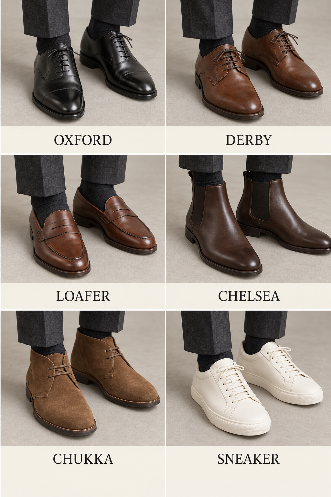
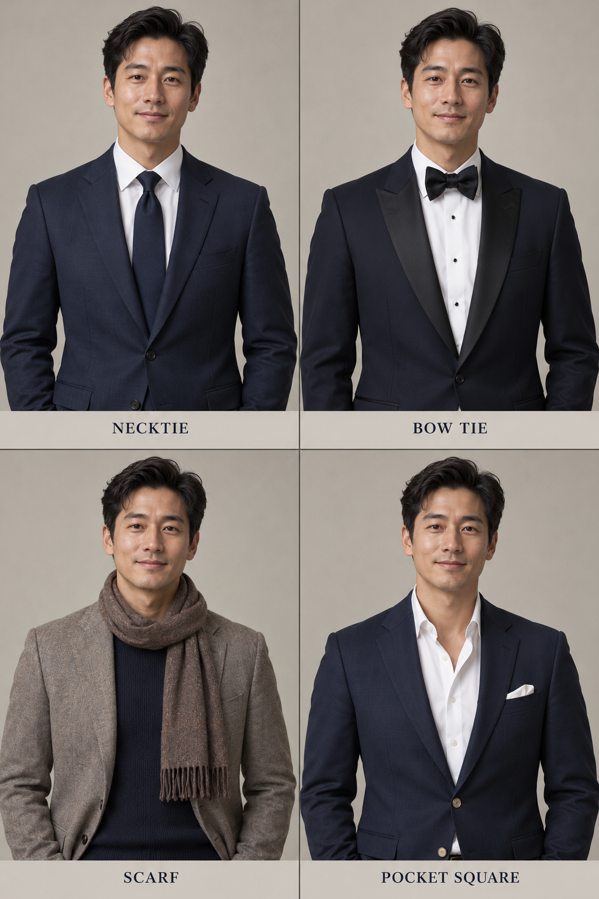

# 第 37 章｜男鞋与配饰：从“皮鞋领带”说到具体结构

*图 61：常见男式鞋履的 AI 教学示意。按每排从左到右依次为牛津鞋／德比鞋、便士乐福鞋／切尔西靴、查卡（丘卡）靴／低帮运动鞋。观察系带、鞋口与装饰；鞋底工艺、皮革种类和性能需另外核实。*

“黑皮鞋”只说出了颜色和一种材料印象，鞋面怎样开合、鞋头有没有接缝、鞋口到哪里，都还没有交代。配饰也是如此：一条深色领带、一只黑色领结和一块围在领口的方巾，会占据不同形状的区域。把它们说清楚，人物即使不换整套衣服，也能形成明显变化。

这里沿用“男鞋”“男式配饰”作为常见商品与穿搭讨论入口。牛津鞋、乐福鞋、领带和方巾都可以被不同性别的人穿用；名称说明结构，不替人物定义身份。

## 牛津与德比，先看鞋带两边怎样连接

牛津鞋（Oxford）的关键线索是封闭式系带：穿鞋带的两片区域与前鞋面连接后，开口相对收合；德比鞋（Derby）使用开放式系带，两侧系带片覆盖在前鞋面上，能看见较开放的连接关系。看不清接缝时，先写“低帮系带皮鞋”，比凭鞋头尖圆猜名称可靠。Crockett & Jones 的鞋型指南提供两类鞋面的结构说明及实物参照。[资料：Crockett & Jones，Style Guide](https://www.crockettandjones.com/pages/style-guide)

**布洛克（brogue）首先说的是装饰孔眼等细节**，不是与牛津、德比互斥的一种开合方式。牛津或德比都能带布洛克装饰；鞋头另接一片、形成横向接缝，称 cap toe／包头式鞋头；翼状鞋头接片又是另一项形状。不能看到几排孔眼，就把鞋的系带结构忽略掉。[资料：Crockett & Jones，The English Oxford](https://www.crockettandjones.com/blogs/the-article/definitive-guide-the-english-oxford)

| 名称 | 先找的外观线索 | 描述时可补的一项 |
|---|---|---|
| 牛津鞋 Oxford | 封闭式系带 | 纯色鞋面、横向鞋头接缝或孔眼装饰 |
| 德比鞋 Derby | 开放式系带 | 鞋带片轮廓、鞋底厚薄与鞋头形状 |
| 乐福鞋 loafer | 无系带的套穿鞋面 | 便士横带、流苏或其他鞋面装饰 |
| 查卡靴 Chukka boot | 脚踝附近的系带短靴，常见两至三对鞋带孔 | 靴筒、系带与鞋头形状 |
| 切尔西靴 Chelsea boot | 脚踝附近的靴筒与侧面松紧片 | 靴筒高度、鞋头与鞋底轮廓 |
| 运动鞋 sneaker | 运动鞋式鞋面及鞋底组合 | 低／高帮、鞋面分区和鞋底体积 |

图外还可认识用扣带闭合的孟克鞋（monk strap），再区分单扣与双扣。查卡（Chukka）也译作丘卡。表格是辨认路线，不是正式程度的绝对排行榜。同一种鞋型可以有光亮薄底与粗厚颗粒底两个版本，观感相差很大。舒适、耐走或防滑也不能仅由鞋名保证；鞋楦、尺码、鞋底、脚型与使用环境仍然重要。

## 袜子让裤脚与鞋之间的空隙有了内容

袜子不只是“穿没穿”。可以写不露出鞋口的袜、到脚踝附近的短袜，或延伸到小腿的袜；坐下后，裤脚上移，原本隐藏的袜面也会出现。描述一套需要保持连贯的深色裤装，可以写“深灰袜在裤脚与黑鞋之间形成连续色块”；想突出细节，则写明浅色、条纹或图案的位置。

如果照片看不出袜口，就描述可见部分，不猜袜筒的总长度。同样，“露踝效果”不一定代表完全没穿袜；生图时写“鞋口上方不露袜边”，比写“没有袜子”更接近画面要求。

*图 62：领口与胸袋配饰的 AI 教学示意。左上领带，右上领结，左下围巾，右下为敞领衬衫加胸袋口袋巾；后者并非颈部配饰。看位置与形状，不将静态图当作系结步骤教程。*

## 领带、领结与方巾，占据的区域不同

领带（necktie）通常从领口向下形成一条纵向区域；要说清宽度、长短、表面和图案，也要交代衬衫最上方扣合与否。领结（bow tie）在颈部形成横向展开的结形，不能用“短领带”替代。针织领带、平整织面领带只是表面与组织的不同，不自动规定整套衣服的正式程度。

小方巾可以在颈部折成窄带并打结，较大的围巾也可披绕在外套领口。描述时写出结在哪里、尾端露出多少、在衬衫里面还是外面。Hermès 的男士丝饰展示同时使用领带、菱形巾和围巾，可作为真实造型参照；它们不是一种只有固定系法的配件。[资料：Hermès，Silk Makes the Knot](https://www.hermes.com/us/en/content/344171-a-sense-of-silk-men/)

口袋巾（pocket square）放在外套胸袋，手帕则首先是用途名称。它们可以使用相似材料，却不必在描述中当作同一件物品。写“胸袋露出一条平直白边”与“胸袋露出松散的多角巾尖”，会得到不同的形状；口袋巾也不必与领带复制同一花纹。

腰带、袖扣和包继续沿用同一方法：位置、形状、尺度，再看材料。袖扣需要与适配的袖口结构配合，不能随意悬在普通扣袖上；腰带要交代带宽与扣头，不必把金属光泽直接猜成某种贵金属。背包、托特包与公文包的区别，也不只是“大包”“小包”，还包括开口、提手和背带。

## 用一个配件改变句子的重点

先固定“浅蓝衬衫、藏蓝夹克、灰色直筒裤”。加一条窄深蓝领带，句子重点落在领口到胸前的纵向区域；换成暗红小方巾，结与短尾端靠近颈部；完全移除颈部配饰，再在胸袋留一条白色巾边，视觉焦点会转移。

一个完整例句可以写成：“成年男性穿米白翻领衬衫与敞穿的深棕夹克，领口围一条深红小方巾，结偏向一侧；灰色直筒裤下穿棕色流苏乐福鞋，露出深灰袜面，手提无肩带的长方形公文包。”这比“绅士配饰很多”提供了更可执行的信息。是否符合某次晚宴要求，则应回到[第 35 章](35-mens-tailoring.md)和活动方说明核对。
