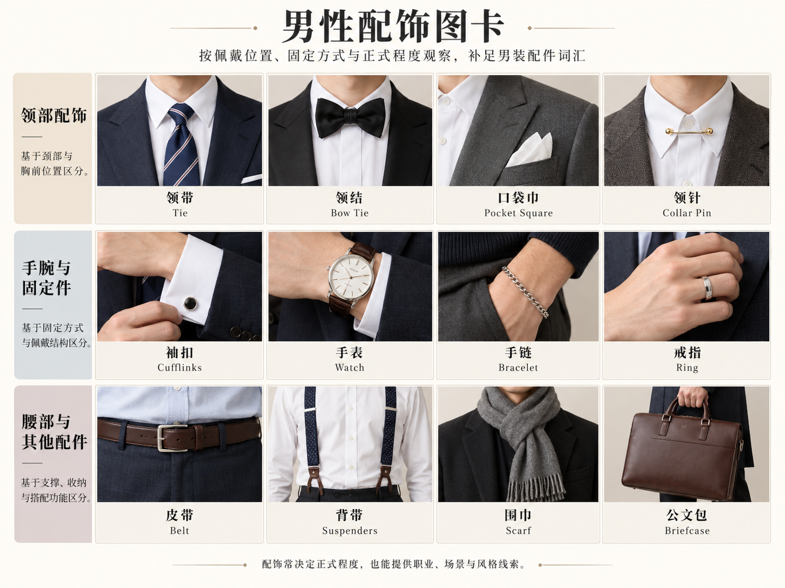

# 第 37 章｜男鞋与配饰：从“皮鞋领带”说到具体结构

*图 61：常见男式鞋履的 AI 教学示意。按每排从左到右依次为牛津鞋／德比鞋、便士乐福鞋／切尔西靴、查卡（丘卡）靴／低帮运动鞋。观察系带、鞋口与装饰；鞋底工艺、皮革种类和性能需另外核实。*

“黑皮鞋”只说出了颜色和一种材料印象，鞋面怎样开合、鞋头有没有接缝、鞋口到哪里，都还没有交代。配饰也是如此：一条深色领带、一只黑色领结和一块围在领口的方巾，会占据不同形状的区域。即使主体衣物相同，不同配饰也会改变领口、胸前与手部的视觉重点。

这里沿用“男鞋”“男式配饰”作为常见商品与穿搭讨论入口。牛津鞋、乐福鞋、领带和方巾都可以被不同性别的人穿用；名称说明结构，不替人物定义身份。

## 牛津与德比，先看鞋带两边怎样连接

牛津鞋（Oxford）的关键线索是封闭式系带：穿鞋带的两片区域与前鞋面连接后，开口相对收合；德比鞋（Derby）使用开放式系带，两侧系带片覆盖在前鞋面上，能看见较开放的连接关系。看不清接缝时，先写“低帮系带皮鞋”，比凭鞋头尖圆猜名称可靠。Crockett & Jones 的鞋型指南提供两类鞋面的结构说明及实物参照。[资料：Crockett & Jones，Style Guide](https://www.crockettandjones.com/pages/style-guide)

**布洛克（brogue）首先说的是装饰孔眼等细节**，不是与牛津、德比互斥的一种开合方式。牛津或德比都能带布洛克装饰；鞋头另接一片、形成横向接缝，称 cap toe／包头式鞋头；翼状鞋头接片又是另一项形状。不能看到几排孔眼，就把鞋的系带结构忽略掉。[资料：Crockett & Jones，The English Oxford](https://www.crockettandjones.com/blogs/the-article/definitive-guide-the-english-oxford)

| 名称 | 先找的外观线索 | 描述时可补的一项 |
|---|---|---|
| 牛津鞋 Oxford | 封闭式系带 | 纯色鞋面、横向鞋头接缝或孔眼装饰 |
| 德比鞋 Derby | 开放式系带 | 鞋带片轮廓、鞋底厚薄与鞋头形状 |
| 乐福鞋 loafer | 无系带的套穿鞋面 | 便士横带、流苏或其他鞋面装饰 |
| 查卡靴 Chukka boot | 脚踝附近的系带短靴，常见两至三对鞋带孔 | 靴筒、系带与鞋头形状 |
| 切尔西靴 Chelsea boot | 脚踝附近的靴筒与侧面松紧片 | 靴筒高度、鞋头与鞋底轮廓 |
| 运动鞋 sneaker | 运动鞋式鞋面及鞋底组合 | 低／高帮、鞋面分区和鞋底体积 |

图外还可认识用扣带闭合的孟克鞋（monk strap），再区分单扣与双扣。查卡（Chukka）也译作丘卡。表格是辨认路线，不是正式程度的绝对排行榜。同一种鞋型可以有光亮薄底与粗厚颗粒底两个版本，观感相差很大。舒适、耐走或防滑也不能仅由鞋名保证；鞋楦、尺码、鞋底、脚型与使用环境仍然重要。

## 袜子让裤脚与鞋之间的空隙有了内容

袜子的长度会影响裤脚与鞋口之间的覆盖：隐形袜藏在鞋口以内，短袜覆盖脚踝附近，较长袜筒则延伸到小腿。坐下后裤脚上移，原本隐藏的袜面可能显露出来。深色袜与深色裤鞋可以形成连续色块，浅色或带图案的袜面则可能形成对比。

“露踝效果”并不等于完全不穿袜。隐形袜可以藏在鞋口以内，较短袜筒则可能只在动作时露出；从照片看不见袜边时，无法据此判断袜子是否存在或袜筒有多长。

*图 62｜AI 教学示意：左上领带，右上领结，左下围巾，右下为敞领衬衫与胸袋口袋巾。口袋巾属于胸前配饰。*

*扩展图卡｜AI 教学示意：领颈、胸前、手腕、腰部与携物配饰。领针格仅显示连接杆外观，规范佩戴还涉及领片与领带结的位置。*
## 领带、领结与方巾，占据的区域不同

领带（necktie）通常从领口向下形成一条纵向区域；要说清宽度、长短、表面和图案，也要交代衬衫最上方扣合与否。领结（bow tie）在颈部形成横向展开的结形，不能用“短领带”替代。针织领带、平整织面领带只是表面与组织的不同，不自动规定整套衣服的正式程度。

小方巾可以在颈部折成窄带并打结，较大的围巾也可披绕在外套领口。结的位置、尾端长度以及位于衬衫内侧还是外侧，会改变颈部覆盖与层次。Hermès 的男士丝饰展示同时使用领带、菱形巾和围巾，可作为真实造型参照；它们不是一种只有固定系法的配件。[资料：Hermès，Silk Makes the Knot](https://www.hermes.com/us/en/content/344171-a-sense-of-silk-men/)

口袋巾（pocket square）放在外套胸袋，手帕则首先是用途名称。它们可以使用相似材料，却不一定承担同一种用途。平直折叠与松散露出多角巾尖，会形成不同的胸前形状；口袋巾也不必与领带使用相同花纹。

腰带、袖扣和包继续沿用同一方法：位置、形状、尺度，再看材料。袖扣需要与适配的袖口结构配合，不能随意悬在普通扣袖上；腰带要交代带宽与扣头，不必把金属光泽直接猜成某种贵金属。背包、托特包与公文包的区别，也不只是“大包”“小包”，还包括开口、提手和背带。

## 配饰怎样改变整套穿着的重点

浅蓝衬衫、藏蓝夹克与灰色直筒裤，可以搭配不同配饰。长领带在领口至胸前形成纵向区域；颈部小方巾将结与尾端集中在领口附近；胸袋口袋巾则在胸前形成较小色块。它们的位置和尺度不同，不能只按颜色当成可互换的物件。

日常搭配中，领口方巾、鞋、袜与包可以形成颜色或材质呼应，但不必机械地全部配成同色。选择多少配饰还涉及活动与个人偏好；是否符合晚宴等特定要求，应结合[第 35 章](35-mens-tailoring.md)与活动方说明。

## 配件按身体位置与固定方式继续展开

领口和鞋履之外，手腕、袖口、腰部与手提空间也值得单独描述。配件不是固定套装，增加一件并不要求把同一组的其他物件全部戴齐。

| 部位 | 可以继续识别的对象 | 需要写清的关系 |
|---|---|---|
| 衬衫袖口 | 袖扣 | 从哪一处扣合，袖口露出外套多少；不把饰物悬在无相应扣孔的袖面上 |
| 领带与胸前 | 领带夹、口袋巾、胸针 | 领带夹跨在领带上，口袋巾置于胸袋，胸针固定在衣片；三者不互换 |
| 腰与肩 | 腰带、背带 | 腰带沿腰头穿行；背带从肩部连至裤腰，交代可见连接点 |
| 手腕与手部 | 手表、手链、戒指、手套 | 左右、尺度、袖口遮挡与手部动作 |
| 携物 | 公文包、托特包、双肩包、小斜挎包 | 提手或肩带、开口、软硬、包底落点 |
| 头颈 | 帽子、围巾、眼镜 | 与头发、衣领、耳饰的叠放顺序 |

领带夹的使用要结合领带与衬衫的固定关系；背带则有纽扣式与夹扣式等连接方式，选购和穿用时需要检查裤腰是否适配。鞋、包和腰带可以做颜色或表面呼应，但不必强制同色同质；这些是造型选择，并非命名规则。

## 配件的取舍与实际使用

口袋巾和胸针虽然都接近胸前，却依靠不同方式放置：前者装入胸袋，后者固定在衣片上。手表则涉及表盘尺度、表带与袖口空间；试戴时可检查表壳是否妨碍袖口扣合，袖口是否容易卡在表缘。品牌名本身不能替代这些实际条件。

配件的功能也不只是装饰。袖扣要与适配的扣孔袖口配合，背带要可靠连接裤腰，包的容量与背法要符合携物和行走需要。穿用时，固定方式、接触舒适度与取用便利，和外观同样值得检查。

鞋履也继续开放：孟克鞋、不同帮高的运动鞋、系带工作靴与凉鞋，都能进入日常衣橱。先观察鞋面覆盖、固定方式、鞋筒与鞋底，再讨论与场景的关系；不能用“男鞋六种”或“正式配件一套”替代实际选择。
