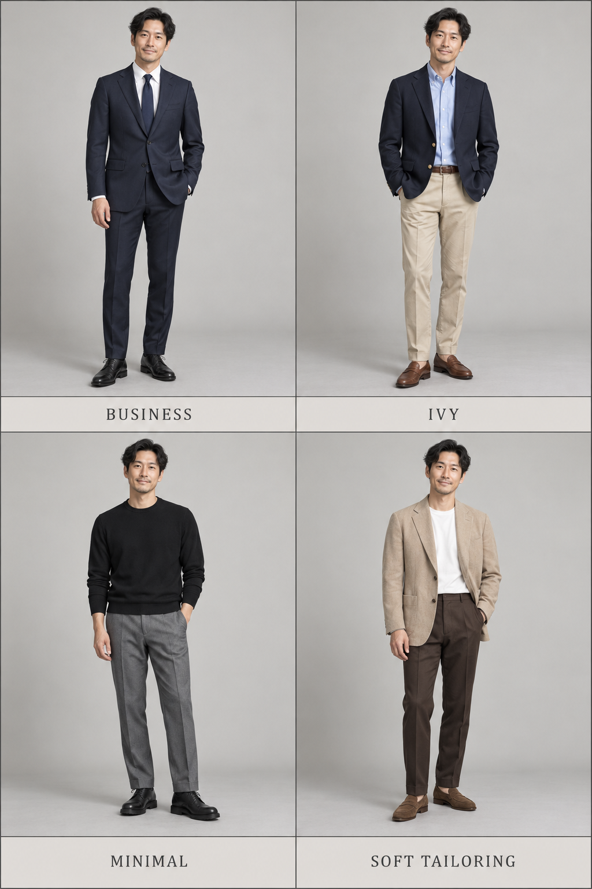
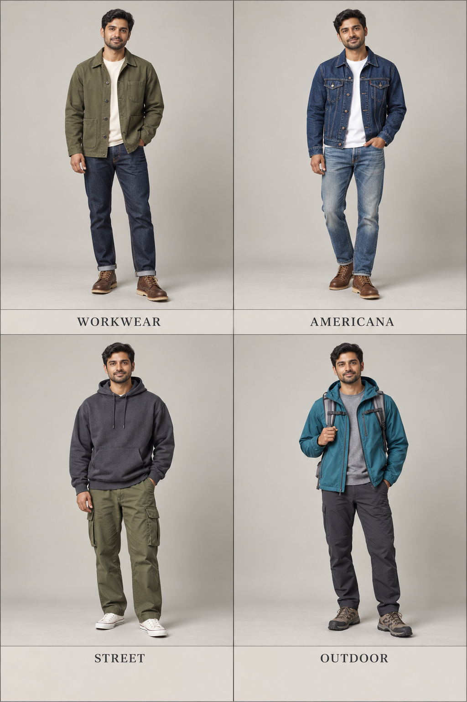

# 第 38 章｜男装风格辨识：先认衣物，再看它们怎样组合

*图 63：经典男装搭配的 AI 教学示意。左上商务、右上 Ivy 学院、左下城市极简、右下柔和剪裁。多项衣物同时变化，比较整套组织方式；这些原创造型不是年代、社群或品牌的历史复原。*

同一件深蓝夹克，搭白衬衫、灰西裤和领带，可以朝商务方向组织；换成扣领衬衫、浅色裤和乐福鞋，可能出现学院线索；再换成宽松 T 恤、牛仔裤和运动鞋，便成了另一种混搭。风格不只藏在单品里，也来自衣物之间的关系。

本章给的是方便观察的路径。现实穿搭经常交叉，商务、学院、工装、美式复古、街头、户外和极简没有一套彼此排斥的国际统一分类。遇到“日系男装”这类大标签，尤其要继续追问：指宽松层次、复古工装、城市机能，还是特定品牌、年代和社群？国家名不能代替衣物描述。

## 经典剪裁，可以组织出不同的整洁

**商务剪裁**先看套装关系：外套和裤子是否同料同色，是否有衬衫与颈部配饰，肩、腰、裤线怎样衔接。全套深色西装是一种清楚的组合，但深色、领带或皮鞋单独出现，都不足以决定职业和身份。宽松西装也可以保持商务线索，贴体并不是前提。

**学院与 Ivy**更适合从一组相互支持的单品认起：扣领衬衫、针织衫、休闲西装外套（sports jacket）、奇诺裤、乐福鞋等。FIT 博物馆的 Ivy Style 展览将 Brooks Brothers 的 sack suit、扣领牛津布衬衫与 Shetland 毛衣放在具体历史语境中。这里借助它理解常见衣橱线索，不把当代所有“学院风”都等同于这段历史。[资料：The Museum at FIT，Ivy Style: Brooks Brothers](https://sites.fitnyc.edu/depts/museum/ivy_style/exhibition/brooks-brothers.html)

**城市极简**通常可以通过少量色块、较少装饰、清楚的衣长和轮廓来表达。它既能用窄直线条，也能用宽松体积；全黑不是必要条件。若只写“高级极简”，读者仍不知道衣服长什么样；补上“无明显图案、短夹克、同色直筒裤、鞋面简洁”，就有了可观察的内容。

图 63 的右下格则展示**柔和剪裁**：浅色夹克配圆领内搭，用较少的领口层次与对比组织正面。这个说法描述造型方向；不从画面直接推断夹克无衬、没有垫肩，或使用了某种柔软纤维。

**美式复古**范围更宽，需要说明靠近哪条线索。牛仔夹克、直筒牛仔裤、工装靴与格纹衬衫，可以形成一种工作服、牛仔衣橱相关的组合；学院毛衣与休闲西装又是另一条路径。“复古”不证明衣物是真正旧物，也不自动标定某一年。需要年代准确的角色设计，应另外找到同期实物与照片。

*图 64：休闲男装搭配的 AI 教学示意。左上工装、右上美式复古、左下街头、右下户外式搭配。多项衣物同时变化，比较口袋、余量与层序；主题标签不代表职业或运动用途认证。*

## 工作服、运动服进入日常之后

工装（workwear）既可讨论实际工作服，也可讨论借用其外观的日常造型。Carhartt 的品牌历史把背带工装裤放在劳动服装的发展中，提供了真实产品线索；今天一件带贴袋的外套是否具备特定防护功能，仍需看它本身的资料。[资料：Carhartt，Carhartt History](https://www.carhartt.com/carhartt-history)

看工装式搭配，可以记录外露贴袋、加固区域、较宽的裤腿、衣料表面和鞋靴体积。卡其色只是颜色；穿卡其裤的人不一定在穿工装，黑色或深蓝也不妨碍一套衣服使用工作服结构。若是职业场景，实用装备与安全要求应另行查证，不靠“耐磨感”三个字代替。

街头也不等于“衣服很大”。卫衣、图案 T 恤、运动鞋、帽饰，以及它们与音乐、运动和社群的联系，都可能成为线索。Nike 的 Air Force 1 历史展示了一种从篮球鞋走向其他文化场景的产品路径；这说明单品意义会改变，不能反推所有运动鞋都属于同一种街头风格。[资料：Nike，The History of the Nike Air Force 1](https://www.nike.com/gb/a/air-force-1-history)

户外式搭配常出现连帽外套、拉链开合、携物口袋、分层衣物与运动鞋靴。辨认外观后，再把“壳层造型”与真正防风防雨装备区分开。REI 的分层指南按贴肤层、中间保温层与外层说明功能；日常造型可以借用这些关系，但图中的每一件衣物是否实现该功能，要另查产品资料。[资料：REI，Layering Basics](https://www.rei.com/learn/expert-advice/layering-basics.html)

## 用四项线索组织比较

| 观察轴 | 可以问的问题 | 比“有某种感觉”更具体的写法 |
|---|---|---|
| 主体衣物 | 是套装、针织、牛仔还是连帽外套？ | 藏蓝单排扣夹克配灰西裤 |
| 体积与比例 | 肩、腰、裤腿、衣长怎样连接？ | 短宽外套配高腰直筒裤 |
| 表面与细节 | 图案、贴袋、接缝、金属件在哪里？ | 胸前两个翻盖贴袋，没有大图案 |
| 搭配关系 | 内层露多少，鞋包如何呼应？ | 白 T 恤下摆露出一段，配厚底运动鞋 |

这四项是本书的原创观察工具，不是给穿着打分的量表。三项都支持学院线索时，可以暂称“学院式搭配”；若只看到一件扣领衬衫，而其余部分明显不同，直接写衣物往往更准确。

## 从混搭写出可执行的句子

“成年男性穿学院和工装混搭”仍然需要展开：“浅蓝扣领衬衫外穿深棕短工装夹克，前面有两个大贴袋；米白直筒裤裤脚轻触棕色乐福鞋，配深灰袜，肩背帆布托特包。”这句话保留一个穿搭意图，再由具体衣物落实。

也可以保留灰色西裤与白色衬衫，只替换外层和鞋：深蓝夹克与黑色系带鞋，改成橄榄色罩衫式外套与白色运动鞋。观察变化发生在什么位置，而不是预先宣布第二套“更年轻”。不同年龄、体型和肤色的成年人物，都可以试用这些衣橱关系。

找参考图时，把风格词放在检索开头，再加两三个具体条件，例如“学院、扣领衬衫、宽直裤、乐福鞋”。做人物描述时则反过来，优先写衣物与关系，把风格词放到最后补充气质。风格负责帮你找方向，结构和搭配负责让别人看见同一套衣服。
