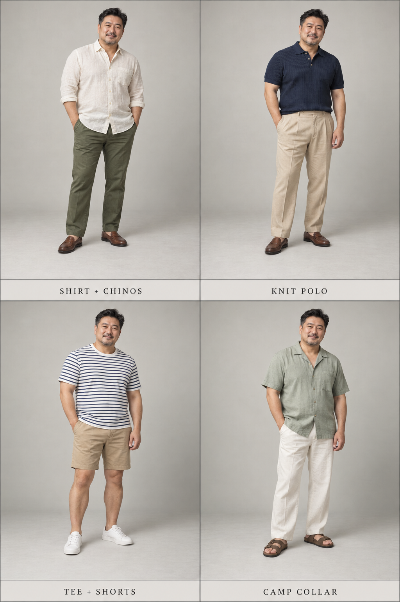
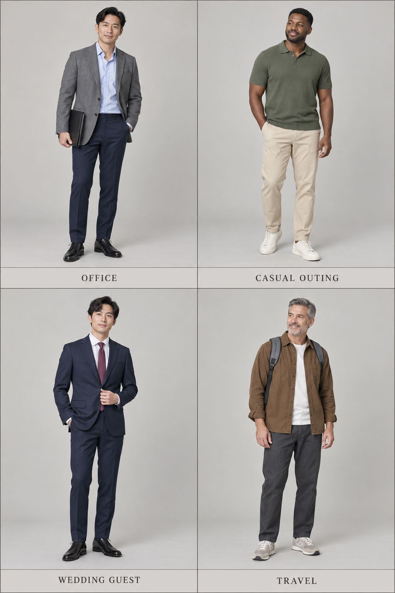

# 第 39 章｜男装场景穿搭：天气、活动与着装要求

*图 65｜AI 教学示意：左上衬衫配奇诺裤、右上针织 Polo 配褶裤、左下条纹 T 恤配短裤、右下开领衬衫配宽松长裤。比较覆盖范围、领口和衣物空间。*

同一件衣服是否适用，要放回天气、活动和场所中判断。通勤可能包括步行、乘车与室内久坐；旅行可能横跨不同温度和活动强度；婚礼的着装要求则可能因时间、地点和主办方而变化。“商务休闲”“夏日”“旅行”等标签，不能代替这些具体条件。

本章把前文的上装、裤装、鞋和配饰放到现实使用中。选择衣服时，一方面考虑外观和个人偏好，另一方面检查覆盖、活动空间、脱穿、携物与礼仪要求。

## 温暖天气：覆盖、透气与活动共同作用

温暖天气可以先看三个方面：**衣物覆盖多少、身体周围有多少空间、是否便于增减衣层**。短袖露出更多手臂，长袖则提供更多覆盖；敞穿短袖衬衫可以形成前襟开口，但里面再加一件 T 恤也会增加衣层。宽松裤腿与贴近身体的窄裤，在活动空间和接触身体的方式上有所不同。

衣物是否凉爽，并不由袖长或纤维名称单独决定。织物厚薄、结构、松量、湿度、风和活动强度都需要一起考虑。REI 的炎热天气与高湿环境衣着指南讨论了轻量、透气、较宽松衣物，以及环境与活动的影响，可作为理解这些变量的入门资料；其中的建议主要面向户外活动。[资料：REI，Hot Weather Hiking](https://www.rei.com/learn/expert-advice/hot-weather-hiking.html) [资料：REI，How to Dress for Humidity](https://www.rei.com/learn/expert-advice/how-to-dress-for-humidity.html)

城市日常穿着还常遇到室内外温差。衬衫、薄开衫与轻外套可作为便于脱穿的衣层；进入空调较强的室内时增加一层，转到温暖户外再脱下。选外搭时还要考虑脱下后怎样携带，而不只是穿着时的轮廓。

“亚麻”是成分信息，“薄”“疏松”“宽松”分别涉及厚度、织物结构和版型。两件同为亚麻的上衣，仍可能因为这些条件不同而有不同穿着感受。声称防晒或速干性能时，应核对具体商品的测试与说明；纤维名称和照片里的薄透外观都不足以代替性能信息。

## 通勤：行走、久坐与室内外转换

工作场所的着装要求应先于抽象风格标签。Emily Post 对 business casual 的解释强调场合差异与工作环境，说明它不是跨单位通用的固定制服。礼仪指南可以提供参考，实际仍以所在单位和活动的说明为准。[资料：Emily Post，Business Casual 101](https://emilypost.com/advice/business-casual-attire-guide)

需要较整洁的外观时，衬衫、剪裁长裤与便装夹克可以组成可增减衣层的组合。外套脱下后，衬衫与裤装仍应适合室内活动；若穿着者需要频繁行走、乘车或携带电脑，鞋、包与外套的重量和取用方式也会影响便利程度。

久坐会让裤脚上移，使肘部、腰腹与髋部产生褶折。试穿通勤服装时，应坐下检查裤腰和裤裆是否挤压，再抬臂、前伸，确认肩背与袖子是否妨碍动作。站立时平整，不能单独证明长时间穿着也合适。

鞋履应结合实际行走距离、地面和个人脚型选择。皮鞋并不必然不适合步行，运动鞋也不必然适合所有人；楦型、尺码、鞋底和穿着体验比类别名称更具体。裤长则应穿上计划搭配的鞋以后检查，避免裤脚受到鞋面支撑后的折痕与预想不同。

*图 66｜AI 教学示意：左上办公、右上休闲出行、左下婚礼宾客、右下旅行的穿着组合。现实着装应结合具体场所与活动要求。*

## 邀请函与礼仪：先读准确名称

“婚礼穿搭”可能指白天的户外聚会，也可能指晚间 black tie。邀请函上的原词、活动时间和场地，通常比“正式一点”更有用；信息不明确时，可向主办方询问。Emily Post 的 black tie 指南区分传统 black tie、creative black tie 与 black-tie optional，普通深色西装与晚礼服在这些语境中并不是可以任意互换的名称。[资料：Emily Post，Black Tie Dress Code](https://emilypost.com/advice/black-tie-dress-code)

[第 35 章](35-mens-tailoring.md)已经介绍西装与晚礼服的区别。Black tie 通常围绕晚礼服套装、相应衬衫与黑领结组织，不是“黑西装加黑长领带”的字面组合。另一方面，普通朋友聚餐未必需要礼服，不能因为活动在晚上就自动套用晚间礼服规范。

| 场景 | 优先核对的条件 | 衣物中的实际问题 |
|---|---|---|
| 通勤办公 | 单位要求、交通、室内外转换 | 外套能否脱穿，鞋是否适合路程，包能否容纳所需物品 |
| 城市散步与会面 | 行走与久坐、天气、个人偏好 | 鞋履、袖长、衣物空间和可增减衣层 |
| 婚礼与宴会 | 邀请函、时间、场地与主题 | 套装或礼服类别、衬衫、颈部配饰与鞋袜 |
| 旅行 | 温度变化、行李、活动与停留时间 | 分层、重量、携带与取用、洗护条件 |

会面和旅行都不是单一的穿着风格。城市旅行可以使用剪裁清楚的衣物，休闲聚会也可以保留领带；场景给出需要解决的条件，个人偏好决定其中的许多取舍。

## 旅行与日常出行：衣物要能够一起使用

整理旅行衣物时，可以先列出预计活动，再检查衣物之间是否能够组合。若只带一件外套，它需要容纳计划中的内层；若只带一双鞋，就应考虑实际行走环境与可能参加的场合。不能互相叠穿、难以携带或用途重叠的单品，可能增加行李，却没有增加相应的使用范围。

包也需要结合现实携物认识。双肩包让重量通过两条肩带分担，单肩与斜挎款的接触位置不同，公文包和托特包的开口、内部组织与提带也有差别。选择时可装入预计携带的物品，检查重量、取物和肩带与外套是否相互干扰。

可以用一次普通出行检验本章知识：穿上计划的内搭和外套，装好包，坐下、起身、走动并取出常用物品。观察哪些衣层需要调整、哪些部位容易挤压或遮挡。服饰知识由此联系到实际身体与活动，而不只停留在一套静止搭配的外观。
