# 衣着有名：人物衣着与单品细节分册

从连衣裙、蕾丝与领袖开始，学会说清人物穿着。

- [第 13 章｜连衣裙叫什么：从细肩带到网球裙装](chapters/13-dresses.md)
- [第 14 章｜半裙的六种组织：裙摆为什么这样展开](chapters/14-skirts.md)
- [第 15 章｜吊带、背心、胸衣与连体衣：外观、结构和用途分别命名](chapters/15-tops-underwear.md)
- [第 16 章｜领口与袖子：从“这件很特别”说到具体形状](chapters/16-necklines-sleeves.md)
- [第 17 章｜蕾丝、缎面与网纱：材料如何改变同一件衣服](chapters/17-fabrics.md)
- [第 18 章｜裤子与外搭：先看轮廓，再说衣型](chapters/18-trousers-outerwear.md)
- [第 19 章｜不要都叫“褶皱”：抽褶、褶裥与波浪边](chapters/19-details.md)
- [第 20 章｜不知道衣服叫什么，也能把它说清楚](chapters/20-description-workshop.md)
- [第 21 章｜汉服：先认形制，再谈风格](chapters/21-hanfu.md)
- [第 22 章｜Cosplay与角色服装：把角色拆成可描述的衣物](chapters/22-cosplay.md)
- [第 23 章｜相邻衣型怎样分：从裙装到裤装与外搭](chapters/23-garment-families.md)
- [第 24 章｜胸衣感从哪里来：固定方式、杯线与支撑结构](chapters/24-bodice-structure.md)
- [第 25 章｜从领口到背部：把一件上衣描述完整](chapters/25-visible-details.md)
- [第 26 章｜只换一种材料：用对照看清衣服的质感](chapters/26-material-comparison.md)
- [第 27 章｜鞋袜与包：名称之外，还要说清哪些部位](chapters/27-shoes-accessories.md)
- [第 28 章｜男装与中性衣橱：把整套穿着写成可调整的关系](chapters/28-wardrobe-lab.md)
- [第 29 章｜纹样的名称、尺度与分布](chapters/29-patterns.md)
- [第 30 章｜帽饰与首饰：轮廓、位置和尺度](chapters/30-headwear-jewelry.md)
- [第 31 章｜季节与场景：让一套衣服适应实际活动](chapters/31-context-layering.md)
- [附录 C｜从衣物到细节：84 条双语查词表](appendices/03-garment-words.md)

---

# 第 13 章｜连衣裙叫什么：从细肩带到网球裙装

前面的风格名称给衣服一个方向，但“浪漫风连衣裙”仍能指很多不同东西。要在生图、角色设定或设计讨论中说得清楚，还得继续叫出单品。先把最容易混用的英文分开：**dress 是上下连成一件的连衣裙，skirt 通常是独立下装半裙**。英文里的 skirt 也能指连衣裙的裙体部分，读具体语境；不能把所有中文“裙子”都翻译成 skirt。

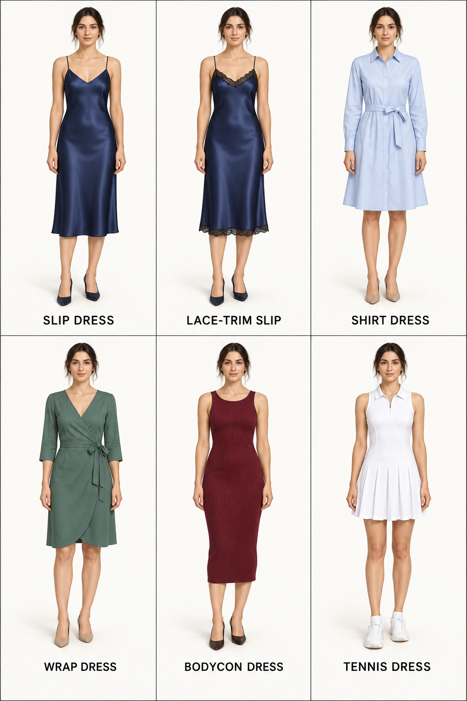

*图 13：AI 教学示意，已按画面核对。上排是深蓝无蕾丝细肩带裙 Slip dress、同色领口与裙摆加蕾丝边的 Lace-trim slip、浅蓝翻领单排扣系腰带衬衫裙 Shirt dress；下排是绿色交叠领腰侧系带裹身裙 Wrap dress、酒红无袖罗纹贴体裙 Bodycon dress、白色无袖短门襟褶摆网球连衣裙 Tennis dress。首两格为膝下中长裙，网球款明显较短、停在膝上；长度差异不是类别定义。正文的穿着句是可另行创作的示例，不是对六格的逐字图注。*

## Slip dress：从细肩带与下落线条说起

Slip dress 常译“吊带裙”，更具体地说，是借用衬裙线条的外穿连衣裙。常见窄肩带、相对简洁的上身、柔软垂坠，但不是每一件都用缎面、斜裁或 V 领。Vintage Fashion Guild 将它与 slip 的区别放在外穿用途以及所用材料、厚度上，而不是只看有没有蕾丝。[资料：Vintage Fashion Guild，Slips](https://vintagefashionguild.org/resources/item/lingerie/slips/)

图中第一格提供最简基线。描述时依次看肩带宽度、领型、腰部松量、裙长与表面反光。“香槟色缎面细肩带中长连衣裙，浅 V 领、腰部略有空间、裙体自然下落、无蕾丝和裙撑”，比“性感吊带裙”提供更多服装信息，也不会把人物情绪误当剪裁。

**完整穿着句：**“成年人物穿香槟色缎面细肩带中长连衣裙，领口无装饰，外搭敞开的深灰短开衫，配低跟细带鞋和小型方包。”外套与鞋包可以把相同基础裙推向日常、晚装或复古，不必为每种搭配发明一个新裙型。

## 一类多款：细肩带是一类入口，垂领、裙长和叠穿继续细分

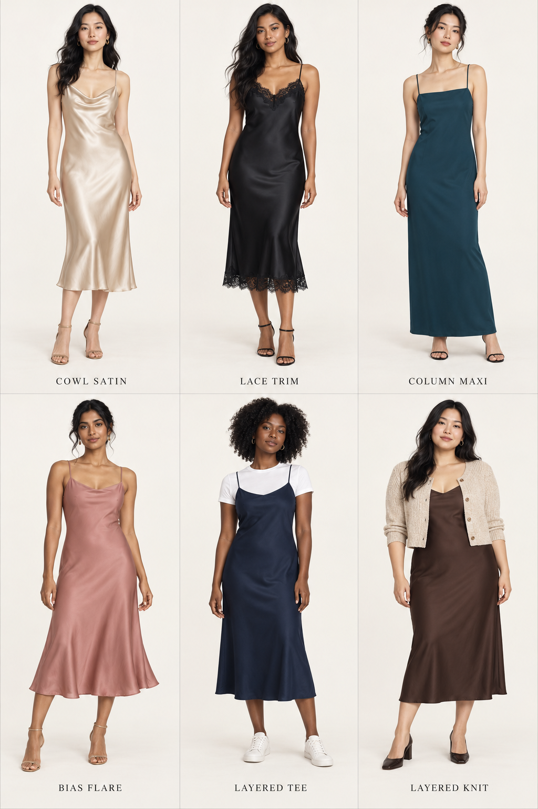

*图中顺序均为从左到右、先上后下。依次为：垂领缎面吊带中长裙、蕾丝饰边吊带裙、直筒长吊带裙、柔和外展的斜裁感吊带裙、内搭白T恤、外搭短针织开衫。斜裁是裁剪方式，照片中的垂坠只能提供线索，不能独自证明裁片方向。*

可以直接这样描述：**她穿香槟色细肩带垂领中长裙，裙身顺着身体垂落，配细带低跟鞋。**

## Lace-trim slip：蕾丝边改变了什么

第二格不是一套与第一格毫无关系的新类别，而是在相近细肩带裙上添加 lace trim／蕾丝饰边。领口蕾丝把视线引向上身，裙摆蕾丝改变边缘，颜色相近时较含蓄，深浅对比明显时更突出。蕾丝边不代表整件裙子都是蕾丝，也不决定它一定是睡衣或内搭。

**完整穿着句：**“她穿一件黑色缎面细肩带及小腿连衣裙，V 领与裙摆各有一圈窄黑蕾丝边，腰部不紧束，搭配黑色玛丽珍鞋与短款米白开衫。”如果希望蕾丝只有领口，明确删除裙摆饰边。模型容易把“lace dress”理解成全蕾丝，应用“satin dress with narrow lace trim”把主体与装饰分清。

第一、二格的比较可以继续做：固定颜色、裙长和人物，只改饰边宽度，观察“精巧细节”什么时候开始变成主要装饰。这个方法同样适用于领口滚边、刺绣或珠饰。

## 一类多款：同样叫蕾丝裙，蕾丝可以放在不同位置

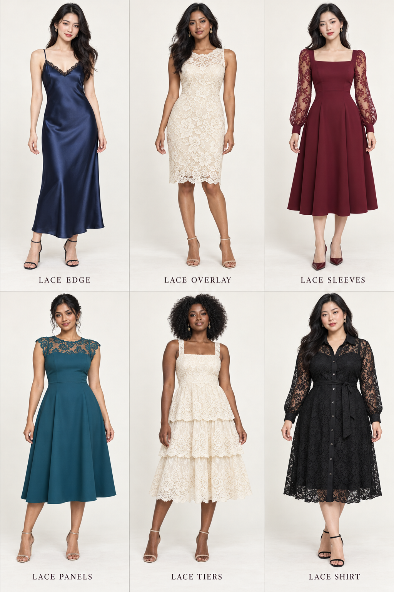

*图中顺序均为从左到右、先上后下。依次为：蕾丝饰边、带不透明里衬的蕾丝覆盖裙、蕾丝袖拼接裙、蕾丝肩部拼接裙、层叠蕾丝裙、蕾丝衬衫式连衣裙。看蕾丝覆盖的面积、所在部位和里衬，比只说“有蕾丝”更准确。*

可以直接这样描述：**她穿酒红色方领中长裙，裙身为不透明面料，长袖用花卉蕾丝拼接，袖口收拢。**

## Slip、slip dress 与 chemise：外形相近，名字还涉及用途

**Slip／衬裙**通常作为衣内层，full slip 从上身延伸到裙摆，half-slip 则从腰部开始。第 15 章用平铺图继续介绍。它与 slip dress 在外形上可能很像，不能仅凭“细肩带＋光滑布面”断言内穿或外穿，最好结合商品资料、结构与搭配情境。

**Chemise**在历史资料中可指贴身穿的衬衣式内衣；当代商品中又常用于较简洁的裙式睡衣。它不永远等同于现代吊带外穿裙。若不确定，直接说“轻薄裙式内搭”或“细肩带裙式睡衣”，再补领口、长度和松量，比一味寻找唯一译名更准确。

V&A《Undressed》指出，内衣、睡衣与外衣之间一直存在设计借用。因而“内衣灵感”与“真实用途”应分开理解，并不是看到蕾丝就能划定边界。[资料：V&A，Inside the Undressed: A Brief History of Underwear exhibition](https://www.vam.ac.uk/articles/inside-the-undressed-a-brief-history-of-underwear-exhibition)

## Shirt dress：衬衫结构延伸成裙

上右可以看到长袖、翻领、正面单排扣和布腰带，衣摆在膝附近。识别重点是衬衫式领口、门襟、扣子与袖口，再看它们怎样延伸到完整裙体。Shirt dress 可以直身，也可以收腰展开；可以长袖、短袖或无袖。它不是把一件普通衬衫画长一点就万事完成，腰部与下摆仍需要清楚组织。

**完整穿着句：**“人物穿浅蓝棉布衬衫连衣裙，翻领、正面单排扣、肘长袖、同色布腰带，裙摆到膝下并轻微展开，配棕色乐福鞋。”这句话同时交代单品、结构与搭配，适合直接作为角色衣着说明。

真实旁读可以看费城艺术博物馆约 1955 年的 Woman's Shirtwaist Dress。其说明把领口、腰部与有褶裙体放在一起讲，说明衬衫裙完全可以兼具清楚的上身结构与丰盈裙体，并非只剩宽松直筒一种。[真实案例：Philadelphia Museum of Art，Woman's Shirtwaist Dress，约 1955](https://www.philamuseum.org/objects/93329)

## Wrap dress：看交叠与固定关系

裹身连衣裙的关键不是 V 领，而是前部衣片交叠、通过系带或其他方式固定的关系。腰间打结只是容易看到的结果。**Faux-wrap／仿裹身**则可能把交叠外观固定缝合，穿着方式不等同于真正展开包裹的结构；一张正面图往往不能完全确认。

**完整穿着句：**“她穿深绿小点纹裹身连衣裙，七分袖、交叠 V 领、一侧腰间系带，裙摆到膝下、行走时有自然开合，配低跟鞋。”若需要制作，把内外衣片、固定点和遮盖关系另画清楚。不能让一根浮在面料上的带子代替真实连接。

DVF 的裹身裙是很好的真实参照，但不必把整类结构说成某位设计师从无到有发明。大都会博物馆将其 1975–76 年藏品放在更早的美式运动休闲服装包裹传统中理解。[真实案例：Diane von Furstenberg，Dress，1975–76，The Met，1997.487](https://www.metmuseum.org/art/collection/search/79701)

## Bodycon dress：贴体程度，不是固定领型

Bodycon 强调靠近身体轮廓，常见弹性面料，但可以有不同肩带、领口、袖长和裙长。它不能与 pencil skirt／铅笔半裙直接互换：一个是整件连衣裙及其贴体倾向，一个是下装轮廓。它也不等于能改变腰围的塑形衣。

**完整穿着句：**“成年人物穿深蓝罗纹针织贴体连衣裙，圆领、无袖、长度到膝下，腰与髋部轮廓清楚，搭配敞开的直身西装与平底鞋。”若想要贴合但不绷紧，写“沿身体自然下落、保留活动空间”，比同时要求“极紧身且完全宽松”更明确。

## Tennis dress：用途灵感能与裙型叠加

网球连衣裙是一件完整裙装，不是“运动背心＋网球半裙”的必然缩写。图中这一款是白色无袖翻领、短拉链式门襟、腰下较宽褶摆，长度明显在膝上；它没有展示内置短裤或口袋，不能补想成已看见的结构。此类服装常见无袖或短袖、清楚的上身与较便于动作的裙摆，有些带领、有些没有。仅看百褶和白色，不能证明它是专业比赛服。

**完整穿着句：**“人物穿白色无袖网球连衣裙，小翻领、短门襟、腰部清楚，下接膝上的浅褶裙摆，配白色运动袜与低帮球鞋。”若是网球灵感日常装，就直接写明；若要真实运动用途，再补材料、活动与内层需求。

## 一类多款：运动感也有多种裙装路径

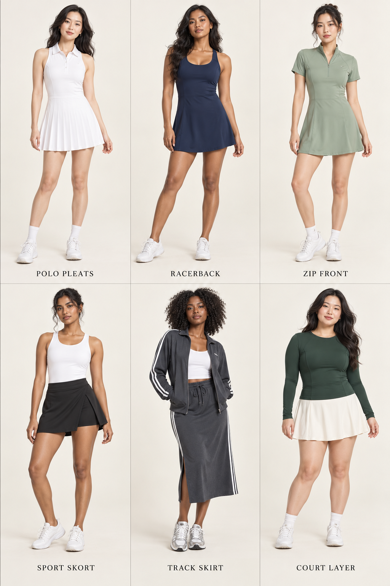

*图中顺序均为从左到右、先上后下。依次为：Polo领百褶网球裙装、运动背心式A字裙、半拉链短袖运动裙、包裹前片裙裤、侧条纹运动中长裙、长袖运动上衣配网球半裙。第二格标签RACERBACK涉及后背结构，当前正面图不能验证；要明确工字背，应另要求背面图。裙裤可见侧边露出的短裤层；图中的运动感不代表已验证专业运动性能。*

可以直接这样描述：**她穿鼠尾草绿短袖半拉链运动连衣裙，裙摆微微外展，配白色运动鞋。**

## 用一句话把不同维度放在一起

“黑色、缎面、细肩带、蕾丝边、中长、浪漫晚装方向”并不互相竞争：它们分别回答颜色、表面、肩部结构、装饰、长度和风格。“运动风、A 字、针织、裹身”也可能叠加，但结构必须能解释。

本章练习是只改一个条件：从第一格出发，先加蕾丝，再换成针织，再把肩带改宽。每一步都问自己：改变的是材料、装饰还是单品结构？如果名字没变，描述仍然可以更精确，这正是学习单品词的价值。

---

# 第 14 章｜半裙的六种组织：裙摆为什么这样展开

连衣裙把上身与裙体接成一件；半裙则从腰或髋部开始，与上衣分别搭配。同样的黑裙换一件上衣，可以从学院、都市转到浪漫或街头。先认出裙子本身的结构，才知道风格变化来自哪里。

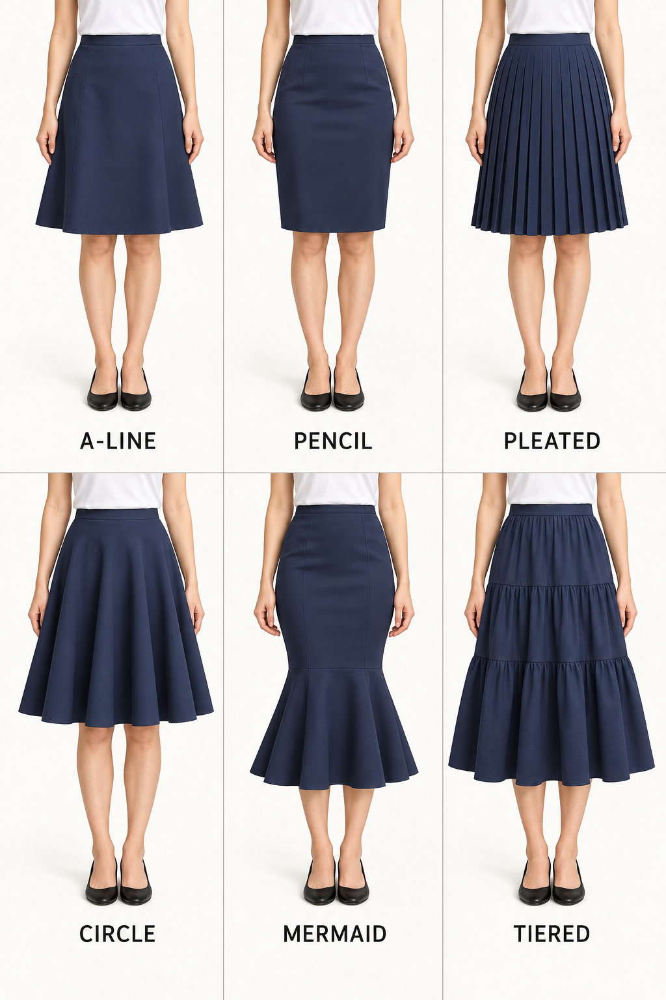

*图 14：AI 教学示意，已按画面核对。从左到右、先上后下：平整裙面的 A 字裙 A-line、窄直铅笔裙 Pencil、竖向重复折叠的褶裙 Pleated、摆量较大且有自然折浪的圆裙 Circle、下部接片展开的鱼尾裙 Mermaid、三段横向接缝与抽褶形成的分层裙 Tiered。六格统一深蓝色、白上衣与黑鞋，裙长仍有差异，并非严格同长度实验。廓形、褶的组织与分层方式可以叠加，不是完全互斥的纸样类别。*

本章先分三件事：**轮廓往哪里走，裙体用什么方式获得余量，长度停在哪里。**A 字与鱼尾主要提示轮廓；Pleated 提示褶的组织；Tiered 提示横向层次；Circle 还涉及裁片的几何关系。所以你可以有一条“A 字百褶中长裙”，也可以有“分层长圆裙”。

## A-line：从腰髋向下逐渐打开

A 字裙的直观特征，是上部较窄、下摆逐渐展开，远看接近字母 A。它可以短到大腿，也可长到脚踝；面料挺或软、腰位高或低，都会改变最终效果。别把所有蓬裙都叫 A 字：有些体积从腰部突然膨出，更接近鼓起的钟形；鱼尾则先贴合再在较低处展开。

**完整穿着句：**“人物穿高腰深蓝 A 字半裙，长度到膝上，腰头平整、裙身没有褶，搭配米白针织上衣、深色短袜和乐福鞋。”加入“没有褶”，是为了让 A 字轮廓本身先被看清，而不是规定 A 字裙不能有褶。

做生图对照时，要求上衣相同、腰线相同，把裙摆开度从小到大变化。你会发现相同名字下仍有很大空间，不必每改变一点就换分类。

## 一类多款：同样向下展开，A字半裙仍有很多样式

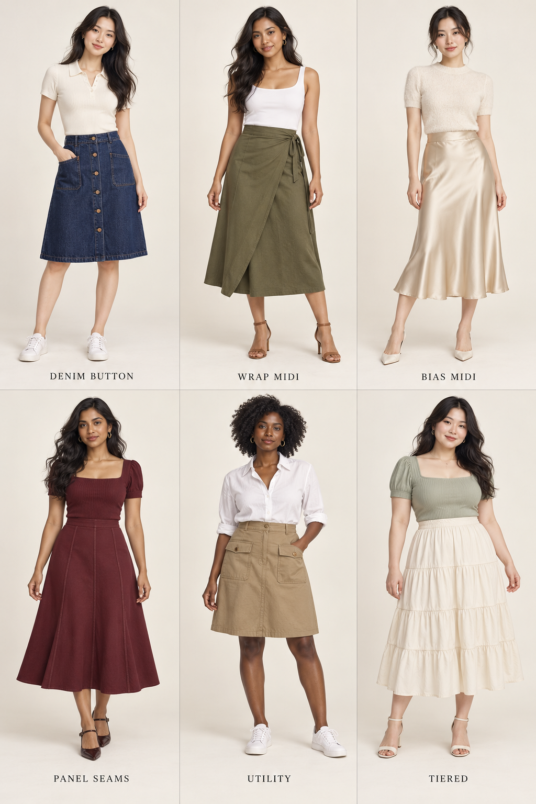

*图中顺序均为从左到右、先上后下。依次为：牛仔排扣、裹身中长、缎面柔垂、纵向拼片、工装贴袋、横向层叠。A字描述整体廓形；裹身、拼片、排扣和层叠说明具体结构，这些词可以组合。缎面光泽不能单独证明真丝成分。*

可以直接这样描述：**她穿橄榄绿裹身A字中长半裙，前片斜向交叠，在侧腰系结，搭配白色背心。**

## Pencil skirt：一条更靠近身体的窄线

铅笔裙通常沿腰髋形成相对贴合的窄长轮廓，下部不大幅展开。它可有前开衩、后开衩或其他活动安排，也可能使用弹性布料；这些要分开描述，不能看到窄裙就自动生成高开衩。

**完整穿着句：**“她穿炭灰高腰及膝铅笔半裙，腰髋贴合、下摆窄而平直，后部有小幅活动开衩，搭配浅蓝衬衫和黑色低跟鞋。”如果图片只画正面，后开衩未必能看到；需要展示结构时，应增加背面图，而不是在正面强画一条不属于它的缝。

与 bodycon dress 区别时，先看是否为独立下装；与 mermaid 区别时，看膝部以下有没有显著展开。贴体程度、裙长与开衩高度都可以独立调整，并不决定穿着者身份或性格。

## Pleated skirt：褶把收拢与展开连接起来

褶裙把布料有秩序地折叠，让较小的腰部容纳更多裙体。静止时可呈现重复的竖向节奏，动作时折叠打开，产生新的体积。褶可以只在一段出现，也可以绕裙一周；“有褶”不等于每条都细密到同样宽度。

**Knife pleats／顺向褶**常向同一方向折；**box pleats／箱褶**与**inverted box pleats／倒箱褶**的折叠关系不同；**accordion pleats／手风琴褶**常用较连续的折扇节奏表达。入门不必背全部名称，先能说清褶宽、方向和起止位置。

**完整穿着句：**“人物穿烟灰色高腰中长百褶半裙，细褶从平整腰头下方连续展开、裙长到小腿中部，搭配贴体黑色高领针织和短靴。”若想要学院感更强的宽褶短裙，就明确“宽顺向褶、膝上长度、挺括面料”，不能只把颜色改成格纹。

真实设计可远比校服式褶裙复杂。大都会博物馆约 1990 年的三宅一生 Flower Pleats 上衣与裙装组合，用褶和造型组织出花瓣般的体积。它适合提醒我们：褶是设计方法，既能规整，也能进入立体实验。[真实案例：Issey Miyake，Ensemble，约 1990，The Met，2015.451a, b](https://www.metmuseum.org/art/collection/search/695620)

## Circle skirt：由几何余量形成展开

圆裙通常关联圆形或部分圆形裁片围绕腰部形成的裙体。完整圆、半圆或其他展开量，可以带来不同的裙摆余量；自然下垂时常形成较大的柔软折浪。它未必需要在腰部密密打褶，也不意味着所有时候都像圆盘一样撑开。

**完整穿着句：**“她穿酒红色高腰圆裙，膝下长度，腰部平整、无密集抽褶，裙摆自然形成较深的大折浪，配短开衫和玛丽珍鞋。”若想展示摆量，可以另画裙摆平展开或轻微转身的一格，静态正面不一定能确认准确圆量。

这也是圆裙与 A 字裙容易混的原因：前者的名称更接近裁片来源，后者主要说外观轮廓。圆裙垂下时也可能呈 A 字。看到照片时可以描述“有较大摆量的 A 字轮廓”，不要凭一眼声称自己已经还原纸样。

## Mermaid：先贴合，再让下部展开

鱼尾裙的重点是上部较贴合、在较低位置转为明显展开。图中下中格能看到下部横向接缝：接缝上方相对收窄，下方展开，并不是拖地长礼服。展开点可以变化，下摆也可用裁片、插片或荷叶边获得体积。它不必是拖地婚纱，也可以是日常及小腿裙；但只有裙摆一条窄荷叶边，未必就需要强调成夸张鱼尾。

**完整穿着句：**“人物穿深绿中长鱼尾半裙，腰髋到膝附近相对贴合，膝下以数片裁片逐渐展开，搭配素色短袖针织和低跟鞋。”想要更轻的效果，可以写“展开幅度较小”；想更戏剧化，则扩大下摆与长度，并检查走动需要的空间。

与铅笔裙的区别不是“更正式”，而是下部体积的变化。与 A 字裙的区别也不只是裙摆宽：A 字从较高位置逐渐展开，鱼尾把展开推迟到更低处。

## Tiered skirt：用横向层次逐段增加体积

分层裙的裙体由一层层横向结构组织，常见接缝、抽褶或荷叶式边缘。它可以长也可以短，层与层的宽度、数量和材料都能变化。中文“蛋糕裙”常用来形容较鲜明的横向层叠，但商品用法不稳定，最好继续说明到底是接片层次还是附加荷叶边。

**完整穿着句：**“她穿米白棉布三层长半裙，每层接缝下有轻度抽褶，裙摆逐层增宽，长度到脚踝，搭配宽松针织罩衫与软底短靴。”若想避免蓬得太满，可补“层间余量克制、自然垂坠”；若想强调层层边缘，则写明每层可见的饰边。

Tiered 与 pleated 的差别在于这里先看横向分段，后者先看布料折叠。两者仍可结合：某一层完全可以做褶，但描述时应标出褶出现在哪层，别让模型把横接缝与竖褶画成无逻辑网格。

## 长度与腰线，是第二套坐标

Mini、midi、maxi 常作为短、中长与长裙的检索词，但具体落点会随品牌与人物比例变化。需要精确画面时，直接写“膝上约一掌”“到小腿中部”或“离地几厘米”。同样的长度词放在不同身高上，不能代替成衣尺寸。

高腰、自然腰、低腰说的是裙腰位置，不是裙型。把一条高腰铅笔裙改为低腰，并不会自动成为 A 字；把长鱼尾缩短，也不必变成圆裙。材料、腰位、长度、装饰应各自描述。

## 半裙、衬裙、裙裤与连衣裙裙体

Skirt 是本章的外穿独立裙装；underskirt／petticoat 则可能是内层，作用可包括体积、保暖或遮盖，不是所有衬裙都带硬裙撑。Skort／裙裤常把裙式外观与短裤结构结合，能否看见裤腿要看设计；一张正面图不能证明其内部结构。

连衣裙的下半部也可以说“pleated skirt／有褶裙体”。因此句子里还要写“a dress with a pleated skirt”还是“a pleated skirt with a blouse”。把这两个整体关系分清，生图时就不容易把分体穿搭误生成连衣裙。

练习：给图中六格都配同一件白衬衫，分别描述裙体，再给每格换鞋包。先观察轮廓变化，再观察风格变化。你会发现“叫什么”不仅帮助搜索，也能解释为什么看起来不同。

---

# 第 15 章｜吊带、背心、胸衣与连体衣：外观、结构和用途分别命名

有些单品在中文里只差一个字：吊带衫、吊带裙、衬裙；有些英文又常被商品标题混用：bustier、corset、corset top。学习时先找衣服覆盖到哪里、由哪里固定、如何连接，再问它在这套搭配中承担什么用途。这样不会把所有有细肩带的衣服都叫背心，也不会把每条竖缝都当成真正的支撑结构。

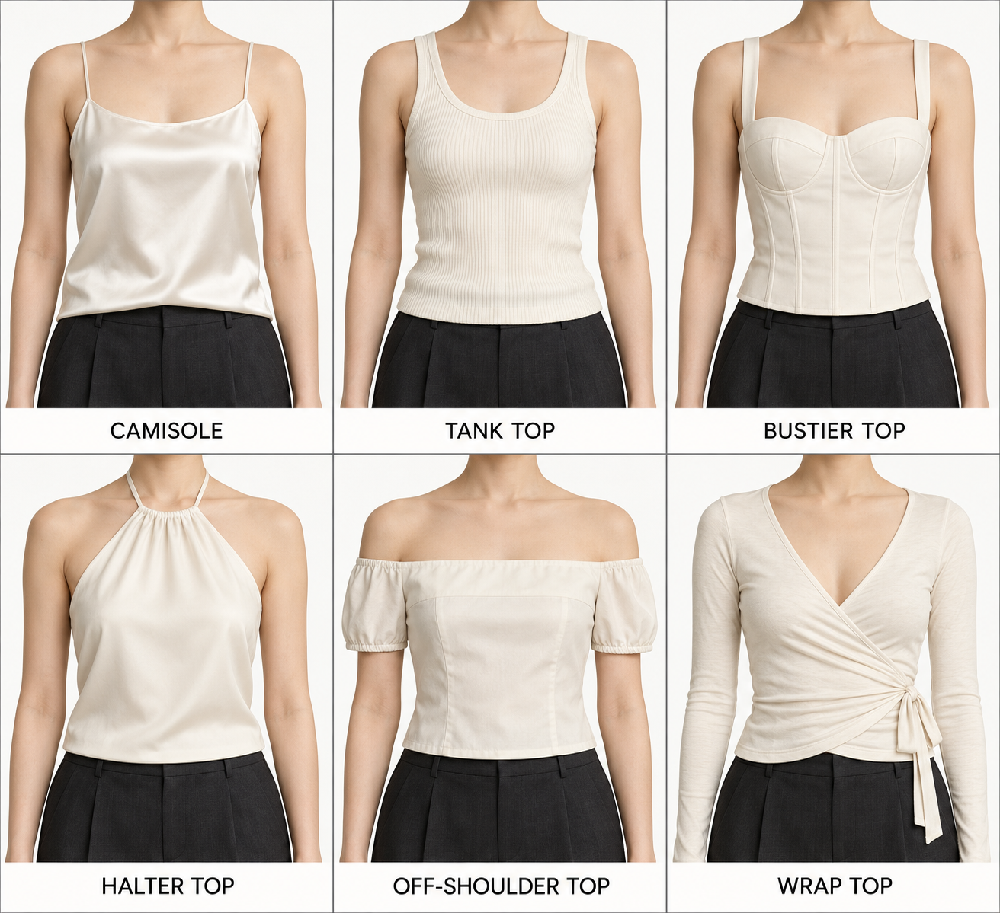

*图 15：AI 教学示意，已按画面核对。从左到右、先上后下：细肩带浅弧领缎面感 Camisole、宽肩部圆领罗纹 Tank top、带肩带且杯线与分片清楚的 Bustier top、领缘抽褶的挂脖 Halter top、带短泡泡袖的松紧领 Off-shoulder top、长袖交叠领腰侧系带 Wrap top。六格采用米白上衣与深色裤装，重点比较衣服结构；正文穿着句另提供变化示例。*

## Camisole：先说细肩带与衫身

Camisole／吊带衫常以相对窄的肩带、无袖上身和到腰髋附近的衫身识别，既有内搭，也有外穿设计。它可以缎面、针织或其他材料；蕾丝不是必要条件，细肩带也不是内衣用途的证明。

与 slip dress 比较，先看长度与整件关系：吊带衫仍是上衣，需要另配下装；吊带连衣裙则是完整裙装。与 tank top 比较，细肩带和较轻的衫身常是有效线索，但商品边界有重叠，别只凭肩带宽一厘米就强判。

**完整穿着句：**“她穿米白缎面细肩带吊带衫，浅 V 领、领口无蕾丝、衣摆到髋部，搭配深蓝直筒牛仔裤与敞开的棉质衬衫。”若要短款，明确“衣摆到腰部”，不要只写 crop 而不管内外层长度。

## Tank top：肩部连接更像无袖上衣

Tank top 常译背心或无袖背心上衣，常见较宽肩部、连续的前后衣片、圆领和针织材料，也有不同领型、宽度与版型。它不一定贴体，不一定用于健身，也不等于运动文胸。

**完整穿着句：**“人物穿白色罗纹棉感圆领背心，上肩带较宽、腋下开口克制、衣身略贴合，搭配高腰卡其宽裤和帆布鞋。”把材质改为光滑运动针织、增加不同背部结构，可能更接近运动穿搭，但仅靠外观仍不能确认专业用途。

## Bustier top：胸衣式结构成为上衣

这类名称常用于强调胸部造型、贴合衣身与分片线的上衣，可能有杯型、支撑条外观，也可能用省道与较挺材料形成结构。可以无肩带，也可以有肩带；不是所有 bustier top 都需要写成“抹胸”。

**完整穿着句：**“人物穿黑色外穿胸衣式短上衣，清楚的弧形杯线、贴合的分片衣身、下摆到腰部，搭配米白高腰长裤与宽松西装。”这里说明“外穿上衣”，避免模型自动生成内衣套装。可见杯线、竖线只是外观证据，不能证明里面有钢圈、鱼骨或实际束形功能。

## 一类多款：胸衣式上衣：把结构放进日常搭配

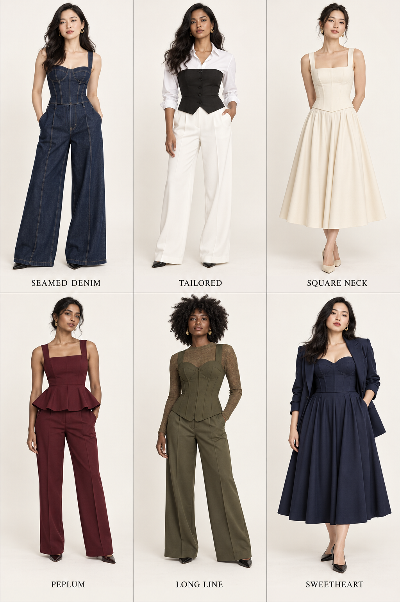

*图中顺序均为从左到右、先上后下。依次为：牛仔分割线款、衬衫外叠穿的无肩带款、宽肩带方领款、腰部荷叶摆款、叠穿薄针织的长款、心形领配敞开西装外套。图中骨条感线迹属于可见造型，不能据此判断内部真的有骨条或束腰功能。*

可以直接这样描述：**她穿深蓝色心形领胸衣式上衣，外披同色西装，下配蓬度适中的中长半裙。**

## Halter top：从颈部关系识别挂脖

Halter／挂脖式的关键是上部绕颈或在颈后固定的关系，肩部常较开放，前胸可以是高领、V 领或其他覆盖。它不是只要露肩就成立；普通肩带从前片直连后片，也不叫挂脖。

**完整穿着句：**“她穿深蓝挂脖上衣，颈后系带、前片高领、肩部开放、下摆到腰部，搭配同色中长 A 字半裙与低跟凉鞋。”若背面关系重要，增加后视图，并说明颈带怎样连接；正面一个高领口并不能证明它是挂脖。

## Off-shoulder top：领口落在肩线以下

露肩或一字肩上衣把领口安排到肩部以下，常形成横向线条，也可以不对称。它与 **cold-shoulder／肩部挖空**不同：后者可能仍有衣料覆盖肩顶，只在局部打开；与无肩带 bustier 也不同，露肩上衣仍可以有袖子，并借领口结构固定。

**完整穿着句：**“人物穿米白一字肩针织上衣，横向翻折领、长袖、衣身贴合但不紧绷，下摆到腰部，搭配深灰直筒裤。”需要画清楚袖子与衣身连接，别把袖子生成为悬浮臂套。若只露一侧肩，就说单肩不对称，不用一字肩代替。

## Wrap top：交叠停在上衣长度

裹身上衣借前片交叠与腰部固定形成关系，和第 13 章裹身裙的区别是衣长及是否连有裙体。它可以长袖或无袖、针织或梭织；也有仿裹身外观，交叠处已经缝合。

**完整穿着句：**“她穿浅粉针织裹身开衫，长袖、交叠 V 领、腰侧细系带，衣摆到自然腰，内搭米白背心，配灰色宽裤与平底鞋。”若希望真正可以解开，设计说明中应明确固定点；若只要视觉，称“仿裹身上衣”同样准确。

## 一类多款：衬衫与罩衫：领型和袖型一起命名

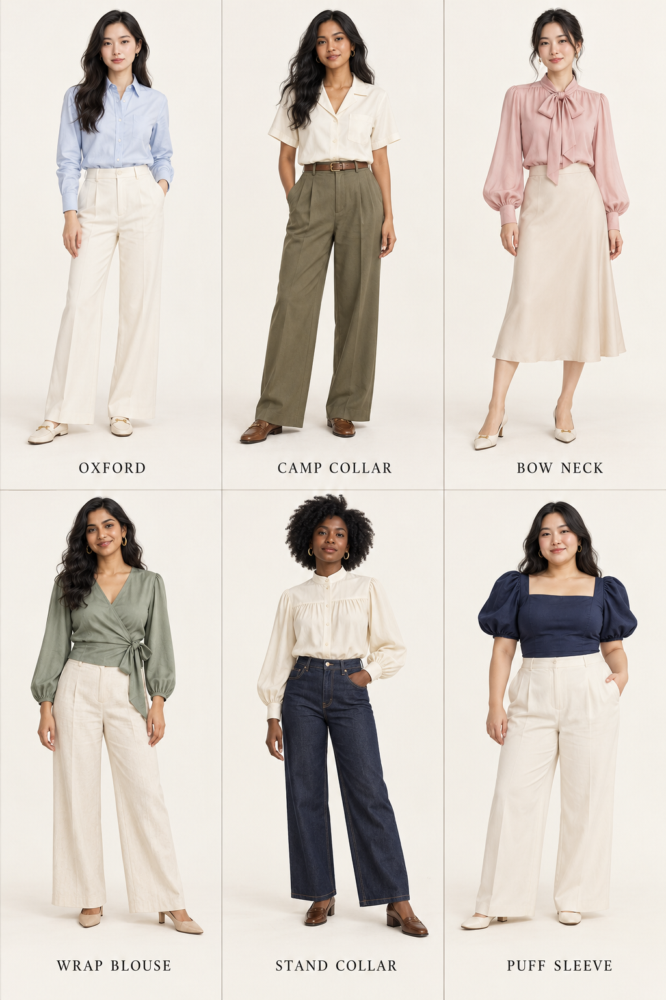

*图中顺序均为从左到右、先上后下。依次为：浅蓝牛津衬衫造型、短袖开领衬衫、系带领衬衫、裹身侧系带罩衫、立领育克抽褶衬衫、方领泡泡袖上衣。牛津布组织需要近景确认；这里先用版型、领口、袖子和门襟描述。*

可以直接这样描述：**她穿浅粉色系带领衬衫，长袖在袖口收拢，领前结成垂落的蝴蝶结，配奶油色中长裙。**

## 一类多款：针织上衣：不必只说一件毛衣

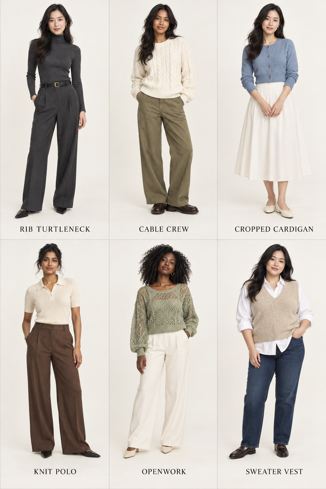

*图中顺序均为从左到右、先上后下。依次为：细罗纹高领、粗针麻花圆领、短款纽扣开衫、短袖针织Polo、内衬吊带的镂空针织、衬衫外叠穿V领针织背心。针织说明织物与组织；开衫、背心和Polo继续说明衣型。*

可以直接这样描述：**她穿灰绿色镂空针织套头衫，内搭同色不透明吊带，下配奶油白阔腿裤。**

## 再看内层：名字不能只靠有多少蕾丝

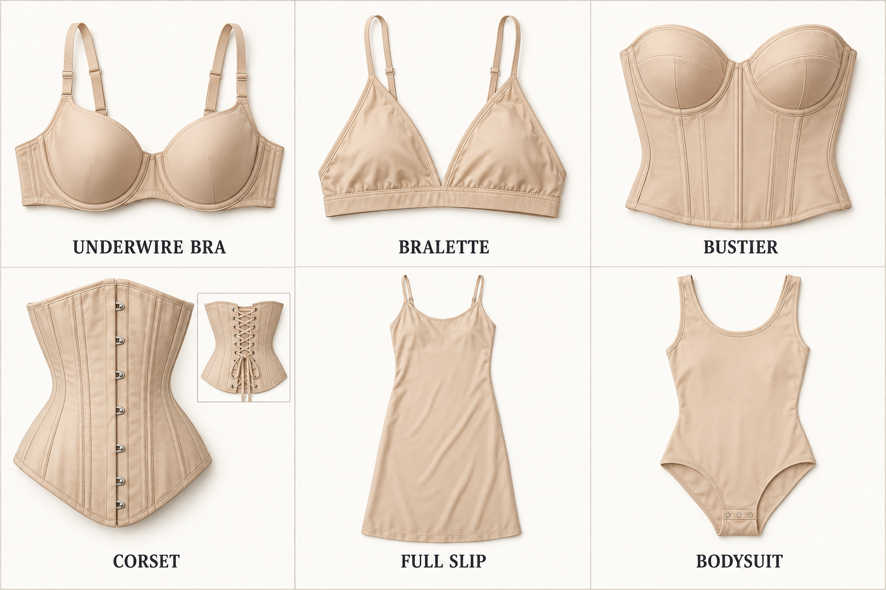

*图 16：AI 教学示意，已按画面核对，采用米色衣物平铺目录形式。上排是带可调肩带的 Underwire bra、三角软杯式 Bralette、无肩带长身 Bustier；下排是胸下腰封式 Corset（旁有后系带小图）、细肩带裙式 Full slip、宽肩部且有裆部按扣的 Bodysuit。主图中的衣物没有穿在人身上，平铺关系便于比较覆盖范围；杯线与支撑通道仍不提供实际性能证明。*

内层可以遮盖、减少外衣摩擦、承托、保暖或参与外部造型，不应只按装饰多少分成两类。FIT《Exposed》以有结构与较柔软的衣物组织观察，并展示内衣与外衣之间的借用，例如约 1950 年 Iris 睡裙与 Claire McCardell 同期晚装的并置。[资料与真实案例：Museum at FIT，Exposed: A History of Lingerie](https://www.fitnyc.edu/museum/exhibitions/exposed-history-of-lingerie.php)

## Underwire bra：名称指向杯下支撑结构

Underwire bra／有钢圈文胸的重点是杯下沿的支撑圈结构，可能搭配不同杯面、罩杯高度、肩带和后背形式。“有圈”不等于厚垫或聚拢，“无圈”也不等于没有其他支撑。平铺画中看到弧形缝线，只能说呈现钢圈式外观；真实结构需看实物。

**具体描述句：**“一件米色有钢圈文胸，平滑杯面、窄可调肩带、背部排扣，杯沿没有蕾丝装饰，以独立平铺目录方式展示。”如果只想画内层如何配合外衣，则说明“作为不外露的内搭”，不必让模型透过衣服展示结构。

## Bralette：较柔软的文胸式上身

Bralette 常指较轻、较少硬结构的文胸式衣物，常见无钢圈款，但商品用法并非绝对统一。它可以蕾丝，也可以素面针织，可以有软杯、内衬或加长下围。三角形杯面是常见外观之一，不是唯一形制。

**具体描述句：**“一件深绿柔软针织 bralette，三角软杯、无可见硬圈结构、细肩带与稍宽下围，作为独立服装平铺。”如果希望内衬明确、不透明，就单独写出；不要把 bralette 当成“必然透明”的同义词。

## Bustier：胸部与躯干共同组织

与常见只到胸下的文胸相比，bustier 往往将较贴合的衣身向腰部延伸，可能结合杯型、分片与支撑。其长度、肩带与扣合形式有变化。它与本章前面的 bustier top 不是只差一条固定长度线，而是还涉及内层、外穿和商品定位。

**具体描述句：**“一件黑色长身 bustier，带明确杯型、腰部长度的分片衣身、背部钩扣，以平铺方式显示正反面。”若看到有吊袜带等附属结构，应另行描述；不是每件 bustier 都有，也不应自动添加。

## Corset：结构词不能被装饰线代替

Corset 常译紧身胸衣、束身衣或束腰，但这些中文词覆盖并不完全相同。图中下左具体是 **underbust corset／胸下式束身衣**：上缘止于胸下方向、重点包围腰部，主图显示前中扣合，小图显示后部交叉系带。它只是 corset 的一种，不能把整类都限定为这幅腰封式外观。

**Overbust／full-bust corset**则是覆盖胸部的款式，常译全胸式束身衣。这里的 full-bust 指覆盖范围，不用来评价穿着者体型。胸下式与全胸式都还会有长度、分片与扣合差异；描述时先说覆盖哪里，再说前扣、后系带或其他结构。Corset 常涉及成型裁片、加固结构与扣合关系，不要简化为“长一点的文胸”，也不能认定凡有后系带的上衣都具有束腰效果。

可对照收藏机构实际使用的两个名称：[The Underpinnings Museum，Thomson's Glove Fitting 胸下式 corset](https://underpinningsmuseum.com/museum-collections/cotton-overlocked-elastic-panel-underbust-corset-by-thomsons-glove-fitting/)与[Agent Provocateur 缎面蕾丝全胸式 corset](https://underpinningsmuseum.com/museum-collections/satin-lace-overbust-corset-by-agent-provocateur/)。本书平铺图只示范前一种覆盖关系，没有复制这两件真实藏品。

V&A 的维多利亚内衣专题把 corset、裙撑与后裙撑分别解释，能看出它们对衣服轮廓的不同作用；竖向支撑、前中结构与系带要结合整件衣物理解。[资料：V&A，Corsets, crinolines and bustles](https://www.vam.ac.uk/articles/corsets-crinolines-and-bustles-fashionable-victorian-underwear)

**具体描述句：**“一件棕色 corset，分片形成腰部曲线、竖向加固通道清楚、前中扣合、背部交叉系带，平铺展示，不夸张收窄。”若只是借样式，应称 **corset-inspired top／束身衣灵感上衣**，再说明“装饰性分片线，无真实束形要求”。杯型、鱼骨状线条与系带外观，单独或同时出现都不能证明实际性能。

## Full slip：连续裙式内层

Full slip／全衬裙从上身延伸为裙式内层，区别于只从腰部开始的 half-slip。它可以细肩带、宽肩带、不同领口和长度；有蕾丝不一定更“内衣”，无蕾丝也不自动是外穿裙。

**具体描述句：**“一件米白全衬裙，窄肩带、平直领口、顺滑低装饰裙体，长度略短于外层中长裙，作为内搭使用。”说明它与外裙的长度关系，才能让层叠有逻辑。若要外穿 slip dress，重新说明用途、材料与搭配，而不是只增加高跟鞋。[术语旁读：Vintage Fashion Guild，Slips](https://vintagefashionguild.org/resources/item/lingerie/slips/)

## Bodysuit：上下连续到裆部的连体结构

Bodysuit／连体衣的关键不是贴身程度，而是上身延伸到下部、形成连续结构；可能有裆部扣合，也可能采用别的穿脱方式。它可以是内衣、塑身衣、外穿上衣或表演衣装，必须继续描述。只见上半身时，它可能与普通背心完全相像。

**具体描述句：**“一件黑色长袖圆领 bodysuit，平滑针织面、下部为三角连体结构、裆部按扣，平铺展示；穿着搭配时下部藏在高腰裤内。”与泳衣、舞蹈 leotard 等的外观可能重叠，用途和材料信息仍需明确，不能靠连体外形认定。

## 把层次关系也写进一句话

“外穿短西装，里面是蕾丝边吊带衫，下配铅笔半裙”说明三件分体衣物；“外穿无蕾丝 slip dress，内有不外露的全衬裙”说明外裙与内层；“corset-inspired 上衣配牛仔裤”说明借用设计语言，不承诺真正束形。

本章练习：先用平铺图写衣物结构，再用完整人物图写搭配。若从前者跳到后者后名字改变，问清改变的是结构、用途还是风格。学会这样分层，你就能既准确命名一件衣服，也保留自由创作的余地。

---

# 第 16 章｜领口与袖子：从“这件很特别”说到具体形状

同样一件黑上衣，圆弧领口、方领口和堆褶领口能改变它围绕脸部形成的线条；袖子短一点、鼓一点、开口大一点，也会改变整套衣服的重心。这里先不猜风格，而是学习说清楚衣服的局部。

## 领口、领子与肩带，先分开

**Neckline／领口线**是衣服开口围绕颈部、肩部和前胸形成的边界；**collar／领子**是领口附近的衣物结构，例如衬衫翻领和立领。方领上衣可能没有另装的领子；深 V 开口也可以同时有翻领。中文常把两者都简称“领型”，讨论时补一句“我说的是开口形状”就能减少误会。

**Strap／肩带**负责连接前后衣片等部位，不是袖子。细肩带、宽肩带、无肩带说的是上身支撑与覆盖关系；无袖说的是没有袖体，二者不能直接画等号。可以说“方领、宽肩带、无袖上衣”，而不是把它们当三个竞争的款式名称。

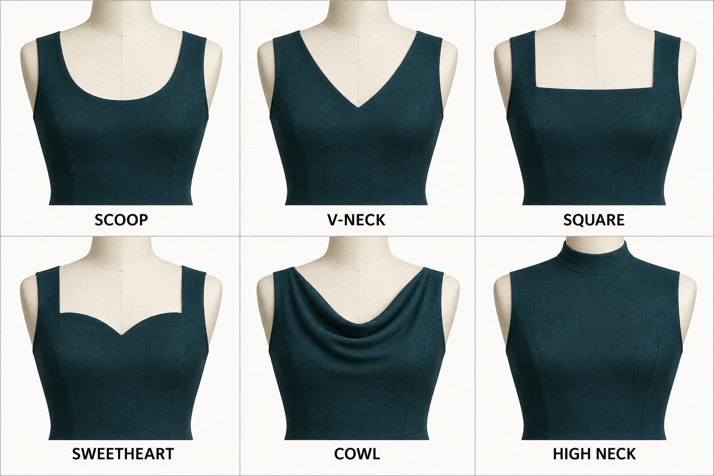

*图 17：AI 教学示意，已核对领口外观。从左到右、先上后下为圆弧、V 形、方形、心形、垂褶与高领口。前五格可见不同边线或垂褶；右下高领口另带短竖领，接近 mock neck，不是“没有领子”的示例。相近衣物颜色有助比较，图不作为裁剪纸样。*

## 六种领口，怎样看、怎样说

**Scoop neckline／较深的圆弧领口**：边缘以连续弧线向下展开；与贴近颈根的小圆领 crew neck 相比，它通常开得更低或更宽，但具体深浅仍需补充。例句：“她穿黑色无袖上衣，领口是宽而不深的圆弧，边缘平整，没有另加翻领。”检索可用 `scoop-neck sleeveless top`。

**V-neck／V 领口**：两侧边线向中间尖点汇合。V 可以宽、窄、浅、深，不必默认大开口。例句：“上衣采用浅 V 领，尖点止于上胸，领缘无花边，搭配窄长吊坠。”检索 `shallow V-neck top`；要强调开口宽度，可加 `wide` 或 `narrow`。

**Square neckline／方领口**：下缘较平，两侧上升，转角可能锐利也可能略圆。例句：“米白方领上衣配短袖，领口较宽、转角柔和，下缘为水平线。”检索 `square-neck blouse`。不要只写“方形领子”，否则模型可能增加一圈独立翻领。

**Sweetheart neckline／心形领口**：前胸上缘形成两个弧峰，中间略下凹，整体让人联想到心形上部。它可以搭配袖子或肩带，不只用于无肩带礼服。例句：“连衣裙采用浅心形领口和宽肩带，中央凹口克制，上身保持完整覆盖。”检索 `sweetheart neckline wide straps`。

**Cowl neckline／堆褶、垂褶领口**：领口附近留出布量，让材料自然垂成褶。要看褶怎样落下，而不只是开口像 U 还是 V。例句：“深蓝上衣的领口形成两三道柔软垂褶，面料低光泽，肩部不加装饰。”检索 `draped cowl-neck top`。它与披在颈外的围巾不是同一对象。

**High neckline／高领口**：首先说明开口位置较高，尚不能确定领子结构。`mock neck` 常指较短的竖起领，`turtleneck` 则常关联较高、可翻折或包围颈部的领体。例句：“贴近颈根的高领口上衣，只有窄包边，没有翻折领筒。”检索 `high-neck top without collar`，比只写“高领”更具体。

这六种并未列尽船领、单肩、露肩或衬衫领等变化。先掌握“边线是什么形、开到哪里、有没有独立领子”，遇见新款也能描述。

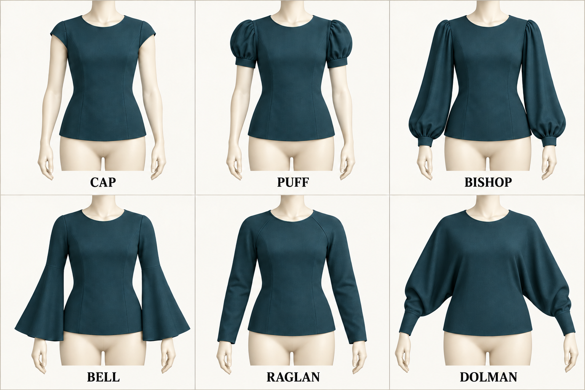

*图 18：AI 教学示意，已核对修订图。从左到右、先上后下为 Cap、Puff、Bishop、Bell、Raglan、Dolman。前四格比较袖体与开口，插肩格显示斜向分界；右下修订格以深腋下、向腕部收窄的连续宽袖轮廓示意 Dolman，不据此推断精确裁片与缝制方式。*

## 袖子要同时看长度、体积和连接

**Cap sleeve／盖肩袖**很短，像一小片袖体盖过肩头。例句：“合体上衣采用极短盖肩袖，只覆盖肩部顶端，袖口不收紧。”检索 `cap-sleeve fitted top`。它与宽肩带的区别，要看是否向肩外延伸形成袖体，角度不足时不要强判。

**Puff sleeve／泡泡袖**常以抽褶或收束形成鼓起的袖体，短款尤其容易认。例句：“方领衬衫配上臂长度泡泡袖，肩部略抽褶，袖口收成窄边。”检索 `short puff sleeves gathered cuffs`。要防止模型把整条手臂都画成均匀气球，可补体积集中位置。

**Bishop sleeve／主教袖**通常是较宽松的长袖，在手腕处收进袖口，布量向下垂落。例句：“长袖在前臂处宽松，手腕以贴合袖口收束，形成柔软主教袖。”检索 `bishop sleeves fitted cuffs`。中文“灯笼袖”使用很宽，可能指圆鼓袖，也可能泛指宽袖收口；需要准确时，直接说体积位置、袖长和收口，不把二者硬作同义词。

**Bell sleeve／喇叭袖**向袖口展开，末端通常没有将布量紧收回去。例句：“七分袖从肘部逐渐放宽，袖口敞开呈喇叭形，不加束口。”检索 `elbow-length flared bell sleeves`。区分主教袖时，先看末端是开放还是收束，别只看袖子大不大。

**Raglan sleeve／插肩袖**看连接：常见分界从领口附近斜向腋下，袖片延伸至领口；袖体本身可以窄、宽或鼓。例句：“休闲上衣采用插肩连接，前面可见领口至腋下的斜线，袖身宽松、手腕收口。”检索 `raglan sleeves diagonal seams`。**落肩 drop shoulder**则常把肩缝移到自然肩点外、上臂处，并不因宽松就成为插肩。

**Dolman sleeve／蝙蝠袖式宽腋下袖**常见袖身与衣身相连、腋下很深、向手腕收窄的形态。例句：“针织上衣腋下留出大片布量，抬臂呈蝙蝠般展开，袖口逐渐收窄。”检索 `dolman sleeves deep underarm` 或 `batwing top`。正面看不清连接时，可以描述“蝙蝠袖式轮廓”，不从图片断定裁片数量。

FIT 的《Statement Sleeves》用基础袖型建立观察，再展示混合与变奏。它说明袖子可以从形状、材料、装饰与功能多方向改变，而非一件衣服只能领一个类别名。[资料与真实服装参照：Museum at FIT，Statement Sleeves，2024](https://www.fitnyc.edu/museum/exhibitions/statement-sleeves/index.php)

## 一段话怎样帮助别人画对

先确定任务看的是哪一面。前面是方领，后面也可能是高背或深开口；前胸照片不能证明后背结构。侧面才能看清某些袖体有多少布量；手臂贴身时，蝙蝠袖的腋下空间又可能被遮住。资料不够，就写“正面可见……，背面未展示”，不要凭风格印象补造。

做对照图时可以固定同一件素色衣服，先只换领口，再只换袖体。比较范围越小，越容易知道改变来自哪里。画成品时再让材料参与：挺括布料会使泡泡袖的边界更明确，柔软面料可能让宽袖更多向下垂落；名字相同，体积也未必一样。

读别人图片时，可按三步复述：“领口为浅方形；袖子到手腕，前臂宽松、末端收紧；肩部连接未看清。”这比猜一个华丽的风格名更可靠。若要修改，继续说“保留方领，只把袖口打开做成喇叭形”，对方就知道不用同时换脸、背景和整套衣服。

最后试着说：“方领、插肩连接、主教袖体、窄袖口的米白上衣。”这句话并不矛盾：领口、连接、体积、收口各回答不同问题。若生成图把它画乱，逐项检查，先修正一个最重要的结构。

---

# 第 17 章｜蕾丝、缎面与网纱：材料如何改变同一件衣服

“黑色蕾丝上衣”可能指三种完全不同的东西：只有领边一圈蕾丝、肩部有蕾丝拼接，或整件蕾丝面料覆在衬里上。它们都能搜索到相近标签，却在轮廓、图案密度与透光范围上相差很大。把材料的**位置、面积、层次**说清，往往比再加一个风格词有用。

## 不把四个层次混在一起

| 层次 | 它回答什么 | 可用的词 |
|---|---|---|
| 原料／纤维 Fiber | 由什么纤维做成？ | 棉、麻、羊毛、蚕丝、聚酯等 |
| 织物结构 Structure | 纱线怎样形成布面？ | 平纹、斜纹、缎纹、针织等 |
| 表面效果 Surface | 看起来和摸起来怎样？ | 光亮、哑光、绒面、压皱、金属光泽 |
| 工艺与装饰 Technique | 怎样加工或添加图案？ | 刺绣、印花、镶边、贴花、压褶等 |

它们可以叠加。一块蚕丝织物可以用缎纹组织，再增加刺绣；罗纹针织也不只有一种纤维。讨论真实衣服时，纤维成分以可靠资料为准；看一张图时，可以说“缎面光泽”“亚麻感表面”，不要直接宣布真丝、纯麻或手工制作。

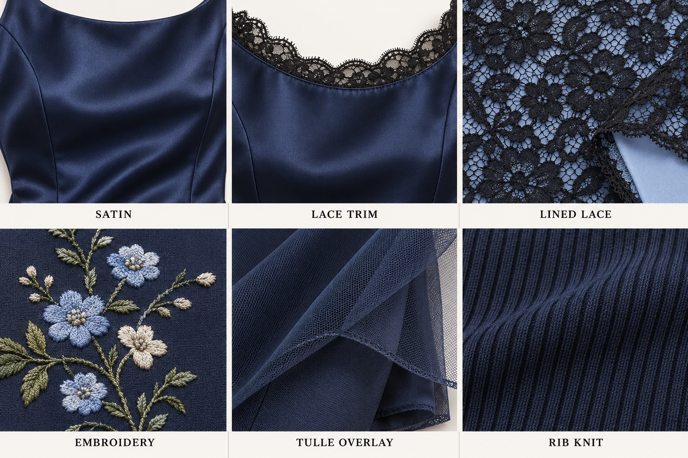

*图 19：AI 教学示意，已核对六格的可见差异。上排为缎面光带、领缘窄蕾丝、满幅蕾丝与浅蓝衬里；下排为底布上的彩色花卉刺绣、无花纹细网纱罩层、连续竖棱针织。右上翻起一角用于展示底层，并非衣服日常穿着的状态。深色近景提供表面与层次的视觉近似，不能鉴定纤维、真实针法或制作工艺。*

## Satin／缎面：看光怎样沿褶走

缎面常呈较连续的光带，折转处明暗变化明显；不必每一处都像镜子。缎纹是一种织物组织，不能与蚕丝画等号。MFA 的材料数据库将 satin weave 作为结构说明，并列举可使用的不同纤维。[资料：Museum of Fine Arts Boston，CAMEO，Satin weave](https://cameo.mfa.org/wiki/Satin_weave)

完整描述可以是：“深蓝缎面上衣，光泽柔和而非金属反光，领口自然垂褶，下摆沿身体下落。”检索 `soft-sheen satin blouse`。若想更轻薄，补厚度和垂坠；若想硬挺，则另说明支撑与折线，别指望“缎面”独自决定。

## Lace trim／蕾丝镶边：只让边缘发声

镶边通常是窄条装饰沿领口、袖口或下摆出现。主要衣身仍由另一种布面构成，蕾丝不必覆盖整件。例句：“黑色哑光上衣，仅在 V 领边缘镶一厘米左右的同色花形蕾丝，衣身保持平整不透。”检索 `black top narrow lace trim neckline`。

不要只说“加蕾丝”，否则模型可能把衣身全部换掉。设计沟通可以同时写正面要求和面积边界：“只沿袖口一圈，肩部与胸前不增加蕾丝”。即便不测量尺寸，也可用“窄边”“宽边”给出相对尺度。

## Lace inset／蕾丝拼接：明确哪一块被替换

拼接是一块相对独立的区域，例如肩部、上胸、袖子或腰侧；它与窄镶边的面积和连接方式不同。例句：“衣身为黑色不透织物，上肩有一块同色花形蕾丝拼接，边界沿肩线延伸，胸腹部分保持覆盖。”检索 `lace-inset shoulders opaque bodice`。

图 19 未单列拼接格，阅读时可借“镶边”与“满幅带衬里”两格想象面积变化，不能把二者当作拼接结构图。要画商品设计，另出正背面位置图会比气氛照片清楚。

## Lined lace／带衬里的满幅蕾丝：花纹与底层一起看

满幅表示花纹覆盖较大区域；有衬里则表示它下方还有一层。深色衬里会使花纹更含蓄，对比色衬里会突出纹样。例句：“上衣为满幅黑色花形蕾丝，衣身内有同色不透衬里；袖子保留未衬的轻透效果，领缘不再加宽荷叶边。”检索 `fully lined lace bodice sheer lace sleeves`。

蕾丝并不只是一种单一制作工艺。V&A 的纺织收藏记录中可见 bobbin lace 等不同类别；继续研究时，应看藏品的材料与技法字段，而不凭图案猜针法。[真实材料参照入口：V&A East Storehouse，Textiles at the V&A](https://lookup.vam.ac.uk/east-storehouse/storagedisplays/USE2193/)

## Embroidery／刺绣：图案怎样依附在底布上

先看图案是不是落在一块可辨认的底布上，线迹或装饰是否有厚度。但现代印花也会模拟绣纹，刺绣还能做在网底上，因此仅靠普通照片未必能确定制作方式。不能把“花卉图案”直接翻成 embroidery。

例句：“黑色不透上衣，胸前与袖口有少量同色花卉刺绣，图案留白充足，线纹略凸起，不做满幅蕾丝镂空。”检索 `tonal floral embroidery on opaque fabric`。需要贴花效果则可检索 `appliqué`，并说明独立花片的边缘。

V&A 的刺绣收藏包含不同地区与针法的作品，也有现代时装实例。它适合用来比较刺绣如何随底布、线材与图案位置改变，而非把刺绣当成一种固定“复古风”。[资料与真实作品入口：V&A，Embroidery](https://www.vam.ac.uk/collections/embroidery)

## Tulle overlay／网纱罩层：重点在两层之间

网纱的细网眼与覆盖关系，可以让同一深色衣物多出轻薄外层。它不一定有蕾丝花纹，也不是所有透明织物都叫 tulle；雪纺与欧根纱还涉及不同组织、挺度和表面。CAMEO 将 tulle 解释为细薄网状材料，并列出多种可用纤维。[资料：MFA Boston，CAMEO，Tulle](https://cameo.mfa.org/wiki/Tulle)

例句：“黑色不透连衣裙外罩一层无花纹细网纱，外层在裙摆处略长，袖部仅网纱一层，衣身下层完整覆盖。”检索 `plain tulle overlay opaque dress`。如果想要挺立的透明体积，可另查 `organza`，不要只加“仙气”。

## Rib knit／罗纹针织：条纹来自结构，不只是印花

常见罗纹针织有连续凹凸竖棱，能在领口、袖口或衣身上形成节奏。不能因为看到竖条就断定罗纹：条纹也可能来自印花、压褶或其他织造。CAMEO 的 rib knit 条目以正反针形成的棱谷解释其结构。[资料：MFA Boston，CAMEO，Rib knit](https://cameo.mfa.org/wiki/Rib_knit)

例句：“深灰细罗纹针织上衣，竖向凹凸纹理清楚，衣身略宽松，袖口较贴合，表面不加花卉图案。”检索 `fine rib-knit top relaxed fit`。细罗纹、粗罗纹和宽窄相间会形成不同节奏，可以直接写清，而不必先掌握全部针织术语。

## 透明范围，也可以准确而平常地描述

按部位说清“哪层透明、下面有什么”，比“半透”“朦胧”更容易执行。例如：“袖子单层半透，衣身双层不透”“肩部网纱拼接，其他部位完整衬里”“蕾丝仅在下摆形成窄透空边”。透光程度还受光线、颜色、层数与背景影响，所以同一材料词并不保证每张图一样。

## 从照片读材料，先排除光线的干扰

黑色布面在侧光下可能出现很亮的折线，柔光下又接近哑光；背景透过网眼，也可能被误认成面料自身的浅色图案。学习时可以把注意力从最亮的反光移到没有过曝的平面，看看纹样是否连续、边缘是否真实连接。图像证据不足时，描述现象即可：“表面有柔和光带”“局部能看见细网眼”，不急着鉴定。

给设计师的材料 brief 还可留出选择空间：“希望轻垂、低光泽、领边有窄花纹；纤维和具体工艺可再选。”这样你表达了视觉目标，同时没有把一个 AI 近景误写成采购规格。真正做衣服时，需看样布、触感、重量与成分资料。

最后练习：把“黑色蕾丝衣服”重写三遍——窄领边、肩部拼接、满幅带衬里。三句必须指出面积与底层。你会发现，材料不是一句漂亮形容，而是能改变整件衣服读法的设计决定。

---

# 第 18 章｜裤子与外搭：先看轮廓，再说衣型

“这条裤子很松，是阔腿裤还是工装裤？”两者可以同时成立。阔腿描述裤腿形状，工装裤常指向袋位、结构与衣橱来源。认识单品时，先把不同问题拆开：它有多宽，在哪里变宽，有多长，又带什么细节？

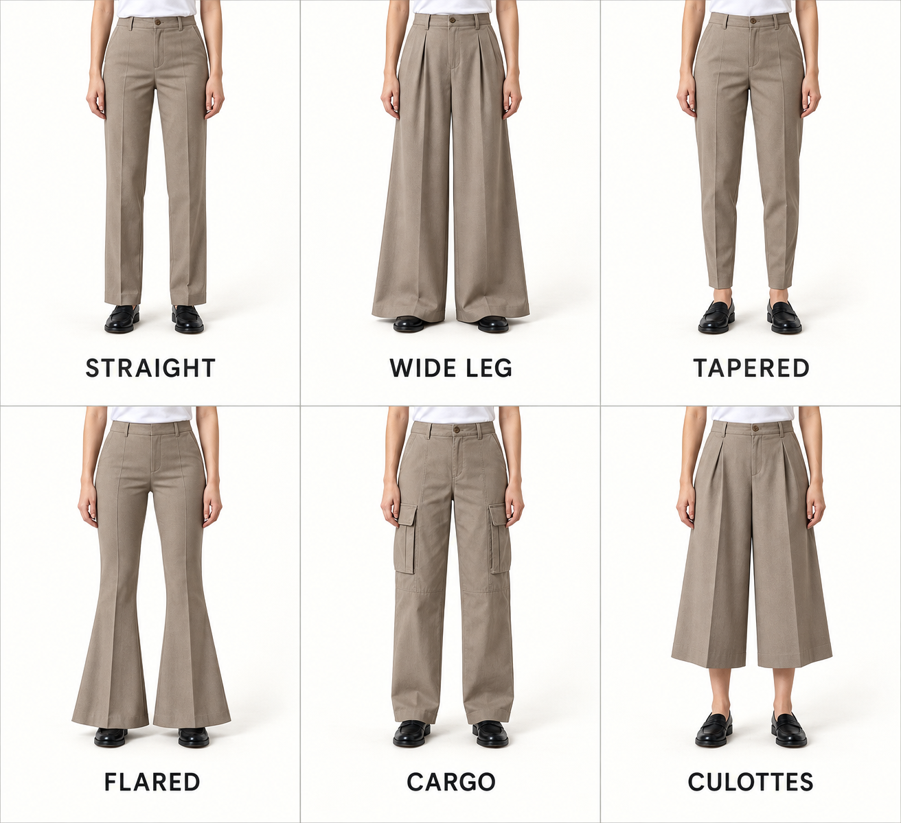

*图 20：AI 教学示意。上排依次为 Straight、Wide leg、Tapered；下排依次为 Flared、Cargo、Culottes。同色布面便于比较裤腿形状；各格裤长不同，也要一起观察。前四项主要描述裤腿轮廓，Cargo 强调袋型，Culottes 同时涉及宽度与长度，不能当成彼此排斥的六个盒子。*

## 直筒、阔腿与锥形：宽度在哪里改变

**Straight／直筒裤**的关键不是“贴腿”，而是裤腿向下的变化相对平直。可以有窄直筒，也可以有宽松直筒。看膝部到裤脚的外缘，再看裤脚是否明显收窄或展开；不要只看腰部合不合身。

**Wide leg／阔腿裤**强调较宽的裤腿与身体周围的空间。它可以从大腿就宽松向下，也可能带前褶与高腰。阔腿不等于长到拖地：及踝阔腿、短阔腿和拖地阔腿，都需要另说长度。

**Tapered／锥形裤**从较宽处逐渐收向较窄裤脚，常见效果是大腿有空间，脚踝附近更紧凑。它不必像紧身裤一样全腿贴合。“窄裤”说的是整体宽度，“锥形”说的是宽度变化，两者不是同义词。

Levi’s 的官方版型指南分别说明 Straight、Tapered 与 Bootcut，并将宽松程度作为另一项描述。这是观察裤型的实物词汇参照，不是全行业尺寸标准。[原始资料：Levi’s，Men’s Denim Fit Guide](https://www.levi.com/US/en_US/features/men-jeans-guide)

## 喇叭、工装与裙裤：换一个问题，名称就会改变

**Flared／喇叭裤**要看膝部附近向裤脚展开的关系。它与阔腿的区别不是裤脚宽不宽，而是上窄下扩的变化是否明显。Bootcut 常用来描述较温和的下摆扩量；具体产品的用词和程度会变化。要生图，可以直接说“膝部较合身、膝下逐渐外扩”，不用猜模型如何理解“大喇叭”。

**Cargo／工装袋裤**常以大腿侧的外置袋、翻盖袋等为识别线索。它可以做成直筒、锥形或宽腿，也可以是短裤。一条裤子若同时有宽裤腿和侧袋，完全可以叫“阔腿 Cargo 工装裤”。不要因为袋子多，就忽略真正决定剪影的裤腿。

**Culottes／裙裤**在这里指宽阔、长度常在膝下至小腿附近、站立时可能近似裙摆的分腿裤装。中文“裙裤”也可能用于带裙片的其他结构，所以检索时补“宽腿、膝下、分腿”更清楚。走动时能看见两条裤腿，比单张正面静态照更容易判断。

## 裤腰、裤长和裤线：不属于另一种神秘风格

高腰、中腰、低腰描述腰头相对身体的位置；腰带系得高，不会把一条原本低腰的裤子变成同样结构的高腰裤。九分、七分、及踝和拖地是长度提示，但穿着者身高会改变实际落点，沟通时最好直接说“裤脚停在脚踝上方”。

前褶是从腰部放出空间的结构；裤中线则是裤腿正中可见的折线，两者不相同。“高腰、单前褶、宽松直筒、及踝”已经是一条相当清楚的裤子描述；不必先决定它属于学院、法式还是极简。

## 外搭不是一种固定衣服

“外套”常是穿着层级，“夹克”是较具体的衣物家族，“开衫”又同时涉及材料与开合。一件开衫可以穿在外面，也可以套进大衣里；一件薄西装也能成为中间层。我们需要的不是强行排出唯一树状分类，而是知道每个词在补什么信息。

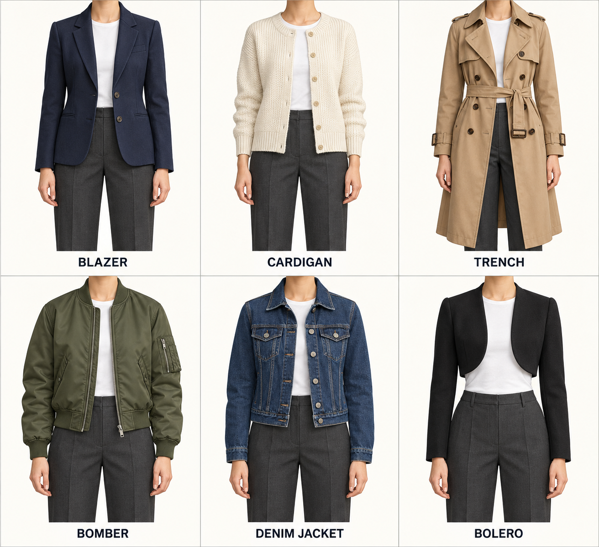

*图 21：AI 教学示意。上排依次为 Blazer、Cardigan、Trench；下排依次为 Bomber、Denim jacket、Bolero。以相近内搭对照外衣结构：注意开衫的针织纹路、Bomber 的罗纹收口，以及 Bolero 的极短弧形前片。衣物家族还可继续叠加长度、松量、领型与材料词。*

**Blazer／西装式夹克**可以从翻折的驳领、前门襟、衣身裁片与较明确的肩部组织入手。不要把所有带领外套都叫西装，也别认为西装一定收腰、垫肩或成套。要区别，描述“单排扣、软肩、直身、长度盖住臀部”会比“休闲西装”具体。

**Cardigan／针织开衫**通常有前开口，可能用扣子、拉链或敞开方式处理。它可以薄、厚、短、长；“毛衣”则不必前开。若你看到针织上衣却没有清楚门襟，不妨先叫针织衫，而不是替它猜一排扣子。

**Trench coat／战壕式风衣**常借双排扣、腰带、肩袢、挡片或袖袢等组合形成识别。中文“风衣”范围更宽，不是每件长外套都必须具备这些细节。表达时可以说“米色双排扣腰带风衣”，再说明长度与肩线；浅卡其色本身不足以定名。

**Bomber／飞行夹克式外套**常用短衣身、前拉链、收束袖口和下摆形成圆而紧凑的体积。以 MA-1 为例，Alpha Industries 的官方说明列有针织罗纹领、袖口和腰部，这是可以直接观察的一组细节；它只是 Bomber 家族的一条路径。[原始资料：Alpha Industries，MA-1 Bomber Jacket](https://www.alphaindustries.com/products/mjm21000c1-ma-1-bomber-jacket-heritage)

**Denim jacket／牛仔夹克**先给出材料与衣物家族，还需继续看胸袋、明线、金属扣、衣长和衣身分割。牛仔面料也能做风衣或西装，不能看见蓝色斜纹就停止观察。Trucker jacket／卡车司机式夹克是常见检索词，但不是所有牛仔外套的同义词。

**Bolero／博莱罗短外搭**常见很短的衣身与敞开前片，让里面衣服继续成为视觉主体。图中黑色款的衣身停在胸下、腰线上方，前片呈弧形，没有可见扣合；它不一定由针织制成。伦敦博物馆藏有一件 1891—1899 年的黑缎 Bolero，前部与袖口饰有珠绣，可见短外搭可以相当有结构与装饰。[真实案例：London Museum，Jacket, bolero，36.80/2](https://www.londonmuseum.org.uk/collections/v/object-79246/jacket-bolero/)

## 一类多款：短外套：长度相近，结构可以完全不同

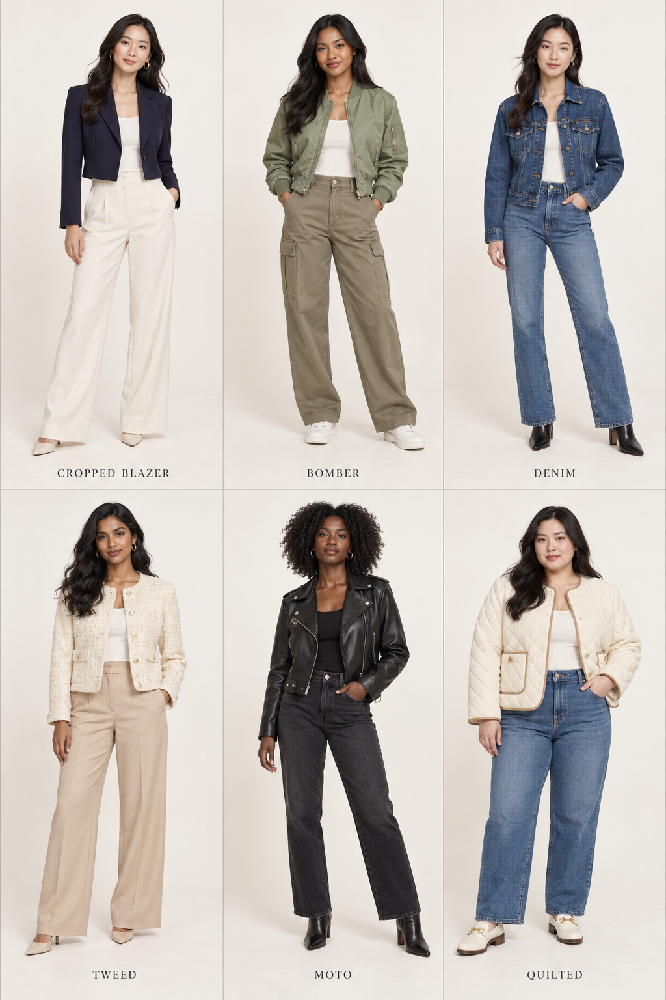

*图中顺序均为从左到右、先上后下。依次为：短西装、罗纹收口飞行夹克、牛仔卡车夹克、无领粗花呢感短外套、斜拉链机车夹克、菱格绗缝短外套。先说单品，再说长度、领口、开合与面料；“短外套”本身还不够具体。*

可以直接这样描述：**她穿奶油白无领菱格绗缝短外套，前襟与袖口有包边，下配直筒牛仔裤。**

## Cropped：只说“短到哪里”，不替代衣型

Cropped 是截短的长度描述。Cropped blazer 是短西装，cropped cardigan 是短开衫，cropped trousers 是较短裤长；三个词组不能互相替换。看到一件胸下结束的小外搭，可以先说“胸下长度、长袖、前开式短外搭”，再判断更接近 Bolero、针织 Shrug，还是某件衣服的截短变体。

试把“酷一点的外套配宽裤”改成“齐腰 Bomber 夹克、罗纹袖口和下摆，搭配高腰宽松直筒 Cargo 裤”。你还没有使用任何风格标签，衣服却已经能被画出来了。

---

# 第 19 章｜不要都叫“褶皱”：抽褶、褶裥与波浪边

一件上衣腰侧有密集细褶，另一件袖口有一圈波浪，你可能都想说“加点褶皱”。但前者可能在收缩衣身，后者可能是一片另接的装饰边。把细节说清楚，不需要先会缝纫，只要先问：褶在哪里，朝什么方向，是否重复，边缘怎样连接？

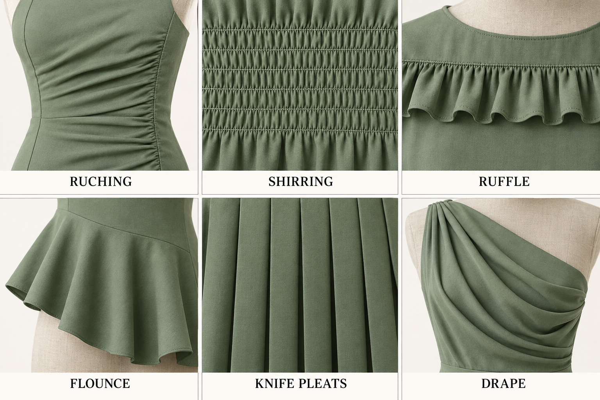

*图 22：AI 教学示意。上排依次为 Ruching、Shirring、Ruffle；下排依次为 Flounce、Knife pleats、Drape。重点比较 Ruffle 接缝处的密集聚拢与 Flounce 较平顺的连接边；Shirring 格呈现多排收缩纹理，实际弹性不能仅由静态图确认。*

## 皱褶是看到的现象，褶裥是有意组织的结构

坐下、抬臂或把衣服塞进裤腰，都会产生自然皱褶。它们随动作与材料变化，不一定是设计师预先固定的。Pleats／褶裥则通常有明确的折叠安排：方向、宽度、间距或开合方式可以被描述。

因此，“不要褶皱”可能有两种不同意思：你想要表面熨得平整，还是不想要任何设计褶裥？一条整洁的百褶裙本来就有折叠；说“平整、折线清楚、没有凌乱压皱”比同时要求“百褶”和“完全无褶”合理。

## Ruching：把局部布面收拢，让细褶向那里汇集

Ruched 常用于描述局部抽褶处理，可能由缝线、抽绳或弹性收缩形成。本图左上可见单侧收拢：一组柔软小褶朝衣身侧缝汇集，而不是整片表面铺满规则竖折。

不要把 Ruching 记成“必须有一条绳”。看不见内侧结构时，可以说“腰侧抽褶、横向细褶向左侧集中”；如果确实能看到绳头与通道，再加“抽绳”。位置也很重要：侧腰、领口与袖口的抽褶，会把视线带到不同部位。

## Shirring：多排缝线让一片布均匀收缩

本章用 Elastic shirring／弹性抽褶指多行弹性线形成的密集收缩面。常见线索是多排相对平行的缝线与其间的小褶，像一整片有节奏的细纹；它不只是某一边聚拢。

Seamwork 的原作教程说明，机缝弹性抽褶通过多排缝线与弹性底线形成纹理和伸缩性。该教程也区分了 Shirring 与利用刺绣组织褶面的 Smocking；市场名称可能混用，学习时不要直接画等号。[原始资料：Katie Whittle，A Guide to Shirring，Seamwork，2017](https://www.seamwork.com/sewing-tutorials/a-guide-to-elastic-shirring)

生图可写“背部多行平行弹性抽褶”，不用笼统写“背面皱皱的”。若只看到照片而不能确认弹性，用“密集横向缝线与细褶”更稳妥。这是在区分可见证据与制作推断，不妨碍你先找到合适参考。

## Ruffle 与 Flounce：波浪都在边上，体积来源不同

**Ruffle／抽褶荷叶边**常由一条布料沿连接边聚拢，再缝到衣服上。靠接缝处也能看到细密的收拢，剩余布料向外展开。它可以窄到只是领口一圈，也可以宽到成为层叠裙摆；窄宽不是唯一判据。

**Flounce／弧形裁片波浪边**通常借弧形或圆形裁片，让外缘比连接边更长，因此形成展开的波浪。连接处可以相对平顺，体积更多出现在自由边缘。中文商品名称往往也叫“荷叶边”，所以想精确讨论时补英文与结构描述就够了。

纸样设计者 Paper Theory 用裁片与缝合边说明这一区别：一类在连接边抽拢，另一类主要把扩量放到外缘。它比“Ruffle 小、Flounce 大”更值得记住。[原始资料：Paper Theory Patterns，Frill and flounce](https://papertheorypatterns.com/pages/frill-and-flounce)

同样的处理换成薄软纱和挺牛仔布，波浪的密度、折线与张开程度会不同。看正面图不能确定裁片时，可先说“领口另接一圈向外展开的波浪边”，等需要制作时再核对来源；不用为了不知道英文而停止描述。

## Knife pleats：一排朝同一方向倒下的整齐褶裥

Knife pleats／刀褶常用于指连续向同一方向折叠的褶裥。观察折边的方向、宽度与重复节奏。它与相邻折层成对相向或背向安排的工字褶类处理不同。后者还可用 box pleat 与 inverted box pleat 进一步区分；中文译名有重叠，讨论时最好指明折向。“百褶”也不是要求恰好一百道。

褶裥未必全都从腰头固定到底，也不必永远锋利挺直。裙子走动时，折层会张开；薄软材料的折面可能更柔和。描述“腰部固定、下摆可以展开的单向褶裥”，比“有很多竖条”更能区分褶与印花。

## Drape：让宽而软的布面悬垂

Drape 在服装语境里可以涉及材料的垂坠表现，也可描述有意组织的悬垂效果。这里重点是后者：布从支撑或固定位置落下，形成较宽、柔软、连续的褶面，不一定有整齐压出的折线。

领口一片松软弧垂、腰间斜向挂落或侧边宽褶，都可这样观察。先找布被固定在哪里，再看重力把它带向哪里。若希望大而舒展的悬垂，写“几道宽软斜褶”会比“密集抽褶”更接近；不要把两种相反的表面节奏塞进同一部位。

## 一个细节，写成一句清楚的话

| 模糊说法 | 可见证据 | 更准确的表达 |
|---|---|---|
| 腰上皱一点 | 褶向左腰集中 | 左侧腰抽褶，细褶横向汇集 |
| 后背弹弹的 | 多排缝线、密集小褶；弹性尚待确认 | 背部多排平行缝线形成细褶；确认弹性后可称弹性抽褶 |
| 领边有波浪 | 另接窄条、连接处聚拢 | 圆领接窄抽褶荷叶边 |
| 裙边大波浪 | 接缝较平、外缘展开 | 下摆接弧形裁片波浪边 |
| 整齐的一条条 | 折层同向重复 | 从腰部向下展开的单向褶裥 |
| 布料软软挂着 | 宽褶从固定处悬落 | 侧腰固定、斜向悬垂的宽软褶 |

褶裥还可以成为整件衣服的设计方法。The Met 收藏的三宅一生《Flower Pleats》套装，用褶与体积形成花瓣般的肩、胯轮廓，适合旁读“局部细节怎样变成整体造型”。这不是图 22 刀褶格的原作来源。[真实案例：Issey Miyake，Ensemble，约 1990 年，The Met，2015.451a, b](https://www.metmuseum.org/art/collection/search/695620)

学习这些词以后，再看“蕾丝镶边吊带裙”：镶边是在边缘接入材料，裙身抽褶是在布面收拢，裙摆褶裥是在组织折层。这三个要求可以分别添加和删除，设计也因而变得可控。

---

# 第 20 章｜不知道衣服叫什么，也能把它说清楚

你看到一张图，知道它不是普通连衣裙，却不知道该搜索“吊带裙”“衬裙式连衣裙”还是某个风格。此时不必先猜名词。把看到的部位顺序说出来，名称往往会逐渐浮现；即使仍不确定，描述也已经足够帮助检索、生图和讨论。

这章不考风格知识。只要会观察长短、开口、宽窄、表面和搭配，就能开始。

## 八个槽位：从一件衣服说到完整人物

| 槽位 | 先回答什么 | 可以使用的词 |
|---|---|---|
| 1 衣物与层次 | 连体还是上下分开？谁在外面？ | 连衣裙、上衣配裤、外搭开衫 |
| 2 肩部与领口 | 怎么挂在肩上，开口是什么形状？ | 细肩带、宽肩带、方领、翻领 |
| 3 袖子 | 有没有袖，袖体怎样？ | 无袖、短袖、落肩长袖、泡泡袖 |
| 4 腰与合身度 | 腰在哪里，身体周围有多少空间？ | 高腰、自然腰、直身、宽松、收腰 |
| 5 下部轮廓与长度 | 裙／裤怎样落下，停在哪里？ | A 字、直筒、锥形、膝下、及踝 |
| 6 表面与材料感 | 光线怎样反射，纹理是什么？ | 哑光棉感、细针织、缎面、牛仔纹理 |
| 7 结构与装饰 | 哪个细节最值得保留？ | 前排扣、蕾丝镶边、侧袋、单向褶裥 |
| 8 搭配与整体呈现 | 配什么鞋包，图要怎样展示？ | 乐福鞋、小肩包、全身、素背景 |

八个槽位不必全部填满，也不要求按顺序写成长清单。最值得填的是那些决定“像不像”的部分。一个人穿一件特殊领口的裙子，领口比耳环重要；你只在讨论裤子，裤腿、腰部和裤长就比发型重要。

没有把握的名词可以暂时空着。你能说“前面从领口到裙摆有一列纽扣、带衬衫式翻领”，就已经给“衬衫裙”提供了足够线索；比先猜“法式复古裙”准确。

## 十句完整人物衣着描述

下面都是可直接修改的原创练习句。每句先给衣服，再给重要部位，最后才是搭配。它们不依赖特定性别或体型，也不预先指定摄影之外的绘画媒介。

1. 一位成年人物穿米白色细肩带直身连衣裙，领口和膝下裙摆接窄蕾丝边，裙身为低光泽缎面效果，外搭齐腰薄针织开衫，配棕色平底鞋与小肩包，以全身目录图展示。

2. 一位成年人物穿深蓝色运动风短裙，宽弹性腰头、A 字下摆和少量规则褶裥，搭配白色短袖 Polo 上衣、浅色运动鞋与中筒袜，整体清爽，衣服的轮廓和分层清楚可见。

3. 一位成年人物穿浅蓝色及小腿衬衫裙，翻领、长袖、前中一列纽扣，腰间用同布腰带轻轻收束，下摆向两侧展开，配白色帆布鞋与帆布袋，背景简洁。

4. 一位成年人物穿灰色落肩连帽卫衣，衣身宽松、前部有连体袋，配橄榄色高腰直筒 Cargo 工装裤，大腿两侧各有翻盖袋，裤脚自然盖到厚底运动鞋上，呈现日常休闲穿搭。

5. 一位成年人物穿齐腰的深蓝牛仔夹克，金属纽扣与明线清楚，内搭米白色圆领细针织衫，配灰色高腰阔腿裤和黑色乐福鞋，夹克敞穿，露出上下装的分段。

6. 一位成年人物穿浅褐色单排扣软肩西装夹克，内搭白色短袖圆领上衣，配同色系及踝锥形裤与棕色低跟系带鞋，袖口不卷起，整体轮廓整洁但不过分贴身。

7. 一位成年人物穿浅绿色方领短袖上衣，袖口接窄抽褶荷叶边，腰部自然放松，搭配米白色膝下宽腿裙裤、平底凉鞋与编织手提袋，以正面三分之四角度展示分腿结构。

8. 一位成年人物穿黑色长袖针织开衫，V 形前开口、单排小扣、长度到腰，搭配深灰色膝下单向褶裥半裙和深色平底皮鞋，衣服不加印花，重点表现针织纹理与整齐折层。

9. 一位成年人物穿沙色双排扣腰带风衣，肩部有袢、袖口有带扣，衣长到膝下，内搭深蓝色直筒裤和浅色针织衫，配棕色短靴，风衣敞穿，腰带在后方松系。

10. 一位成年人物穿深绿色短款 Bomber 夹克，前拉链、罗纹领口、袖口与下摆，内搭浅灰圆领上衣，配深蓝色高腰微喇裤与简洁运动鞋，全身站姿，避免配饰遮住外套开合线。

这些句子没有硬塞进“极简、复古、甜酷”等词，仍然能形成不同衣着。想增加风格时，只需在开头补一个方向，再调整与之相关的两三处，不必推倒整句重写。

## 三次改写：把模糊感觉拆成衣服

### 第一次：“那种带蕾丝的温柔小裙子”

先找衣物层次：是一件连衣裙，还是上衣配半裙？再找肩与袖：细肩带、无袖。再看边缘：蕾丝只在领口和下摆，不是整件蕾丝。最后看轮廓：直身、及小腿。于是可以写成：

> 米白细肩带直身连衣裙，低光泽表面，领口与及小腿下摆接窄蕾丝边，配薄针织开衫和平底鞋。

如果想找“衬裙式连衣裙／slip dress”的参考，可以把它作为下一轮检索词；但并不是所有细肩带裙都属于同一种结构。先保留你真正喜欢的镶边位置，比争论名字重要。

### 第二次：“宽宽的，有口袋的那种裤子”

先把宽度与袋型拆开。若从大腿到裤脚都宽，可以写阔腿；若脚踝明显收窄，可以写锥形。大腿侧有外置翻盖袋，再加 Cargo。假设你想要前一种，就写：

> 灰绿色高腰阔腿 Cargo 工装裤，大腿侧有大翻盖袋，裤腿向下保持宽松，裤脚停在鞋面，配齐腰宽松卫衣。

这比“机能裤”少了一层猜测。若要减少夸张装备感，直接说袋子数量少、没有外露绑带即可，不必换掉裤子的主要名称。

### 第三次：“短短的外套，里面软软的，有点知性”

先判断外套材料：是牛仔、针织还是西装织物？再看前面怎样闭合、衣身在哪里结束。假设外面有翻领与金属扣，里面是圆领细针织，便可以改成：

> 齐腰深蓝牛仔夹克敞穿，内搭米白圆领细针织衫，配深灰高腰直筒裤与乐福鞋；夹克较挺，内搭柔软，整体用低对比配色。

“知性”可以留下当情绪提示，但现在别人已经知道要画什么。若外套实际是前开式针织，那么就把牛仔夹克改成短开衫，其他槽位仍可保留。

## 从图片观察，沿一条路线走

先看全身分成几层、几件；再沿肩部和领口看上衣结构；向下找腰部连接或分段；然后看裙摆或两条裤腿的宽度变化与落点；最后放大扣子、袋子、镶边和褶。不要一开始盯着花纹，也不要让人物姿态替衣服做判断。

需要时再看侧面与背面。侧面可以帮助判断衣身体积、开衩和前后长度；背面可以发现前面看不到的系带、后开口或抽褶。图中若被包、头发或手臂遮住，记录“看不清”，而不是填一个似乎合理的细节。

写完后做一个小检查：把所有情绪词删掉，这句话还剩可画的衣服吗？如果只剩“高级、温柔、复古”，就补衣物、长度和结构；如果已能看见“方领短袖上衣＋膝下裙裤”，便可以开始检索和创作。风格名字会帮助定位，但从来不是开口描述的入场券。

---

# 第 21 章｜汉服：先认形制，再谈风格

“她穿一身汉服”只说明了很宽的范围。要让别人画出同一套衣服，还要说上衣和下装是什么、衣襟怎样闭合、裙片怎样围合、哪些部分属于内层。本章从有具体藏品资料支持的实例出发，练习把“古风”拆成能观察和核查的词。

本章配图为依据资料约束生成的穿着教学示意，**不作为文物照片、精确复原成果或裁剪纸样**。颜色、人物、发型与未获证实的装饰不用于证明时代。需要制作或复原时，应继续核对藏品图、实测数据、裁片和研究报告；生成图不能替代这些证据。

## 先分清：形制、组合、审美与使用目的

形制关注衣物怎样构成；搭配组合关注几件衣物怎样叠穿；审美可以是素雅、浓丽、清秀；用途则可以是当代穿着、历史研究或角色服装。四者可以同时描述，却不能互相替代。

| 你说的词 | 它主要回答什么 | 还需补充什么 |
|---|---|---|
| 交领、对襟、右衽 | 领襟与掩合关系 | 具体衣物、时期和闭合位置 |
| 褙子、袍、裙 | 单件衣物类别 | 领、袖、长短、开衩与内部结构 |
| 上衣下裙、袄裙、衫裙 | 穿着组合 | 上衣是哪件、裙是哪种 |
| 素雅、华丽、仙气 | 视觉感受 | 可见剪裁与材料，不能据此定朝代 |
| 历史复原、当代汉服、幻想古风 | 对证据与设计的不同要求 | 哪些结构有出处，哪些是创作 |

例如“明代女装”不是一个固定款式。中国丝绸博物馆的展览同时展示不同领式与裙褶的复原实例；认识时代之后，仍要落到具体衣物。[资料：中国丝绸博物馆，《丝·赏》，历史服饰复制展示](https://www.chinasilkmuseum.com/yz/info_18.aspx?itemid=26689)

## 交领右衽：按穿着者的左右判断

交领是领襟交叉；交领右衽通常表现为穿着者的左前襟在外，覆盖右前襟，并向穿着者右侧掩合。判断时追踪哪片前襟在外、最后在哪侧固定，不以观者左右或一个似乎像字母Y的线条下结论。镜像照片尤其容易造成反向。

一个可核查的例子是万黄氏墓出土的黄绮折枝花卉女单衣：馆方明确记录交领右衽、右腋下纽襻扣合，且为无衬里的单衣。这说明**宽袖和交领并不足以把所有衣物都叫“袄”**；单、夹及材料结构仍须查实物。[资料：中国丝绸博物馆，一物Vol.11，黄绮女单衣与曲水如意云罗裙](https://www.chinasilkmuseum.com/info_151.aspx?itemid=27787)

描述可以写：“交领右衽长上衣，外襟在穿着者右腋附近扣合，宽直袖，衣身两侧开衩。”这句话先交代结构；若要指定时代，再补藏品依据。不要把“交领右衽”当作能独立证明所有历史归属的唯一规则。

## 南宋褙子：直领对襟，还要看侧衩和系结

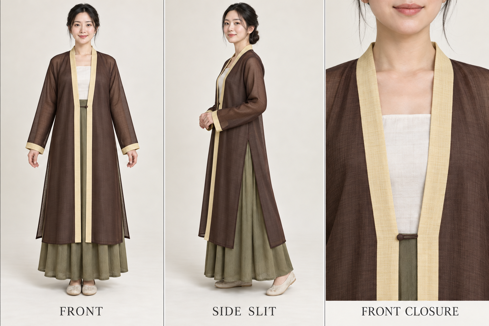

*AI教学示意：从左到右观察直领对襟、长侧衩和前襟一处扣合。人物与配色为创作；轻薄面料与单粒小扣经过定向修图；具体罗组织、原件扣襻细节及内层、下裙不作出土实物复原。*

这里选择南宋周氏墓素罗单衣的资料作为观察入口：这件实物衣长120厘米，直领对襟、窄袖、两侧长开衩，领襟和袖口有缘边，前门襟中部有一粒同料纽扣。它不是一件用宽腰带束紧的交领大袖袍。馆方还记录宋代女式褙子的不同前襟固定方式，因此“褙子一定没有扣和带”并不成立；这些特征也不能不分时期地套给所有名为褙子的衣物。[资料：中国丝绸博物馆，一物Vol.38，素罗单衣](https://www.chinasilkmuseum.com/gskt/info_319.aspx?itemid=28354)

另一件周氏墓镶边褙子则为夹衣，门襟用纽襻系结，侧面开衩。博物馆的复原研习资料另列围裹式两片裙，说明裙片由两块交叠围合。**两片围裹裙不因为有重叠就自动等于马面裙**，还须看平幅、褶裥和围合的具体组织。[资料：中国丝绸博物馆，南宋褙子与围裹式两片裙复原研习](https://www.chinasilkmuseum.com/yg/info_13.aspx?itemid=31106)

看图时可以先遮住人物的脸，只看衣边：两条前襟是否平直、袖体是否相对窄长、侧边是否真的分开？这些信息比“清冷宋风”更容易传达给设计者。

> 描述例句：成年女性穿直领对襟、窄袖、过膝的褙子，前襟有一处小型布质扣合，两侧开长衩；里面是独立内层与长裙，外衣不束宽腰封。

## 明初三件套：不能把短袖外层误看成披帛

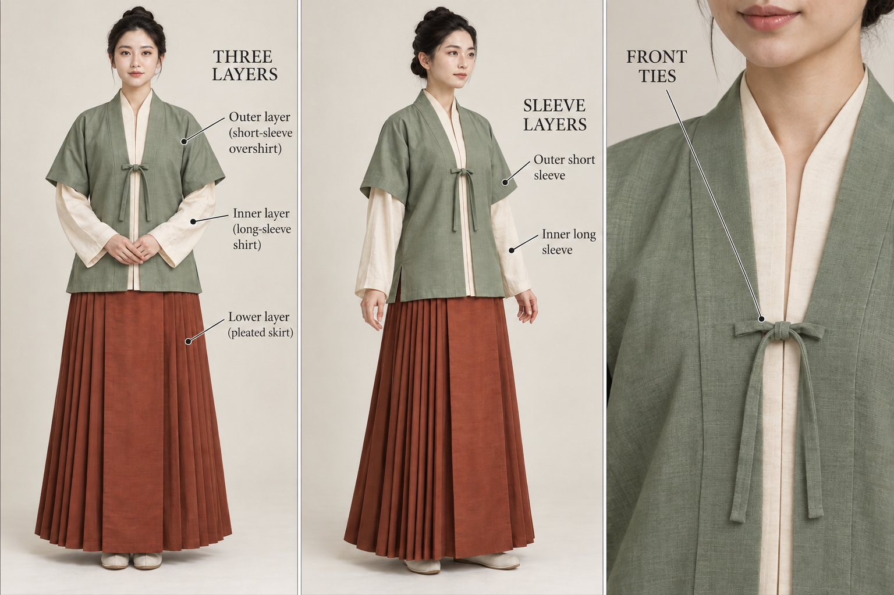

*AI教学示意：长袖内衫、短袖外衫与下裙的层次。人物与配色为创作；图中省略原件短袖衫领缘的刺绣花卉边和内衫的万字田格纹，重点观察袖层与前襟，不作原件纹样或完整裙片结构复原。*

中国丝绸博物馆的“绢短袖衫、绮长袖衫、绢裙”记录了一套明初钱姓女子的三件组合：里面是直领对襟长袖衫，外层为直领对襟短袖衫，门襟有两根系带结系，腋下开衩，下面配裙。“两根系带”应理解为成一组系结的两条布带，不能误画成上下两处结。外层有自己的衣身和袖子，不能因短袖就只叫“肩上披的一块布”。[资料：中国丝绸博物馆，绢短袖衫、绮长袖衫、绢裙](https://www.chinasilkmuseum.com/zggd/info_21.aspx?itemid=1870)

对人物描述而言，层次可以按“由内到外、由上到下”写：米白长袖衫 → 绿色短袖外衫 → 褶裙。短袖外层下面看见长袖，是两件衣服；不要直接说“拼色长袖”，否则很可能被理解成一件现代拼接衫。

“袄裙”和“衫裙”是上衣与裙的组合说法，不能与“马面裙”并排当成互斥裙型。更准确的表达是“某领式上衣配某结构的裙”。上衣是否有里、是否夹棉，优先按实物记录命名，不凭画面厚薄猜测。

## 马面裙：从平整裙门继续追到裙片

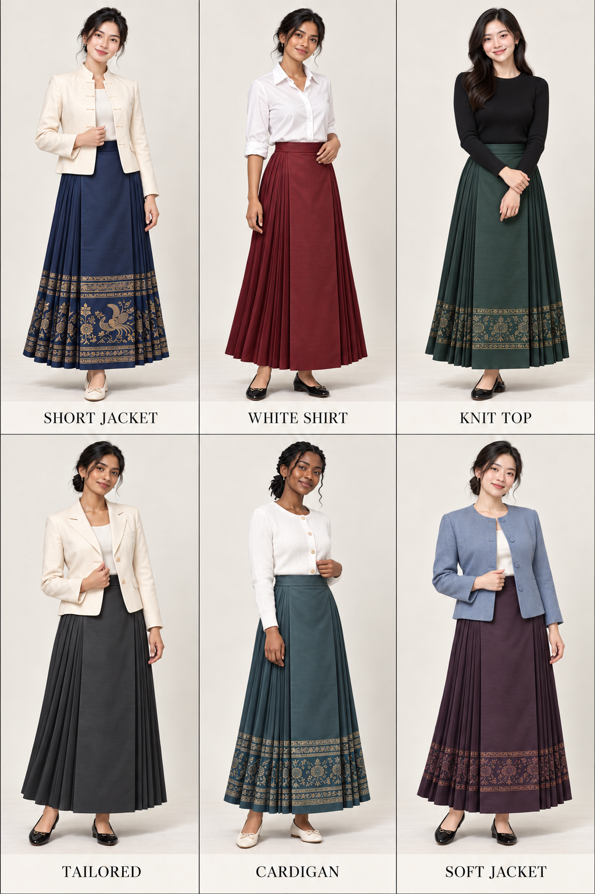

*AI教学示意：短外套、衬衫、针织、西装、开衫与柔和短夹克的现代搭配。图中可观察正面平幅与侧褶；背面、内裙片和腰部围合未展示，不能据这张正面图完成形制验收。这组是当代搭配，不标作明代或清代整套复原。*

平整的正面、两侧褶裥只是可见入口，严格辨识还要看裙片的交叠与围合。国丝馆藏曲水如意云纹罗裙的说明记录两片交叠与裙门两侧对称折裥；清代红色皮球花纹绸马面裙则记录了两片裙、腰部扣合和马面两侧百褶。实例不同，具体闭合与装饰也不同。[资料：中国丝绸博物馆，曲水如意云纹罗裙](https://www.chinasilkmuseum.com/zggd/info_21.aspx?itemid=1905) [资料：中国丝绸博物馆，红色皮球花纹绸马面裙](https://www.chinasilkmuseum.com/zggd/info_21.aspx?itemid=1974)

| 观察位置 | 应继续核查 | 常见误认 |
|---|---|---|
| 正面平幅 | 是裙片重叠形成，还是另贴装饰布 | 在百褶裙前贴一片布就叫马面裙 |
| 两侧褶裥 | 褶的位置、方向、宽窄及固定方式 | 把全周均匀褶当作所有马面裙标准 |
| 后面 | 是否有相应平幅与交叠 | 只有正面图就宣称完整结构正确 |
| 腰部 | 裙片连接、系带或扣合方式 | 只凭现代腰头判断历史原貌 |
| 裙襕与纹样 | 所属藏品和时期 | 任意印花都据称复原某朝纹样 |

清华艺博《裙裳华彩》按明代、清代、二十世纪初与当代重构展现裙装变化。它提醒我们，同一个名称中有不同的时期与样式，不能把一套现代商品照片当作所有马面裙的唯一标准。[资料：清华大学艺术博物馆，裙裳华彩](https://www.artmuseum.tsinghua.edu.cn/cpsj/zlxx/zlhg/202509/t20250926_20317.shtml)

> 描述例句：她穿藏蓝马面裙，正面是平整裙门，两侧有密褶，下部有横向纹样裙襕；上配奶油色现代短夹克。这是一套现代搭配。需要制作时另附背面、平铺与腰部结构参考。

## 圆领袍、曲裾与齐胸穿法：别急着套名字

**圆领袍不是看到圆领就能认定。** 还要看整件袍服、领部开合、袖体、腰带和侧部结构。国博“男装女陶俑”明确记载女性着圆领袍服、束带、穿靴；因此圆领袍不能写成男性专属，也不能只靠领口就定为唐代。[真实案例：中国国家博物馆，男装女陶俑](https://www.chnmuseum.cn/zp/zpml/kgfjp/202111/t20211116_252274.shtml)

**曲裾不是“下摆弯弯的”。** 需要追踪衣襟、衣裾延长及交掩的路径；一根斜向飘带或一块三角下摆不能证明曲裾。国丝《丝·赏》里的曲裾袍被明确标为依据马王堆出土实物制作的复制品，应以这个具体案例理解，不推出“所有曲裾都绕同样圈数”。[博物馆复制案例：中国丝绸博物馆，印花敷彩纱曲裾袍](https://www.chinasilkmuseum.com/yz/info_18.aspx?itemid=26689)

**齐胸是穿着高度的说法，不能独自补出完整纸样。** 若图上只看见胸上方一条系带，仍应查裙腰、系结、内层和出土或图像依据。没有核实到具体对象时，可以描述“胸上部系结的高腰长裙与短衫组合”，不要凭“唐风”“敦煌风”四字宣称严格复原。本章不提供未经验证的唐代齐胸裙裁剪图。

## 给生图和讨论使用的核查次序

先选目标：当代穿着、具体实物复原研究或仙侠角色。记录参考对象的年代、出处与结构，再依次核对：穿着者左右 → 领襟闭合 → 袖与衣身 → 裙片和褶 → 内外层次 → 腰部与配件。颜色和图案放在结构之后检查。

补正、背、侧视图；被遮住的部位记为“不可判定”，不能借正面观感补出内部结构。提示词可按“用途与证据等级＋参考藏品＋领襟方向＋袖体衣长＋下装结构＋内外层次＋待查视角”组织。幻想设计明确标注幻想。

---

# 第 22 章｜Cosplay与角色服装：把角色拆成可描述的衣物

Cosplay不是一种固定剪裁。它可以使用制服、长袍、铠甲、日常服装，也可能把多种元素组合进同一个角色。只说“动漫风衣服”，模型不知道该生成水手领、立领制服，还是厚重肩甲。

本章按服装结构组织原创教学示意；图里没有声称还原某个已有角色。若目标是某作品中的具体人物，应另以该作品的官方设定与明确版本为标准。

## 先问：还原、改编，还是原创

| 目标 | 描述必须包含 | 如何检查 |
|---|---|---|
| 还原既有角色 | 作品、角色、服装版本、参考图 | 与该版本的轮廓、层次和配件逐项对应 |
| 角色改编 | 保留哪些识别点，改动哪些结构 | 不把改编称为完全还原 |
| 日常化搭配 | 色彩、轮廓、标志细节与日常单品 | 是否仍能解释灵感来自何处 |
| 原创角色服装 | 角色用途、衣物结构、世界观和材料 | 结构自洽，避免无意拼出矛盾部件 |

同一角色的默认服装、节日服、游戏皮肤和影视版本可能不同。把版本写清，比不断增加“精美”“高级”“还原”更有效。如果前后参考来自不同版本，应主动指出，这是混合改编。

世界Cosplay锦标赛将服装与原作设计的对应列入评审，同时考虑制作质量与技术；这是一项具体赛事的标准，不是所有cosplay活动的统一规则。它也明确说明，扮演者的种族、性别或身形与原角色的差异，不影响服装完成度的评判。[资料：World Cosplay Championship，Judging and Competition Rules，2026年1月更新](https://wcc.worldcosplaysummit.jp/en/championship/rule/)

## 六种入口：看服装骨架，不先猜角色

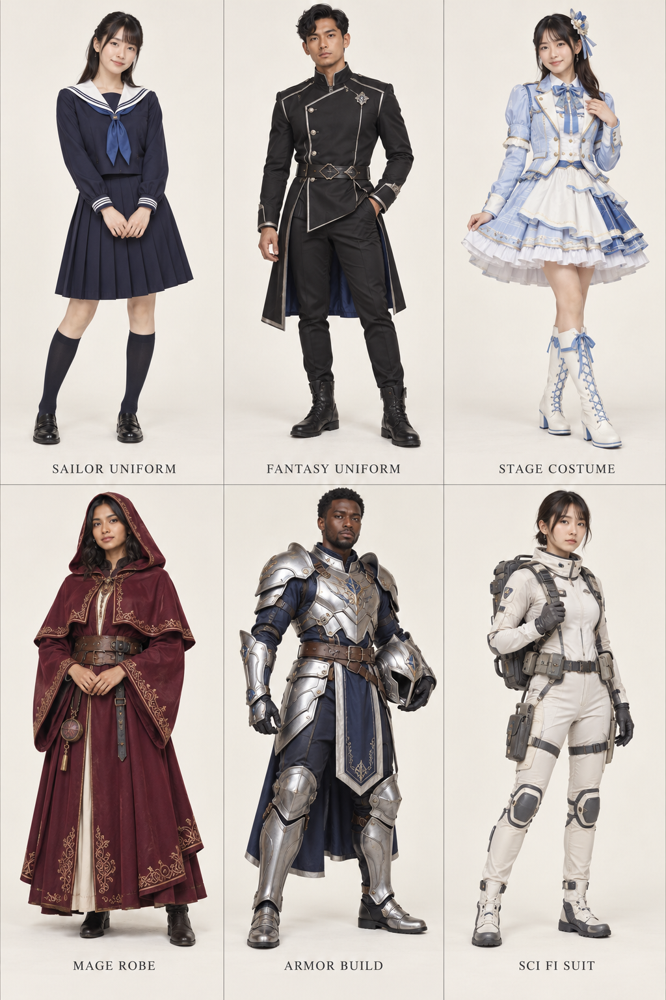

*AI原创教学示意，均为成年模特。从左到右、先上后下：水手领制服式、幻想立领制服、舞台演出服、法师长袍、板甲式装甲、科幻连体服。这是本书的观察分组，彼此可组合，不是官方分类，也不对应特定作品。*

**水手领制服式**的重点是领片形状、领带或领巾、上衣和裙裤。前面V形领只是部分信息；要确认后方方形领片，还应看背面。日常制服、角色制服和原创制服不能仅凭同一领型当作一回事。

**立领制服式**要说明衣身长短、门襟走向、肩部与袖口。图中黑色套装的斜向开合、长短不同的下摆和银色饰边，是可描述的设计信息；它并不证明某国真实军服或特定军衔。

**舞台演出服**常需要把上衣、裙体、装饰层与鞋靴分别说清。本图是短外套配多层裙摆；“偶像服”只是使用情境，不能代替领口、裙长和层次。

**长袍与披肩**要辨认是不是独立衣物。图中酒红长袍外有短连帽披肩，腰带另带小袋。“有帽子的红裙子”会丢失层次，也容易把罩在外面的披肩画成裙身的一部分。

**装甲式服装**可以描述肩甲、胸甲、护臂与胫甲的分件关系，以及下面穿什么。外观像金属，不等于真由金属制成；材料与连接方式应来自制作者记录，不能从AI画面猜出EVA、树脂或热塑片材。

**科幻连体服**先说连续的基础衣身，再说外加护具、背包、束带和挂载。贴在衣上的色块、缝线和可拆装甲不是同一结构。图中为闭合式连体服与外置装备，读图时先追踪哪些部件独立于布料。

> 描述例句：成年角色穿象牙白立领连体服，外加独立肩部与膝部护片，腰间有灰色装备带，背负小型硬壳背包，袖口和鞋靴之间保留布料活动区。

## 假发、披风、铠甲与道具：分别命名，避免一团装饰

假发说明发型、发束与颜色；头饰说明固定位置和轮廓；披风、披肩和外袍说明覆盖范围；手持物说明角色如何持握。它们可能一起形成识别点，但不应统称“角色配饰”。

| 不够清楚的描述 | 更可执行的表达 |
|---|---|
| 很复杂的肩部 | 两侧独立层叠肩甲，外缘上翘，下面是布料袖子 |
| 脖子后面一大块布 | 从肩部扣合的短披肩，后缘到腰，独立于内层长袍 |
| 腰上很多东西 | 宽腰带上挂两只皮质感小袋，左侧悬挂圆形徽章 |
| 角色发型 | 银白齐肩假发，侧分刘海，右侧有一枚蓝色发夹 |
| 二次元材质 | 哑光织物衣身、亮面护片、压纹饰边；具体材质待实物确认 |

Blizzard官方的角色参考套件说明很值得借鉴：它强调多角度、装备与徽记近景，以及披风和装甲遮住的内层。这正是“知道名字”之后，让制作或生图能执行下去的资料形式。[真实参考方法：Blizzard，Introducing: Cosplay Reference Kits](https://news.blizzard.com/en-gb/article/19881985/introducing-cosplay-reference-kits)

拿到参考图后，先列可见部件，再列被遮住的部件。看不见背包背面的绑带，就不要假装已经知道；可以要求补背视图，或将连接方式标为原创设计。

## 仙侠古风：有意幻想，也把衣物说清

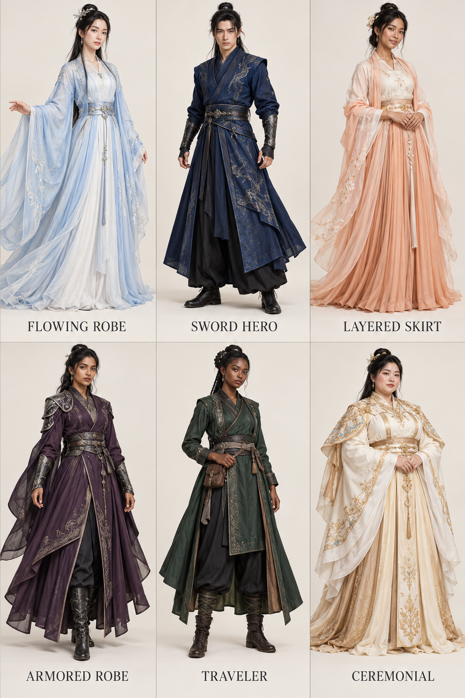

*AI原创幻想服装，均为成年模特，不作朝代形制复原。从左到右、先上后下：宽袖层叠袍服、窄袖侠客装、短上衣与层叠裙、带护甲的袍服、旅装、仪式感长袍。名称是本书的描述入口，不是历史服装定名。*

仙侠服装可以借用交领、长裙、宽袖和肩部披饰，也可以加入虚构护甲或现代固定件。创作空间很大，但如果它混合了不同来源，就明确写“仙侠幻想设计”，不要因为人物拿着长剑或站在古建筑前，就称为某朝汉服。

图中第一格先读内外层：白色内层、浅蓝宽袖外袍、窄腰带。第二格则强调窄袖、护腕、长短衣摆与裤装，活动感来自这些具体关系，而不只来自“英气”。第三格以独立肩部轻披与长裙形成纵向线条，不能把所有垂下的布都自动命名为某朝披帛。

第四格可以说“幻想长袍叠穿肩甲，外衣分片，下配裤装”；第五格是窄袖旅装；第六格则用宽袖、长袍与独立披肩形成仪式感。它们和上一章有文物依据的形制教学采用不同验收目标：这里检查设计是否清楚、自洽，以及是否诚实标注幻想来源。

> 描述例句：原创仙侠成年女性角色，穿不透明白色内层与冰蓝色宽袖长外袍，腰间用窄银色带固定，裙摆分层；发型简洁，服装为幻想设计，不指定朝代。

## 从还原走向日常化：识别点可以少而明确

日常化角色穿搭可以保留主色关系、某一轮廓或一两件标志配件，再换成现成衬衫、夹克和裤裙。它与严格复制角色服装是不同目标，不必用“装甲不够多”去评价一套本来就在做轻量改编的穿搭。

Blizzard的真实采访提供了两个容易理解的例子：Nic的“Golfer:76”以Polo衫的色块和数字表达角色；Marina的“Casual Johanna”把角色装甲的灵感转成围巾与夹克。它们说明角色的识别线索可以迁移，而不是只有整套铠甲才算有角色意识。[真实案例：Blizzard，Casual Cosplay Shines at BlizzCon](https://news.blizzard.com/en-us/article/22647474/casual-cosplay-shines-at-blizzcon)

练习时可以选一个自己熟悉的角色，写下三个不可少的识别点，然后只用日常单品改编。再写出改动：例如“保留蓝白主色和领部蝴蝶结，将夸张裙架改为普通A字裙”。这样既能讨论原角色，也能明确设计取舍。

## 可直接复用的角色穿着说明

> 目标：还原／改编／原创。参考：作品、角色与版本。人物：成年、面孔及体型另行说明。服装：内层、主衣、外层。结构：领、襟、袖、腰和裙裤。装备：头饰、假发、护具、鞋靴与手持物。必须保留：三个识别点。需要补充：背面、连接处与遮挡层。

例如：“原创成年女法师，穿高领酒红长袍，外罩独立连帽短披肩，腰带有两只小袋，下配深色平底靴。披肩到腰，长袍到脚踝，两件分开制作。”这段话不依赖某个网络风格标签，也能帮助画师和生图系统理解衣物关系。

汉服与cosplay的交集在于服装可以成为角色的一部分；区别在于评价依据。历史衣装核对文物与研究，既有角色还原核对设定版本，原创角色核对设计目标。**先确定依据，再讨论哪里准确。**

---

# 第 23 章｜相邻衣型怎样分：从裙装到裤装与外搭

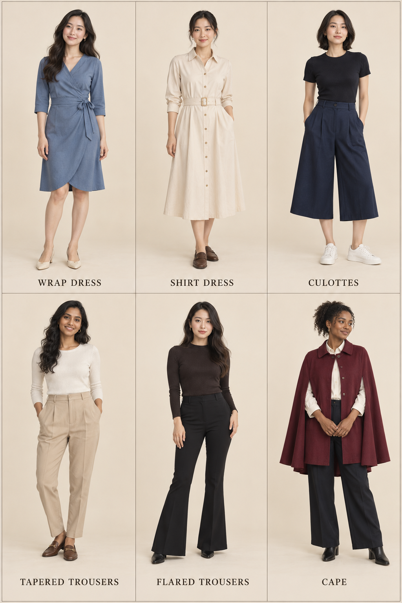

*图 38：AI 教学示意。用于比较相近衣型的可见轮廓；内部连接、扣合和裁片关系，应结合实物或结构资料确认。图中造型不代表某个品牌的真实产品。*

第 13—18 章建立了单品名称；这一章处理更常见的实际困难：一件衣服似乎同时符合几个名字。白色裙装可以既有衬衫领、又有交叠前片；一条裤子可以上部很宽、裤脚却收窄。名称并不总是互斥选项。**先找衣物类别，再补局部结构与轮廓**，往往比争论它“到底算什么风格”更有用。

## 同一条裙子，可以同时是衬衫式与裹身式

衬衫裙的识别线索集中在领、门襟和袖口；裹身裙则涉及衣片如何交叠与固定。这是两组不同的问题，完全可能出现在同一件衣服上。真正的裹身结构与已经缝合的仿裹身外观，也可能从正面看起来接近。

描述“白色翻领衬衫裙，前片交叠，腰侧系带”，比先从 shirt dress 和 wrap dress 中删掉一个词更准确。需要设计制作时，还应补充内片的固定点，以及外片打开后哪些部位仍被遮盖。DVF 的历史款可以帮助观察包裹关系，大都会博物馆也将其置于更早的美式包裹服装传统中，而非把全部裹身衣物归于单一发明。[真实旁读：The Met，Diane von Furstenberg，Dress，1975–76](https://www.metmuseum.org/art/collection/search/79701)

| 名称 | 优先观察什么 | 还不能由名字推出什么 |
| --- | --- | --- |
| 衬衫裙／shirt dress | 衬衫式领襟与袖口如何延伸成裙 | 不必直筒，也不必全长扣合 |
| 裹身裙／wrap dress | 前片交叠、内外固定点与穿脱关系 | V 领或腰结本身不能证明结构 |
| 仿裹身裙／faux-wrap dress | 固定交叠外观，开口另行安排 | 不能默认整件能摊开包裹 |
| 茶歇裙／tea dress | 在当代商品语境中核对具体款式 | 不是唯一领型、面料或纸样 |

## “茶歇裙”适合检索，不足以交代衣型

中文“茶歇裙”经常与 V 领、收腰、柔软裙摆等外观连在一起，但它不能代替这些结构词。品牌也会把不同材料与细节放入 tea dress 名称：M&S 的一款就使用缎面、V 领与中长裙身。它说明商品命名的使用情境，不构成全行业统一的裁剪标准。[当代实例：M&S，Satin V-Neck Midi Tea Dress](https://www.marksandspencer.com/satin-v-neck-midi-tea-dress/p/clp23045425)

也不要将现代 tea dress 自动视作维多利亚时期 tea gown 的准确复原。大都会博物馆的 1898—1901 年藏品，是在家接待客人时穿的裙袍，包含历史服装与日本服装的设计影响；ASU FIDM 的约 1887—89 年实例则联系到唯美主义。两件具体实物已经足以说明：历史名称需要年代与对象，不能用一张碎花 V 领裙替代。[历史旁读：The Met，Tea gown，2009.300.558](https://www.metmuseum.org/art/collection/search/159102)；[ASU FIDM Museum，Time for Tea](https://asufidmmuseum.asu.edu/learn/articles/time-tea)

创作时可写：“人物穿小花印纹膝下连衣裙，短袖、交叠 V 领、自然腰位，裙摆轻微展开。”若还想保留检索方向，在后面补“现代茶歇裙方向”即可。衣物信息先成立，审美名称再帮助定向。

## 裤装先看两条裤腿怎样变化

宽松不是完整裤型。观察大腿、膝部和裤口之间的关系，才能分清几种经常混用的描述。

| 裤型词 | 从上到下的观察线索 | 容易混淆之处 |
| --- | --- | --- |
| 阔腿／wide-leg | 裤腿保留较多宽度与空间 | 宽度与收放方向是两回事 |
| 锥形／tapered | 向裤口逐渐收窄 | 大腿可以宽松，并非紧身裤 |
| 喇叭／flared | 下部向裤口展开 | 与从大腿就宽的阔腿轮廓不同 |
| 裙裤／culottes | 分腿结构形成接近裙装的体积 | 不等于有一层裙片盖在短裤外 |

UNIQLO 的 Wide Tapered Pants 将宽松与向裤口收拢放在同一名称中，正好提醒我们不要把 wide 与 tapered 当成对立词。其 culottes 实例则通过宽裤腿和褶形成裙装般体积，并采用较短裤长；这里的长度是该款信息，不应机械推广到所有中文“裙裤”。[实物旁读：UNIQLO，Wide Tapered Pants](https://www.uniqlo.com/us/en/products/E471934-000/00)；[UNIQLO，Culottes，481238](https://www.uniqlo.com/sg/en/products/E481238-000/00)

与之相比，**skort** 通常是在短裤结构上结合裙式外观，可能由前方裙片遮住裤腿。若只看到正面，先写“裙式前片、侧边可见短裤”，不要凭整体像裙子就断定是独立半裙。第 14 章和第 18 章的基础对照可帮助继续辨认。

把这些词用于同一个人物时，可以先固定腰位和裤长，再逐个更换裤型。例如“深灰高腰九分裤，大腿宽松，裤脚逐渐收窄”明确指向宽松锥形；换成“从髋部到裤口维持宽阔空间”，轮廓便接近阔腿。裤腿在膝下展开时，再用喇叭形描述。膝部弯曲、双腿交叉和风吹起面料，都可能暂时改变轮廓；观察站立正面之外，侧面和自然迈步图也很有帮助。不要因为一个姿势把裤口遮住，就对裤型作过强判断。

## 斗篷、披肩与短夹克：先确认手臂从哪里出来

在现代日常衣橱中，披肩常以一块织物披绕肩背，穿法改变就会改变前方开合；斗篷通常已有领肩与衣身组织，手臂可能从边缘或专门开口伸出；短夹克则通常有明确袖身，手臂进入袖筒。先找这条关系，再谈长度与材质。不要把一切披在肩上的衣服都叫斗篷：西装外套不穿入袖子、只披在肩上，仍可以称“披着西装”。

这些是本书面对现代衣物的观察办法，并非把世界各地的历史服饰强行归为三种纸样。真实旁读可以看德国国家博物馆收藏的一件约 1895 年晚间斗篷：欧洲时装遗产协会的介绍明确指出其黑色天鹅绒、刺绣与前方开口等细节。名称之外，仍要回到具体衣物的材料、开合与体积。[实物旁读：European Fashion Heritage Association，A Rich Evening Cape from Southern Germany](https://fashionheritage.eu/object-voices-a-rich-evening-cape-from-southern-germany/)

描述可以是：“人物穿深灰直身长裤，内搭浅色高领上衣，肩上披一条长方形格纹披肩，两端垂在前方。”若换成“立领短斗篷，前中扣合，两侧留手臂开口”，衣物关系随即改变，不只是风格标签不同。

长度还应独立补充：到腰、到髋、到膝，分别改变外层与内搭露出的关系。“短”不是一种固定衣型，无领短夹克、短斗篷和短披肩也不会因此变成同一件衣物。

## 将比较结果用于人物描述

试把一句“她穿复古长裙和外套”改成：“人物穿酒红色衬衫式中长裙，翻领、长袖、腰侧系带；外搭米白无领短夹克，手臂穿入袖中，配棕色低跟鞋。”其中颜色、衣型、固定关系与穿法各自承担任务。

不确定结构时，用“呈交叠外观”“裤脚向内收窄”“披绕在肩背”这样的可见描述。暂时没有唯一名称，并不妨碍把衣服讲清楚；真正需要避免的是，用一个听起来专业的词替代尚未观察的连接关系。

---

# 第 24 章｜胸衣感从哪里来：固定方式、杯线与支撑结构

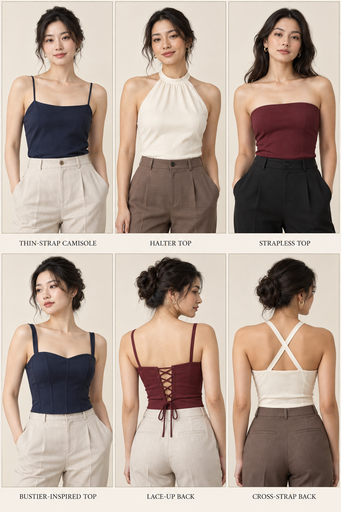

*图 39：AI 教学示意。用于观察肩颈连接、领缘、杯线与衣身分割等外观；内部是否有钢圈、骨条以及实际承托能力，不能由生成图证明。图中的外穿造型不等同于历史束身衣复原。*

第 15 章介绍了 camisole、halter、bustier 和 corset 的基础用法。本章继续向里走一层：同样一件贴合上身的衣服，肩带、罩杯、分片和系带分别在做什么？认识这些部位，可以把“有点像内衣的上衣”拆成明确的服装描述，也能减少生图时把外穿上衣变成内衣套装的偏差。

## 先沿着衣服的上缘走一圈

想描述一件露肩上衣，可以先从正面领缘沿肩部看到后背。普通吊带从前片越过肩顶连接后片；挂脖将上部连接移到颈后；抹胸则没有越过肩顶的肩带。三者首先改变的是固定关系，不能只靠露出多少皮肤判断。

| 可见关系 | 可以先这样说 | 还需查看哪里 |
| --- | --- | --- |
| 两条带从前片越过肩顶 | 细肩带或宽肩带上衣 | 后片连接点，是否交叉 |
| 上缘或带子绕到颈后 | 挂脖式上衣／halter top | 颈后如何系结或扣合 |
| 肩上无带，衣服围绕躯干 | 无肩带抹胸／bandeau top | 背部、侧边及内部固定 |
| 领缘落在肩顶以下，仍带袖 | 一字肩或露肩有袖上衣 | 袖子与衣身连接处 |

当代商品会把几组结构放在同一件上衣中。H&M 的棉质挂脖上衣，同时采用 V 领、颈后系带、开放后背与胸下抽褶；“V 领”说明正面领缘，“挂脖”说明肩颈连接，“抽褶”说明体积怎样展开，它们可以同时成立。商品还明确标注无里衬，提醒我们外观与内层仍须分别核实。[真实旁读：H&M，Cotton halterneck top，1332448007](https://www2.hm.com/en_sg/productpage.1332448007.html)

因此，一张正面高领无袖图不足以证明“挂脖”。为角色设定补一句“颈后固定、肩胛区域开放”，或要求前后视图，比反复堆叠 halter、backless 更有用。长发遮住连接点时，更需要保留这种不确定性。

## 抹胸不等于胸衣式上衣

“抹胸”主要告诉我们没有肩带；它可以是柔软针织，也可以是较挺的分片上衣。**胸衣式**则是在说造型语言：杯线、贴合分片、骨条感通道或束身衣灵感。这两种描述能够交叉，但不应互相替代。

一件水平领缘、无独立杯线的弹性抹胸，可以很简洁；一件带肩带、心形领和明显杯线的 bustier top，也并非无肩带。作为造型练习，还可以把无肩带上衣设想成上缘贴合、下摆向外展开的形式。“无肩带”只交代肩部，不会自动规定整件衣身都紧包躯干。

需要的是日常外穿时，可直接写：“黑色不透明无肩带短上衣，直领缘、衣摆到自然腰，下配高腰长裤。”需要胸衣式外观时，再加“弧形杯线、贴合分片衣身”。这比仅写 lingerie 或 corset 更能约束最终图像。

## 罩杯、钢圈与骨条不是同一件东西

把衣物平铺想一遍，会更容易分清下面三组结构。

**罩杯／cup**是容纳和组织胸部形状的部分。杯面可以由多片拼接，也可以成型；“有杯线”首先说明可见分割，“厚垫”“聚拢”与“有钢圈”不能由此自动推出。

**钢圈／underwire**通常位于杯下缘的通道中，与杯面不是同一部件。Wacoal 的结构图把杯、肩带、下围、侧翼、中心部位及钢圈分别标示，适合对照学习部件名称。它也提醒我们：一件文胸的组织并不只由两条肩带完成。[结构资料：Wacoal，Bra Anatomy](https://wacoal-america.com/pages/bra-anatomy)

**骨条／boning**沿衣身的特定通道布置，用于参与维持形状。不要因为中文口语叫“鱼骨”，就把所有现代骨条都想成同一种材料；也不要将一条竖向拼缝直接称为骨条。V&A 对维多利亚时期内衣的介绍展示了骨条、系带与前中支撑等结构随年代变化的情况，说明真实束身衣需要整体考察。[历史结构资料：V&A，Corsets, crinolines and bustles](https://www.vam.ac.uk/articles/corsets-crinolines-and-bustles-fashionable-victorian-underwear)

描述远景人物时，通常只需交代“清楚杯线”和“竖向分割线”。只有商品资料、实物内侧或明确的结构设定能支持时，才进一步写“内置钢圈”“骨条通道”。这样既准确，也不会让图注假装看到了衣服内部。

## 拼缝、装饰通道与真实支撑，分三个层次说

同样的竖线可能来自分片缝合、压线、滚条，或者装有骨条的通道。它们在成图里很接近，用途却不同。外观任务可以停在第一层：“衣身有六道竖向分割线”；设计任务才需要第二层：“这些位置是通道还是装饰”；制作任务还要补材料、衬层和扣合关系。

同样，背后系带可能用于调节围度，也可能只是附着在完整布片上的装饰。先辨认孔眼、衣片边缘与开合缝是否对应，再判断其作用。若背部画着交叉带，却没有相应连接点，就应修正图像，而不是用“复杂设计”解释结构异常。

## Bustier、corset top 与 corset：名称不能代替证据

当代商品标题的边界并不整齐。Bustier top 或 corset top 可能借用胸衣、束身衣的外观，却不具备历史实物的材料与束形机制。本书因此使用“外穿胸衣式上衣”“束身衣灵感分片上衣”等工作描述，把造型来源与实际功能分开。

反过来，真正的 corset 也不能只用“有罩杯”识别：有胸下款，也有覆盖胸部的形式。伦敦博物馆一件 18 世纪 stays 的藏品说明记录了密集骨条通道，这是具体实物证据；远景照片里几道竖线没有相同的证明力。[实物旁读：London Museum，Corset, stays，object-77973](https://www.londonmuseum.org.uk/collections/v/object-77973/corset-stays/)

衣长也是独立变量。短款上衣可以停在胸下、自然腰或腰线以下，不能只凭 crop top 决定具体位置；胸衣式上衣也可以接腰部荷叶摆。若想保持完整衣身、只在腰下增加外展部分，可以写“贴合分片上身，腰线以下接短荷叶摆”。不要同时要求“到胸下的极短款”和“连续覆盖腰腹的长衣身”。这不是风格不兼容，而是同一个部位收到了互相冲突的长度指令。

## 将局部词接回一整套衣服

可以从简到细地写：“人物穿奶油色外穿胸衣式上衣，宽肩带、浅心形领、弧形杯线，分片衣身到腰部；下配深灰阔腿裤，外搭敞开的短西装。”这里已经交代了用途、固定、领缘、分割、衣长与层次，不需要补无法验证的塑形效果。

若更换成挂脖款，就重写肩颈连接；若更换成软针织抹胸，就删除独立杯线和骨条设定。每次只改变一个结构条件，能看清究竟是什么让衣服显得简洁、运动、内衣感或较有建筑感。对生图而言，这也比把所有上衣词一起塞进提示词更稳定。

---

# 第 25 章｜从领口到背部：把一件上衣描述完整

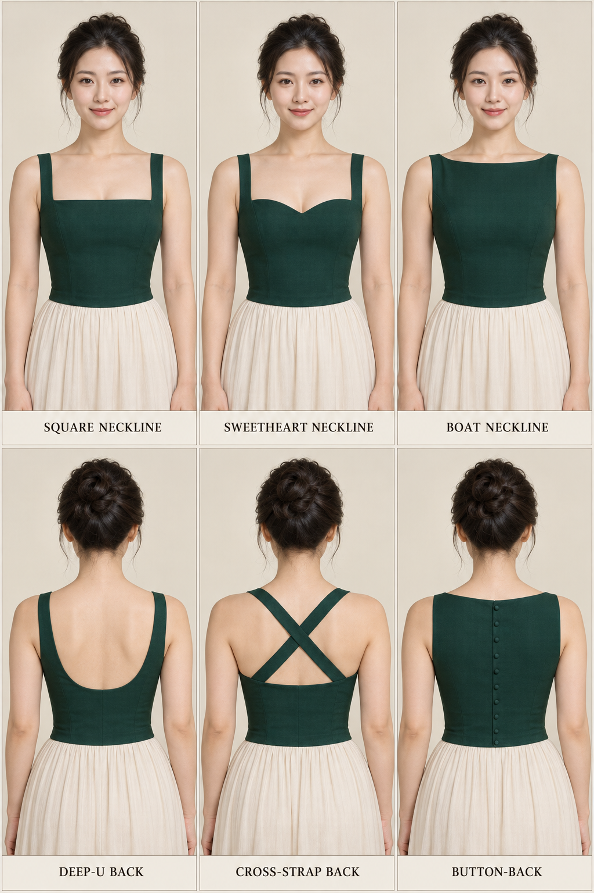

*图 40：领口与背部处理的 AI 教学示意。上排比较正面领缘，下排比较背面处理；各格为独立设计方案，不是三套衣物的前后配对。观察开口边界、覆盖位置和带子的连接，不据图确认内部支撑。*

第 16 章建立了领口与袖型词汇，本章把这些词放回同一件衣服。实际沟通中，困难往往不是少记一个名称，而是正面、侧面和背面各说了一点，却没有交代它们怎样连接。正面看见的方领，不能替你决定后背高度；一条斜线，也不一定证明袖子属于某种裁法。

## 正面开口：形状、宽度与深度分别说

先沿着衣物与皮肤之间的边界看一圈。方领的下缘较平、两侧形成转角；心形领口在前中形成凹口，两边是弧峰；船领则偏向横向展开，通常较浅。它们不是三个固定尺寸：方领能深能浅，船领的弧度也有变化。犹他教育网络的服装教学图将不同领口并排展示，适合先认边界，再补深浅。[教学参照：Utah Education Network，Neckline Variations](https://www.uen.org/cte/family/fashion/downloads/principles/necklines.pdf)

“宽方领、下缘停在上胸”比“法式领口”更容易画对。“贴近锁骨的宽船领”则交代了横向开口和纵向高度。这里的深浅应尽量依靠可见位置表达，不把某个领名直接理解为暴露程度，也不据此判断穿着者的身材或身份。

## 背面不是正面的镜像

有些上衣正面十分平整，转身后才显出低背、交叉带或多排系带。描述时先指出开口占据的位置，再说边缘和连接，不把所有露背款都写成同一个 backless。

| 可见处理 | 比较时抓住什么 | 可以怎样写 |
|---|---|---|
| 深 U 形背部开口 | 圆弧最低点与背腰的位置 | 背部为深 U 开口，下缘止于腰线上方 |
| 交叉肩带 | 带子从哪里出发、在哪里交叉 | 两条细带在肩胛之间交叉，接回后腰两侧 |
| 背部系带 | 成对孔眼、穿带范围与是否留隙 | 背部中段有多排交叉系带，底下保留不透衬片 |
| 局部镂空 | 是否被衣料完整包围 | 高背上衣在肩胛之间留一处水滴形开口 |
| 后中开合 | 拉链、纽扣或其他闭合件的位置 | 后中隐形拉链，领口顶部以小扣闭合 |

这张表是本书用于观察的拆解方法，不是互斥分类。一件衣服可以既有 U 形开口，又有跨过开口的横带；交叉带也可能只是装饰。若图像没有展示接点，就写“背部可见交叉细带”，暂不补它怎样承重或怎样穿脱。

背面资料缺失时，描述也可以完整地保留空白：“正面宽方领、窄肩带；背部结构待定。”对人物设计而言，这句话比自行补一个低背更有用，因为它明确告诉后续绘图者，哪些是已定条件。

## 袖子用两层词，不挤进一个名称

一层说袖子怎样接近肩部，另一层说袖体怎样展开。常规装袖沿袖窿连接独立袖体，常见接合位置接近肩部；落肩描述连接位置向上臂方向下移；插肩则让袖部延伸到领口附近，形成斜向分界。针织服装还可能通过增减针形成这些边界，不一定都有可见缝线。Knit Picks 的自有教学文章用实际毛衣区分这些结构，因此看针织物时应写“斜向分界”或“增减针线”，不一律说成缝合线。[品牌教学参照：Knit Picks，Anatomy of a Sweater](https://blog.knitpicks.com/anatomy-of-a-sweater/)

泡泡、主教、喇叭等词更多描述袖体的体积与末端。它们能与接合方式组合：“插肩连接、前臂宽松、窄袖口收束”，并不矛盾。中文“灯笼袖”范围较宽；想减少误差，就追加“圆鼓集中在上臂”或“长袖下半段鼓起、手腕收口”。不要仅靠一个中文名称要求别人猜出全部轮廓。

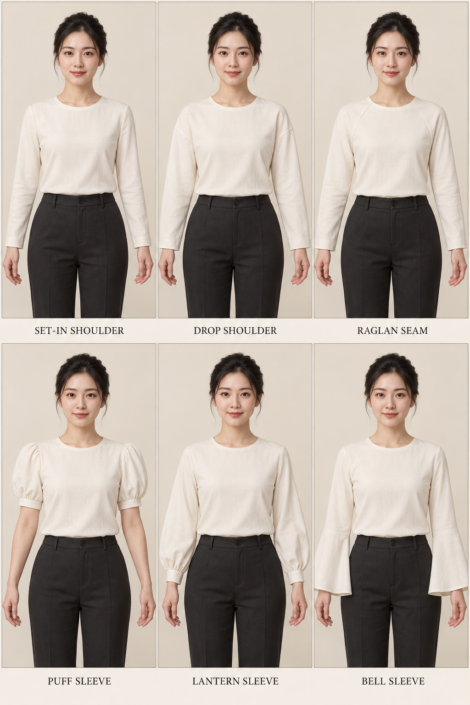

*图 41：袖子接合与体积的 AI 教学示意。上排比较装袖、落肩与插肩的可见边界；下排比较短泡泡袖、宽松收口长袖与喇叭形袖口。下中“LANTERN SLEEVE”作为宽泛造型标签使用，具体布量仍看画面；示意图不作为精确裁片依据。*

FIT 的《Statement Sleeves》展览把基础袖型与设计变奏相连：同类袖子可通过材料、形状、装饰和功能继续改变。读图时因此要同时记录“叫什么”和“这一件具体怎样”。[博物馆参照：Museum at FIT，Statement Sleeves](https://www.fitnyc.edu/museum/exhibitions/statement-sleeves/index.php)

## 开口与闭合方式不是同一件事

开口说衣服哪里敞开；闭合方式说哪些边缘怎样合在一起。衬衫前中一排纽扣，通常与门襟区域有关；后背一个水滴形开口，则可能只在顶端用小扣连接。看见一根绳结，只能确认系带外观，不能保证它是唯一穿脱通道。拉链也可能在侧缝，不一定出现在视觉上最明显的背部开口旁。

这一区分会改变生图指令。想要装饰性系带，就补“衣身保持覆盖，带子附在表面”；想要真实可开的背中系带，则说明两边衣片、穿带范围与下方是否有衬片。设计任务还应另画背面或局部图，因为正面摄影无法说明隐藏的闭合件。

## 让一段描述在转身后仍然成立

可以先用一句话确定主件，再按观察方向补充：“她穿奶油色合体上衣，正面是浅心形领口；短袖上臂略鼓、袖口收窄；背部保留完整衣片，后中拉链闭合。”这段话没有依赖某个风格标签，却能限制领口、袖体和背面的主要变化。

修改时只动一个层次：“保留领口、肩部连接和袖口，只增加袖身布量。”若同时要求换领口、换材料、加系带，最后很难判断哪一项导致画面偏离。做人物转面图时，也先核对前后肩带是否接得上、腰线是否连续，再考虑姿态、发型与装饰。

## 用近景解决遮挡，而不是增加想象

自然站姿往往会遮住一部分接缝。手臂垂下时，腋下布量可能折进衣身；长发落在后背，肩带接点和领口边缘也可能被盖住。拍摄或生成参考图时，可让头发移到一侧，手臂与身体略留空间，但不必摆成僵硬的解剖姿态。局部近景负责说明连接，全身图负责说明整套比例，两者可以互补。

例如同一件黑上衣，正面全身图用于确认腰线和袖长；背部半身图用于确认 U 形开口；肩部近景用于确认接合边界。不要把三个视角误当三套衣服：颜色、带宽、袖口与缝线位置应连续一致。只展示一面时，图注也注明视角，读者便能区分“这一面没出现”与“这件衣服没有”。

资料核查：2026 年 10 月 22 日。术语作为描述工具使用；内部工艺与合体效果需结合实物、纸样或设计资料确认。

---

# 第 26 章｜只换一种材料：用对照看清衣服的质感

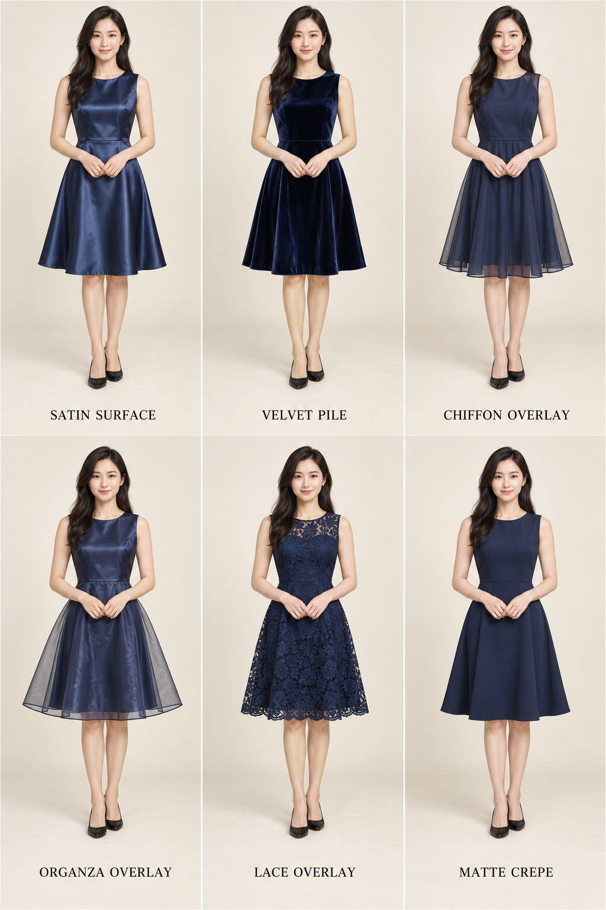

*图 42：固定衣型方向、比较不同材料外观的 AI 教学示意。用来观察光泽、透光、表面纹理与轮廓变化，不用于鉴定纤维成分或材料性能。各格的领缘、褶量与裙摆仍有微差，因此这张图用于认识外观方向，不是严格的单变量实验。*

第 17 章解释材料、面积与层次，本章进一步控制比较条件。同一条裙子如果换了人物、颜色、姿势、光线和裙摆大小，你很难判断差异究竟来自哪里。把衣型、配色和机位尽量固定，再改变一项处理，材料的作用才会从“气氛”变成可以讨论的线索。

## 先确定在比较哪一层

“丝绸和缎面哪个好看”把两个层级放在了一起。蚕丝属于纤维来源；缎纹属于织物组织；缎面在日常描述中还常指具有相近光泽的布面外观。蚕丝可以形成不同织物，缎纹织物也不必由蚕丝制成。MFA 的 CAMEO 分别收录 silk 与 satin weave，前者谈纤维，后者谈纱线交织。[材料参照：MFA Boston，Silk](https://cameo.mfa.org/wiki/Silk)；[结构参照：MFA Boston，Satin weave](https://cameo.mfa.org/wiki/Satin_weave)

因此，面对一张生成图，可以要求“柔和缎面光泽”，却不应据图宣布“百分之百真丝”。若是有产品资料的实物，则可写“品牌标注为蚕丝成分、缎纹织物”，把资料事实和视觉观察放在各自的位置。哑光同样不是一种纤维，粗糙也不自动等于亚麻。

## 第一组实验：保留轮廓，只看光怎样移动

把同一件深色、无花纹、轮廓简洁的衣服放在相近柔光中。先看平面，再看折转处。缎面感的布面常显出较连续的亮带；哑光表面更多靠整体明暗表现体积；绒面感则可能出现有方向的深浅变化。这里比较的是可见效果，不是通过光泽排名材料档次。

判断时也留意光源。硬光可能把普通布面照出尖锐高光，过曝则会抹掉纹理。只有一张照片时，描述“折转处出现窄亮带”比直接写“镜面真丝”更可靠。做生图对照可固定“同一人物、同一站姿、同一柔光、同一裙长”，避免让强光替材料完成差异。

| 观察维度 | 先找的证据 | 对应的描述句 |
|---|---|---|
| 光泽 | 亮带是否连续，明暗转折是否集中 | 深蓝布面有柔和连续光带，不作金属反光 |
| 透明程度 | 哪一层、哪一部位能看见底层 | 仅外罩层半透，衣身内层完整覆盖 |
| 挺括程度 | 边缘是否支开，折线是否清楚 | 袖口略向外支开，轮廓边界明确 |
| 垂坠表现 | 布量向哪里落，褶是否细长 | 裙身自然下垂，形成细长纵褶 |
| 表面纹理 | 网眼、绒感、颗粒或凹凸的尺度 | 表面有细小颗粒，不增加花卉纹样 |

这些维度可以并存。“透明”不等于“柔软”，“有光”也不等于“厚重”；一句描述最好选择最重要的两三项，余下留给材料样本和设计讨论。

## 第二组实验：同样轻透，边缘可以不同

雪纺与欧根纱都可能轻薄透光，却不该只用“仙气纱”合并。CAMEO 把 chiffon 描述为轻薄、平纹、由细捻纱形成的透明织物；organza 则强调平纹、透明与较挺的整理外观。它们都可能使用不止一种纤维。[材料参照：MFA Boston，Chiffon](https://cameo.mfa.org/wiki/Chiffon)；[Organza](https://cameo.mfa.org/wiki/Organza)

在对照中，可以让外罩袖保持相同长度和大致布量，观察下缘：一件更柔软地下落，另一件更容易支出清晰边界。但不要将这个示例变成“所有雪纺都这样、所有欧根纱都那样”的定律。厚度、整理、层数与裁剪也参与塑形；真实采购仍要看具体样布。

描述轻透材料时，先把覆盖关系交代好：“薄透明外层在膝部以下长出一截，内层为不透直身裙。”这样既说明了透光范围，也让别人知道膝部以上不是直接透出身体。想改为更挺的外罩，可继续写“外层边缘略支开”，不必同时把裙长和裙型全部改变。

## 第三组实验：蕾丝花纹、网底与底层分别看

蕾丝不是“有洞的布”这样一个单一外观词。菲茨威廉博物馆的术语说明强调透空结构与图案，也列出多种蕾丝类别；馆藏中还存在花纹附加在机器网底上的实例。这提醒我们：花纹、网底和制作方法不能简单一一对应。[术语参照：Fitzwilliam Museum，Lace](https://data.fitzmuseum.cam.ac.uk/id/terminology/term-39352)；[实物参照：Border or flounce，T.5-1986](https://data.fitzmuseum.cam.ac.uk/id/object/110172)

想观察蕾丝与普通网纱的视觉差异，就先保持底层相同：一格是没有花纹的细网罩层，一格加入密度明确的花形纹样。再固定蕾丝，分别换成同色与对比色衬里，观察花纹显眼程度。这是两次比较，不能一次把花纹、网眼和衬里全换掉后，仍把结果归因于“蕾丝更华丽”。

给创作的描述可以是：“同色不透衬里外覆盖稀疏花形蕾丝，肩袖区域不加衬里；花纹间留出足够细网空隙。”如果看不清制作方式，写“花形镂空外观”即可，不据一张图认定手工梭织、针绣或机器制作。

## 从材料词走向可执行的选择

“高级、柔美、复古”可以表达偏好，却不足以决定材料。把其中一项翻成可观察要求，会更有帮助。例如：“希望裙摆轻垂、低光泽，外层只在下摆透出一小段；不要明显蓬起。”这里交代了视觉目标，设计者仍有空间选择合适成分、组织和厚度。

一轮对照结束后，写出改变和保留的内容：“保留人物、领口、裙长与机位；将外层由柔软薄纱改为略挺透明布面。”再回看衣服边缘和褶的走向，判断图像是否兑现要求。生成图中的相似脸、固定姿态和标签只是辅助；真正有效的单变量对照，仍要逐格检查轮廓有没有偷偷改变。

## 同一块布，也值得正反比较

还可以把实验缩小到一块布面：保留同样的支撑与折叠方式，比较平铺处、弯折处和叠成两层的区域。平铺便于看网眼与图案，折转便于看光带，两层叠合则帮助说明透光如何随覆盖改变。若做的是 AI 示意，只能把它当成视觉练习，不能用画面测量实际透光率。

记录时尽量不用比较对象之外的词：“这组中左格亮带更宽、右格折边更清楚”，比“真丝一定更有光泽”保留了证据范围。等拿到实物，再补成分、克重与触感资料。这样从图片到材料选择有了连接，也不会把一次审美观察伪装成纺织品检测。

资料核查：2026 年 10 月 22 日。光泽、透明度、厚薄和垂坠不能替代成分标签、触摸样布或性能测试。

---

# 第 27 章｜鞋袜与包：名称之外，还要说清哪些部位

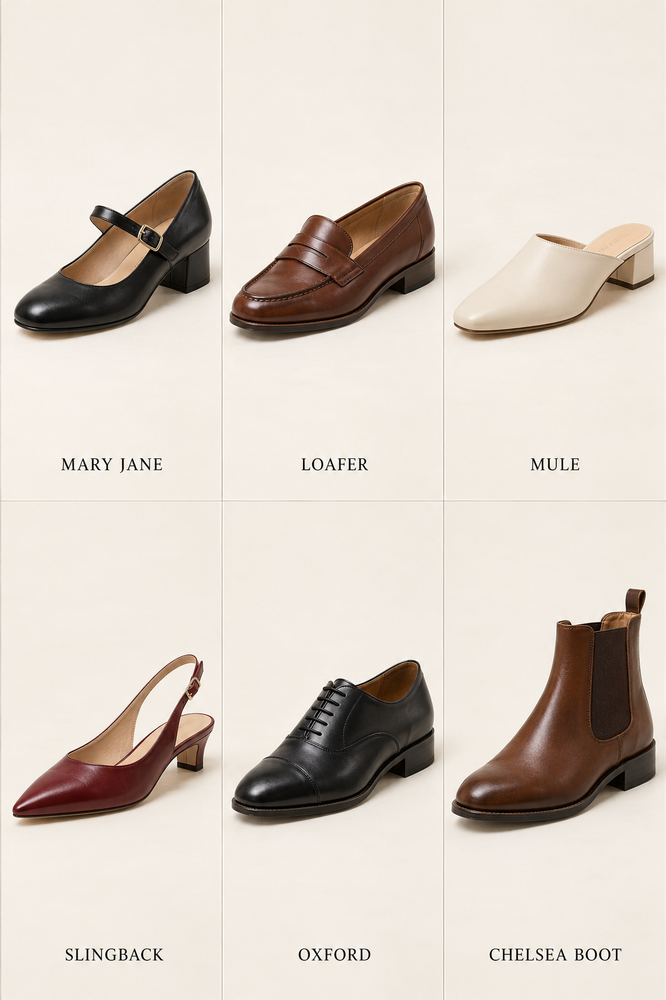

*图 43：鞋型与局部结构的 AI 教学示意。用于比较可见外观，不据此推断真实鞋履的合脚程度、支撑性能或材料成分。*

第 10 章讨论配饰如何参与风格，这一章把镜头拉近：同样是一双黑鞋，脚背横带、后跟露空、鞋头形状和鞋底厚度，都可能比“复古”更能帮助别人画对它。鞋与包的名字也不总是互斥分类；有些词说外形，有些词说结构，有些词说怎样穿戴。

## 先找固定方式，再补鞋头与鞋跟

玛丽珍鞋（Mary Jane）以跨脚背的带子为重要线索。经典款常见圆头与低跟，但现代设计会改变带数、跟高和鞋底，不能把“平底圆头”当成所有玛丽珍鞋的必要条件。[资料：CHARLES & KEITH，Mary Jane Shoes: All You Need to Know](https://www.charleskeith.com/sg/guides/mary-janes.html)

穆勒鞋（mule）的辨认重点是露出的后跟；乐福鞋式前帮也可以与这种后部结构结合。Cole Haan 的官方指南直接使用“loafer mule”，解释其保留乐福鞋的前帮而去掉后帮。因此，“穆勒”和“乐福鞋式”可以共同描述一双鞋，而不是必须二选一。[资料：Cole Haan，Women's Loafer Style Guide](https://www.colehaan.com/pages/womens-loafer-style-guide)

后空带鞋（slingback）用带子绕住后跟，与完全没有后跟带的穆勒鞋区别明显。Clarks 的 Straven Sling 又同时使用“slingback loafer”名称，展示乐福鞋式前帮与后跟带的组合。商品命名是实用参照，不能由此推出所有品牌都采用同一分类规则。[资料：Clarks，Straven Sling](https://clarks.sg/products/straven-sling-womens)

| 命名层次 | 观察位置 | 具体表达 |
|---|---|---|
| 基本鞋型或前帮语言 | 整体鞋面、脚背 | 乐福鞋式前帮、玛丽珍横带 |
| 后跟固定方式 | 足跟周围 | 包后跟、露后跟无带、后跟绕带 |
| 鞋头轮廓 | 最前端 | 圆头、杏仁头、尖头、方头 |
| 鞋跟与鞋底 | 侧面和地面之间 | 平底、低粗跟、细跟、厚底 |
| 表面与细节 | 鞋面及边缘 | 光亮漆皮感、绒面感、搭扣、横带 |

“黑色尖头低粗跟后空带鞋”已经能形成明确外观；再加“脚背双横带”，就能说明它与普通后空带鞋的不同。不要只靠鞋头判断鞋型，也不要把鞋底厚叫成鞋跟高。厚底可同时抬高前掌和后跟，高跟主要涉及前后高度差；描述时分别指出前掌底厚与后跟形状，更不容易混淆。

还可以把脚背看成一块需要描述的区域。鞋面覆盖到脚背较高的位置，和只围住脚趾、留下较大开口的鞋，视觉上不同。若用“深鞋口”“浅鞋口”仍说不清，就换成“前帮覆盖大部分脚背”或“鞋口较浅，露出较多脚背”。这是为描述图像而采用的直白说法，不要求读者先掌握制鞋版型术语。

观察时至少留一个斜侧面。纯正面图容易把低粗跟藏在鞋后，也可能看不见后跟带；脚尖朝向镜头，又会缩短鞋头的视觉长度。需要比较鞋型时，让鞋的方向、拍摄高度和缩放一致。若只看人物全身，能确定“深色低帮鞋”就先写到这里；鞋带、鞋耳或后部结构看不清时，不借画面气氛替它定名。

检索可以分两轮进行：先用最确定的结构词找相似鞋型，再添加颜色和表面效果。比如先搜“后跟绕带、方头、低跟”，随后才加“酒红漆皮感”。如果第一轮已被宽泛的“法式鞋”带偏，增加更多情绪词只会让方向继续漂移；回到鞋的可见部位，往往更快。

图 43 另有两种结构入口：牛津鞋（Oxford）重点看闭合式鞋襟，穿鞋带的部位连接在前帮下方；切尔西靴（Chelsea boot）则看踝部靴筒和弹力侧片。系带皮鞋未必都叫牛津鞋，棕色短靴也未必都是切尔西靴。[品牌结构指南：Charles Tyrwhitt，Shoe Design](https://www.charlestyrwhitt.com/ca/en_CA/ttip-shoe-design.html)

## 袜子先写落点，再写厚薄

“短袜”很容易产生不同画面。画人物时，直接写“袜口在踝骨下”“越过踝骨少许”“到小腿中部”或“到膝下”，通常比一个含糊名称稳妥。再说明贴腿还是松堆、细罗纹还是平滑表面、透明还是不透明。

英文标签也要结合品牌定义看。Injinji 将 Hidden 定位在典型跑鞋鞋口以下，No-Show 位于踝下，Mini-Crew 位于踝骨上方，Crew 到小腿中部；它的 Over the Calf 到膝下。这是一套已查证的品牌用法，并非所有袜子的统一厘米标准。[资料：Injinji，Toesock Height Options](https://www.injinji.com/height.html)

本书的表达方法是先说可见关系：“米白细罗纹袜，袜口到小腿中部，穿黑色圆头单横带平底鞋”。若裤脚遮住袜口，只能确认露出的颜色与纹理，不必猜袜长。袜子与鞋同色时，脚下边界较连续；强对比袜色会增加一条醒目的分段。这是构图观察，不是必须遵守的穿搭规则。

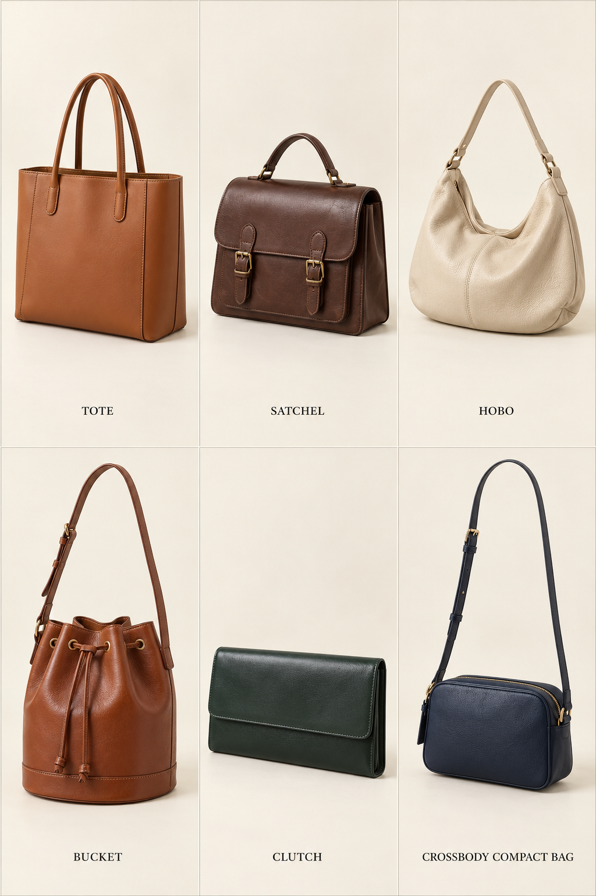

*图 44：包型与提带形式的 AI 教学示意。上排为托特包、翻盖书包式 satchel、新月肩包 hobo；下排为水桶包、手拿包与小型长肩带包。最后一格的 crossbody 是背法方向，实际佩戴落点仍需结合人物或尺寸资料确认。*

## 包型、软硬与背法要分开说

托特包（tote）常见两条提带与较开放的容纳空间；hobo 常以柔软、弯曲或新月状轮廓识别；satchel 在本书中用作翻盖书包式的检索入口，具体提手、扣带与包身仍需说明。这里不把这些名称变成严密互斥的几何盒子：品牌会推出混合设计，托特也可以柔软，hobo 也可以较有结构。

CHARLES & KEITH 的官方 hobo 指南同时列出 hobo tote、satchel hobo 和可转换背法的款式，正好说明名称可以组合。Mulberry 的斜挎包分类也包含 satchel 与 tote 产品，提示 crossbody 主要回答“怎样跨身携带”，不足以单独确定包身轮廓。[资料：CHARLES & KEITH，Hobo Bags Guide](https://www.charleskeith.co.uk/gb/guides/hobo-bags.html)；[资料：Mulberry，Crossbody Bags](https://www.mulberry.com/sg/shop/women/bags/crossbody-bags)

图中的水桶包（bucket bag）有立体桶状包身与抽绳口；手拿包（clutch）则以不用提带、握持携带作为入口，图里是薄长方形翻盖款。并非所有水桶包都必须抽绳，也并非所有 clutch 都没有可拆肩带；描述具体包口与提带，仍比只写名称可靠。[实物检索参照：CHARLES & KEITH，Bucket & Drawstring Bags](https://www.charleskeith.com/sg/bags/bucket-bags)

描述一个包，可以沿“轮廓—软硬—开口—提带—位置”走：

> 棕色横向长方形翻盖包，包身较挺，前方有两条短扣带；保留短提手，另接细长肩带，斜挎后包底落在髋部。

这句话没有强行押注某个商品名，仍然足够检索与设计。若想表现柔软新月包，就改变包身轮廓和支撑感，不必把颜色、人物和整套衣服一起改掉。

包的大小最好有可读的参照。“大包”可能指宽，也可能指厚；画人物时可以说“横向宽度约与躯干相当”“小包位于腰侧、不遮住腰线”，需要产品精度则直接给尺寸。也要记录包口怎样闭合：拉链、翻盖、抽绳和开放口，会改变边缘轮廓。“带金属件”太宽泛，可以继续定位为提手连接环、前翻盖锁扣或肩带调节扣。无需把每颗铆钉列完，但最影响识别的位置应当保留。

最后检查佩戴位置。腋下、腰侧和髋部会让同一个包与不同衣物相邻；肩带压过翻领，可能遮住你本来想展示的结构。人物图需要讲清衣服时，让包略移到身体侧面，或补一张无包对照。图鉴的任务是让结构可读，配饰的数量并不等于信息量。

---

# 第 28 章｜男装与中性衣橱：把整套穿着写成可调整的关系

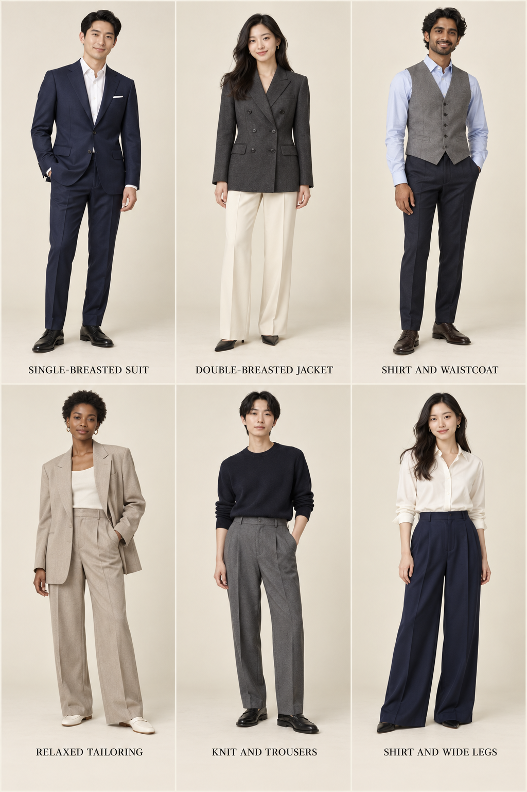

*图 45：剪裁与衣橱组合的 AI 教学示意。人物、造型和搭配为创作，识别重点是可见衣物及层次。*

第 20 章已经给出衣着描述的槽位。这一章用西装、衬衫、马甲和裤装练习更细的组合：外套的肩部、开合和驳领怎样共同形成上身体积，内层露出多少，裤脚又怎样与鞋连接。这里的“男装”指一种设计、商品与历史讨论入口，不是对穿着者的限制；“中性”也不等于只穿灰色宽大衣服。

V&A 的 Fashioning Masculinities 展览同时呈现历史衣装与当代设计，并将性别表达、身份和观看方式纳入讨论。它适合作为真实作品旁读：衣服的文化意义会变化，不能仅凭穿西装或裙装判定人物身份。[资料：V&A，Fashioning Masculinities: The Art of Menswear](https://www.vam.ac.uk/exhibitions/fashioning-masculinities-the-art-of-menswear)

## 西装不是一个不能拆开的标签

先看肩部的外轮廓：肩线是贴近身体自然肩点，还是明显向外延伸？袖山是平缓过渡还是有清楚的抬起？可以描述“肩部自然圆顺”“肩线外扩、轮廓较硬”，但不从一张正面图断言垫肩厚度和内部衬料。外观是观察，内部做法需要商品说明、结构图或实物验证。

再看前襟。单排扣和双排扣讨论的是前部的扣列与围合关系，不是简单数纽扣总数。双排扣常见两列外观扣位，但看得见的扣子未必全用于扣合。驳领又是另一条命名轴：平驳领（notch lapel）在领与驳头交接处形成缺口；戗驳领（peak lapel）的驳头尖端向上；青果领（shawl collar/lapel）用连续弧线形成翻折边。不要把某一种驳领与某一种扣列永久绑定。[资料：Suitsupply，Your Jacket Detail Guide](https://suitsupply.com/en-it/journal/jacket-details-explained.html)

| 可调整的部分 | 写清楚什么 | 只写风格时遗漏的信息 |
|---|---|---|
| 肩与衣身 | 肩线位置、胸腰余量、衣长 | “宽松西装”可能只宽在肩，也可能全身宽 |
| 前部 | 单／双排扣、扣位高低、敞穿或扣合 | “正式”没有说明开合结构 |
| 领与口袋 | 驳领形状和宽度、贴袋或翻盖袋 | 同色外套也可能差异很大 |
| 内层 | 衬衫、圆领针织、马甲；各露出多少 | “叠穿”没有交代谁在外面 |
| 下装与鞋 | 裤腿变化、裤脚落点、鞋面覆盖 | “长裤”无法确定整体下半身线条 |

裤子尤其需要区分“宽度”和“收窄程度”。Suitsupply 的裤型指南同时列出 wide leg tapered 与 wide leg straight：臀腿空间宽裕的裤子，仍可以在下段收窄；贴体与锥形也不是同义词。这是理解相邻轮廓的实用例子，不是要求采用某一品牌的合身标准。[资料：Suitsupply，Trousers Fit Guide](https://suitsupply.com/en-us/journal/trousers-fit-guide.html)

## 用内层露出的位置组织叠穿

衬衫、马甲、西装夹克从内向外穿时，领口、袖口和前开口会显示不同层次。描述“米白衬衫外穿深灰 V 领马甲，最外层是敞穿的藏蓝夹克”，比“英伦三件套感”更容易落实。只有外套、马甲和裤子确属一套设计时，才把它们明确写成三件套；颜色接近并不证明面料和套装关系相同。

针织内搭会让衬衫领这一块结构消失，但不会自动让整套衣服失去剪裁感。短夹克与高腰裤会把上下装分界抬高；长夹克会覆盖更多腰臀区域。此处讨论的是图像中能看见的比例，不应把“显高”“显瘦”当成所有身体都相同的结果。

## 六次从感觉走到衣物

下面是原创描述练习，与图 45 的具体分格不作逐项对应。它们可以用于不同性别、体型和肤色的成年人物；需要保持人物一致时，另行固定人物、姿态、取景和光线。

1. **“干净一点的都市感”** → 深蓝单排扣平驳领夹克，肩部自然、衣长盖过臀部，内搭白色圆领细针织；灰色直筒裤裤脚轻触黑色乐福鞋，配小型方形肩包。

2. **“宽松，但不要整个人一团”** → 米色宽肩短西装夹克敞穿，内搭贴近身体的黑色背心，配高腰双褶阔腿裤；裤脚保持宽直，腰部用细皮带形成明确分段。

3. **“像穿了马甲的文艺人物”** → 浅蓝翻领长袖衬衫，外穿深棕 V 领单排扣马甲，衬衫袖口完整露出；配奶油色及踝锥形裤、棕色系带鞋，衣物不加格纹。

4. **“有点柔和的正装”** → 灰绿色双排扣戗驳领夹克，衣身有余量、腰部轻收，内搭米白薄针织；同色直筒长裤与低跟后空带鞋连接，保留简洁小耳饰。

5. **“日常一点，能活动的层次”** → 齐腰深蓝无领夹克，里面是下摆稍长的米白衬衫；橄榄色宽松锥形裤，裤脚停在鞋口上方，配浅色运动鞋与柔软大肩包。

6. **“剪裁感，但不想只穿裤装”** → 黑色单排扣长夹克敞穿，内搭灰色圆领上衣，下配膝下直身半裙，侧面有便于行走的开衩；配黑色平底皮鞋与小腿中部深灰袜。

这些句子的“干净”“柔和”是创作意图，后面的衣物与关系才是可检验的要求。若成图出现宽裤，却把裤脚收成束口，就只修正“裤脚保持开放、没有松紧束口”；不要再堆一串新的风格词，让本来清楚的要求失去主次。

## 一次只改变一个可见条件

做三张对照图时，可以固定人物、浅灰背景、白色内搭、灰色直筒裤和鞋，仅改变夹克前部：单排平驳领、单排戗驳领、双排戗驳领。这样能先比较驳领，再比较扣列。若同时换掉模特、颜色、裤型和姿态，看到的差异就无法归到某个结构。

比较前先写一行“固定项”，再写一行“变化项”。固定项可以包括人物身形、肩臂姿态、相机距离和衣物配色；变化项则只写“驳领形状”。如果输出没有守住条件，例如第二版同时变成收腰短款，就把它记为一次未控制好的比较，不能拿来证明驳领造成了腰部变化。这个检查也适合讨论真人穿搭：先承认照片角度、动作和衣物尺寸不同，再判断哪些部分确实能比较。

观察结果要写成具体关系：“第二版向上的领尖更突出；第三版前部重叠面积更大。”不要把它们直接升级为“第二版一定更高级、第三版一定更有权威”。记住衣物结构，是为了能有意识地调整选择，而不是把一个新标签替换成另一个新标签。

完成一组后，把最有用的差异收进自己的衣着词表，并留下一句完整描述，便于下次直接调用。

---

# 第 29 章｜纹样的名称、尺度与分布

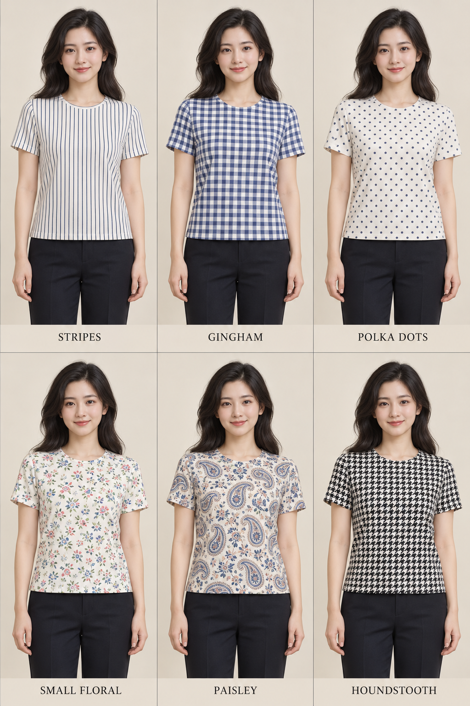

*图 46：从左至右，上排为纵条纹、维希格纹、波点，下排为小碎花、佩斯利纹、千鸟格。用于比较基本形状、重复方向、尺度与留白；图中的花纹不能证明印花、织造或刺绣工艺，具体图案也不对应某一族群、品牌或历史实物。*

第 17、26 章讲布面质感，本章把注意力放到布面上的形状。两件衣服都可以是棉质平纹，却分别出现细条纹与大花；同一种格纹也可以印在布上，或由不同颜色的纱线组织出来。先叫出纹样，再补制作资料，能避免把“看起来有花”直接写成“刺绣”。

## 先看一个重复单位，再看它怎样排列

不必一次记住全部花纹名称。先在衣服上找出一个能重复的单位：一条线、一个圆点、一组方格、一朵花，或一个弯曲的叶状形。接着看单位的大小、间距、方向和底色。相同花形排得稀疏或密集，常比换一个风格标签更能改变画面。

| 纹样入口 | 可见线索 | 可以继续补充的词 |
|---|---|---|
| Stripe／条纹 | 线带沿一个主要方向重复 | 横向、纵向、斜向；等宽或宽窄交替 |
| Check／格纹 | 两组线带相交成格 | 方格大小、线带宽度、交点颜色 |
| Polka dot／波点 | 圆点在底色上重复 | 点径、间距、整齐或错位排列 |
| Floral／花卉纹 | 可辨认的花、叶或枝条 | 小碎花、大朵花、枝蔓、疏密与留白 |
| Paisley／佩斯利纹 | 常见弯尖的水滴或叶状单元 | 尖端方向、内填花纹、单元尺度 |
| Geometric／几何纹 | 圆、菱形、折线等组织成图案 | 轮廓、重复节奏、色块与方向 |

这张表提供检索入口，不是互斥分类。佩斯利单元内部可以填花卉，几何格子中也能嵌入花朵。“碎花”主要帮助表达花朵较小而重复较多，并没有跨品牌统一的厘米界线。描述时加上“花形约纽扣大小、间距较宽”，往往比只写“复古碎花”有效。

## 格纹要看交叉之后留下什么

Gingham／常称维希格纹或小方格纹，典型外观由间隔均匀的两色线带交叉，形成规则方块和交叠色。MFA 的 CAMEO 从平纹织物与经纬配色解释 gingham；但仅凭照片，仍不能确定眼前这件衣服是否按这种方式织成。[材料与组织参照：MFA Boston，Gingham](https://cameo.mfa.org/wiki/Gingham)

Houndstooth／千鸟格的单位带有断裂、向外伸出的尖角，不是普通的黑白棋盘格。纺织行业机构 Première Vision 用双色纱线和斜纹组织说明传统千鸟格的形成；现代衣服也可能只借用它的外观。因此先写“黑白千鸟格外观、单位较大”，不要自动补成“羊毛呢”。[行业参照：Première Vision，Textile Glossary: Suiting Motifs](https://www.premierevision.com/articles/094df59a-75fa-ef11-90cb-00224888722c/textile-glossary-suiting-motifs)

Tartan／苏格兰格纹则要留意不同宽度的色带和重复次序。苏格兰格纹登记机构把 tartan 设计与纵横交织、重复的彩色条带联系起来。看到红绿相交不能直接认定某个家族格纹；需要具体纹样名称、线数记录或可靠商品资料。[定义与识别边界：Scottish Register of Tartans，FAQ](https://www.tartanregister.gov.uk/FAQ)

## 人字纹与连续折线，不只差在名字

Herringbone／人字纹在纺织结构中是一类交替方向的破斜纹。Chevron 常用来描述连续尖角折线，也可以指相应织物设计。CottonWorks 的织造教材将二者并列：chevron 在转向处形成尖点，herringbone 的转向存在错位与中断。商品名称可能混用，普通远景也未必能分辨这个接点。[结构说明：Cotton Incorporated，Weaving 101，第 22—23 页](https://cottonworks.com/wp-content/uploads/2023/03/Weaving-101.pdf)

图 46 未展示人字纹与 chevron；辨认转向接点时，请对照上述教材的组织示意，不能把图中的千鸟格当作人字纹例图。

需要精确表达时，把英文名与观察句放在一起：“灰色细人字纹，左右斜纹在转向处错开”“海军蓝与米白连续 V 形折线，尖点衔接”。不能看清接点时，写“细密 V 形纹理”就足够；不要借一个远景花纹去推断完整织法。

佩斯利同样需要区分名称与文化来源。它常见弯尖单元，却不等同于一个可以随意安上寓意的“神秘符号”。苏格兰国家博物馆以南亚社群叙述和披肩藏品说明 buta 等纹样与 Paisley 名称之间的关系。兴趣检索可沿这些具体资料继续，不把某一种起源故事写成全部纹样的唯一解释。[文化与实物旁读：National Museums Scotland，South Asian origins of Paisley pattern](https://www.nms.ac.uk/discover-catalogue/stories-about-the-south-asian-origins-paisley-pattern)

## 尺度、密度与位置，决定别人会画出什么

“蓝色花裙”仍留下很多选择：花是掌心大小还是指甲大小，底色能露出多少，花朵是均匀散开还是集中在下摆？可以写成“米白底及膝裙，稀疏钴蓝小花均匀分布，花形之间保留大片底色”。若重点在边缘，则改为“花卉集中沿裙摆形成一圈，腰部与上身保持素色”。

后一句是位置要求，不必先猜工艺。Placement print／定位印花涉及图案在衣物上的特定安排；如果没有制作证据，先说“胸前单个图案”“下摆环绕花边式纹样”更稳妥。也要区分领口真正接了一条蕾丝，与印出了类似蕾丝的边框。

## 还要说明图案怎样经过衣服的边界

图案落在一件衣服上，会遇到门襟、口袋、袖口和接缝。看见左右两片上的线条对齐，可以描述“门襟闭合后横条连续”；如果条纹在口袋上转成斜向，就把变化写出来。这些是可见的排列关系，不足以单独判断做工价格，也不能要求所有方向不同的裁片都保持完全连续。

例如：“白底细海军蓝横条纹衬衫，条距均匀；胸袋改用斜向条纹，领子仍为同色素面。”这句话同时交代主体、局部变化和保持素净的位置。若参考图只露出半身，就不要补写看不见的后背纹样，而在设计需求中另列“背面延续同样的横条排列”。创作要求与照片事实因此可以分别讨论。

最后做一次小比较：保持同一条直身裙、同一底色，只把小波点放大，再分别缩小间距。第一轮只改尺度，第二轮只改密度。记录“点与点之间露出的底色变少”，而不是用“更高级”替代观察。想进行图案混搭时，也先指定一处主纹样、一处次纹样及各自面积，让描述中的两个图案有清楚的位置。

资料核查：2026 年 10 月 22 日。图案外观、织物组织与文化归属需要分别核实。

---

# 第 30 章｜帽饰与首饰：轮廓、位置和尺度

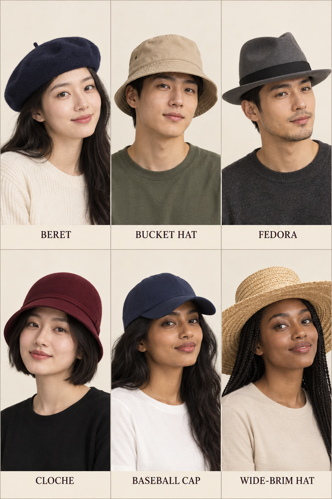

*图 47：从左至右，上排为贝雷帽、渔夫帽、费多拉帽，下排为钟形帽、棒球帽、宽檐帽。用于观察帽冠、帽檐与佩戴位置；右侧两格的帽檐接近或碰到画面边缘，不适合据此量取完整檐宽。帽型可以由不同性别、年龄和文化背景的人使用，图中人物不代表某类帽子的专属人群。*

第 10 章把配饰放进风格，本章进一步把头部和领口周围的物件说清楚。一顶帽子会在头顶和脸旁增加轮廓，一条项链会在颈部与衣领之间增加线条。知道名称以后，仍要补尺寸、位置和与衣服的关系，才能让别人看见你想象的那一款。

## 帽冠和帽檐，分开观察

Crown／帽冠是围住头部的主体；brim／帽檐通常沿帽冠下缘向外伸出。棒球帽前方的遮檐与一顶四周有檐的帽子，轮廓组织并不相同。还可以继续说明帽冠高低、顶面圆平、是否有凹折，以及帽檐向下、平伸还是局部翻起。

| 名称 | 主要观察点 | 有用的补充描述 |
|---|---|---|
| Beret／贝雷帽 | 柔软、较扁的圆形主体，通常没有向外伸出的环形帽檐 | 米白软帽冠，轻向一侧偏戴 |
| Bucket hat／渔夫帽 | 帽冠与向下斜出的环形帽檐相接 | 深蓝短檐，边缘自然下垂 |
| Fedora／费多拉帽 | 帽冠常有凹折与前部捏褶，四周有檐 | 棕色帽冠中部凹折，配窄帽带 |
| Cloche／钟形帽 | 较贴头的钟状轮廓，檐部常向下包拢 | 深灰低戴，短檐靠近眉上 |
| Baseball cap／棒球帽 | 贴头帽冠，主要遮檐位于前方 | 无标识、弯檐，后部调节带可见 |
| Wide-brim hat／宽檐帽 | 强调帽檐较宽，而非一种唯一帽冠 | 平顶或圆顶另说，帽檐较平或柔软下垂 |

Lock & Co. 的官方说明以软帽檐、凹折帽冠和前部捏褶解释 fedora；同一类别内也有不同檐宽。因此“宽檐”和“费多拉”可以同时成立，不是非此即彼。[帽型参照：Lock & Co.，What is a Fedora Hat?](https://www.lockhatters.com/blogs/news/what-is-a-fedora-hat)

贝雷帽可参考品牌的软毡款；钟形帽与渔夫帽则重点比较贴头的圆拱轮廓、下包程度，以及帽檐与帽冠的分界。品牌分类能帮助检索具体款式，不必照搬其“某种脸型必须配某种帽子”的搭配判断。[真实产品参照：Lock & Co.，French Beret](https://www.lockhatters.com/collections/best-selling-hats/products/women-wool-french-beret-hat)；[帽形比较：Eric Javits，Hat Shapes Guide](https://ericjavits.com/blogs/news/hat-shapes-guide-fedora-cloche-bucket-boater)

## 佩戴位置不是帽型名称的一部分

同一顶软帽，深戴、后移和偏戴会露出不同面积的额头，也会改变帽冠与头发的相对位置。生图时可写“帽子自然戴稳，前缘在眉毛上方，鬓发仍可见”，而不把“法式”“文艺”当成位置说明。需要比较帽型时，尽量固定机位和发型，以免把发量或低头动作误当作帽子结构。

完整句可以是：“人物穿深灰短外套，戴一顶无标识的深蓝渔夫帽，帽檐短而向下；耳侧头发自然露出。”若换成贝雷帽，先保留衣服和颜色，只改变帽冠轮廓与偏戴方向，再判断自己喜欢的是形状还是搭配产生的气氛。

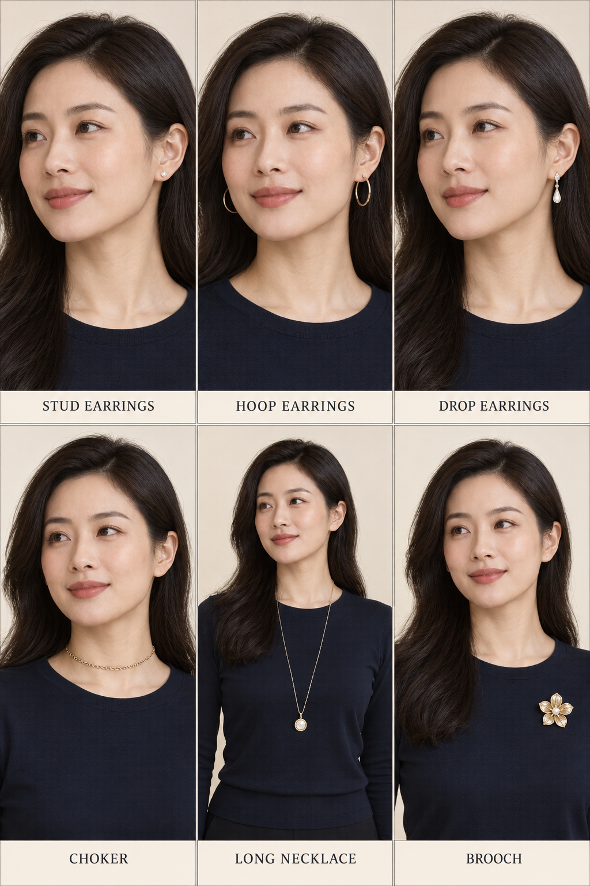

*图 48：从左至右，上排为耳钉、圈式耳环、垂坠耳饰，下排为贴颈项链、长项链配吊坠、胸针。长项链一格取景更远，用于展示悬垂落点；六格不是严格固定机位的尺度实验。金属色泽、珠状外观和透明亮点不能用来鉴定贵金属或宝石。*

## 耳饰：贴在哪里，向哪里延伸

Stud／耳钉通常在耳垂附近呈现较紧凑的装饰；hoop／圈式耳环以环形轮廓为主要线索；drop 或 dangle／垂坠耳饰则把装饰向耳垂下方延伸。商品中这些轴可以叠加，例如圈上接一枚垂坠物。Tiffany 官方耳饰分类与产品名称同时使用 stud、hoop 和 drop，适合对照不同轮廓。[真实产品分类：Tiffany & Co.，Earrings](https://www.tiffany.com/jewelry/earrings/)

只写“大耳环”不容易执行。可改为“银色细圈耳环，直径约与耳垂长度相近”“金色单颗圆形耳钉，紧贴耳垂”“两段连接的细长垂坠耳饰，末端停在下颌附近”。这里的相对尺度帮助沟通，不是在规定佩戴者的体型或性别。

## 项链：名称之外，补上落点

Choker／贴颈项链强调靠近颈部的佩戴关系；long necklace／长项链则仍需说明末端到哪里。Pendant／吊坠描述悬挂的主体，不能单独决定链长。GIA 的首饰教学把不同长度和构造的项链并列展示，说明项链远不止“细链”与“珍珠串”两种。[首饰教学参照：GIA GemKids，Necklaces](https://gemkids.gia.edu/jewelry/necklaces)

可以描述“单层细链沿锁骨附近落下，中央有一枚小圆片”，或“长链在胸前形成窄 U 形，末端为一枚椭圆吊坠”。不要只给一个长度数字：相同链长在不同人的颈肩与衣领上，视觉落点仍会变化。人物设计中，落点与衣领是否遮挡往往比数字更重要。

## 胸针与整套配饰的重心

Brooch／胸针把装饰固定在衣物表面；描述时写清左侧或右侧、领片或胸前、图形方向与尺度。金匠中心的专题也提醒，胸针兼有服装扣合的历史与装饰潜力，不能一概视为领口上多出的一朵花。[专题旁读：The Goldsmiths’ Centre，The Brooch: A Versatile Jewel](https://www.goldsmiths-centre.org/learn-and-upskill/resources/knowledge-brooch-versatile-jewel-rachel-church/)

本书把主次安排作为创作方法，而非穿搭禁令：若想让胸针成为重点，可以把耳饰缩成小耳钉；若想强调重复节奏，也可以让圈式耳环与圆片吊坠呼应。完整描述例如：“米白无领夹克左上胸别一枚小型叶形胸针，尖端斜向肩部；耳部仅一对银色小耳钉，不再叠加项链。”

## 看正面轮廓，也为固定方式留出余地

耳钉外观不等于已经确认耳针结构，贴耳的圆片也可能采用耳夹；一张正面人像通常看不见背面的耳堵。只做人物外观描述时，写清贴耳还是垂坠即可。若需要制作或佩戴参考，则应另查扣合位置和产品说明，不把前视图当作完整结构图。

围巾、眼镜与头发也会参与同一个局部空间。宽檐帽加眼镜时，可说明“帽檐不遮住镜框”；垂坠耳饰配围巾时，可说明“耳饰在围巾外侧完整可见”。这些要求不必变成新的风格名，却能避免生成图把不同物件混成一团。若想突出帽形，先用简洁发型和少量首饰建立参考，再逐项加入其他配件，会更容易判断是哪一项改变了画面重心。

最后分别改写“她戴着漂亮的首饰”和“他戴了一顶复古帽子”。保留一个名称，再补形状、尺度、位置及与衣领或头发的关系。即使暂时不知道材质，仍可以准确地说出可见外观；等有实物资料时，再补材料与制作信息。

---

# 第 31 章｜季节与场景：让一套衣服适应实际活动

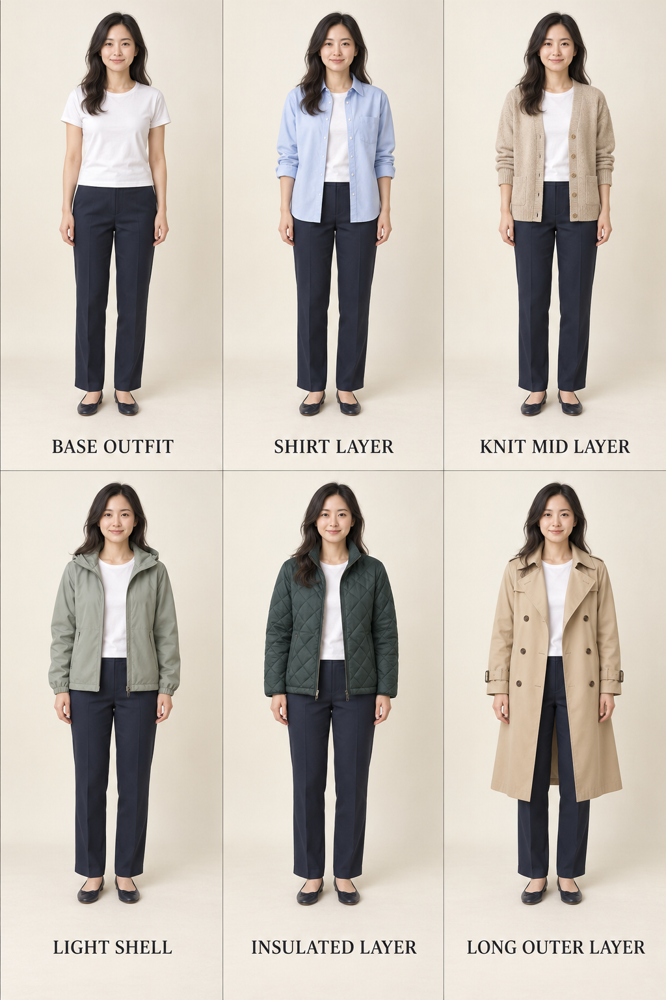

*图 49：白色 T 恤与深蓝裤装外增加不同衣层的 AI 教学示意。各格展示不同外搭，并非从左上到右下逐件累加；观察内外顺序、衣长与开合。图中 shell、insulated 等标签提示造型主题，不证明衣物具有特定保暖、防水或透湿性能。*

描述人物穿着时，场景能帮助选择细节。一个人从地铁走到办公室，需要考虑外套脱下后还剩下什么；逛街与舞台表演的动作幅度不同；室内晚宴与露天傍晚也不能只用同一句“正式一点”概括。先交代活动、环境和着装要求，再选择衣物，画面会更容易落实。

## 先分清功能层，再写清可见层

户外装备常用基础层（base layer）、中间层（mid layer）与外层（outer layer／shell layer）说明功能分工：贴肤层处理汗液，中间层帮助保温，外层应对风雨。REI 还提醒读者，活动强度、个人冷热感受与天气都影响组合，三层不必始终同时穿在身上。[资料：REI，Layering Basics](https://www.rei.com/learn/expert-advice/layering-basics.html)

这套功能分类和时尚照片中的“内搭／中层／外搭”有联系，却不能完全互换。敞开的西装可能是画面最外层，但不因此成为防雨壳衣；衬衫可以贴肤，也可以作为罩在背心外面的轻外搭。同一件衣物处在哪一层，需要看当前组合。写生图描述时，先交代谁在谁外面、哪里露出，再补资料能够支持的功能。

| 观察位置 | 可以直接写出的关系 | 需要额外资料的判断 |
|---|---|---|
| 贴身衣物 | 圆领上衣从衬衫领口露出；袖口贴近手腕 | 纤维成分、吸湿与干燥表现 |
| 中间衣物 | V 领开衫包在衬衫外；衣身有余量 | 实际保温能力、填充材料 |
| 最外衣物 | 连帽外套敞穿；下摆盖过中层 | 防水等级、耐磨与透湿指标 |

叠穿的可读性来自露出的边界。领口、袖口、前襟与下摆都完全重合时，即使穿了三件，也可能只看见一件。需要画面清楚，可以让中层敞开、内层领口稍高，或让内层下摆从短外搭下露出一小段。这里调整的是可见关系，不意味着层数越多越好。

## 季节信息要落在具体变化上

“春装”“冬装”本身不能决定衣物。不同城市的温湿度、室内空调和出行方式差别很大。对人物设定，可以先写“从温暖室内走到有风的街道”，再考虑可脱外套、袖长与颈部覆盖；若是连续场景，还要说明外套脱下后拿在手上、搭在椅背，还是放进包里。

同一套米白上衣与藏蓝直筒裤，在温暖室内可以只露出基础层；转到凉爽室外，可增加敞穿针织开衫；再加外套时，要给肩袖和身体留出叠放空间。外层若比中层更短，中层下摆会露出；若外层很长，腰部比例则可能被覆盖。这些关系都能通过图像观察。实际旅行或户外活动的装备选择仍需查看当地条件、产品资料与相应活动指南。

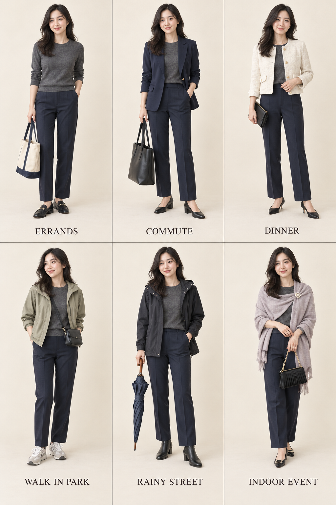

*图 50：以深灰上衣与深蓝裤装为基础的场景衣橱 AI 教学示意。主要变化是外搭、鞋包和配饰，姿态与裤褶也略有变化，不能当作严格的单变量实验。场景标签不证明衣物性能或符合某一场所的着装要求；具体造型与下面的文字练习不作逐格对应。*

## 场景给约束，不替人物作身份判断

| 场景 | 先确认什么 | 描述时值得补上的部分 |
|---|---|---|
| 通勤与办公 | 工作场所要求、交通方式、室内外转换 | 外套如何脱穿、鞋履与行走、包的背法 |
| 日常出行 | 走路、久坐、携物与天气 | 裤脚或裙摆落点、可活动余量、外搭位置 |
| 宴会或较正式聚会 | 邀请函原文、时间、场地与主办方说明 | 衣型、面料表面、鞋包和首饰的尺度 |
| 户外活动 | 活动强度、环境与装备要求 | 穿着层序及可验证的功能信息 |
| 舞台或角色演出 | 动作、灯光、收音和服装切换 | 下摆与袖体积、固定方式、道具位置 |

场景名并不等于统一着装标准。Saffron Hall 在观众指南中明确表示不设着装要求，日常装与较整洁的休闲装都可出现。这是一个具体场所的例子，不能据此推断其他音乐厅、场次或典礼的要求。[资料：Saffron Hall，New to concerts?](https://www.saffronhall.com/visit-us/new-to-concerts)

收到 smart casual、business casual 或“半正式”等说法时，保留邀请方的原词，再确认是否有示例、限制或主题。Black tie 也不能理解成“黑色西装加领带”：在常见西式晚间礼服语境中，tuxedo／dinner suit 与普通商务西装存在礼服结构和搭配上的区别；Suitsupply 的指南分别讨论传统 black tie、creative black tie 和 black-tie optional。阅读这类品牌指南时，应将品牌的造型建议与活动方的实际要求分开。[资料：Suitsupply，Black-Tie Attire Decoded](https://suitsupply.com/en-us/journal/blacktie-attire-decoded.html)

## 把动作也写进穿着

站立展示与实际活动会改变衣服的位置。坐下时，长外套与裙摆如何落在座位周围；抬手时，宽袖是否遮住手部；肩包背带跨过哪一层衣物，都能影响画面。写“人物穿宽袖上衣”之后，可以再补“手臂自然下垂，袖口停在手腕附近”；需要表现展开的袖体积，再明确写出侧举手臂的姿态。姿态服务于观察，不必让每个人都双手叉腰。

舞台、展会和角色拍摄还要区分衣服本体与随身道具。长披风、挂饰、腰包、剑鞘或麦克风应交代佩戴位置；如果只写“很多装饰”，生成画面容易把饰物接进衣片或让道具悬空。真实表演中的固定、活动范围和换装，需要服装与舞台团队实际确认，图中的外观不能代替试穿。

## 保留基础套装，改变场景信息

下面三段使用同一位成年人物、米白圆领上衣和藏蓝直筒裤，只改变外搭、鞋包与状态，观察场景如何进入衣着。它们是原创描述练习，不是通用礼仪规定。

1. **办公室与地铁之间**：人物穿米白圆领薄针织上衣与藏蓝及踝直筒裤，外搭敞穿的灰色单排扣夹克；黑色乐福鞋露出鞋面，棕色托特包提在身侧。到室内后，夹克脱下搭在椅背，内层依然完整。

2. **凉爽天气的城市散步**：保留同一上衣与裤子，增加浅灰纽扣开衫，外面罩一件橄榄色连帽短外套，前襟敞开；换成浅色系带运动鞋与小型斜挎包。句子只说明款式和层序，不把外套直接称为专业防雨装备。

3. **没有指定礼服要求的晚间聚会**：保留基础套装，换成深蓝无领短夹克，配黑色低跟后空带鞋与小型手拿包，耳侧只留一对小耳钉；夹克前部敞开，领口没有叠加项链。这是较收整的搭配方案，不标作 black tie。

最后把活动改成“需要频繁抬手的舞台角色”，只修订会受到影响的衣物：袖子、腋下余量、下摆、饰物与道具位置。若描述中只把风格词换成“舞台感”，衣物关系却完全没动，就还没有真正回应活动。

---

# 附录 C｜从衣物到细节：84 条双语查词表

本表从第 13—20 章提取图示对象与相关描述词，按“你正在看哪里”分组。先找到最接近的对象，再到对应章节看图和完整例句。它不是互斥分类：一条裙可以同时是 A 字、百褶、中长、带蕾丝边；一个袖子也可以同时采用插肩连接和主教袖体。

## 连衣裙：先看是否上下连成一件

| 序号 | 中文 | 英文 | 一句识别 | 回章 |
|---|---|---|---|---|
| 01 | 衬裙式外穿连衣裙／吊带连衣裙 | Slip dress | 常借细肩带与简洁垂坠线条，外穿用途须结合资料与搭配。 | [第 13 章](chapters/13-dresses.md) |
| 02 | 蕾丝镶边吊带连衣裙 | Lace-trim slip dress | 主体仍是吊带裙，蕾丝只沿指定领缘或裙摆出现。 | [第 13 章](chapters/13-dresses.md) |
| 03 | 衬衫连衣裙 | Shirt dress / Shirtwaist dress | 衬衫式领口与门襟延伸成完整裙装，腰部可松可收。 | [第 13 章](chapters/13-dresses.md) |
| 04 | 裹身连衣裙 | Wrap dress | 前部衣片交叠并固定，不只是一条 V 领裙。 | [第 13 章](chapters/13-dresses.md) |
| 05 | 贴体连衣裙 | Bodycon dress | 名称强调贴近身体轮廓，不限定领型、袖长或裙长。 | [第 13 章](chapters/13-dresses.md) |
| 06 | 网球连衣裙 | Tennis dress | 一件式运动裙装，可有领和褶摆，内层短裤不能凭空推断。 | [第 13 章](chapters/13-dresses.md) |
| 07 | 仿裹身结构 | Faux-wrap | 保留交叠外观，但可能已固定缝合，未必能展开包裹。 | [第 13 章](chapters/13-dresses.md) |
| 08 | 衬衣式内衣／裙式睡衣 | Chemise | 词义随历史与商品语境变化，宜补用途、长度与松量。 | [第 13 章](chapters/13-dresses.md) |

## 半裙：轮廓、展开方法与长度分开

| 序号 | 中文 | 英文 | 一句识别 | 回章 |
|---|---|---|---|---|
| 09 | A 字半裙 | A-line skirt | 从较窄上部向下逐渐展开，名称主要说外轮廓。 | [第 14 章](chapters/14-skirts.md) |
| 10 | 铅笔半裙 | Pencil skirt | 腰髋相对贴合、下摆窄直，开衩位置需要另说。 | [第 14 章](chapters/14-skirts.md) |
| 11 | 褶裙／百褶半裙 | Pleated skirt | 用有秩序的折叠组织裙体余量，不要求恰好一百褶。 | [第 14 章](chapters/14-skirts.md) |
| 12 | 圆裙 | Circle skirt | 名称关联圆形或部分圆形裁片，静态照片未必能确认圆量。 | [第 14 章](chapters/14-skirts.md) |
| 13 | 鱼尾半裙 | Mermaid skirt | 上部相对贴合，到较低位置才明显展开。 | [第 14 章](chapters/14-skirts.md) |
| 14 | 分层裙／蛋糕裙式层叠 | Tiered skirt | 以横向分段逐层组织体积，需说明接片或附加饰边。 | [第 14 章](chapters/14-skirts.md) |
| 15 | 裙式短裤／裙裤 | Skort | 将裙式外观与短裤结构结合，不等于宽腿 Culottes。 | [第 14 章](chapters/14-skirts.md) |
| 16 | 短裙／中长裙／长裙 | Mini / Midi / Maxi | 都是长度提示，精确画面还应说明相对膝、踝的落点。 | [第 14 章](chapters/14-skirts.md) |

## 上衣：从肩部固定到衣身连接

| 序号 | 中文 | 英文 | 一句识别 | 回章 |
|---|---|---|---|---|
| 17 | 吊带衫 | Camisole | 常有较窄肩带与到腰髋的衫身，仍是上衣而非完整裙。 | [第 15 章](chapters/15-tops-underwear.md) |
| 18 | 背心式无袖上衣 | Tank top | 常见较宽肩部与连续前后衣片，不必贴体或用于运动。 | [第 15 章](chapters/15-tops-underwear.md) |
| 19 | 外穿胸衣式上衣 | Bustier top | 用杯线、分片与贴合衣身表达结构，外观不证明束形性能。 | [第 15 章](chapters/15-tops-underwear.md) |
| 20 | 挂脖上衣 | Halter top | 上部绕颈或在颈后固定，不能只凭正面高领口判断。 | [第 15 章](chapters/15-tops-underwear.md) |
| 21 | 露肩／一字肩上衣 | Off-shoulder top | 领口落到肩线以下，仍可保留连接衣身的袖子。 | [第 15 章](chapters/15-tops-underwear.md) |
| 22 | 裹身上衣 | Wrap top | 前片交叠与固定停在上衣长度，没有连成完整裙体。 | [第 15 章](chapters/15-tops-underwear.md) |
| 23 | 肩部挖空 | Cold-shoulder | 肩部局部开口，仍可能有衣料覆盖肩顶。 | [第 15 章](chapters/15-tops-underwear.md) |
| 24 | 吊带／肩带 | Strap | 描述前后片的肩部连接，可细可宽，不是袖型。 | [第 16 章](chapters/16-necklines-sleeves.md) |

## 内层与结构衣物：覆盖与用途不能只看蕾丝

| 序号 | 中文 | 英文 | 一句识别 | 回章 |
|---|---|---|---|---|
| 25 | 有钢圈文胸 | Underwire bra | 名称指杯下支撑结构，画出的弧线本身不证明实际内构。 | [第 15 章](chapters/15-tops-underwear.md) |
| 26 | 柔软文胸式衣物 | Bralette | 常较轻、较少硬结构，杯型、衬里与商品定位仍有变化。 | [第 15 章](chapters/15-tops-underwear.md) |
| 27 | 长身胸衣 | Bustier | 胸部造型与延伸到腰附近的衣身共同组织。 | [第 15 章](chapters/15-tops-underwear.md) |
| 28 | 束身衣／紧身胸衣 | Corset | 看成型分片、加固与扣合关系，不以装饰竖线断言功能。 | [第 15 章](chapters/15-tops-underwear.md) |
| 29 | 胸下式束身衣 | Underbust corset | 上缘止于胸下方向，主要围绕腰部，图 16 展示此类外观。 | [第 15 章](chapters/15-tops-underwear.md) |
| 30 | 全胸式束身衣 | Overbust / Full-bust corset | 覆盖范围包括胸部，full-bust 在此不指穿着者体型。 | [第 15 章](chapters/15-tops-underwear.md) |
| 31 | 全衬裙 | Full slip | 内层从上身延伸到裙摆，区别于腰下开始的 Half-slip。 | [第 15 章](chapters/15-tops-underwear.md) |
| 32 | 连体衣 | Bodysuit | 上身连续到下部，可有裆部扣合，不能仅凭外形认定用途。 | [第 15 章](chapters/15-tops-underwear.md) |

## 领口：边线、开口位置与领子各说一项

| 序号 | 中文 | 英文 | 一句识别 | 回章 |
|---|---|---|---|---|
| 33 | 圆弧领口 | Scoop neckline | 连续弧线向下展开，通常比贴颈小圆领开得更宽或低。 | [第 16 章](chapters/16-necklines-sleeves.md) |
| 34 | V 领口 | V-neck | 两侧向中央尖点汇合，宽窄与深浅可以分别调整。 | [第 16 章](chapters/16-necklines-sleeves.md) |
| 35 | 方领口 | Square neckline | 下缘较平、两侧上升，转角可以锐利或略圆。 | [第 16 章](chapters/16-necklines-sleeves.md) |
| 36 | 心形领口 | Sweetheart neckline | 两个弧峰在中央略下凹，可与肩带或袖子组合。 | [第 16 章](chapters/16-necklines-sleeves.md) |
| 37 | 堆褶／垂褶领口 | Cowl neckline | 领口留出布量形成自然悬垂褶，不只是固定 U 形开口。 | [第 16 章](chapters/16-necklines-sleeves.md) |
| 38 | 高领口 | High neckline | 首先说明开口位置较高，尚不能确定是否有独立领子。 | [第 16 章](chapters/16-necklines-sleeves.md) |
| 39 | 领口线／领子 | Neckline / Collar | 前者说开口边界，后者说领口附近的衣物结构。 | [第 16 章](chapters/16-necklines-sleeves.md) |
| 40 | 短竖领 | Mock neck | 常指较短的竖起领体，图 17 高领格接近这一外观。 | [第 16 章](chapters/16-necklines-sleeves.md) |
| 41 | 翻折高领 | Turtleneck | 常关联较高、围颈或可翻折的领体，具体高度应另说。 | [第 16 章](chapters/16-necklines-sleeves.md) |

## 袖子：长度、体积与连接可以叠加

| 序号 | 中文 | 英文 | 一句识别 | 回章 |
|---|---|---|---|---|
| 42 | 盖肩袖 | Cap sleeve | 极短袖体越过肩头，区别于只在肩上的宽带。 | [第 16 章](chapters/16-necklines-sleeves.md) |
| 43 | 泡泡袖 | Puff sleeve | 抽褶或收束让袖体鼓起，需补长度与体积集中位置。 | [第 16 章](chapters/16-necklines-sleeves.md) |
| 44 | 主教袖 | Bishop sleeve | 长袖宽松下垂，布量在手腕处收入较贴合袖口。 | [第 16 章](chapters/16-necklines-sleeves.md) |
| 45 | 喇叭袖 | Bell sleeve | 袖体向开放末端展开，通常不在末端紧收回去。 | [第 16 章](chapters/16-necklines-sleeves.md) |
| 46 | 插肩袖 | Raglan sleeve | 常见分界从领口附近斜向腋下，名称涉及连接关系。 | [第 16 章](chapters/16-necklines-sleeves.md) |
| 47 | 蝙蝠袖式宽腋下袖 | Dolman / Batwing sleeve | 深腋下、宽袖身与向腕收窄形成连续轮廓。 | [第 16 章](chapters/16-necklines-sleeves.md) |
| 48 | 落肩 | Drop shoulder | 肩部连接移到自然肩点外、上臂处，不等于插肩。 | [第 16 章](chapters/16-necklines-sleeves.md) |
| 49 | 灯笼袖相关检索 | Lantern sleeve；另查 Balloon sleeve | 中文商品名使用较宽，两个英文也不必同义，应补鼓起部位、袖长与收口。 | [第 16 章](chapters/16-necklines-sleeves.md) |

## 材料与层次：先说出现在哪里

| 序号 | 中文 | 英文 | 一句识别 | 回章 |
|---|---|---|---|---|
| 50 | 缎面／缎纹 | Satin / Satin weave | 连续光带帮助识别表面，缎纹不等于蚕丝纤维。 | [第 17 章](chapters/17-fabrics.md) |
| 51 | 蕾丝镶边 | Lace trim | 窄条沿领缘、袖口或下摆出现，主体布面仍可平整不透。 | [第 17 章](chapters/17-fabrics.md) |
| 52 | 蕾丝拼接 | Lace inset | 一块指定区域改用蕾丝，如肩部或袖子，而非仅一圈窄边。 | [第 17 章](chapters/17-fabrics.md) |
| 53 | 带衬里的满幅蕾丝 | Lined lace | 大面积花纹覆盖在另一层上，衬里颜色改变图案对比。 | [第 17 章](chapters/17-fabrics.md) |
| 54 | 刺绣 | Embroidery | 图案依附底布，照片中的花纹仍不一定足以证明针法。 | [第 17 章](chapters/17-fabrics.md) |
| 55 | 细网纱罩层 | Tulle overlay | 一层细网覆盖在另一层衣物外，网眼与层间关系是重点。 | [第 17 章](chapters/17-fabrics.md) |
| 56 | 罗纹针织 | Rib knit | 连续凹凸棱谷形成节奏，不等同于印在布上的竖条纹。 | [第 17 章](chapters/17-fabrics.md) |
| 57 | 纤维原料／织物结构 | Fiber / Fabric structure | 原料回答“什么做”，结构回答“怎样成布”，不能互换。 | [第 17 章](chapters/17-fabrics.md) |
| 58 | 半透／不透与衬里 | Sheer / Opaque / Lining | 指定透明部位与底层，避免“半透”被理解为整件统一处理。 | [第 17 章](chapters/17-fabrics.md) |

## 裤子：把宽度变化与口袋分开

| 序号 | 中文 | 英文 | 一句识别 | 回章 |
|---|---|---|---|---|
| 59 | 直筒裤 | Straight trousers | 膝部向下的宽度变化较平直，可窄也可宽。 | [第 18 章](chapters/18-trousers-outerwear.md) |
| 60 | 阔腿裤 | Wide-leg trousers | 裤腿与身体之间空间较大，裤长需要独立说明。 | [第 18 章](chapters/18-trousers-outerwear.md) |
| 61 | 锥形裤 | Tapered trousers | 从较宽的上部逐渐收向较窄裤脚，不等于全腿紧身。 | [第 18 章](chapters/18-trousers-outerwear.md) |
| 62 | 喇叭裤 | Flared trousers | 膝部附近较合身，向裤脚明显外扩。 | [第 18 章](chapters/18-trousers-outerwear.md) |
| 63 | 工装袋裤 | Cargo trousers | 大腿侧袋等提供识别，可同时采用直筒、阔腿或锥形。 | [第 18 章](chapters/18-trousers-outerwear.md) |
| 64 | 宽腿裙裤 | Culottes | 宽阔分腿、常见膝下至小腿长度，站立时可能近似半裙。 | [第 18 章](chapters/18-trousers-outerwear.md) |
| 65 | 微喇版型 | Bootcut | 常表示较温和的裤脚扩量，具体幅度依产品而异。 | [第 18 章](chapters/18-trousers-outerwear.md) |
| 66 | 裤腰高度／腰位 | Rise / Waist placement | 描述腰头相对身体的位置，不决定裤腿轮廓。 | [第 18 章](chapters/18-trousers-outerwear.md) |

## 外搭：衣物家族与截短程度分开

| 序号 | 中文 | 英文 | 一句识别 | 回章 |
|---|---|---|---|---|
| 67 | 西装式夹克 | Blazer | 看驳领、门襟、裁片与肩部组织，不一定收腰或成套。 | [第 18 章](chapters/18-trousers-outerwear.md) |
| 68 | 针织开衫 | Cardigan | 针织上衣有前开口，可扣合、拉链或敞穿。 | [第 18 章](chapters/18-trousers-outerwear.md) |
| 69 | 战壕式风衣 | Trench coat | 腰带、双排扣、肩袢等组合识别，不能只凭卡其色。 | [第 18 章](chapters/18-trousers-outerwear.md) |
| 70 | 飞行夹克式外套 | Bomber jacket | 常用短衣身、前拉链与收束袖口下摆形成紧凑体积。 | [第 18 章](chapters/18-trousers-outerwear.md) |
| 71 | 牛仔夹克 | Denim jacket | 材料与衣物家族已知后，还需看衣长、胸袋、明线与扣子。 | [第 18 章](chapters/18-trousers-outerwear.md) |
| 72 | 博莱罗短外搭 | Bolero | 短衣身与敞开前片让内层继续成为主体，材料不限针织。 | [第 18 章](chapters/18-trousers-outerwear.md) |
| 73 | 截短／短款 | Cropped | 长度修饰词，可用于西装、开衫或裤子，不能独自定义衣型。 | [第 18 章](chapters/18-trousers-outerwear.md) |
| 74 | 针织短披式外搭 | Shrug | 作为短外搭检索入口，仍应补袖长、前开关系和结束位置。 | [第 18 章](chapters/18-trousers-outerwear.md) |

## 褶与波浪边：看折叠、收拢和悬垂

| 序号 | 中文 | 英文 | 一句识别 | 回章 |
|---|---|---|---|---|
| 75 | 局部抽褶 | Ruching | 布面小褶向局部汇集，不一定有可见抽绳。 | [第 19 章](chapters/19-details.md) |
| 76 | 弹性抽褶 | Elastic shirring | 多排弹性缝线让一片布均匀收缩，与单侧聚拢不同。 | [第 19 章](chapters/19-details.md) |
| 77 | 抽褶荷叶边 | Ruffle | 常在连接边聚拢一条布料，让自由边向外展开。 | [第 19 章](chapters/19-details.md) |
| 78 | 弧形裁片波浪边 | Flounce | 常借弧形裁片将扩量放在外缘，连接处可相对平顺。 | [第 19 章](chapters/19-details.md) |
| 79 | 刀褶／单向褶裥 | Knife pleats | 折层连续朝同一方向排列，宽度与起止位置可再说明。 | [第 19 章](chapters/19-details.md) |
| 80 | 悬垂／垂褶 | Drape | 宽软布面从固定位置落下，不必有整齐压折线。 | [第 19 章](chapters/19-details.md) |
| 81 | 箱褶 | Box pleats | 两侧折层组织成较宽的平面，需结合图或纸样确认方向。 | [第 14 章](chapters/14-skirts.md) |
| 82 | 倒箱褶 | Inverted box pleats | 与箱褶内外关系不同，细分制作时需看折叠结构。 | [第 14 章](chapters/14-skirts.md) |
| 83 | 手风琴褶 | Accordion pleats | 连续折扇式节奏，褶宽与面料会改变最终效果。 | [第 14 章](chapters/14-skirts.md) |
| 84 | 自然皱褶 | Wrinkles / Creases | 可随动作、塞衣或受压形成，不一定是固定设计褶裥。 | [第 19 章](chapters/19-details.md) |

## “我只会这样说”可以怎样改写

右栏都是可执行的创作示例，不声称左栏只有一种正确答案。先决定你真正想保留的线索，再更换颜色、长度与搭配。更完整的观察顺序见[第 20 章描述工作坊](chapters/20-description-workshop.md)。

| 我只会这样说 | 可以改成 |
|---|---|
| 蕾丝的裙 | 黑色缎面细肩带中长连衣裙，仅在领口与裙摆镶窄蕾丝边，主体不透。 |
| 内衣感觉的裙 | 衬裙式外穿连衣裙，细肩带、浅弧领、直身及小腿、低光泽表面，外搭短开衫。 |
| 运动裙 | 白色无袖网球连衣裙，小翻领、短门襟、腰下膝上褶摆，配球鞋；不凭空添加内置短裤。 |
| 袖子鼓鼓的 | 上臂长度的短泡泡袖，肩部略抽褶、袖口收窄，体积集中在上臂。 |
| 领口堆着布 | 柔软垂褶领口，前胸形成两三道自然弧垂，肩部平整，没有独立围巾。 |
| 加一点褶皱 | 左侧腰局部抽褶，细褶向一侧汇集；其余衣身保持平整，不改成整件百褶。 |
| 宽宽的裤子 | 高腰阔腿直筒裤，大腿到裤脚保留空间，裤脚到鞋面；大腿两侧各有一个翻盖袋。 |
| 短短的小外套 | 胸下长度的长袖 Bolero 短外搭，前片敞开，保留里面连衣裙的腰线。 |
| 很蓬的裙子 | 米白三层长半裙，横向接缝下轻度抽褶，裙体逐层增宽，不使用硬裙撑。 |
| 后面弹弹的 | 上衣背部有多行平行弹性抽褶，形成密集小褶，前片不做同样收缩。 |

你不必先记住 84 个英文词。每次学会把一个模糊要求改成“对象＋位置＋形状＋材料或层次”，就已经增加了一点表达能力。名字帮助检索，具体细节帮助别人画对。

## 汉服与角色服装补充索引

| 词语 | 本书中的描述用途 | 核查位置 |
|---|---|---|
| 交领／对襟 | 领襟交叉或前片相对的关系 | 第21章具体实物 |
| 右衽 | 按穿着者左右说明掩合方向 | 第21章交领右衽 |
| 褙子 | 以周氏墓实例认识直领对襟与长侧衩 | 第21章褙子 |
| 袄裙／衫裙 | 上衣与裙的组合，不是单一裙型 | 第21章三件套 |
| 裙门／侧褶 | 马面裙可见观察入口，仍须查裙片 | 第21章马面裙 |
| 曲裾／直裾 | 需追踪衣襟衣裾结构，不能只看下摆曲直 | 第21章邻近衣型 |
| 角色版本 | 某套设定或皮肤，避免混合不同版本 | 第22章目标选择 |
| 角色参考套件 | 多角度、局部与隐藏层的资料组合 | 第22章官方方法 |
| 假发／头饰 | 分开描述发型与附加配件 | 第22章装备分解 |
| 肩甲／护臂／胫甲 | 身体不同位置的独立装甲部件 | 第22章结构分组 |
| 披肩／披风／长袍 | 结合覆盖长度、固定点与袖体说清 | 第22章结构分组 |
| 日常化改编 | 将角色识别点迁移到日常单品 | 第22章真实案例 |
